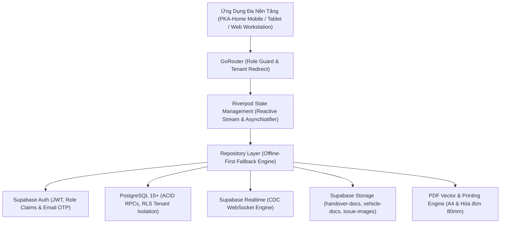

# PKA-Home — Nền Tảng Quản Trị & Vận Hành Bất Động Sản B2B SaaS (PropTech Platform)

> **Commercial Production SaaS & PropTech Platform**  
> Giải pháp chuyển đổi số toàn diện cho Ban Quản Lý, Chủ đầu tư và các Đơn vị quản lý vận hành tòa nhà, chuỗi chung cư, căn hộ dịch vụ cao cấp. Kết nối liền mạch giữa Bộ máy Quản trị (Ban Quản Lý, Kế toán, Kỹ thuật viên) và Khách hàng (Cư dân, Khách thuê) với độ tin cậy cấp doanh nghiệp, dữ liệu đồng bộ thời gian thực (Realtime), bảo mật đa tầng tuân thủ Luật Nhà ở 2023 & Luật Bảo vệ dữ liệu cá nhân 2026.

---

## 🏢 1. Định Vị Sản Phẩm & Giá Trị Thương Mại B2B SaaS

**PKA-Home** là nền tảng phần mềm thương mại thực tế (SaaS B2B) được thiết kế chuyên biệt để giải quyết triệt để các bài toán nhức nhối nhất trong vận hành bất động sản hiện đại:

- **Bàn giao & Kiểm kê tài sản số hóa**: Xóa bỏ hoàn toàn văn bản giấy và tranh chấp tiền cọc khi cư dân nhận nhà (Move-in) hoặc trả phòng (Move-out). Tích hợp trạm kiểm kê hiện trường, chốt chỉ số điện/nước, chiết tính cấn trừ cọc và ký số trực tiếp trên màn hình, tự động kết xuất biên bản PDF chuẩn pháp lý.
- **Cổng thanh toán thật 100% VietQR SePay & Tự động gạch nợ Webhook**: Tích hợp cổng chuyển khoản VietQR Napas 247 động theo chuẩn gateway SePay (`sepay.vn`), tự động xử lý biến động số dư ngân hàng qua Webhook, gạch nợ hóa đơn tức thì sau 2-3 giây qua Supabase Realtime CDC, cơ chế chống thanh toán trùng lặp (Idempotency Key), tự động bóc tách mã hóa đơn chuẩn mực và lưu vết đối soát giao dịch chưa khớp (`UNMATCHED`) tại Bàn làm việc Kế toán Web. Loại bỏ 100% mã nguồn và cơ chế demo/giả lập.
- **Kiểm soát phương tiện & Minh chứng cà vẹt**: Quy trình thẩm định xe chính chủ với ảnh chụp giấy đăng ký xe (Cà vẹt), trực quan hóa sơ đồ bãi đỗ xe và gán vị trí ô đỗ cố định tại tầng hầm B1/B2 (`parking_slots`), tự động hạch toán phí gửi xe pro-rata.
- **Tiếp nhận & Điều phối sự cố thông minh**: Phân loại mức độ khẩn cấp (Rule-Based), tự động điều phối kỹ thuật viên hiện trường, trao đổi bình luận thời gian thực qua Realtime CDC và đánh giá chất lượng dịch vụ 3 tiêu chí sau khi nghiệm thu.
- **Onboarding & Trung tâm nhập liệu hàng loạt (Batch Import Center)**: Hỗ trợ nạp hàng nghìn căn hộ, cư dân, hợp đồng và số dư ban đầu qua tệp Excel (`.xlsx`) với cơ chế kiểm tra lỗi (Dry-run validation) trước khi ghi vào cơ sở dữ liệu.
- **Mở rộng đa cơ sở (Multi-Tenant Architecture)**: Hỗ trợ quản lý độc lập nhiều tòa nhà/chuỗi dự án trên cùng một hạ tầng với bộ chuyển đổi tòa nhà nhanh chóng (`Building Switcher`) và cách ly dữ liệu tuyệt đối bằng Row Level Security (RLS).

---

## 🛠️ 2. Ngăn Xếp Công Nghệ & Kiến Trúc Hệ Thống

### 2.1. Ngăn Xếp Công Nghệ (Technology Stack)

| Thành phần | Công nghệ / Thư viện | Vai trò & Mục đích trong Sản Xuất |
| :--- | :--- | :--- |
| **Frontend Framework** | [Flutter](https://flutter.dev) (SDK ^3.12.0+, tương thích Flutter 3.44+) | Ứng dụng đa nền tảng (Android, iOS, Web Responsive, Desktop) |
| **Quản lý Trạng thái** | [Flutter Riverpod](https://riverpod.dev) (^2.6.1) | Clean Architecture + Feature-First (`AsyncNotifier`, `StreamProvider`) |
| **Backend & CSDL** | [Supabase Enterprise](https://supabase.com) (PostgreSQL 15+) | CSDL quan hệ, Auth JWT, RLS Multi-tenant, Realtime CDC, Storage |
| **Điều hướng & Guard** | [GoRouter](https://pub.dev/packages/go_router) (^14.8.1) | Declarative Routing, quản lý URL Web, Deep-linking và Role-based Guard |
| **Cổng Thanh Toán & Webhook** | [SePay Gateway](https://sepay.vn) & VietQR Napas 247 | Tự động hóa gạch nợ biến động số dư ngân hàng 24/7, loại bỏ 100% demo |
| **Bộ máy Xuất PDF** | `pdf` (^3.12.0) & `printing` (^5.14.3) | Kết xuất PDF Vector A4 hóa đơn, biên lai thu tiền và biên bản kiểm kê |
| **Xử lý Dữ liệu Lớn** | `excel` (^4.0.6) | Đọc/ghi bảng tính Excel trong Batch Import Center và Báo cáo tài chính |
| **Chữ Ký Số Cảm Ứng** | Flutter `CustomPainter` & Canvas Vector | Ký điện tử trực tiếp trên màn hình di động/máy tính bảng |
| **Biểu Đồ & Phân Tích** | [FL Chart](https://pub.dev/packages/fl_chart) (^1.2.0) | Trực quan hóa dòng tiền, tỷ lệ thu hồi công nợ và KPI vận hành |
| **Thông Báo Đẩy (FCM)** | `firebase_messaging` & `local_notifications` | Push notification biến động số dư, sự cố khẩn và phê duyệt hồ sơ |

### 2.2. Sơ Đồ Kiến Trúc Hệ Thống (Architecture Flow)



### 2.3. Cấu Trúc Thư Mục Chuẩn (Feature-First)

```text
lib/
├── core/                              # Thành phần dùng chung toàn hệ sinh thái
│   ├── constants/                     # Hằng số (quyền hạn AppPermissions, bảng màu, trạng thái)
│   ├── router/                        # GoRouter cấu hình, RouteNames, PageTransitions
│   ├── services/                      # Dịch vụ thông báo đẩy, OCR simulator
│   ├── theme/                         # AppTheme chuẩn mực, font Google Fonts / Segoe UI
│   ├── utils/                         # HandoverPdfBuilder, DocumentPdfBuilder, ExcelExport, VietQR
│   └── widgets/                       # SignaturePadDialog, AppCard, AdaptiveScaffold, ErrorView
├── data/                              # Tầng dữ liệu trung gian & Hợp đồng giao tiếp
│   ├── models/                        # Strongly-typed Models ánh xạ bảng CSDL (Handover, Vehicle, Invoice...)
│   ├── repositories/                  # Repository pattern kết hợp FailClosedGuard & Offline Fallback
│   ├── services/                      # PaymentService, NotificationService
│   └── providers/                     # Riverpod Providers chuyên biệt cho từng phân hệ nghiệp vụ
├── features/                          # Phân hệ tính năng phân theo tác nhân và ngữ cảnh vận hành
│   ├── auth/                          # Đăng nhập, đăng ký, kích hoạt cư dân lần đầu, OTP phục hồi
│   ├── resident/                      # Toàn bộ màn hình & component nghiệp vụ dành cho Cư dân / Khách thuê
│   │   ├── screens/                   # Trang chủ, Hóa đơn, Phản ánh, Bàn giao căn hộ, Đăng ký xe...
│   │   └── widgets/                   # Thẻ dịch vụ, Modal đối soát, Lưới ảnh hiện trường...
│   └── management/                    # Toàn bộ màn hình & component dành cho Ban Quản Lý & Điều hành
│       ├── screens/                   # Dashboard KPI, Bàn kế toán, Trạm kiểm kê bàn giao, Duyệt xe...
│       └── widgets/                   # Sơ đồ bãi xe, Biểu đồ công nợ, Dialog cấp quyền, Resident 360...
└── main.dart                          # Điểm khởi chạy ứng dụng, nạp biến môi trường & bảo mật
```

---

## 👥 3. Ma Trận Phân Quyền & Quản Trị Tác Nhân (RBAC Matrix)

Hệ thống tuân thủ chặt chẽ nguyên tắc đặc quyền tối thiểu (Least Privilege) với 5 vai trò nghiệp vụ chuẩn hóa:

| Vai Trò | Mã Role | Phạm Vi Quyền Hạn Nghiệp Vụ Chính |
| :--- | :--- | :--- |
| **Cư dân / Khách thuê** | `resident` | Tra cứu hóa đơn căn hộ mình, quét VietQR thanh toán, gửi chỉ số điện nước, gửi phản ánh, ký số biên bản bàn giao, đăng ký xe & nộp cà vẹt, đặt tiện ích nội khu. |
| **Quản trị viên Tòa nhà** | `admin` | Toàn quyền kiểm soát cấu hình hệ thống, quản lý sơ đồ căn hộ, phê duyệt tài khoản, phân quyền ma trận, ủy quyền vai trò, quản lý gói cước SaaS tòa nhà. |
| **Quản lý Tòa nhà** | `manager` | Quản lý căn hộ, phê duyệt hồ sơ liên kết, điều phối xử lý sự cố, quản lý bãi đỗ xe và gán ô hầm, lập biên bản bàn giao căn hộ, gửi thông báo diện rộng. |
| **Kế toán Tòa nhà** | `accountant` | Thẩm định chỉ số điện nước, phát hành hóa đơn hàng loạt, vận hành Bàn kế toán đối soát giao dịch VietQR, thu hộ tiền mặt, quản lý quỹ bảo trì 2%, xuất Excel. |
| **Kỹ thuật viên** | `technician` | Tiếp nhận và cập nhật tiến độ sự cố được phân công, kiểm tra danh mục vật tư kho, thực hiện kiểm kê tài sản hiện trường tại trạm bàn giao căn hộ. |

> **Cơ chế Ủy Quyền Vai Trò Linh Hoạt (`role_delegations`)**: Quản trị viên có thể ủy quyền tạm thời một vai trò (ví dụ: ủy quyền quyền Kế toán hoặc Lễ tân cho nhân sự trực thay) trong khoảng thời gian xác định (`starts_at` $\rightarrow$ `ends_at`) mà không cần thay đổi quyền gốc của tài khoản, lưu vết kiểm toán đầy đủ.

---

## 📋 4. Đặc Tả Chi Tiết Các Phân Hệ Nghiệp Vụ Cốt Lõi

### 4.1. Biên Bản Bàn Giao & Kiểm Kê Tài Sản Số Hóa (Digital Move-in/Move-out & Asset Inspection)
- **Quản lý Tài sản Căn hộ (`apartment_assets`)**: Lưu trữ danh mục nội thất, trang thiết bị theo từng căn hộ chuẩn `A0110` (mã tag, tên thiết bị, khu vực phòng khách/ngủ/bếp/vệ sinh, đơn giá bồi thường).
- **Trạm Kiểm Kê Hiện Trường (`InspectionWorkstationScreen`)**: Nhân viên BQL/Kỹ thuật viên nạp tự động tài sản căn hộ, kiểm tra hiện trạng (Tốt, Hao mòn bình thường, Hư hỏng, Thất lạc), chụp ảnh bằng chứng và chốt chỉ số đồng hồ điện/nước tại thời điểm bàn giao.
- **Chiết Tính Tiền Cọc & Cấn Trừ Tự Động**: Tự động tính toán tổng chi phí sửa chữa hư hại và khấu trừ trực tiếp vào tiền cọc ban đầu để đưa ra số tiền thực tế hoàn trả cho khách thuê.
- **Ký Tên Cảm Ứng Hai Bên (`SignaturePadDialog`)**: Đại diện BQL và Cư dân ký số trực tiếp trên màn hình cảm ứng, lưu vết ảnh chữ ký lên Supabase Storage `handover-docs/`.
- **Cư Dân Đối Soát & Khiếu Nại (`ResidentHandoverDetailScreen`)**: Cư dân kiểm tra danh mục chi tiết trên điện thoại, đồng ý ký tên hoặc gửi khiếu nại hiện trạng kèm ghi chú phản hồi.
- **Xuất Biên Bản PDF Vector Chuẩn Pháp Lý (`HandoverPdfBuilder`)**: Sinh file PDF A4 hoàn chỉnh có quốc hiệu, thông tin các bên, bảng chi tiết từng hạng mục, bảng chỉ số kỹ thuật/tài chính, mã tra cứu bảo mật (`lookupCode`) và 2 khung chữ ký số.
- **Bảo Vệ Tính Toàn Vẹn Bất Biến**: Trigger PostgreSQL tự động khóa cứng, cấm chỉnh sửa (`UPDATE/DELETE`) bất kỳ nội dung nào khi biên bản đã chuyển sang trạng thái `confirmed`.

### 4.2. Kiểm Soát Phương Tiện Minh Chứng Cà Vẹt & Gán Ô Đỗ Tầng Hầm (Vehicle Proof & Slot Allocation)
- **Cư Dân Tải Minh Chứng Cà Vẹt Xe**: Cho phép chụp hoặc tải ảnh Giấy đăng ký xe (Cà vẹt) lên Supabase Storage `vehicle-docs/` khi đăng ký thẻ xe mới.
- **BQL Thẩm Định & Phóng To Minh Chứng**: Ban Quản Lý mở modal soi ảnh cà vẹt phóng to để đối soát thông tin chủ sở hữu trước khi duyệt.
- **Gán Vị Trí Ô Đỗ Cố Định Tầng Hầm B1/B2**: Với đơn đăng ký ô tô, hệ thống hiển thị danh sách ô đỗ còn trống theo sơ đồ thực tế (`parking_slots`) để chọn gán cho căn hộ.
- **Tự Động Kích Hoạt Phí Gửi Xe Pro-rata**: Thẻ xe sau khi được phê duyệt sẽ tự động kích hoạt tính phí vào kỳ phát hành hóa đơn kế tiếp.

### 4.3. Tài Chính, Hóa Đơn Điện Tử, VietQR & Bàn Kế Toán (Accounting Workstation)
- **Bàn Làm Việc Kế Toán Web (`AccountingWebWorkstationScreen`)**: Giao diện dạng bảng chuyên nghiệp dành riêng cho kế toán trên máy tính: lọc căn hộ, đối soát sao kê, theo dõi dòng tiền và đóng sổ kỳ kế toán.
- **Phát Hành Hóa Đơn Hàng Loạt (Batch Invoicing)**: Tự động tổng hợp phí quản lý theo $m^2$, phí gửi xe theo danh sách thẻ xe đã duyệt, tiền điện nước theo chỉ số tiêu thụ.
- **Thanh Toán VietQR Động Chuẩn NAPAS**: Tự động sinh mã VietQR động chứa mã giao dịch hóa đơn, hỗ trợ quét thanh toán qua tất cả các ứng dụng ngân hàng tại Việt Nam.
- **Xử Lý Thanh Toán Hợp Nhất Nguyên Tử (`simulate_unified_payment`)**: Đảm bảo tính toàn vẹn ACID, chống thanh toán trùng lặp, chống thanh toán chéo căn hộ.
- **Quản Lý Quỹ Bảo Trì 2% (`maintenance_fund_ledger`)**: Theo dõi thu chi quỹ bảo trì tòa nhà theo đúng quy định của Luật Nhà ở 2023.

### 4.4. Ghi Nhận Chỉ Số Đồng Hồ (Điện/Nước) & Mô Phỏng OCR
- **Cư Dân Tự Nộp Chỉ Số Kèm Ảnh**: Cư dân chụp ảnh công tơ điện nước và nộp lên hệ thống.
- **Thuật Toán Phát Hiện Bất Thường (Utility Anomaly Detector)**: So sánh mức tiêu thụ với trung bình 3 tháng gần nhất để cảnh báo rò rỉ nước hoặc chỉ số nhảy vọt.
- **Khóa Chống Lùi Số (Anti-Rollback Lock)**: RPC `approve_meter_reading` sử dụng khóa hàng `FOR UPDATE`, từ chối duyệt nếu chỉ số mới nhỏ hơn chỉ số kỳ trước, bảo vệ chống thất thoát doanh thu.

### 4.5. Tiếp Nhận & Điều Phối Sự Cố Hiện Trường (Smart Dispatching)
- **Phân Loại Khẩn Cấp Tự Động (Rule-Based)**: Nhận diện từ khóa nguy hiểm (*cháy, nổ, rò gas, kẹt thang máy, tràn nước*) để tự động nâng mức ưu tiên lên **Khẩn cấp (Urgent)**.
- **Điều Phối & Bàn Giao Kỹ Thuật Viên**: Phân công kỹ thuật viên theo chuyên môn (Điện, Nước, Xây dựng, Thang máy), theo dõi tiến độ xử lý qua Kanban board.
- **Trao Đổi Bình Luận Hai Chiều Realtime**: Cư dân và kỹ thuật viên trao đổi trực tiếp kèm ảnh chụp trong quá trình sửa chữa qua WebSocket Realtime.
- **Đánh Giá Nghiệm Thu 3 Tiêu Chí**: Khảo sát chất lượng 5 sao (Tốc độ, Thái độ, Hiệu quả) sau khi sự cố hoàn thành.

### 4.6. Trung Tâm Nhập Liệu Hàng Loạt (Batch Import Center)
- **Nhập Liệu Dự Án Mới Siêu Tốc**: Nạp danh sách hàng trăm căn hộ, cư dân, hợp đồng thuê và số dư ban đầu từ file Excel (`.xlsx`).
- **Cơ Chế Kiểm Tra Lỗi Trước Khi Ghi (Dry-Run Prevalidation)**: Phát hiện trùng mã căn hộ, sai định dạng số điện thoại, thiếu trường bắt buộc trước khi commit vào database.

### 4.7. Kích Hoạt Cư Dân Lần Đầu, Khách Đến Thăm & Bưu Kiện (Visitor & Parcel)
- **Kích Hoạt Tài Khoản Bằng Token / Mã PIN**: Cư dân mới nhận mã kích hoạt một lần từ BQL để kích hoạt tài khoản an toàn mà không cần thủ tục giấy tờ rườm rà.
- **Tạo Mã QR Đón Khách**: Cư dân tạo mã QR đón khách viếng thăm có thời hạn; bảo vệ tại cổng quét mã check-in điện tử.
- **Quản Lý Bưu Kiện / Giao Nhận Lễ Tân**: Lễ tân quét nhận bưu kiện, hệ thống sinh mã PIN nhận hàng gửi về máy cư dân và chụp ảnh xác nhận bàn giao.

### 4.8. Biểu Quyết Cộng Đồng Điện Tử & Truyền Thông Tòa Nhà
- **Biểu Quyết Trực Tuyến**: Tổ chức các cuộc họp hội nghị nhà chung cư, biểu quyết kinh phí bảo trì hoặc nội quy sinh hoạt với cơ chế kiểm soát mỗi căn hộ đúng 1 phiếu đại diện.
- **Phát Thông Báo Đa Kênh**: Gửi thông báo đến toàn thể cư dân hoặc khoanh vùng theo từng Block/Tầng.
- **Cẩm Nang Cư Dân & Danh Bạ Khẩn Cấp**: Tra cứu nội quy tòa nhà và gọi khẩn cấp đến Hotline BQL, Cứu hỏa 114, Cấp cứu 115 qua một chạm.

---

## 🔒 5. Bảo Mật Cấp Doanh Nghiệp & Tuân Thủ Pháp Lý (Security & Compliance)

- **Tuân thủ Luật Nhà ở 2023**: Phân tách bạch minh bạch giữa Kinh phí quản lý vận hành và Quỹ bảo trì 2%, quy chuẩn hóa biên bản bàn giao và lưu trữ hợp đồng căn hộ.
- **Tuân thủ Luật Bảo vệ dữ liệu cá nhân 2026**:
  - Dữ liệu cư dân (Họ tên, CCCD, số điện thoại, biển số xe, ảnh cà vẹt) được phân lập tuyệt đối bằng Row Level Security (RLS). Cư dân tòa nhà này tuyệt đối không thể đọc dữ liệu cư dân tòa nhà khác.
  - Ngăn chặn triệt để tấn công leo thang đặc quyền: Trigger `trg_prevent_role_self_escalation` ngăn chặn việc người dùng tự sửa role qua API.
- **Toàn Vẹn Dữ Liệu ACID qua PostgreSQL RPCs**:
  - `simulate_unified_payment`: Thanh toán nguyên tử cho hóa đơn và tiện ích.
  - `approve_meter_reading`: Duyệt chỉ số với khóa hàng chống xung đột đồng thời.
  - `trg_enforce_handover_immutable`: Khóa cứng biên bản bàn giao khi đã hoàn tất ký kết.
- **Nhật Ký Kiểm Toán Bất Biến (Audit Trail)**: Mọi thao tác trọng yếu (duyệt cư dân, xóa căn hộ, phát hành hóa đơn, cấn trừ cọc, chi quỹ bảo trì) đều được ghi nhận vào bảng `audit_logs` phục vụ thanh tra.

---

## 🚀 6. Hướng Dẫn Cài Đặt & Triển Khai (Deployment Playbook)

### Yêu cầu tiên quyết
- [Flutter SDK](https://flutter.dev/docs/get-started/install) (Phiên bản `>= 3.12.0`, tương thích tốt nhất Flutter 3.44+)
- [Dart SDK](https://dart.dev/get-dart)
- Tài khoản máy chủ [Supabase](https://supabase.com) (hoặc cụm Supabase Self-Hosted qua Docker)

### Các bước khởi chạy

1. **Clone mã nguồn dự án**:
   ```bash
   git clone https://github.com/PVM-05/PKA-Home.git
   cd pka_home
   ```

2. **Cài đặt các gói phụ thuộc (Dependencies)**:
   ```bash
   flutter pub get
   ```

3. **Cấu hình môi trường (`.env`)**:
   Sao chép file mẫu `.env.example` thành `.env`:
   ```bash
   cp .env.example .env
   ```
   Cấu hình thông tin kết nối Supabase:
   ```env
   SUPABASE_URL=https://<your-project-ref>.supabase.co
   SUPABASE_ANON_KEY=<your-publishable-anon-key>

   # Cờ chế độ phát triển / Offline testing (Tùy chọn)
   USE_MOCK=false
   ```
   > **Lưu ý An ninh**: Chỉ đưa `SUPABASE_ANON_KEY` lên ứng dụng client. **Tuyệt đối không** nhúng `service_role key` vào ứng dụng client hoặc commit lên Git.

4. **Khởi tạo Cơ sở dữ liệu & Storage**:
   Áp dụng tuần tự các tệp migration trong thư mục `supabase/migrations/` trên Supabase SQL Editor:
   - Các bảng cốt lõi: người dùng, căn hộ, hóa đơn, sự cố, phương tiện.
   - Migration bãi đỗ xe & ô đỗ hầm: `20261106_01_parking_slots_and_vehicle_approval.sql`
   - Migration bàn giao & kiểm kê tài sản: `20261107_02_digital_asset_handover_and_inspection.sql`

5. **Chạy ứng dụng**:
   - Chạy trên điện thoại di động / Máy ảo:
     ```bash
     flutter run
     ```
   - Chạy Bàn làm việc Kế toán / Quản trị trên Web:
     ```bash
     flutter run -d chrome
     ```

---

## 🧪 7. Đảm Bảo Chất Lượng & Kỷ Luật Kiểm Thử (Quality Assurance)

Dự án duy trì quy chuẩn kiểm thử nghiêm ngặt cấp độ doanh nghiệp:

- **Phân Tích Cú Pháp & Kiểm Tra Chất Lượng Mã Nguồn Tĩnh**:
  ```bash
  dart analyze lib test
  ```
  *(Kết quả xác minh: **`No issues found!`** — 0 lỗi, 0 cảnh báo).*

- **Chạy Toàn Bộ Test Suite Tự Động (Hơn 1.000 bài kiểm thử trên 320 test files)**:
  ```bash
  flutter test --dart-define=USE_MOCK=true
  ```
  *(Bao gồm: Unit Tests cho Models & Helpers, Widget Tests cho toàn bộ màn hình BQL & Cư dân, Contract RPC Tests, Repository Fallback Tests, SQL Migration Tests và PDF Engine Tests).*

- **Kiểm Thử An Ninh Row Level Security Trực Tiếp (Live Database)**:
  ```bash
  flutter test test/integration/rls_security_test.dart
  ```

---

## 📜 8. Quy Chuẩn Dự Án & Git Workflow

- **Ngôn ngữ & Giao diện**: 100% tiếng Việt chuẩn mực, chuyên nghiệp, giữ nguyên các thuật ngữ quốc tế thông dụng (Hotline, Email, App, QR, VietQR, Wifi). Sử dụng biểu tượng Material Icons chuẩn (`Icons.*`), tuyệt đối không sử dụng Emoji trong mã nguồn UI.
- **Quy chuẩn Định danh Căn hộ**: Sử dụng thống nhất định dạng chuẩn `<Block><Tầng 2 chữ số><Phòng 2 chữ số>` (ví dụ: `A0110`, `B0205`).
- **Quy chuẩn Git**:
  - Toàn bộ thay đổi được thực hiện và **commit trực tiếp trên nhánh `main`**. Không tạo nhánh tính năng phụ.
  - Định dạng Commit Message theo chuẩn Conventional Commits: `<loại>: <mô tả ngắn>`
    - `feat:` Tính năng mới
    - `fix:` Sửa lỗi
    - `docs:` Tài liệu
    - `refactor:` Tối ưu cấu trúc mã nguồn
    - `test:` Kiểm thử tự động

---

*Bản quyền © 2026 PKA-Home PropTech Platform. Được xây dựng và phát triển chuyên nghiệp với Flutter & Supabase Enterprise PostgreSQL.*
