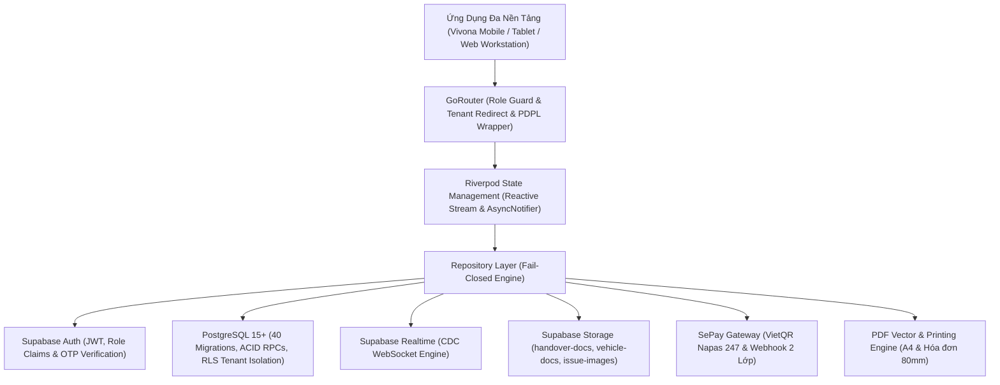

# Vivona — Nền Tảng Quản Trị & Vận Hành Bất Động Sản B2B SaaS (PropTech Platform)

> **Vivona — Nơi chung cư sống động hơn** | *Quản lý tòa nhà, chạm là xong*  
> **Commercial Production SaaS & PropTech Platform**  
> Giải pháp chuyển đổi số toàn diện dành cho Ban Quản Lý, Chủ đầu tư và các Đơn vị quản lý vận hành tòa nhà, chuỗi chung cư, căn hộ dịch vụ cao cấp. Kết nối liền mạch giữa Bộ máy Quản trị (Ban Quản Lý, Kế toán, Kỹ thuật viên, Lễ tân) và Khách hàng (Cư dân, Khách thuê) với độ tin cậy cấp doanh nghiệp, dữ liệu đồng bộ thời gian thực (Realtime), bảo mật đa tầng tuân thủ Luật Nhà ở 2023 & Luật Bảo vệ dữ liệu cá nhân 2026.

---

## 🏢 1. Định Vị Sản Phẩm & Giá Trị Thương Mại B2B SaaS

**Vivona** là nền tảng phần mềm thương mại thực tế (SaaS B2B) được thiết kế và xây dựng chuyên biệt để giải quyết triệt để các bài toán nhức nhối nhất trong vận hành bất động sản hiện đại:

- **Bàn giao & Kiểm kê tài sản số hóa (Digital Move-in/Move-out)**: Xóa bỏ hoàn toàn biên bản giấy và nguy cơ tranh chấp tiền cọc khi cư dân nhận nhà hoặc trả phòng. Tích hợp trạm kiểm kê hiện trường, chốt chỉ số điện/nước, chiết tính cấn trừ tiền cọc tự động, ký số cảm ứng hai bên trực tiếp trên màn hình và tự động kết xuất biên bản PDF chuẩn pháp lý có mã tra cứu bảo mật.
- **Cổng thanh toán tự động VietQR SePay & Gạch nợ Webhook 2 lớp**: Tích hợp cổng chuyển khoản VietQR Napas 247 động theo chuẩn gateway SePay (`sepay.vn`), tự động xử lý biến động số dư ngân hàng qua Webhook, gạch nợ hóa đơn tức thì sau 2-3 giây qua Supabase Realtime CDC, cơ chế chống thanh toán trùng lặp (Idempotency Key), tự động bóc tách mã hóa đơn chuẩn mực và lưu vết đối soát giao dịch chưa khớp (`UNMATCHED`) tại Bàn làm việc Kế toán Web. Loại bỏ 100% mã nguồn và cơ chế demo/giả lập.
- **Tuân thủ Luật Bảo vệ dữ liệu cá nhân (PDPL 2026)**: Tích hợp quy trình xin chấp thuận xử lý dữ liệu cá nhân bắt buộc (Consent Dialog) ngay khi mở ứng dụng theo Luật số 91/2025/QH15 và Nghị định số 356/2025/NĐ-CP. Cung cấp quyền xem lại phạm vi đồng ý, quyền trích xuất dữ liệu cá nhân (Data Portability dạng JSON) và quyền yêu cầu đóng băng/xóa dữ liệu.
- **Kiểm soát phương tiện & Minh chứng cà vẹt**: Quy trình thẩm định xe chính chủ với ảnh chụp giấy đăng ký xe (Cà vẹt), trực quan hóa sơ đồ bãi đỗ xe và gán vị trí ô đỗ cố định tại tầng hầm B1/B2 (`parking_slots`), tự động hạch toán phí gửi xe pro-rata theo chu kỳ kế toán.
- **Tiếp nhận & Điều phối sự cố thông minh**: Phân loại mức độ khẩn cấp (Rule-Based), tự động điều phối kỹ thuật viên hiện trường, trao đổi bình luận thời gian thực qua Realtime CDC và đánh giá chất lượng dịch vụ 3 tiêu chí sau khi nghiệm thu.
- **Trung tâm nhập liệu hàng loạt (Batch Import Center)**: Hỗ trợ nạp hàng nghìn căn hộ, cư dân, hợp đồng và số dư ban đầu qua tệp Excel (`.xlsx`) với cơ chế kiểm tra lỗi (Dry-run validation) trước khi ghi vào cơ sở dữ liệu.
- **Kiến trúc Đa cơ sở (Multi-Tenant Architecture)**: Hỗ trợ quản lý độc lập nhiều tòa nhà/chuỗi dự án trên cùng một hạ tầng với bộ chuyển đổi tòa nhà nhanh chóng (`Building Switcher`) và cách ly dữ liệu tuyệt đối bằng Row Level Security (RLS).
- **Kiến trúc Kiên cố Fail-Closed**: Loại bỏ 100% mock fallback ngầm. Mọi sự cố gián đoạn mạng đều kích hoạt rào chắn lỗi an toàn, tuyệt đối không hiển thị dữ liệu giả định danh làm sai lệch hoạt động vận hành của khách hàng doanh nghiệp.

---

## 🛠️ 2. Ngăn Xếp Công Nghệ & Kiến Trúc Hệ Thống

### 2.1. Ngăn Xếp Công Nghệ (Technology Stack)

| Thành phần | Công nghệ / Thư viện | Vai trò & Mục đích trong Sản Xuất |
| :--- | :--- | :--- |
| **Frontend Framework** | [Flutter](https://flutter.dev) (SDK ^3.12.0+, tương thích Flutter 3.44+) | Ứng dụng đa nền tảng (Android, iOS, Web Responsive Workstation, Desktop) |
| **Quản lý Trạng thái** | [Flutter Riverpod](https://riverpod.dev) (^2.6.1) | Clean Architecture + Feature-First (`AsyncNotifier`, `StreamProvider`, Reactive State) |
| **Backend & CSDL** | [Supabase Enterprise](https://supabase.com) (PostgreSQL 15+) | CSDL quan hệ, Auth JWT, RLS Multi-tenant, Realtime CDC WebSocket, Storage |
| **Điều hướng & Phân luồng** | [GoRouter](https://pub.dev/packages/go_router) (^14.8.1) | Declarative Routing, quản lý URL Web Workstation, Deep-linking và Role-based Guard |
| **Cổng Thanh Toán & Webhook** | [SePay Gateway](https://sepay.vn) & VietQR Napas 247 | Tự động hóa gạch nợ biến động số dư ngân hàng 24/7, loại bỏ 100% demo |
| **Bảo mật Dữ liệu PDPL** | `shared_preferences` & Storage Vault | Quản lý con dấu thời gian chấp thuận dữ liệu theo Luật 91/2025/QH15 & NĐ 356/2025/NĐ-CP |
| **Bộ máy Xuất PDF Vector** | `pdf` (^3.12.0) & `printing` (^5.14.3) | Kết xuất PDF Vector A4 biên bản bàn giao, hóa đơn dịch vụ và biên lai thu tiền |
| **Xử lý Dữ liệu Lớn** | `excel` (^4.0.6) | Đọc/ghi bảng tính Excel trong Batch Import Center và Báo cáo tài chính kế toán |
| **Chữ Ký Số Cảm Ứng** | Flutter `CustomPainter` & Canvas Vector | Ký điện tử trực tiếp trên màn hình di động/máy tính bảng tại hiện trường |
| **Biểu Đồ & Phân Tích** | [FL Chart](https://pub.dev/packages/fl_chart) (^1.2.0) | Trực quan hóa dòng tiền, cơ cấu doanh thu, tỷ lệ thu hồi nợ và KPI vận hành |
| **Thông Báo Đẩy (FCM)** | `firebase_messaging` & `local_notifications` | Push notification biến động số dư, sự cố khẩn cấp và thông báo tòa nhà |

### 2.2. Sơ Đồ Kiến Trúc Hệ Thống (Architecture Flow)



### 2.3. Cấu Trúc Thư Mục Dự Án (Feature-First)

```text
lib/
├── core/                              # Nền tảng dùng chung toàn hệ sinh thái
│   ├── constants/                     # Hằng số (quyền hạn AppPermissions, bảng màu, trạng thái)
│   ├── router/                        # Cấu hình GoRouter, RouteNames, PageTransitions, Shell Wrappers
│   ├── services/                      # Dịch vụ thông báo đẩy FCM, tiện ích OCR bóc tách chỉ số
│   ├── theme/                         # AppTheme chuẩn mực B2B SaaS, Typography Google Fonts / Segoe UI
│   ├── utils/                         # HandoverPdfBuilder, DocumentPdfBuilder, ExcelExport, VietQR
│   └── widgets/                       # PdplConsentDialog, SignaturePadDialog, AppCard, AdaptiveScaffold
├── data/                              # Tầng dữ liệu & Hợp đồng giao tiếp backend
│   ├── models/                        # Strongly-typed Models ánh xạ bảng CSDL (Handover, Vehicle, Invoice...)
│   ├── repositories/                  # Repository pattern kết hợp FailClosedGuard (0% mock fallback)
│   ├── services/                      # DataPrivacyService (PDPL), PaymentService, NotificationService
│   └── providers/                     # Riverpod Providers chuyên biệt cho từng phân hệ nghiệp vụ
├── features/                          # Phân hệ tính năng phân theo đối tượng tác nhân
│   ├── auth/                          # Đăng nhập, đăng ký, kích hoạt cư dân lần đầu, OTP phục hồi mật khẩu
│   ├── resident/                      # Màn hình & component nghiệp vụ dành cho Cư dân / Khách thuê
│   │   ├── screens/                   # Trang chủ, Hóa đơn VietQR, Bàn giao căn hộ, Đăng ký xe, PDPL Profile...
│   │   └── widgets/                   # Thẻ tiện ích, Modal đối soát, Lưới ảnh hiện trường, Apartment Chip...
│   └── management/                    # Màn hình & component dành cho Ban Quản Lý, Kế toán & Kỹ thuật
│       ├── screens/                   # Dashboard KPI, Bàn kế toán Web, Trạm kiểm kê bàn giao, Duyệt xe...
│       └── widgets/                   # Sơ đồ bãi xe, Biểu đồ công nợ, Modal cấp quyền, Resident 360...
└── main.dart                          # Điểm khởi chạy ứng dụng, nạp biến môi trường & cấu hình bảo mật
```

---

## 👥 3. Ma Trận Phân Quyền & Quản Trị Tác Nhân (RBAC Matrix)

Hệ thống tuân thủ nghiêm ngặt nguyên tắc đặc quyền tối thiểu (Principle of Least Privilege) với 5 vai trò nghiệp vụ chuẩn hóa:

| Vai Trò | Mã Role | Phạm Vi Quyền Hạn Nghiệp Vụ Chính |
| :--- | :--- | :--- |
| **Cư dân / Khách thuê** | `resident` | Tra cứu hóa đơn căn hộ mình, quét VietQR thanh toán tự động, gửi chỉ số điện nước, gửi phản ánh, ký số biên bản bàn giao, đăng ký xe & nộp ảnh cà vẹt, đặt tiện ích nội khu, xem lại thỏa thuận PDPL và xuất dữ liệu cá nhân. |
| **Quản trị viên Tòa nhà** | `admin` | Toàn quyền kiểm soát cấu hình hệ thống, quản lý sơ đồ căn hộ, phê duyệt tài khoản, phân quyền ma trận, ủy quyền vai trò, quản lý gói cước SaaS tòa nhà, xem toàn bộ audit logs. |
| **Quản lý Tòa nhà** | `manager` | Quản lý danh mục căn hộ, phê duyệt hồ sơ liên kết, điều phối xử lý sự cố, quản lý bãi đỗ xe và gán ô đỗ hầm B1/B2, lập biên bản bàn giao căn hộ, gửi thông báo diện rộng. |
| **Kế toán Tòa nhà** | `accountant` | Thẩm định chỉ số điện nước, phát hành hóa đơn hàng loạt, vận hành Bàn kế toán đối soát giao dịch VietQR SePay, gạch nợ thủ công giao dịch chưa khớp, thu hộ tiền mặt, quản lý quỹ bảo trì 2%, xuất báo cáo Excel. |
| **Kỹ thuật viên** | `technician` | Tiếp nhận và cập nhật tiến độ sự cố hiện trường được phân công, kiểm tra danh mục vật tư kho, thực hiện kiểm kê tài sản và chốt chỉ số công tơ tại trạm bàn giao căn hộ. |

> **Cơ chế Ủy Quyền Vai Trò Linh Hoạt (`role_delegations`)**: Quản trị viên có thể ủy quyền tạm thời một vai trò (ví dụ: ủy quyền quyền Kế toán hoặc Lễ tân cho nhân sự trực thay) trong khoảng thời gian xác định (`starts_at` $\rightarrow$ `ends_at`) mà không cần thay đổi quyền gốc của tài khoản, lưu vết kiểm toán đầy đủ trong cơ sở dữ liệu.

---

## 📋 4. Đặc Tả Chi Tiết Các Phân Hệ Nghiệp Vụ Cốt Lõi

### 4.1. Biên Bản Bàn Giao & Kiểm Kê Tài Sản Số Hóa (Digital Move-in/Move-out)
- **Quản lý Tài sản Căn hộ (`apartment_assets`)**: Lưu trữ danh mục nội thất, trang thiết bị theo từng căn hộ chuẩn `A0110` (mã tag, tên thiết bị, khu vực phòng khách/ngủ/bếp/vệ sinh, đơn giá bồi thường).
- **Trạm Kiểm Kê Hiện Trường (`InspectionWorkstationScreen`)**: Kỹ thuật viên/BQL kiểm tra hiện trạng (Tốt, Hao mòn bình thường, Hư hỏng, Thất lạc), chụp ảnh bằng chứng và chốt chỉ số đồng hồ điện/nước tại thời điểm bàn giao.
- **Chiết Tính Tiền Cọc & Cấn Trừ Tự Động**: Tự động tính toán tổng chi phí sửa chữa hư hại và khấu trừ trực tiếp vào tiền cọc ban đầu để đưa ra số tiền thực tế hoàn trả cho khách thuê.
- **Ký Số Cảm Ứng Hai Bên (`SignaturePadDialog`)**: Đại diện BQL và Cư dân ký số trực tiếp trên màn hình, lưu vết vector chữ ký lên Supabase Storage `handover-docs/`.
- **Cư Dân Đối Soát & Khiếu Nại (`ResidentHandoverDetailScreen`)**: Cư dân kiểm tra danh mục chi tiết trên điện thoại, đồng ý ký tên hoặc gửi khiếu nại hiện trạng kèm ghi chú phản hồi.
- **Xuất Biên Bản PDF Vector Chuẩn Pháp Lý (`HandoverPdfBuilder`)**: Sinh tệp PDF A4 hoàn chỉnh có quốc hiệu, thông tin các bên, bảng chi tiết từng hạng mục, bảng chỉ số kỹ thuật/tài chính, mã tra cứu bảo mật (`lookupCode`) và 2 khung chữ ký số.
- **Khóa Cứng Bất Biến (PostgreSQL Immutability Trigger)**: Trigger cơ sở dữ liệu tự động khóa cứng, cấm chỉnh sửa (`UPDATE/DELETE`) bất kỳ nội dung nào khi biên bản đã chuyển sang trạng thái `confirmed`.

### 4.2. Cổng Thanh Toán VietQR SePay & Bàn Kế Toán (Accounting Workstation)
- **Bàn Làm Việc Kế Toán Web (`AccountingWebWorkstationScreen`)**: Giao diện dạng bảng chuyên nghiệp dành riêng cho kế toán trên máy tính: lọc căn hộ, đối soát sao kê, theo dõi dòng tiền và đóng sổ kỳ kế toán.
- **Thanh Toán VietQR Động Chuẩn NAPAS**: Tự động sinh mã VietQR động chứa mã hóa đơn và số tiền chính xác, hỗ trợ quét thanh toán qua tất cả các ứng dụng ngân hàng tại Việt Nam.
- **Webhook Tự Động Gạch Nợ Bảo Mật 2 Lớp & Cách Ly Bí Mật (Tenant-Scoped)**:
  - *Lớp Edge Function*: Kiểm tra bắt buộc API key từ header `Authorization: Apikey <key>` hoặc query param. Nếu thiếu, từ chối ngay với mã `HTTP 401 Unauthorized`.
  - *Cách ly Bí mật (Secret Isolation)*: Toàn bộ khóa bí mật (`sepay_api_key`, `vnpay_hash_secret`) được tách sang bảng riêng `building_payment_secrets` với RLS cấm tuyệt đối `anon` và `resident`. Bảng công khai `building_payment_configs` bị xóa bỏ các cột bí mật, ngăn chặn 100% rò rỉ qua client.
  - *Lớp Database RPC*: Hàm `process_sepay_webhook` đối chiếu bắt buộc `p_api_key` với `building_payment_secrets` của **chính tòa nhà chứa hóa đơn (`invoice_building_id`)**, loại bỏ hoàn toàn lỗ hổng Cross-Tenant Spoofing. Nếu vi phạm, ghi ngay audit log `SEPAY_WEBHOOK_CROSS_TENANT_UNAUTHORIZED` và chặn giao dịch.
  - *Gạch nợ tức thì*: Đổi trạng thái hóa đơn sang `paid`, lưu vết `payment_transactions`, bắn tín hiệu Realtime CDC cập nhật giao diện cư dân sau 2-3 giây.
- **Quản Lý Quỹ Bảo Trì 2% (`maintenance_fund_ledger`)**: Tách bạch sổ cái thu chi quỹ bảo trì tòa nhà theo đúng quy định của Luật Nhà ở 2023.

### 4.3. Bảo Mật Dữ Liệu Cá Nhân PDPL (Luật 91/2025/QH15 & NĐ 356/2025/NĐ-CP)
- **Hộp thoại Chấp thuận Bắt buộc (PDPL Consent Modal)**: Khi người dùng mở ứng dụng lần đầu, modal [PdplConsentDialog](file:///c:/Users/ADMIN/StudioProjects/Vivona/lib/core/widgets/pdpl_consent_dialog.dart) yêu cầu đọc và chấp thuận điều khoản thu thập thông tin (CCCD, SĐT, biển số xe, công tơ, giao dịch) trước khi sử dụng hệ thống.
- **Minh Bạch Quyền Chủ Thể Dữ Liệu**: Màn hình Hồ sơ cư dân tích hợp mục xem lại thỏa thuận bất kỳ lúc nào, hiển thị chi tiết căn cứ pháp lý và con dấu thời gian đã đồng ý.
- **Trích Xuất Dữ Liệu Cá Nhân (Data Portability)**: Cho phép cư dân tải về bản sao kê thông tin cá nhân, danh sách căn hộ, phương tiện và lịch sử thanh toán định dạng JSON có mã băm bảo mật.
- **Quyền Đóng Băng / Yêu Cầu Xóa Dữ Liệu**: Cư dân có thể gửi yêu cầu đóng băng thông tin khi kết thúc hợp đồng thuê hoặc chuyển đi nơi khác.

### 4.4. Kiểm Soát Phương Tiện Minh Chứng Cà Vẹt & Gán Ô Đỗ Tầng Hầm
- **Cư Dân Tải Minh Chứng Cà Vẹt Xe**: Cho phép chụp hoặc tải ảnh Giấy đăng ký xe (Cà vẹt) lên Supabase Storage `vehicle-docs/` khi đăng ký thẻ xe mới.
- **BQL Thẩm Định & Phóng To Minh Chứng**: Ban Quản Lý mở modal soi ảnh cà vẹt phóng to để đối soát thông tin chủ sở hữu trước khi duyệt.
- **Gán Vị Trí Ô Đỗ Cố Định Tầng Hầm B1/B2**: Với đơn đăng ký ô tô, hệ thống hiển thị danh sách ô đỗ còn trống theo sơ đồ thực tế (`parking_slots`) để chọn gán cho căn hộ.
- **Tự Động Kích Hoạt Phí Gửi Xe Pro-rata**: Thẻ xe sau khi được phê duyệt sẽ tự động kích hoạt tính phí vào kỳ phát hành hóa đơn kế tiếp.

### 4.5. Ghi Nhận Chỉ Số Đồng Hồ (Điện/Nước) & Khóa Chống Lùi Số
- **Cư Dân Tự Nộp Chỉ Số Kèm Ảnh**: Cư dân chụp ảnh công tơ điện nước và nộp lên hệ thống.
- **Thuật Toán Phát Hiện Bất Thường (Utility Anomaly Detector)**: So sánh mức tiêu thụ với trung bình 3 tháng gần nhất để cảnh báo rò rỉ nước hoặc chỉ số nhảy vọt.
- **Khóa Chống Lùi Số (Anti-Rollback Lock)**: RPC `approve_meter_reading` sử dụng khóa hàng `FOR UPDATE`, từ chối duyệt nếu chỉ số mới nhỏ hơn chỉ số kỳ trước, bảo vệ chống thất thoát doanh thu.

### 4.6. Tiếp Nhận & Điều Phối Sự Cố Hiện Trường (Smart Dispatching)
- **Phân Loại Khẩn Cấp Tự Động (Rule-Based)**: Nhận diện từ khóa nguy hiểm (*cháy, nổ, rò gas, kẹt thang máy, tràn nước*) để tự động nâng mức ưu tiên lên **Khẩn cấp (Urgent)**.
- **Điều Phối & Bàn Giao Kỹ Thuật Viên**: Phân công kỹ thuật viên theo chuyên môn (Điện, Nước, Xây dựng, Thang máy), theo dõi tiến độ xử lý qua Kanban board.
- **Trao Đổi Bình Luận Hai Chiều Realtime**: Cư dân và kỹ thuật viên trao đổi trực tiếp kèm ảnh chụp trong quá trình sửa chữa qua WebSocket Realtime.
- **Đánh Giá Nghiệm Thu 3 Tiêu Chí**: Khảo sát chất lượng 5 sao (Tốc độ, Thái độ, Hiệu quả) sau khi sự cố hoàn thành.

### 4.7. Khách Thăm, Bưu Kiện & Kích Hoạt Cư Dân Lần Đầu
- **Kích Hoạt Tài Khoản Bằng Token / Mã PIN**: Cư dân mới nhận mã kích hoạt một lần từ BQL để kích hoạt tài khoản an toàn mà không cần thủ tục giấy tờ rườm rà.
- **Tạo Mã QR Đón Khách**: Cư dân tạo mã QR đón khách viếng thăm có thời hạn; bảo vệ tại cổng quét mã check-in điện tử.
- **Quản Lý Bưu Kiện / Giao Nhận Lễ Tân**: Lễ tân quét nhận bưu kiện, hệ thống sinh mã PIN nhận hàng gửi về máy cư dân và chụp ảnh xác nhận bàn giao.

### 4.8. Biểu Quyết Cộng Đồng Điện Tử & Truyền Thông Tòa Nhà
- **Biểu Quyết Trực Tuyến Chuẩn Luật Nhà ở 2023**: Tổ chức các cuộc họp hội nghị nhà chung cư, biểu quyết kinh phí bảo trì hoặc nội quy sinh hoạt với cơ chế tính phiếu theo diện tích sở hữu riêng ($m^2$).
- **Phát Thông Báo Đa Kênh**: Gửi thông báo đến toàn thể cư dân hoặc khoanh vùng theo từng Block/Tầng.
- **Cẩm Nang Cư Dân & Danh Bạ Khẩn Cấp**: Tra cứu nội quy tòa nhà và gọi khẩn cấp đến Hotline BQL, Cứu hỏa 114, Cấp cứu 115 qua một chạm.

---

## 🔒 5. Bảo Mật Cấp Doanh Nghiệp & Tuân Thủ Pháp Lý (Security & Compliance)

- **Tuân thủ Luật Nhà ở 2023**: Phân tách bạch minh bạch giữa Kinh phí quản lý vận hành và Quỹ bảo trì 2%, quy chuẩn hóa biên bản bàn giao và lưu trữ hợp đồng căn hộ.
- **Tuân thủ Luật Bảo vệ dữ liệu cá nhân 2026 (PDPL)**:
  - Dữ liệu cư dân (Họ tên, CCCD, số điện thoại, biển số xe, ảnh cà vẹt) được phân lập tuyệt đối bằng Row Level Security (RLS). Cư dân tòa nhà này tuyệt đối không thể đọc dữ liệu cư dân tòa nhà khác.
  - Ngăn chặn triệt để tấn công leo thang đặc quyền: Trigger `trg_prevent_role_self_escalation` ngăn chặn việc người dùng tự sửa role qua API.
- **Toàn Vẹn Dữ Liệu ACID qua PostgreSQL RPCs**:
  - `process_sepay_webhook`: Gạch nợ nguyên tử, đối soát API key và chống thanh toán trùng lặp.
  - `approve_meter_reading`: Duyệt chỉ số với khóa hàng chống xung đột đồng thời.
  - `trg_enforce_handover_immutable`: Khóa cứng biên bản bàn giao khi đã hoàn tất ký kết.
- **Nhật Ký Kiểm Toán Bất Biến (Audit Trail)**: Mọi thao tác trọng yếu (duyệt cư dân, xóa căn hộ, phát hành hóa đơn, cấn trừ cọc, chi quỹ bảo trì, từ chối webhook) đều được ghi nhận vào bảng `audit_logs` phục vụ thanh tra.

---

## 🚀 6. Hướng Dẫn Cài Đặt & Triển Khai (Deployment Playbook)

### Yêu cầu môi trường
- [Flutter SDK](https://flutter.dev/docs/get-started/install) (Phiên bản `>= 3.12.0`, tương thích tốt nhất Flutter 3.44+)
- [Dart SDK](https://dart.dev/get-dart)
- Máy chủ [Supabase](https://supabase.com) (hoặc cụm Supabase Self-Hosted qua Docker)

### Các bước khởi chạy

1. **Clone mã nguồn dự án**:
   ```bash
   git clone https://github.com/PVM-05/PKA-Home.git
   cd Vivona
   ```

2. **Cài đặt các gói phụ thuộc (Dependencies)**:
   ```bash
   flutter pub get
   ```

3. **Cấu hình môi trường (`.env`)**:
   Sao chép tệp mẫu `.env.example` thành `.env`:
   ```bash
   cp .env.example .env
   ```
   Cấu hình thông tin kết nối Supabase:
   ```env
   SUPABASE_URL=https://<your-project-ref>.supabase.co
   SUPABASE_ANON_KEY=<your-publishable-anon-key>
   ```
   > **Cảnh báo An ninh**: Chỉ đưa `SUPABASE_ANON_KEY` lên ứng dụng client. **Tuyệt đối không** nhúng `service_role key` vào ứng dụng client hoặc commit lên Git. Khóa `service_role key` và `SEPAY_WEBHOOK_API_KEY` chỉ được cấu hình trong phần Secrets của Supabase Dashboard / Edge Functions.

4. **Cấu hình Thông Báo Đẩy Firebase FCM (Tùy chọn cho Môi trường Local)**:
   Để kích hoạt tính năng nhận thông báo đẩy thời gian thực trên thiết bị thật:
   - **Android**: Tải `google-services.json` từ Firebase Console và đặt vào `android/app/google-services.json` (tham khảo mẫu `android/app/google-services.example.json`).
   - **iOS**: Tải `GoogleService-Info.plist` từ Firebase Console và đặt vào `ios/Runner/GoogleService-Info.plist` (tham khảo mẫu `ios/Runner/GoogleService-Info.example.plist`).
   > **Cơ chế Fail-Safe**: Nếu chưa bổ sung 2 tệp trên, bộ máy khởi chạy của Vivona tự động bọc khối Try/Catch bảo vệ và kích hoạt chế độ Fallback thông báo nội bộ (In-app Notification Center), bảo đảm ứng dụng vẫn khởi chạy bình thường mà không bị crash.

5. **Khởi tạo Cơ sở dữ liệu (40 Migrations)**:
   Áp dụng tuần tự các tệp migration trong thư mục `supabase/migrations/` trên Supabase SQL Editor:
   - Các bảng cốt lõi: người dùng, căn hộ, hóa đơn, sự cố, phương tiện.
   - Migration bãi đỗ xe & ô đỗ hầm: `20261106_01_parking_slots_and_vehicle_approval.sql`
   - Migration bàn giao & kiểm kê tài sản: `20261107_02_digital_asset_handover_and_inspection.sql`
   - Migration cổng thanh toán thật SePay: `20261108_01_sepay_real_payment_and_webhook.sql`
   - Migration gia cố bảo mật Webhook SePay: `20261116_01_sepay_webhook_security_hardening.sql`
   - Migration cách ly bí mật & kiểm soát tenant: `20261116_02_separate_payment_secrets_and_scope_webhook.sql`

6. **Chạy ứng dụng**:
   - Chạy trên điện thoại di động (Android / iOS):
     ```bash
     flutter run
     ```
   - Chạy Bàn làm việc Kế toán / Quản trị trên Web Workstation:
     ```bash
     flutter run -d chrome
     ```

---

## 🧪 7. Đảm Bảo Chất Lượng & Kỷ Luật Kiểm Thử (Quality Assurance)

Dự án duy trì quy chuẩn kiểm thử nghiêm ngặt cấp độ doanh nghiệp:

- **Phân Tích Cú Pháp & Kiểm Tra Chất Lượng Mã Nguồn Tĩnh**:
  ```bash
  dart analyze lib test
  ```
  *(Kết quả xác minh: **`No issues found!`** — 0 lỗi, 0 cảnh báo trên toàn bộ 307 file `lib/` và 381 file `test/`).*

- **Chạy Toàn Bộ Test Suite Tự Động (Hơn 1.200 bài kiểm thử trên 381 test files)**:
  ```bash
  flutter test
  ```
  *(Bao gồm: Unit Tests cho Models & Helpers, Widget Tests cho toàn bộ màn hình BQL & Cư dân, Contract RPC Tests, Repository Fail-Closed Tests, SQL Migration Tests và PDF Engine Tests).*

- **Kiểm Thử An Ninh Row Level Security Trực Tiếp (Live Database)**:
  ```bash
  flutter test test/integration/rls_security_test.dart
  ```

---

## 🗺️ 8. Lộ Trình Phát Triển Mở Rộng (Commercial Product Roadmap)

Để nâng cao năng lực phục vụ các khách hàng B2B quy mô lớn và chuẩn hóa quy trình thương mại hóa, các module nâng cao đang được chuẩn bị triển khai theo lộ trình:

| Hạng mục mở rộng | Mục tiêu & Giá trị mang lại | Trạng thái kỹ thuật |
| :--- | :--- | :--- |
| **Cổng Ví Điện Tử (MoMo / ZaloPay SDK)** | Bổ sung phương thức thanh toán tức thì qua App-to-App Deeplink dành cho cư dân ưa chuộng ví điện tử bên cạnh VietQR Napas 247. | *Đã có kiến trúc PaymentGateway abstraction; sẵn sàng tích hợp Merchant SDK.* |
| **Hóa Đơn Điện Tử Chuẩn Thuế (e-Invoice API)** | Kết nối trực tiếp hệ thống hóa đơn điện tử của Viettel (Sinvoice), MISA (meInvoice) hoặc VNPT, tự động cấp mã cơ quan thuế theo Nghị định 70/2025. | *Đã có công cụ xuất PDF vector A4 + mã tra cứu bảo mật; chuẩn bị hợp đồng API đối tác.* |
| **Kênh Thông Báo Zalo ZNS & SMS Brandname** | Tự động gửi thông báo hóa đơn, nhắc nợ và cảnh báo sự cố khẩn cấp trực tiếp đến số Zalo / SMS của cư dân qua eSMS / SpeedSMS / Zalo OA. | *Đã có FCM và in-app notification center; chuẩn bị cổng Webhook đối tác viễn thông.* |
| **Giám Sát Vận Hành & Lỗi (Crashlytics & Sentry)** | Tích hợp Sentry và Firebase Crashlytics để thu thập stacktrace thời gian thực từ máy người dùng, phát hiện sớm các lỗi phát sinh ngoài môi trường sản xuất. | *Dự kiến bổ sung khi đóng gói bản phát hành Play Store / App Store.* |
| **Quốc Tế Hóa Đa Ngôn Ngữ (i18n)** | Hỗ trợ Tiếng Anh (EN), Hàn Quốc (KR), Nhật Bản (JA) phục vụ cư dân và khách thuê người nước ngoài tại các khu đô thị cao cấp. | *Toàn bộ nhãn dán UI đã được quy chuẩn hóa; sẵn sàng tách tệp `.arb` qua thư mục `l10n/`.* |
| **Nghiệp Vụ Hiện Trường Nâng Cao** | Bổ sung phân hệ Tuần tra bảo vệ theo ca trực (Guard Patrol QR Check-in) và Đăng ký nuôi thú cưng (Pet Registry) theo nội quy chung cư. | *Dự kiến triển khai trong phiên bản v2.2.* |
| **Tích Hợp Phần Cứng IoT Tòa Nhà** | Kết nối điều khiển barie tự động và phân tầng thang máy qua giao thức mở MQTT / REST API. | *Kiến trúc backend đã sẵn sàng tiếp nhận Webhook thiết bị.* |
| **Quy Trình Phát Hành Tự Động (Fastlane CI/CD)** | Thiết lập Fastlane tự động ký chứng chỉ, build bundle `.aab`/`.ipa` và phân phối lên Google Play Internal Test & Apple TestFlight. | *Đang chuẩn bị kịch bản `Fastfile` trong CI/CD.* |

---

## 📜 9. Quy Chuẩn Dự Án & Git Workflow

- **Ngôn ngữ & Giao diện**: 100% tiếng Việt chuẩn mực, chuyên nghiệp, giữ nguyên các thuật ngữ quốc tế thông dụng (Hotline, Email, App, QR, VietQR, Wifi). Sử dụng biểu tượng Material Icons chuẩn (`Icons.*`), tuyệt đối không sử dụng Emoji trong mã nguồn UI.
- **Quy chuẩn Định danh Căn hộ**: Sử dụng thống nhất định dạng chuẩn `<Block><Tầng 2 chữ số><Phòng 2 chữ số>` (ví dụ: `A0110`, `B0205`).
- **Quy chuẩn Git**:
  - Toàn bộ thay đổi được thực hiện và **commit trực tiếp trên nhánh `main`**. Không tạo nhánh tính năng phụ.
  - Định dạng Commit Message theo chuẩn Conventional Commits: `<loại>: <mô tả ngắn>`
    - `feat:` Tính năng mới
    - `fix:` Sửa lỗi
    - `docs:` Tài liệu
    - `refactor:` Tối ưu cấu trúc mã nguồn
    - `test:` Kiểm thử tự động

---

*Bản quyền © 2026 Vivona PropTech Platform. Được xây dựng và phát triển chuyên nghiệp với Flutter & Supabase Enterprise PostgreSQL.*
