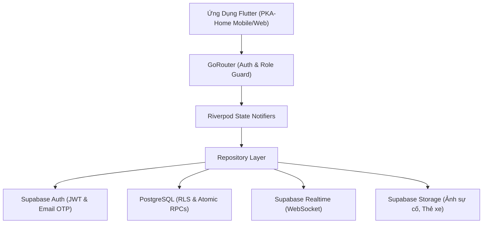

# PKA-Home — Hệ Thống Quản Lý Chung Cư Thông Minh

> **Đồ án Liên ngành Kỹ thuật Phần mềm**  
> Giải pháp số hóa toàn diện quy trình vận hành và quản trị chung cư, kết nối trực tiếp Ban Quản Lý (BQL) và Cư dân với độ an toàn cao, dữ liệu đồng bộ thời gian thực (Realtime) và giao diện trực quan 100% tiếng Việt chuẩn mực.

---

## 🏢 1. Tổng Quan & Mục Tiêu Hệ Thống

**PKA-Home** giải quyết triệt để các bài toán thường gặp trong quản trị và sinh hoạt tại các khu đô thị / chung cư hiện đại:
- **Minh bạch tài chính & Thu chi chuẩn xác**: Hóa đơn phân rã từng loại phí (điện, nước, quản lý, gửi xe), Cổng thanh toán mô phỏng tức thì (`simulate_unified_payment`), phòng chống thanh toán chéo và gian lận dữ liệu ở cấp độ cơ sở dữ liệu.
- **Tiếp nhận & Xử lý sự cố tức thời**: Tiếp nhận phản ánh sự cố kèm hình ảnh, tự động nhận diện mức độ khẩn cấp (Rule-based), phân công kỹ thuật viên phụ trách và trao đổi thời gian thực.
- **Tiện ích số hóa nội khu**: Đăng ký thẻ xe điện tử (xe máy/ô tô), đặt chỗ tiện ích nội khu (hồ bơi, BBQ, phòng sinh hoạt) với thuật toán kiểm tra xung đột thời gian, cẩm nang tòa nhà và danh bạ khẩn cấp một chạm.
- **Kiến trúc an toàn (Security by Design)**: Phân quyền đa cấp độ (RBAC), bảo vệ toàn vẹn dữ liệu bằng PostgreSQL Row Level Security (RLS) và xử lý giao dịch nguyên tử (ACID) qua Remote Procedure Calls (RPC).

---

## 🛠️ 2. Công Nghệ & Kiến Trúc Hệ Thống

### 2.1. Ngăn Xếp Công Nghệ (Technology Stack)

| Thành phần | Công nghệ / Thư viện | Vai trò & Mục đích |
| :--- | :--- | :--- |
| **Frontend Framework** | [Flutter](https://flutter.dev) (SDK ^3.12.0) | Đa nền tảng (Android, iOS, Web, Windows/macOS) |
| **Quản lý trạng thái** | [Flutter Riverpod](https://riverpod.dev) (^2.6.1) | Quản lý state hướng dữ liệu (`AsyncNotifier`, `StreamProvider`) |
| **Backend & Cơ sở dữ liệu** | [Supabase](https://supabase.com) (PostgreSQL 15+) | CSDL quan hệ, Auth, RLS Policies, Realtime Engine, Storage |
| **Điều hướng & Guard** | [GoRouter](https://pub.dev/packages/go_router) (^14.8.1) | Declarative Routing, quản lý URL và Auth/Role Guard |
| **Kiểu chữ & Design System**| [Google Fonts](https://pub.dev/packages/google_fonts) | Đồng bộ font chữ Segoe UI/Google Fonts nhất quán |
| **Biểu đồ & Thống kê** | [FL Chart](https://pub.dev/packages/fl_chart) (^1.2.0) | Biểu đồ doanh thu tài chính, cơ cấu thu nợ và tỷ lệ lấp đầy |
| **Báo cáo & Xuất file** | [Excel](https://pub.dev/packages/excel) (^4.0.6) | Xuất báo cáo danh sách hóa đơn theo kỳ định dạng `.xlsx` |
| **Thông báo đẩy (FCM)** | `firebase_messaging` & `local_notifications` | Tiếp nhận và hiển thị thông báo tức thời |
| **Quản lý Môi trường** | `flutter_dotenv` (^6.0.1) | Nạp biến môi trường an toàn với cơ chế fallback |

### 2.2. Sơ Đồ Kiến Trúc Hệ Thống (Architecture Flow)



### 2.3. Cấu Trúc Thư Mục Chuẩn (Feature-First)

```text
lib/
├── core/                              # Tiện ích và cấu hình dùng chung toàn hệ thống
│   ├── constants/                     # Hằng số (màu sắc, quyền hạn, trạng thái)
│   ├── router/                        # Cấu hình GoRouter, AppRoute & RoleGuard
│   ├── services/                      # Push notifications, OCR simulator
│   ├── theme/                         # AppTheme, màu sắc, font chữ chuẩn mực
│   ├── utils/                         # Formatter tiền tệ VND, ngày tháng, validate mã A0110
│   └── widgets/                       # Widget dùng chung (AppCard, Shimmer, ErrorView...)
├── data/                              # Tầng dữ liệu trung gian
│   ├── models/                        # Data classes ánh xạ bảng CSDL
│   ├── repositories/                  # Tương tác Supabase Client, truy vấn & RPC
│   ├── services/                      # PaymentService, NotificationService
│   └── providers/                     # Riverpod Providers cho từng phân hệ
├── features/                          # Phân chia theo tác nhân và luồng người dùng
│   ├── auth/                          # Đăng nhập, đăng ký, quên mật khẩu qua Email OTP
│   ├── resident/                      # Toàn bộ màn hình & widget dành cho Cư dân
│   │   ├── screens/                   # Trang chủ, Hóa đơn, Phản ánh, Đặt chỗ, Thẻ xe...
│   │   └── widgets/                   # Các component con chuyên biệt của cư dân
│   └── management/                    # Toàn bộ màn hình & widget dành cho Ban Quản Lý
│       ├── screens/                   # Dashboard, Quản lý Căn hộ, Hóa đơn, Phê duyệt xe...
│       └── widgets/                   # Dialog thêm căn hộ, bộ lọc phân cấp, biểu đồ KPI...
└── main.dart                          # Điểm khởi chạy ứng dụng & nạp cấu hình an toàn
```

---

## 👥 3. Ma Trận Tác Nhân & Phân Quyền (RBAC Matrix)

Hệ thống thiết kế theo nguyên tắc đặc quyền tối thiểu (Least Privilege) với 5 vai trò chính:

| Vai Trò | Mã Role | Phạm Vi Quyền Hạn Chính |
| :--- | :--- | :--- |
| **Cư dân** | `resident` | Xem hóa đơn căn hộ mình, nộp chỉ số đồng hồ, thanh toán demo, gửi phản ánh, đặt tiện ích, đăng ký phương tiện. |
| **Quản trị viên** | `admin` | Toàn quyền cấu hình hệ thống, quản lý căn hộ, duyệt tài khoản, ủy quyền vai trò, giám sát tài chính. |
| **Quản lý tòa nhà**| `manager` | Quản lý căn hộ, duyệt liên kết, điều phối sự cố, quản lý tiện ích, gửi thông báo diện rộng. |
| **Kế toán** | `accountant` | Duyệt chỉ số điện nước, phát hành hóa đơn hàng loạt, ghi nhận thanh toán tiền mặt, xuất báo cáo Excel. |
| **Kỹ thuật viên** | `technician` | Tiếp nhận và cập nhật tiến độ xử lý sự cố được phân công, kiểm tra bảo trì thiết bị tòa nhà. |

> **Cơ chế Ủy Quyền Vai Trò Linh Hoạt (`role_delegations`)**: Ban quản trị có thể ủy quyền tạm thời một vai trò (ví dụ: ủy quyền quyền Kế toán cho nhân sự trực) trong khoảng thời gian xác định (`starts_at` $\rightarrow$ `ends_at`) mà không cần thay đổi quyền gốc của tài khoản.

---

## 📋 4. Đặc Tả Chi Tiết Các Phân Hệ Nghiệp Vụ

### 4.1. Phân Hệ Xác Thực & Bảo Mật Tài Khoản
- **Đăng ký & Đăng nhập**: Xác thực qua Supabase Auth với mã hóa JWT bảo mật.
- **Khôi phục mật khẩu qua Email OTP**: 
  - Gửi mã OTP 6 chữ số ngẫu nhiên qua email đăng ký.
  - Mã có hiệu lực trong 5 phút; cơ chế giới hạn tần suất gửi lại (Rate Limit 60 giây).
  - Tự động nhảy ô số và dán clipboard nhanh chóng trên giao diện di động.
- **Liên kết Căn hộ Phân Cấp**:
  - Cư dân gửi yêu cầu liên kết theo cấu trúc phân cấp: **Khối/Tòa nhà (Block) $\rightarrow$ Tầng $\rightarrow$ Căn hộ (`A0110`)**.
  - Ban Quản Lý phê duyệt hoặc từ chối kèm lý do qua RPC an toàn.

### 4.2. Phân Hệ Tài Chính, Điện Nước & Thanh Toán
- **Ghi Nhận Chỉ Số Đồng Hồ (Meter Reading)**:
  - Cư dân tự chụp ảnh và gửi chỉ số điện nước định kỳ kèm ảnh minh chứng.
  - Tích hợp công cụ mô phỏng nhận diện quang học (OCR Simulator).
  - **Bảo vệ toàn vẹn chỉ số gốc (Anti-Rollback)**: RPC `approve_meter_reading` sử dụng khóa hàng `FOR UPDATE`, từ chối duyệt (`RAISE EXCEPTION`) nếu chỉ số mới gửi lên nhỏ hơn chỉ số gốc của căn hộ, bảo vệ doanh thu các kỳ sau.
- **Phát Hành Hóa Đơn Hàng Loạt (Batch Invoicing)**:
  - Cơ chế **Prevalidation Dry-Run** trước khi phát hành: Tự động phát hiện căn hộ thiếu chỉ số hoặc đã lập hóa đơn kỳ đó.
  - Tự động tổng hợp: Phí quản lý căn hộ (theo $m^2$), phí gửi xe (theo số xe đã duyệt), tiền điện nước (theo mức tiêu thụ).
- **Cổng Thanh Toán Hợp Nhất (`simulate_unified_payment`)**:
  - Xử lý giao dịch nguyên tử cho cả Hóa đơn (`INVOICE`) và Dịch vụ tiện ích (`SERVICE`).
  - **Kiểm soát quyền sở hữu đa tầng**: Bắt buộc đăng nhập (`auth.uid()`), cư dân chỉ được thanh toán hóa đơn thuộc căn hộ mình hoặc lượt đặt do mình tạo; Ban Quản Lý được phép hỗ trợ thu hộ.
  - Chống thanh toán trùng (`paid`, `confirmed`) và chống thay đổi trạng thái hóa đơn đã hủy.
- **Thu Tiền Mặt Ban Quản Lý (`record_manual_payment`)**:
  - Dành riêng cho Kế toán và Admin khi cư dân nộp tiền trực tiếp tại văn phòng ban quản lý.
- **Xuất Báo Cáo Tài Chính**: Xuất danh sách hóa đơn theo kỳ ra file Excel (`.xlsx`) phục vụ đối soát.

### 4.3. Phân Hệ Tiện Ích & Dịch Vụ Nội Khu
- **Đặt Chỗ Tiện Ích Trực Tuyến**: Đặt lịch sử dụng hồ bơi, sân tennis, khu tiệc nướng BBQ ngoài trời.
- **Kiểm Tra Xung Đột Thời Gian Thực**: Thuật toán kiểm tra giao thoa thời gian (`slot_start < booking_end AND slot_end > booking_start`), ngăn chặn tình trạng đặt trùng khung giờ.
- **Hàng Đợi Chờ (Waitlist Queue)**: Tự động đôn lượt đặt trong hàng đợi lên trạng thái chờ thanh toán khi có người hủy lịch.
- **Vé Điện Tử & Check-in**: Cư dân xuất trình mã QR / mã đặt chỗ; Ban Quản Lý quét mã để thực hiện check-in điện tử.

### 4.4. Phân Hệ Phản Ánh & Xử Lý Sự Cố
- **Gửi Yêu Cầu Kèm Minh Chứng**: Đính kèm hình ảnh hiện trường trực tiếp từ Camera hoặc Thư viện ảnh.
- **Tự Động Phân Loại Khẩn Cấp (Rule-Based)**: Nhận diện từ khóa nguy hiểm (*cháy, nổ, sập, kẹt thang, tràn nước*) để tự động nâng mức ưu tiên lên **Khẩn cấp (Urgent)**.
- **Điều Phối Kỹ Thuật Viên**: Ban Quản Lý phân công kỹ thuật viên phụ trách, trao đổi bình luận hai chiều thời gian thực qua Supabase Realtime.
- **Khảo Sát Chất Lượng 3 Tiêu Chí**: Cư dân đánh giá chất lượng xử lý (Tốc độ, Thái độ, Hiệu quả) theo thang điểm 5 sao sau khi hoàn tất.

### 4.5. Phân Hệ Quản Lý Phương Tiện & Vận Hành
- **Đăng Ký Phương Tiện Số Hóa**: Đăng ký thẻ xe máy, ô tô kèm thông tin biển số và giấy tờ xe.
- **Phê Duyệt / Từ Chối Thẻ Xe**: Ban Quản Lý xét duyệt hồ sơ; số lượng xe được phê duyệt sẽ tự động cập nhật vào phí giữ xe trong kỳ hóa đơn tiếp theo.
- **Resident 360 Sheet**: Tra cứu tổng thể thông tin căn hộ, danh sách thành viên cư trú, phương tiện đăng ký và lịch sử thanh toán trên một màn hình duy nhất.
- **Nhật Ký Kiểm Toán (Audit Trail)**: Ghi nhận mọi biến động trạng thái (duyệt cư dân, phát hành hóa đơn, thanh toán, phân công sự cố) phục vụ truy vết.

### 4.6. Phân Hệ Thông Báo & Truyền Thông
- **Phát Thông Báo Đa Kênh**: Gửi thông báo đến toàn thể cư dân hoặc lọc theo từng Block/Tầng.
- **Trung Tâm Thông Báo In-App**: Lưu trữ và phân loại thông báo theo danh mục (Tài chính, Vận hành, Bảo trì, Sự cố).
- **Cẩm Nang Cư Dân & Danh Bạ Khẩn Cấp**: Tra cứu nội quy tòa nhà và gọi trực tiếp đến Hotline BQL, Cứu hỏa 114, Cấp cứu 115 qua một chạm.

---

## 🔒 5. Đặc Tả Cơ Sở Dữ Liệu & Bảo Mật (Database & Security)

### 5.1. Quy Ước Thiết Kế Cơ Sở Dữ Liệu
- **Khóa chính**: `UUID` ngẫu nhiên sinh bằng `gen_random_uuid()`.
- **Audit Columns**: Toàn bộ bảng dữ liệu bắt buộc có `created_at` và `updated_at`.
- **Mã Căn Hộ Chuẩn**: Cấu trúc `<Block><Tầng 2 chữ số><Phòng 2 chữ số>` (ví dụ: `A0110`, `B0205`).

### 5.2. Chính Sách Bảo Mật Cấp Hàng (Row Level Security - RLS)
- Mọi bảng trong schema `public` đều kích hoạt RLS (`ENABLE ROW LEVEL SECURITY`).
- **Nguyên tắc phân lập dữ liệu cư dân**: Cư dân chỉ có quyền `SELECT` và tương tác với các dòng dữ liệu gắn với `apartment_id` mà mình đã được phê duyệt trong bảng `residents_apartments`.
- **Ngăn chặn leo thang đặc quyền**: Trigger `trg_prevent_role_self_escalation` chặn đứng việc cư dân tự sửa `role` của chính mình thông qua API.
- **Bảo mật RPC**: Các hàm `SECURITY DEFINER` thực thi với quyền nâng cao đều có kiểm tra định danh `auth.uid()`, khóa hàng `FOR UPDATE`, và kiểm tra vai trò chặt chẽ ở dòng lệnh đầu tiên.

---

## 🚀 6. Hướng Dẫn Cài Đặt & Khởi Chạy

### Yêu cầu tiên quyết
- [Flutter SDK](https://flutter.dev/docs/get-started/install) (Phiên bản `>= 3.12.0`, khuyến nghị `3.44.0`)
- [Dart SDK](https://dart.dev/get-dart)
- Tài khoản [Supabase](https://supabase.com) (hoặc máy chủ Supabase cục bộ)

### Các bước khởi chạy

1. **Clone mã nguồn dự án**:
   ```bash
   git clone https://github.com/PVM-05/PKA-Home.git
   cd pka_home
   ```

2. **Cài đặt các gói phụ thuộc (Dependencies)**:
   ```bash
   flutter pub get
   ```

3. **Cấu hình môi trường (`.env`)**:
   - Sao chép file mẫu `.env.example` thành file `.env`:
   ```bash
   cp .env.example .env
   ```
   - Điền URL và Anon Key của dự án Supabase:
   ```env
   SUPABASE_URL=https://<your-project-ref>.supabase.co
   SUPABASE_ANON_KEY=<your-publishable-anon-key>

   # Cấu hình kiểm thử RLS (Tùy chọn)
   TEST_RESIDENT_EMAIL=resident101@test.com
   TEST_RESIDENT_PASSWORD=password123
   TEST_RESIDENT_APARTMENT_ID=
   ```
   > **Lưu ý Bảo mật**: Chỉ đưa `SUPABASE_ANON_KEY` vào ứng dụng client. **Tuyệt đối không** đưa `service_role key` vào mã nguồn Flutter hoặc file `.env` phía client.

4. **Thiết lập Cơ sở dữ liệu Supabase**:
   - Áp dụng tuần tự các script trong thư mục `supabase/migrations/` trên Supabase SQL Editor.
   - (Tùy chọn) Chạy `supabase/seed.sql` để nạp dữ liệu demo ban đầu (danh sách căn hộ mẫu, tài khoản mẫu, thông báo mẫu).

5. **Chạy ứng dụng**:
   ```bash
   flutter run
   ```

---

## 🧪 7. Đảm Bảo Chất Lượng & Kiểm Thử (Quality Assurance)

Dự án duy trì kỷ luật kiểm thử phần mềm nghiêm ngặt với độ tin cậy tuyệt đối:

- **Phân tích cú pháp & Chất lượng mã nguồn tĩnh**:
  ```bash
  flutter analyze
  ```
  *(Kết quả xác minh: **`No issues found!`** — 0 lỗi, 0 cảnh báo).*

- **Chạy toàn bộ bộ kiểm thử tự động (Unit, Widget, TDD & Migration Tests)**:
  ```bash
  flutter test
  ```
  *(Kết quả xác minh: **`368/368 tests passed!`** — 100% tỷ lệ vượt qua trên toàn bộ suite).*

- **Kiểm thử Bảo mật RLS Trực Tiếp (Live Database Integration)**:
  ```bash
  flutter test test/integration/rls_security_test.dart
  ```
  *(Gồm 3 bài test xác thực RLS trên cụm Supabase thật. Mặc định tự động bỏ qua (skip) an toàn khi chạy offline trong môi trường phát triển cục bộ và kích hoạt khi cấu hình tài khoản kiểm thử trong `.env`).*


---

## 📜 8. Quy Chuẩn Dự Án & Git Workflow

- **Ngôn ngữ giao diện**: 100% tiếng Việt chuẩn mực, tôn trọng thuật ngữ quốc tế phổ biến (Hotline, Email, App, QR, Wifi...).
- **Quy chuẩn Git**:
  - Toàn bộ công việc thực hiện và **commit trực tiếp vào nhánh `main`**. Không tạo nhánh tính năng hay worktree phụ.
  - Định dạng Commit Message theo chuẩn Conventional Commits: `<loại>: <mô tả ngắn>`
    - `feat:` Thêm tính năng mới
    - `fix:` Sửa lỗi hệ thống
    - `docs:` Cập nhật tài liệu
    - `chore:` Cấu hình, bảo trì
    - `test:` Bổ sung hoặc cập nhật bài kiểm thử

---

## 👥 9. Đội Ngũ Phát Triển

Dự án được xây dựng và hoàn thiện bởi nhóm sinh viên thực hiện **Đồ án Liên ngành Kỹ thuật Phần mềm**.

---
*Bản quyền © 2026 PKA-Home Project. Phát triển bằng Flutter & Supabase PostgreSQL.*
