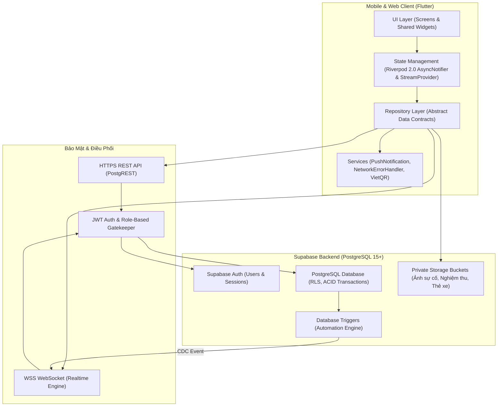
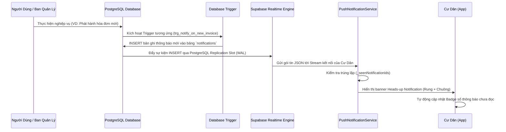

# Kiến Trúc Kỹ Thuật Hệ Thống PKA-Home (Architecture)

> **Mục tiêu kiến trúc:** Xây dựng hệ thống có tính ổn định cao (High Availability), phản hồi thời gian thực (Realtime), an toàn dữ liệu tài chính (Financial Integrity) và dễ dàng mở rộng từ 1 tòa nhà lên hàng trăm tòa nhà/khu nhà trọ (Multi-tenancy Scale).

---

## 1. Kiến Trúc Tổng Thể (System Architecture)

PKA-Home áp dụng mô hình **Client - Cloud Backend (BaaS)** kết hợp với kiến trúc **Event-Driven & Reactive State**:



---

## 2. Cấu Trúc Thư Mục Chuẩn Công Nghiệp (Feature-First)

Mã nguồn frontend được tổ chức theo phương pháp **Feature-First** (tách theo nhóm tính năng thay vì tách theo tầng kỹ thuật), giúp các nhóm phát triển có thể làm việc song song mà không bị xung đột:

```text
lib/
├── core/                               # Tài nguyên dùng chung toàn ứng dụng
│   ├── constants/                      # Biểu mẫu hằng số, bảng màu, kích thước chuẩn
│   ├── theme/                          # Theme Sáng/Tối, Google Fonts (Inter/Segoe UI)
│   ├── widgets/                        # Widget tái sử dụng (AppCard, ShimmerLoading, Header)
│   ├── services/                       # Dịch vụ hạ tầng: PushNotification, NetworkErrorHandler, VietQR
│   └── utils/                          # Hàm tiện ích: Validators, CurrencyFormatter, DateFormatter
├── data/                               # Tầng dữ liệu & Quản lý trạng thái
│   ├── models/                         # Data classes ánh xạ các bảng CSDL (fromJson/toJson)
│   ├── repositories/                   # Lớp truy vấn dữ liệu từ Supabase (Data Access Layer)
│   └── providers/                      # Riverpod Providers (AsyncNotifier, StreamProvider)
├── features/                           # Các phân hệ tính năng nghiệp vụ
│   ├── auth/                           # Xác thực, Đăng nhập, Đăng ký, Quên mật khẩu OTP
│   ├── resident/                       # Toàn bộ màn hình & widget con của Cư dân / Khách thuê
│   │   ├── screens/                    # Home, Invoice, Issue, Amenity, Vehicle, Notification
│   │   └── widgets/                    # Component con chuyên biệt của Cư dân
│   └── management/                     # Toàn bộ màn hình & widget con của Ban Quản Lý / Chủ cơ sở
│       ├── screens/                    # Dashboard, Apartment, Invoice, Issue, Amenity, Audit
│       └── widgets/                    # Biểu đồ tài chính, Thẻ chỉ số KPI, Sơ đồ phòng
└── main.dart                           # Điểm khởi chạy ứng dụng & ProviderScope
```

---

## 3. Quản Lý Trạng Thái Phản Ứng (Riverpod 2.0 Reactive Flow)

PKA-Home triệt để tuân thủ nguyên tắc: **Widget không bao giờ gọi trực tiếp cơ sở dữ liệu**. Mọi tương tác dữ liệu đều tuân theo chu trình phản ứng 4 bước:

1. **Widget:** Lắng nghe Provider thông qua `ref.watch(someProvider)`. Khi Provider cập nhật dữ liệu, Widget tự động render lại một cách tối ưu mà không giật lag.
2. **Provider:** Sử dụng `AsyncNotifierProvider` cho các dữ liệu bất đồng bộ (tự động xử lý 3 trạng thái: `loading`, `error`, `data`) hoặc `StreamProvider` cho dữ liệu thời gian thực.
3. **Repository:** Đảm nhận việc serialize/deserialize JSON, gọi Supabase Client hoặc gọi RPC Stored Procedure.
4. **Resilience Handler:** Tự động bắt lỗi mạng, ánh xạ mã lỗi kỹ thuật sang thông báo tiếng Việt thân thiện cho người dùng thông qua `NetworkErrorHandler`.

---

## 4. Cơ Chế Thông Báo Realtime & Database Triggers

Thay vì yêu cầu Client liên tục gửi request thăm dò (Polling) gây tốn pin và băng thông máy chủ, PKA-Home sử dụng mô hình **PostgreSQL Change Data Capture (CDC)**:



### 4 Bộ Trigger Tự Động Hóa Cốt Lõi:
1. `trg_notify_on_new_invoice`: Tự động sinh thông báo khi BQL phát hành hóa đơn mới.
2. `trg_notify_on_issue_status_change`: Tự động gửi thông báo khi sự cố chuyển trạng thái (Tiếp nhận -> Đang xử lý -> Nghiệm thu hoàn thành).
3. `trg_notify_on_link_request_status`: Báo kết quả tức thì khi BQL duyệt hoặc từ chối yêu cầu gia nhập căn hộ/phòng trọ.
4. `trg_notify_on_invoice_paid`: Tự động sinh thông báo xác nhận thanh toán thành công và cấp biên lai điện tử.

---

## 5. Kiến Trúc Bảo Mật Đa Tầng (Security by Design)

```text
[Tầng 1: Transport Security] -> HTTPS / WSS TLS 1.3 mã hóa toàn bộ đường truyền.
       ↓
[Tầng 2: Authentication]    -> Supabase Auth cấp phát mã thông báo JWT ngắn hạn.
       ↓
[Tầng 3: Client Guard]      -> GoRouter redirect guard ngăn truy cập trái phép màn hình.
       ↓
[Tầng 4: UI Role Guard]     -> RoleGuard widget ẩn các nút thao tác nhạy cảm (Xóa, Duyệt).
       ↓
[Tầng 5: Database RLS]      -> PostgreSQL Row Level Security ép buộc quyền ở mức từng dòng dữ liệu.
       ↓
[Tầng 6: Atomic RPCs]       -> Stored Procedures kiểm tra quyền nội tại (SECURITY DEFINER) và rollback.
```

- **Nguyên tắc "Fail-closed":** Mọi bảng trong cơ sở dữ liệu đều bật RLS ngay từ khi tạo. Nếu không có policy nào thỏa mãn điều kiện, PostgreSQL sẽ mặc định từ chối truy cập.
- **Cách ly dữ liệu Cư Dân:** Cư dân A chỉ có thể đọc dữ liệu thuộc về căn hộ mà họ đã được BQL phê duyệt liên kết trong bảng `residents_apartments`. Cư dân tuyệt đối không thể đọc hoặc chỉnh sửa dữ liệu của căn hộ khác.
