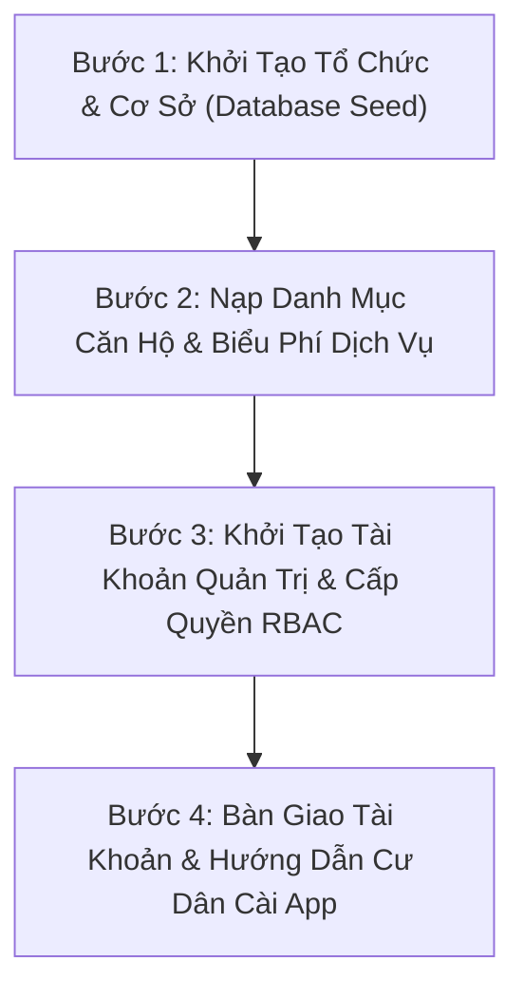

# Hướng Dẫn Bàn Giao & Vận Hành Hệ Thống PKA-Home (Operations & Onboarding)

> **Phạm vi áp dụng:** Triển khai mới cho Ban Quản Lý Chung Cư hoặc Đơn Vị Quản Lý Chuỗi Phòng Trọ / Căn Hộ Dịch Vụ.  
> **Mô hình triển khai:** Cloud SaaS trên nền tảng Supabase Managed hoặc On-Premise Docker.

---

## 1. Quy Trình 4 Bước Triển Khai Cơ Sở Mới (Onboarding Workflow)

---

## 2. Thiết Lập Tham Số Phù Hợp Từng Mô Hình Tài Sản

Khi thiết lập một cơ sở mới trong bảng `buildings`, cần chú ý trường `property_type`:

| Loại Hình | Giá Trị `property_type` | Cấu Hình Đặc Trưng | Giao Diện Ứng Dụng Tương Ứng |
| :--- | :--- | :--- | :--- |
| **Chung Cư Cao Tầng** | `apartment_building` | • Bật `strictApartmentFormat` (Mã căn `A0110`). • Biểu phí quản lý tính theo diện tích m². • Mở thẻ Quỹ Bảo Trì 2% tòa nhà. | Hiển thị đầy đủ Quỹ Bảo Trì, Thẻ Xe, Lập hóa đơn m², Đặt chỗ tiện ích. |
| **Chuỗi Nhà Trọ / Dãy Trọ** | `boarding_house` | • Nới lỏng mã phòng (`P101`, `101`, `Phòng 3`). • Tiền phòng cố định theo tháng (`rent_price`). • Tự động ẩn Quỹ bảo trì. | Tối giản giao diện, tập trung vào Tiền phòng, Điện nước, Rác, Wifi, Báo sự cố. |
| **Căn Hộ Dịch Vụ Cho Thuê** | `serviced_apartment` | • Mã phòng linh hoạt. • Hợp đồng ngắn hạn/dài hạn. • Tính phí trọn gói theo gói dịch vụ. | Hiển thị tiện ích giặt là, dọn phòng, thẻ xe và biên lai điện tử. |

---

## 3. Đặc Tả 6 Bảng Excel Mẫu Thu Thập Dữ Liệu Ban Đầu

Gửi mẫu Excel 6 sheet chuẩn này cho đơn vị quản lý trước ngày triển khai:

1. **Sheet 1 (`CoSo_ToaNha`):** Tên cơ sở, mã cơ sở, địa chỉ, số tầng, số phòng, thông tin tài khoản ngân hàng nhận VietQR.
2. **Sheet 2 (`DanhSach_CanHo_Phong`):** Mã phòng, số tầng, diện tích m² (nếu chung cư), giá thuê phòng cố định (nếu nhà trọ), tiền cọc, số người ở tối đa.
3. **Sheet 3 (`CuDan_KhachThue`):** Họ tên, số điện thoại (tài khoản đăng nhập), CCCD, email, mã căn hộ/phòng gắn kết, vai trò (chủ hộ / khách thuê).
4. **Sheet 4 (`BieuPhi_DichVu`):** Đơn giá điện (kWh), đơn giá nước (m3 hoặc đầu người), phí quản lý, phí gửi xe máy/ô tô, internet, vệ sinh.
5. **Sheet 5 (`PhuongTien_TheXe`):** Biển số xe, loại xe (xe máy/ô tô), mã phòng đăng ký, tình trạng giấy tờ.
6. **Sheet 6 (`ChiSo_DienNuoc_DauKy`):** Mã phòng, số điện bắt đầu, số nước bắt đầu, ngày chốt công tơ gần nhất.

---

## 4. Danh Sách Tài Khoản Mẫu Cho Đơn Vị Thử Nghiệm (UAT Testing)

> **Mật khẩu dùng chung cho môi trường thử nghiệm:** `PkaHome@2026`

| Vai Trò | Email Đăng Nhập | Mục Đích Thử Nghiệm (UAT Scenario) |
| :--- | :--- | :--- |
| **Quản trị viên (Admin)** | `pkahome.admin@gmail.com` | Thử nghiệm toàn quyền quản trị, xem Dashboard KPIs, phân quyền nhân sự. |
| **Kế toán (Accountant)** | `pkahome.ketoan@gmail.com` | Thử nghiệm lập hóa đơn hàng loạt, quét nhắc nợ tự động, xác nhận thu tiền. |
| **Kỹ thuật viên (Technician)** | `pkahome.kythuat@gmail.com` | Thử nghiệm tiếp nhận sự cố, tải ảnh nghiệm thu thực tế và đóng phiếu. |
| **Cư dân / Khách thuê mẫu** | `cudan.a0101@gmail.com` | Thử nghiệm nhận thông báo Realtime, thanh toán VietQR và báo sự cố. |

---

## 5. Checklist Nghiệm Thu Bàn Giao Kỹ Thuật (UAT Checklist)

- [ ] **Auth & Session:** Đăng nhập, đăng ký, đăng xuất hoạt động ổn định trên cả Android, iOS và Web.
- [ ] **Mã phòng linh hoạt:** Nhập thử mã phòng trọ `P101` và mã chung cư `A0110` đều hợp lệ.
- [ ] **Lập hóa đơn:** Lập thành công hóa đơn đơn lẻ và hóa đơn hàng loạt không bị lỗi trùng kỳ.
- [ ] **Thanh toán & Biên lai:** Thao tác thanh toán VietQR thành công, sinh mã biên lai điện tử chuẩn xác.
- [ ] **Database Triggers:** Khi lập hóa đơn hoặc đổi trạng thái sự cố, điện thoại người dùng nhận ngay thông báo banner Heads-up kèm rung/chuông.
- [ ] **Bảo mật RLS:** Xác minh tài khoản phòng A không thể xem hóa đơn hoặc danh sách xe của phòng B.
