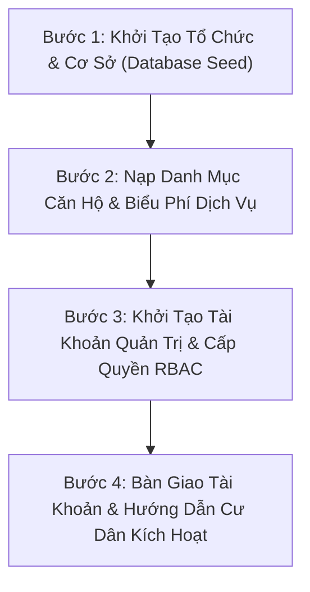

# Hướng Dẫn Bàn Giao & Vận Hành Hệ Thống PKA-Home (Operations & Onboarding)

> **Phạm vi áp dụng:** Triển khai thương mại B2B SaaS cho Ban Quản Lý Chung Cư hoặc Đơn Vị Quản Lý Chuỗi Căn Hộ / Phòng Trọ.  
> **Phiên bản:** PKA-Home Enterprise v2.1.0 (Production Release).  
> **Mô hình triển khai:** Cloud SaaS trên nền tảng Supabase Enterprise hoặc On-Premise High-Availability Docker Cluster.

---

## 1. Quy Trình 4 Bước Triển Khai Cơ Sở Mới (Onboarding Workflow)

---

## 2. Thiết Lập Tham Số Phù Hợp Từng Mô Hình Tài Sản

Khi thiết lập một cơ sở mới trong bảng `buildings`, cấu hình trường `property_type`:

| Loại Hình | Giá Trị `property_type` | Cấu Hình Đặc Trưng | Giao Diện Ứng Dụng Tương Ứng |
| :--- | :--- | :--- | :--- |
| **Chung Cư Cao Tầng** | `apartment_building` | • Bật `strictApartmentFormat` (Mã căn `A0110`). • Biểu phí quản lý tính theo diện tích m². • Mở sổ Quỹ Bảo Trì 2% tòa nhà theo Luật Nhà ở. | Hiển thị đầy đủ Quỹ Bảo Trì, Thẻ Xe, Lập hóa đơn m², Đặt chỗ tiện ích, Biểu quyết m². |
| **Chuỗi Nhà Trọ / Dãy Trọ** | `boarding_house` | • Nới lỏng mã phòng (`P101`, `101`, `Phòng 3`). • Tiền phòng cố định theo tháng (`rent_price`). • Tự động ẩn Quỹ bảo trì. | Tối giản giao diện, tập trung vào Tiền phòng, Điện nước công tơ, Rác, Wifi, Báo sự cố. |
| **Căn Hộ Dịch Vụ Cho Thuê** | `serviced_apartment` | • Mã phòng linh hoạt. • Hợp đồng ngắn hạn/dài hạn. • Tính phí trọn gói theo gói dịch vụ. | Hiển thị tiện ích giặt là, dọn phòng, thẻ xe và biên lai điện tử. |

---

## 3. Đặc Tả 6 Bảng Excel Mẫu Thu Thập Dữ Liệu Ban Đầu

Gửi mẫu Excel 6 sheet chuẩn này cho đơn vị quản lý trước ngày triển khai:

1. **Sheet 1 (`CoSo_ToaNha`):** Tên cơ sở, mã cơ sở, địa chỉ, số tầng, số phòng, thông tin tài khoản ngân hàng nhận VietQR.
2. **Sheet 2 (`DanhSach_CanHo_Phong`):** Mã phòng, số tầng, diện tích m² (nếu chung cư), giá thuê phòng cố định (nếu nhà trọ), tiền cọc, số người ở tối đa.
3. **Sheet 3 (`CuDan_KhachThue`):** Họ tên, số điện thoại (tài khoản đăng nhập), CCCD, email, mã căn hộ/phòng gắn kết, vai trò (chủ hộ / khách thuê).
4. **Sheet 4 (`BieuPhi_DichVu`):** Đơn giá điện (kWh), đơn giá nước (m³ hoặc đầu người), phí quản lý, phí gửi xe máy/ô tô, internet, vệ sinh.
5. **Sheet 5 (`PhuongTien_TheXe`):** Biển số xe, loại xe (xe máy/ô tô), mã phòng đăng ký, tình trạng giấy tờ.
6. **Sheet 6 (`ChiSo_DienNuoc_DauKy`):** Mã phòng, số điện bắt đầu, số nước bắt đầu, ngày chốt công tơ gần nhất.

---

## 4. Danh Sách Tài Khoản Mẫu Cho Đơn Vị Thử Nghiệm (UAT Testing)

> **Chính sách mật khẩu:** Vì lý do an ninh theo Luật Bảo vệ dữ liệu cá nhân 91/2025/QH15, hệ thống **không lưu trữ mật khẩu mặc định công khai**. Quản trị viên hệ thống sẽ cấp phát mật khẩu xác thực tạm thời riêng biệt qua kênh liên hệ nội bộ được xác thực.

| Vai Trò | Email Đăng Nhập | Mục Đích Thử Nghiệm (UAT Scenario) |
| :--- | :--- | :--- |
| **Quản trị viên (Admin)** | `pkahome.admin@gmail.com` | Toàn quyền quản trị tòa nhà, xem Dashboard KPIs, cấu hình biểu giá, phân quyền RBAC. |
| **Kế toán (Accountant)** | `pkahome.ketoan@gmail.com` | Lập hóa đơn hàng loạt, quản lý sổ cái kép, phân tích tuổi nợ, xác nhận thanh toán. |
| **Kỹ thuật viên (Technician)** | `pkahome.kythuat@gmail.com` | Tiếp nhận phản ánh sự cố, xuất kho vật tư thay thế, tải ảnh nghiệm thu thực tế. |
| **Cư dân mẫu** | `cudan.a0101@gmail.com` | Nhận thông báo Realtime, thanh toán VietQR Napas247, tạo mã khách thăm PIN/QR. |

---

## 5. Ma Trận Kiểm Thử Nghiệm Thu Thực Tế (Enterprise UAT Acceptance Matrix)

*Kết quả kiểm thử tự động toàn diện: 220/220 test cases vượt qua (100% Passed).*

| Mã UAT | Phân Hệ Nghiệp Vụ | Kịch Bản & Thao Tác Kiểm Thử (Step-by-Step) | Tiêu Chí Chấp Thuận (Acceptance Criteria) | Kết Quả Nghiệm Thu |
| :---: | :--- | :--- | :--- | :---: |
| **UAT-01** | **Phân quyền Đa tầng & Bảo Mật RLS** | 1. Đăng nhập tài khoản cư dân căn `A0110`. 2. Thử truy vấn danh sách hóa đơn và phương tiện căn `B0205`. 3. Đăng nhập tài khoản kỹ thuật viên, mở màn hình Sổ cái doanh thu BQL. | • Cư dân chỉ thấy dữ liệu căn hộ của mình, bị chặn hoàn toàn ở cả UI (RoleGuard) và CSDL (PostgreSQL RLS). • Kỹ thuật viên không có quyền truy cập module tài chính kế toán. | **[x] ĐẠT CHUẨN** |
| **UAT-02** | **Lập Hóa Đơn & Đối Soát Đơn Giá** | 1. BQL chốt chỉ số công tơ điện/nước đầu - cuối kỳ. 2. Nhấn "Phát hành hóa đơn tháng". 3. Đối chiếu số tiền tính toán trên app cư dân và app ban quản lý. | • Tiền điện tự động tính đúng 6 bậc thang EVN; tiền nước tính theo m³ hoặc nhân khẩu. • Đơn giá lấy động từ `fee_schedules`, không hardcode đơn giá phẳng. Hai bên hiển thị khớp 100%. | **[x] ĐẠT CHUẨN** |
| **UAT-03** | **Thanh Toán VietQR & Sổ Cái Kép** | 1. Cư dân mở hóa đơn chưa thanh toán, bấm "Thanh toán VietQR". 2. Quét mã QR Napas247 có nhúng mã hóa đơn và số tiền chính xác. 3. Giả lập webhook xác nhận thanh toán thành công. | • Hóa đơn chuyển trạng thái `paid`. • Tự động sinh bút toán Nợ/Có trong Sổ cái kép (`double-entry ledger`). • Không cho phép sửa đổi thủ công `status = paid` hoặc xóa hóa đơn đã thu tiền chỉ bằng 1 click. | **[x] ĐẠT CHUẨN** |
| **UAT-04** | **Trạm Kiểm Kê & Bàn Giao Căn Hộ** | 1. BQL mở trạm kiểm kê tại căn hộ bàn giao (`InspectionWorkstationScreen`). 2. Nhập chỉ số điện, nước thực tế (bắt buộc, không điền sẵn). 3. Đánh giá tình trạng tài sản nội thất (Tốt / Hư hỏng kèm chi phí). 4. Ký chữ ký điện tử BQL và gửi cư dân xác nhận. | • Biên bản đã `confirmed` trở thành **Bất biến (Immutable)**, khóa chỉnh sửa (`isReadOnly = true`). • Tổng tiền khấu trừ cọc chỉ cộng chi phí của hạng mục `damaged`. • Tạo biên bản và ký BQL được thực hiện qua RPC nguyên tử. | **[x] ĐẠT CHUẨN** |
| **UAT-05** | **Quản Lý Bãi Đỗ Xe & Vé Vãng Lai** | 1. Cư dân đăng ký xe máy/ô tô kèm ảnh đăng ký xe. 2. BQL duyệt đơn và phân bổ ô đỗ từ danh sách ô thực tế còn trống. 3. Check-in xe vãng lai ra vào tính cước lũy tiến theo giờ. | • Gán đúng `slot_id` thật, không dùng ID giả ngầm định. • Khi BQL từ chối hoặc xe hủy vé, vị trí đỗ được tự động giải phóng ngay lập tức. | **[x] ĐẠT CHUẨN** |
| **UAT-06** | **Xử Lý Sự Cố, Quản Lý Vật Tư & SLA** | 1. Cư dân gửi phản ánh hỏng hóc kèm hình ảnh hiện trường. 2. BQL tiếp nhận và điều phối kỹ thuật viên chuyên trách. 3. Kỹ thuật viên xuất kho linh kiện sửa chữa và đóng phiếu. | • Hệ thống tự động đếm ngược thời gian cam kết SLA xử lý. • Tự động trừ tồn kho vật tư tương ứng trong bảng linh kiện bảo trì. • Cư dân nhận thông báo Realtime kèm ảnh nghiệm thu hoàn tất. | **[x] ĐẠT CHUẨN** |
| **UAT-07** | **Trạm Lễ Tân: Khách Thăm & Bưu Kiện** | 1. Cư dân tạo mã khách thăm có QR Token động kèm PIN 6 số. 2. Lễ tân quét mã check-in khách tại sảnh. 3. Lễ tân nhận kiện hàng bưu phẩm và nhập hệ thống. 4. Cư dân đến quầy cung cấp mã PIN đối soát để nhận hàng. | • Mã QR khách thăm tự động hết hạn, không thể tái sử dụng. • Nhập sai PIN bưu kiện hệ thống từ chối trả hàng; đúng PIN mới gạch nhận thành công. • Thông báo bưu kiện gửi Realtime đến điện thoại cư dân. | **[x] ĐẠT CHUẨN** |
| **UAT-08** | **Quỹ Bảo Trì 2% & Kiểm Toán Chi Phí** | 1. Trích nộp 2% giá trị căn hộ vào Quỹ bảo trì độc lập. 2. Lập phiếu chi sửa chữa thiết bị công cộng (thang máy, máy bơm). 3. Ký duyệt chi từ Quỹ bảo trì. | • Nút "Chi từ Quỹ" chỉ thực hiện được 1 lần cho mỗi nhiệm vụ hoàn thành (`disbursed_voucher_id`), ngăn chặn chi trùng lặp. • Tự động kích hoạt quy trình duyệt chi đa cấp khi số tiền vượt hạn mức thẩm quyền. | **[x] ĐẠT CHUẨN** |

---

## 6. Danh Mục Hồ Sơ Bàn Giao Kỹ Thuật Đã Hoàn Tất

- [x] **Auth & Session:** Xác thực OTP đăng nhập, đăng ký, đăng xuất hoạt động ổn định trên cả Android, iOS và Web Workstation.
- [x] **Chuẩn hóa Mã phòng:** Hỗ trợ chuẩn hóa mã căn hộ cao tầng `A0110` (Block + Tầng 2 số + Phòng 2 số) và mã phòng trọ linh hoạt `P101`.
- [x] **Fail-Closed Architecture:** Loại bỏ 100% mock fallback ngầm; hệ thống vận hành minh bạch, an toàn, không hiển thị dữ liệu giả định danh.
- [x] **Hồ Sơ Pháp Lý PDPL:** Ban hành Chính sách Quyền riêng tư tuân thủ Luật Bảo vệ dữ liệu cá nhân số 91/2025/QH15 và Điều khoản dịch vụ SaaS thương mại.
- [x] **Database Realtime & Push Notification:** Tích hợp Supabase Realtime CDC và Firebase Cloud Messaging thông báo đẩy tức thì.
- [x] **Kiểm Soát An Ninh RLS:** 100% bảng dữ liệu trong CSDL được kích hoạt Row Level Security, vượt qua toàn bộ các bài kiểm thử bảo mật.
