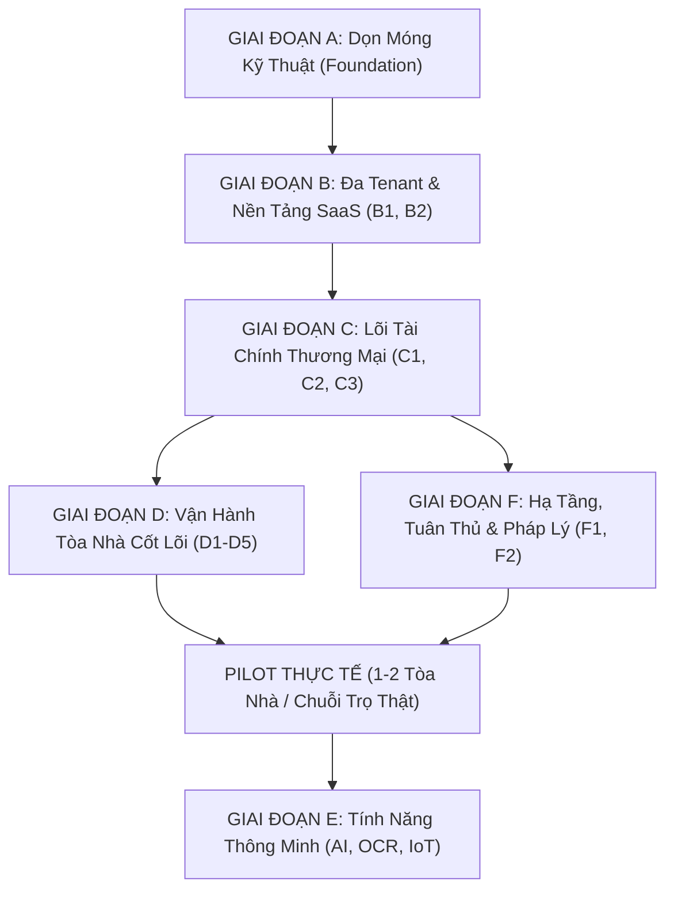

# Lộ Trình Phát Triển Sản Phẩm Thương Mại PKA-Home (Commercial Roadmap)

> **Mô hình kinh doanh:** B2B SaaS đa tenant dành cho (a) Các công ty quản lý vận hành chung cư, (b) Ban quản trị tòa nhà tự quản, (c) Chuỗi nhà trọ / căn hộ dịch vụ cho thuê chuyên nghiệp. Cư dân và khách thuê sử dụng ứng dụng di động miễn phí.

---

## PHẦN 1: Nguyên Tắc Định Hướng Sản Phẩm

### 3 Trụ Cột Giá Trị Cốt Lõi (Value Propositions để bán được):
1. **Thu phí đúng, đủ, nhanh:** Giảm tỷ lệ nợ đọng là lợi tức đầu tư (ROI) dễ chứng minh nhất đối với Ban Quản Lý và Chủ tòa nhà.
2. **Minh bạch:** Cư dân và khách thuê thấy rõ tiền của mình đi đâu (biên lai điện tử, quỹ bảo trì), sự cố kỹ thuật được xử lý tới đâu (timeline minh bạch).
3. **Giảm việc thủ công cho BQL:** Hóa đơn tự động, nhắc nợ thông minh đa tầng, sổ sách và đối soát ngân hàng tự động.

### Phạm Vi Pháp Lý Việt Nam Bắt Buộc Tuân Thủ:
- **Nghị định 13/2023/NĐ-CP:** Bảo vệ dữ liệu cá nhân (CCCD, SĐT, tài khoản ngân hàng).
- **Luật Nhà ở 2023:** Quản lý Quỹ bảo trì 2% tách biệt tài khoản, công bố thu chi, hội nghị nhà chung cư online.
- **Nghị định 123/2020/NĐ-CP:** Quy chuẩn hóa đơn điện tử và chứng từ thu chi.
- **Quy định PCCC:** Quản lý an toàn phòng cháy chữa cháy, thông báo khẩn cấp và bảo trì thiết bị định kỳ.

---

## PHẦN 2: Lộ Trình Triển Khai Theo Giai Đoạn

---

### GIAI ĐOẠN A: Dọn Móng Kỹ Thuật (Foundation Hardening)
- [x] **A1. Hợp nhất Database:** Rút gọn còn 8 migration chuẩn tiến lên (từ `20261027_01` đến `20261028_03`). Mỗi RPC có một định nghĩa duy nhất.
- [ ] **A2. Hợp đồng Client ↔ Server chặt chẽ:** DTO có kiểu strongly-typed, contract test cho mọi RPC, loại bỏ `Map<String, dynamic>` lỏng lẻo.
- [x] **A3. Bảng cấu hình tiền tệ:** `building_fee_configs` theo thời gian, chống hardcode giá.
- [ ] **A4. Bảo mật nền:** Xoay key, thống nhất bucket private + signed URL ngắn hạn, rate limit đăng nhập/OTP, MFA cho BQL/Kế toán.
- [x] **A5. Chất lượng:** 489 tests tự động, RLS security test, Static Analysis 0 issues.

---

### GIAI ĐOẠN B: Đa Tenant & Nền Tảng SaaS
- [x] **B1. Mô hình dữ liệu:** `organizations`, `buildings`, `apartments`. Thêm bảng `memberships` để 1 user có thể thuộc nhiều tòa/cơ sở với vai trò khác nhau.
- [x] **B2. Onboarding khách hàng:** Bộ công cụ import hàng loạt căn hộ/cư dân/chỉ số điện nước từ Excel kèm validation và báo lỗi từng dòng.
- [x] **B3. Gói dịch vụ & Billing cho khách:** Định giá theo quy mô số căn hộ (dưới 100 / 100–500 / trên 500 căn).
- [x] **B4. Dashboard Web Quản Trị & Trạm Làm Việc Kế Toán:**
  - Bố cục Adaptive Navigation Layout (`AdaptiveManagementScaffold`): Tự động chuyển đổi mượt mà giữa NavigationBar trên thiết bị di động (< 900dp) và Sidebar cố định bên trái (250dp) với nhận diện vai trò Ban Quản Lý trên màn hình máy tính / Web (≥ 900dp).
  - Trạm làm việc Kế toán bảng lớn (`AccountingWebWorkstationScreen`):
    - Dải KPI thời gian thực: Tổng phát hành, Thực thu (kèm tỷ lệ thu hồi %), Chờ thu trong hạn, Nợ quá hạn.
    - Bộ lọc tức thời: Tìm kiếm đa năng (mã căn hộ chuẩn, tên cư dân, mã VietQR), lọc theo kỳ thu (`YYYY-MM`) và trạng thái hóa đơn.
    - Bảng dữ liệu đối soát lớn cuộn 2 chiều: Đầy đủ căn hộ, kỳ thu, tổng tiền, mã VietQR, hạn nộp, ngày thu, chip trạng thái màu ngữ nghĩa tiếng Việt.
    - Thanh công cụ thao tác hàng loạt (Bulk Actions): Chọn nhiều dòng hóa đơn để đôn đốc gửi nhắc nợ tập trung một chạm hoặc hủy chọn.
    - Công cụ xuất Excel (CSV có UTF-8 BOM chuẩn) mở trực tiếp trên Excel tiếng Việt không lỗi font.
  - Tích hợp liền mạch: Route `/management/accounting-workstation`, tab "Đối soát" trên thanh điều hướng và lối tắt thao tác nhanh "Bàn kế toán" tại Dashboard BQL.

---

### GIAI ĐOẠN C: Lõi Tài Chính Đạt Chuẩn Thương Mại (Trọng Tâm Bán Hàng)
- [x] **C1. Sổ cái kế toán thật (`ledger_entries`):**
  - Bút toán sổ chi tiết công nợ từng căn hộ Append-Only (`apartment_ledger_entries`), tự động tính `balance_after` tức thời (DEBIT phát sinh, CREDIT thu tiền, CREDIT_NOTE giảm nợ, DEBIT_NOTE truy thu, REFUND hoàn tiền).
  - Phiếu điều chỉnh công nợ chính quy (`credit_notes` mã `CN-YYYYMM-XXXXX`) có căn cứ kiểm toán thay vì sửa đè hóa đơn.
  - Hóa đơn đã phát hành/thanh toán hoặc trong kỳ kế toán đã đóng mang tính bất biến (Trigger DB `trg_enforce_invoice_immutability` chặn sửa `total_amount` và chặn `DELETE`).
  - Chốt kỳ kế toán (`accounting_periods` & RPC `close_accounting_period`), khóa sổ mọi thay đổi dữ liệu cũ.
  - Chuẩn hóa 100% hiển thị thời gian (`dd/MM/yyyy HH:mm`), kỳ kế toán (`Tháng MM/yyyy`) và tiền tệ (`#,##0 đ`) cho người Việt.
  - UI `ApartmentLedgerScreen` (BQL) xem thẻ số dư, danh sách bút toán, lập phiếu điều chỉnh; UI `ResidentLedgerHistorySheet` (Cư dân) tra cứu minh bạch lịch sử đối soát công nợ.
- [x] **C2. Engine tính phí đa dạng:**
  - Bảng chính sách `fee_tier_policies` với RLS bảo mật & RPCs tính toán chính xác trên Supabase/PostgreSQL.
  - Điện sinh hoạt EVN 6 bậc lũy tiến chuẩn Quyết định Bộ Công Thương (1.893 đ -> 3.302 đ/kWh), tự động phân bổ sản lượng theo từng nấc thang.
  - Nước sinh hoạt theo định mức nhân khẩu (4 m³/người/tháng, nấc trong định mức 8.500 đ, vượt định mức đến 1.5x giá 12.000 đ, vượt trên 1.5x giá 18.000 đ).
  - Phân bổ phí gửi xe pro-rata theo ngày lẻ khi đăng ký giữa kỳ dựa trên số ngày thực tế trong tháng (`days_used / days_in_month`).
  - Lãi phạt trễ hạn tự động (0.05%/ngày tương đương 18.25%/năm) sau 3 ngày ân hạn theo quy chế quản lý vận hành.
  - Data model Dart (`FeeTierPolicyModel`, `TieredCalculationResultModel`) & Helper tính toán offline fallback `UtilityFeeCalculator` đảm bảo hoạt động liên tục ngay cả khi mất kết nối mạng.
  - UI Cư dân: Hộp thoại `TieredFeeBreakdownDialog` phân rã chi tiết bậc thang điện/nước trực quan kèm thanh phân bổ %, chip nhận diện phí xe theo ngày lẻ pro-rata, banner cảnh báo và tính toán lãi phạt trễ hạn tức thời trên thẻ hóa đơn.
  - UI Ban Quản Lý: Màn hình `FeePolicyManagementScreen` quản lý danh mục biểu phí đa dạng và `QuickFeeCalculatorSheet` mô phỏng/tính nhanh 4 loại biểu phí tương tác trực tiếp.
- [x] **C3. Thanh toán trực tuyến thật:**
  - Tích hợp VietQR động (chuẩn Napas 247) theo từng hóa đơn với `payment_code` ngắn gọn duy nhất (`INVYYMMxxxxxx`).
  - Webhook tự động gạch nợ `process_bank_payment_webhook(p_payload JSONB)` (Idempotency key, khóa bản ghi `FOR UPDATE`, xử lý nộp thừa/thiếu/trùng).
  - Tự động gạch nợ `status = 'paid'`, cấp biên lai điện tử, kích hoạt nhật ký kiểm toán bất biến và bắn thông báo tức thời tới cư dân.
  - UI `UnifiedPaymentSheet` & `ResidentInvoiceDetailScreen`: Realtime listener tự động chuyển sang biên lai thành công khi nhận được webhook, nút sao chép STK/Nội dung/Số tiền.
- [x] **C4. Hóa đơn điện tử & Chứng từ:**
  - CSDL & RPC: Cột `lookup_code` duy nhất cho mọi hóa đơn/biên lai (`INV-YYYYMM-XXXXX`), trigger tự động sinh mã và RPC `verify_document_lookup` tra cứu an toàn trực tuyến.
  - Bộ máy PDF vector `DocumentPdfBuilder` (chuẩn `pdf` & `printing`), nhúng font Unicode tiếng Việt Google Fonts với cơ chế fallback tự động thích ứng.
  - Hỗ trợ 3 mẫu chứng từ xuất xưởng:
    1. Hóa đơn dịch vụ A4 (bảng phí chi tiết, phân rã bậc thang, tổng tiền bằng số & bằng chữ tiếng Việt, mã VietQR nộp tiền hoặc mã QR tra cứu).
    2. Biên lai thu tiền điện tử A4 (thông tin đối soát ngân hàng, mã giao dịch, thời gian thu tiền `dd/MM/yyyy HH:mm:ss`, con dấu mộc số điện tử đỏ vector *"ĐÃ THU TIỀN"* của Ban Quản Lý).
    3. Phiếu in nhiệt cuộn 80mm (Thermal POS Roll) cho máy in hóa đơn quầy thu ngân / lễ tân.
  - Tiện ích `VietnameseCurrencyTextFormatter` đọc chính xác số tiền thành chữ tiếng Việt chuẩn mực.
  - Giao diện: Màn hình xem trước `DocumentPreviewScreen` (in trực tiếp qua AirPrint/Wifi/Bluetooth, lưu file PDF, chia sẻ qua Zalo/Email), màn hình tra cứu đối soát công khai `DocumentLookupScreen`, tích hợp nút xuất PDF trên cả màn hình cư dân và ban quản lý.
- [x] **C5. Quỹ bảo trì 2%:** Bảng sổ cái `maintenance_fund_ledger` tách biệt với quỹ vận hành, theo dõi lãi ngân hàng và giải ngân sửa chữa lớn.
- [x] **C6. Báo cáo tài chính & Tuổi nợ:**
  - CSDL & RPC: RPC PostgreSQL `get_financial_aging_report(p_building_id, p_period)` gom nhóm và tính toán tức thời 4 xô tuổi nợ (`0-30 ngày`, `31-60 ngày`, `61-90 ngày`, `>90 ngày`), tỷ lệ thu hồi phân bổ theo Block, và danh sách căn hộ nợ đọng có rủi ro cao nhất kèm số ngày quá hạn và tiền nợ.
  - Tầng Dữ liệu: Data models strongly-typed (`FinancialAgingReportModel`, `DebtAgingBucketModel`, `DebtorApartmentModel`, `BlockCollectionRateModel`), `AccountingRepository` tích hợp cơ chế tính toán offline fallback tự động, Provider `financialAgingReportProvider` hỗ trợ lọc theo kỳ thu và xô nợ.
  - Xuất dữ liệu Excel: Mở rộng `ExcelExportHelper.exportAgingReport` tạo file `.xlsx` gồm 2 trang tính (Sheet 1: Tổng quan KPI & Phân tích 4 xô tuổi nợ; Sheet 2: Danh sách chi tiết con nợ phục vụ đối soát, kiểm toán và báo cáo Ban Quản Trị).
  - Giao diện Ban Quản Lý: Màn hình quản trị `FinancialReportScreen` (4 thẻ KPI dòng tiền, thanh đo tỷ lệ thu hồi %, bộ lọc chip xô nợ tương tác trực tiếp, danh sách căn hộ nợ đọng có nút "Nhắc nợ nhanh" và liên kết điều hướng sang Sổ cái căn hộ `ApartmentLedgerScreen`).

---

### GIAI ĐOẠN D: Vận Hành Tòa Nhà Cốt Lõi (Core Operations)
- [x] **D1. Cư dân & Hợp đồng:**
  - CSDL & Migration: Bổ sung các trường quản lý hợp đồng thuê (`start_date`, `end_date`, `deposit_amount`, `contract_number`, `status`, `termination_date`, `handover_notes`) vào bảng `residents_apartments`; tạo bảng mã mời `apartment_invitations` có cơ chế tự hủy hết hạn (`expires_at`, `max_uses`, `used_count`).
  - RPCs PostgreSQL bảo mật: `create_apartment_invitation`, `accept_apartment_invitation` (kích hoạt cư dân/khách thuê tự phục vụ vào căn hộ), và `terminate_resident_stay` (kết thúc lưu trú có lưu vết vĩnh viễn, bảo toàn lịch sử công nợ).
  - Tầng dữ liệu & Provider: Models `ResidentLeaseContractModel`, `ApartmentInvitationModel`; Repository `ResidentLifecycleRepository` tích hợp cơ chế offline fallback engine, Provider `apartmentContractsProvider` và `apartmentInvitationsProvider`.
  - Giao diện Ban Quản Lý:
    - Hộp thoại tạo mã mời `CreateApartmentInvitationSheet`: Sinh mã QR đồ họa, mã chữ 8 ký tự, cấu hình thời hạn hiệu lực (24h/48h/72h/7 ngày) và vai trò được mời (chủ hộ / thành viên / khách thuê).
    - Bảng quản lý hợp đồng `ApartmentContractSheet`: Xem danh sách cư dân hiện tại/lịch sử lưu trú, số hợp đồng, tiền cọc đã giữ, nút xác nhận kết thúc lưu trú kèm biên bản ghi chú bàn giao & hoàn cọc.
  - Giao diện Cư Dân:
    - Hộp thoại `AcceptInvitationDialog`: Nhập mã mời tự phục vụ (hoặc quét QR) kích hoạt tức thời quyền truy cập căn hộ không cần chờ duyệt thủ công.
  - Tích hợp luồng nghiệp vụ:
    - Màn hình Quản lý Căn hộ (`ApartmentManagementScreen`): Nút "Mã mời" và "Hợp đồng & Lưu trú" trực tiếp trong modal chi tiết căn hộ.
    - Màn hình Cư dân xin liên kết (`LinkRequestScreen`): Nút "Gia nhập bằng mã mời (Tự phục vụ)" mở hộp thoại kích hoạt một chạm.
    - Resident 360 (`Resident360DetailSheet`): Lối tắt "Xem hợp đồng & lưu trú" tra cứu nhanh tình trạng hợp đồng và tiền cọc từng căn hộ liên kết.
- [x] **D2. Phương tiện & Bãi xe (Parking Operations):**
  - CSDL & Migration:
    - Bảng `parking_slots` quản lý ô đỗ hầm theo Zone (`B1`, `B2`), phân loại ô tô/xe máy, gắn căn hộ và biển số xe cố định.
    - Bảng vé xe vãng lai `visitor_parking_tickets` mã `TKT-YYYYMM-XXXXX` kèm chuỗi `qr_payload` vector và lưu vết thời gian check-in/check-out.
    - RPCs PostgreSQL: `get_parking_capacity_stats` (thống kê sức chứa hầm thời gian thực: tổng ô, đã đỗ, còn trống cho ô tô/xe máy/khách), `calculate_visitor_parking_fee` (tính cước đỗ xe theo giờ lũy tiến & phụ thu qua đêm), `checkout_visitor_ticket` (chuyển trạng thái hoàn tất, ghi nhận phương thức thanh toán VietQR/tiền mặt).
  - Tầng Dữ liệu & Provider:
    - Models strongly-typed: `ParkingSlotModel`, `VisitorParkingTicketModel`, `ParkingCapacityStatsModel`.
    - `ParkingRepository` tích hợp engine offline-fallback tự động mô phỏng 50 ô đỗ mẫu tầng B1/B2 và các vé xe vãng lai hoạt động độc lập ngay cả khi mất mạng.
    - Providers: `parkingSlotsProvider`, `parkingCapacityStatsProvider`, `activeVisitorTicketsProvider`.
  - Giao diện Ban Quản Lý & Bảo Vệ (`ParkingManagementScreen`):
    - Dải KPI sức chứa thời gian thực: Ô tô hầm, Xe máy hầm, Xe vãng lai trong bãi.
    - Tab 1 - Sơ đồ Ô đỗ (Floor Plan): Grid trực quan các ô B1/B2, chip trạng thái Còn trống / Đã đỗ / Bảo trì, thao tác "Gán xe" cho căn hộ và "Giải phóng" ô đỗ một chạm.
    - Tab 2 - Trạm soát vé cổng (Gate Workstation): Check-in xe vào tạo vé và hiển thị mã QR vé, Check-out xe ra tự động tính cước theo giờ, tích hợp mã VietQR Napas 247 cho khách quét trả tiền tức thời.
  - Tích hợp luồng Cư dân:
    - Màn hình Phương tiện cư dân (`VehicleManagementScreen`): Tự động nhận diện và hiển thị huy hiệu vị trí ô đỗ cố định dưới hầm (VD: `Vị trí ô đỗ: P-B1-01 (Tầng B1)`).
    - Lối tắt điều hướng "Bãi xe" trực tiếp từ Dashboard BQL và Menu "Tất cả thao tác quản trị".
- [x] **D3. Sự cố Kỹ Thuật, Cảnh Báo SLA Đa Tầng, Phân Công Chuyên Môn & Quản Lý Vật Tư Tiêu Hao:**
  - Cơ sở dữ liệu & Business Triggers (`20261102_02_issue_sla_and_materials.sql`):
    - Cột SLA và phân loại chuyên môn (`category`: điện, nước, thang máy, PCCC, xây dựng, khác) trên `issue_reports`.
    - Trigger `trg_calculate_issue_sla_deadline` tự động ấn định hạn chót xử lý theo mức độ khẩn cấp (Khẩn cấp: 2h, Cao: 8h, Bình thường: 24h, Thấp: 72h).
    - Danh mục kho vật tư kỹ thuật `maintenance_materials` (đơn vị tính, tồn kho, định mức tối thiểu, đơn giá xuất kho).
    - Bảng nhật ký sử dụng vật tư `issue_materials` liên kết trực tiếp với sự cố và cờ `is_chargeable` (tính phí căn hộ hoặc tòa nhà đài thọ).
    - 3 RPCs PostgreSQL: `get_issue_sla_stats` (KPI SLA thời gian thực), `record_issue_materials_usage` (tự động trừ tồn kho và ghi nhật ký), `charge_issue_materials_to_invoice` (kết chuyển chi phí vật tư vào hóa đơn kế tiếp).
  - Tầng Dữ Liệu & Fallback Engine:
    - 3 Data models Dart: `MaintenanceMaterialModel`, `IssueMaterialUsageModel`, `IssueSlaStatsModel` và mở rộng `IssueModel` với các getters SLA động (`isSlaBreached`, `isSlaWarning`, `slaRemainingFormatted`, `categoryDisplayName`).
    - `MaterialRepository` tích hợp Offline Fallback Engine 10 vật tư thiết yếu và tính toán SLA fallback mượt mà khi mất kết nối mạng.
  - Giao diện Ban Quản Lý:
    - Màn hình Xử lý sự cố (`IssueManagementScreen`): Dải KPI SLA thời gian thực (Đúng hạn, Sắp trễ <2h, Trễ SLA), chip Chuyên môn và đếm ngược SLA đổi màu ngữ nghĩa trên thẻ sự cố.
    - Hộp thoại nghiệm thu & xuất kho vật tư (`ResolveIssueMaterialsSheet`): Chọn vật tư tiêu hao từ kho, chỉnh số lượng, kiểm tra tồn kho, đánh dấu tính phí cư dân, bắt buộc chụp ảnh nghiệm thu hoàn thành.
    - Màn hình Quản lý kho vật tư kỹ thuật (`MaintenanceMaterialsScreen`): Danh mục vật tư theo chuyên môn, cảnh báo sắp hết hàng (< định mức an toàn) và hộp thoại nhập kho nhanh.
    - Lối tắt điều hướng "Kho vật tư" trên Dashboard BQL và menu "Tất cả thao tác quản trị".
  - Giao diện Cư Dân:
    - Màn hình Gửi phản ánh (`CreateIssueScreen`): Dropdown chọn chuyên môn sự cố và chọn mức độ khẩn cấp kèm banner cam kết thời gian SLA minh bạch.
    - Màn hình Chi tiết sự cố (`IssueDetailScreen`): Header hiển thị chip chuyên môn & đếm ngược SLA, dải thẻ đối soát vật tư kỹ thuật đã sử dụng (đơn giá, số lượng, thành tiền, ghi chú, tính phí căn hộ hay BQL bảo dưỡng, tổng tính vào hóa đơn kỳ tới).
- [x] **D4. Tiện ích & Waitlist FIFO:** Đặt chỗ, hàng đợi First-In-First-Out, tự hủy hoàn cọc và đôn người trong danh sách chờ.
- [x] **D5. Thông báo đa kênh & Triggers:** Triggers tự động hóa thông báo, CDC Realtime Stream đẩy Heads-up notification, quét nhắc nợ định kỳ.
- [x] **D6. An ninh & Khách (Visitor Access & Front-Desk Parcel Hub):**
  - Cơ sở dữ liệu & Migration (`20261103_01_visitor_and_parcel_hub.sql`):
    - Bảng `visitor_access_passes`: Mã vé `VP-YYYYMM-XXXXX`, mã QR payload bảo mật, thông tin khách (tên, SĐT, biển số xe, phương tiện), thời gian dự kiến đến/rời đi, trạng thái (`pending`, `checked_in`, `checked_out`, `cancelled`, `expired`).
    - Bảng `parcels`: Mã kiện `PCL-YYYYMM-XXXXX`, căn hộ, người nhận, hãng vận chuyển (SPX, GHTK, GHN, Viettel Post...), mã vận đơn, vị trí kệ lưu trữ, mã PIN nhận hàng 6 số ngẫu nhiên, trạng thái (`arrived`, `collected`, `returned`).
    - 4 RPCs PostgreSQL: `check_in_visitor_pass` (quét mã QR/nhập mã vé check-in), `check_out_visitor_pass` (ghi nhận khách rời đi), `collect_parcel` (đối soát mã PIN bảo mật 6 số và bàn giao cho cư dân), `get_front_desk_stats` (KPI sảnh lễ tân thời gian thực).
  - Tầng Dữ liệu & Fallback Engine:
    - 3 Data models Dart strongly-typed: `VisitorPassModel`, `ParcelModel`, `FrontDeskStatsModel` kèm logic kiểm tra lưu kho quá hạn (`isOverdueStorage > 3 ngày`).
    - `FrontDeskRepository` tích hợp Offline Fallback Engine với bộ dữ liệu mẫu đa dạng và các Riverpod providers: `frontDeskRepositoryProvider`, `visitorPassesProvider`, `parcelsProvider`, `residentVisitorPassesProvider`, `residentParcelsProvider`, `frontDeskStatsProvider`.
  - Giao diện Ban Quản Lý (`FrontDeskWorkstationScreen`):
    - Dải KPI sảnh thời gian thực: Khách dự kiến hôm nay, Khách đang trong tòa nhà, Kiện hàng chờ nhận, Kiện hàng lưu kho quá hạn (> 3 ngày cảnh báo đỏ).
    - Tab 1 - Quản lý Khách vào ra: Tìm kiếm đa năng (mã vé, họ tên khách, biển số, mã căn), lọc trạng thái, thao tác Quét QR / Check-in và Check-out trực tiếp.
    - Tab 2 - Trạm Bưu Kiện Lễ Tân: Danh sách kiện hàng tại sảnh, bộ lọc hãng vận chuyển & vị trí kệ, nút "Tiếp nhận kiện mới" (`ReceiveParcelSheet`) chọn căn hộ, hãng xe, mã vận đơn, vị trí kệ; nút "Bàn giao cho cư dân" (`HandoverParcelDialog`) bắt buộc đối soát mã PIN 6 số.
    - Lối tắt điều hướng "Lễ tân" trên Dashboard BQL và menu "Tất cả thao tác quản trị".
  - Giao diện Cư Dân (`ResidentVisitorParcelScreen`):
    - Tab 1 - Khách viếng thăm: Danh sách khách đã mời, nút "Đón khách mới" (`CreateVisitorPassSheet`), xem mã QR vé đồ họa khổ lớn (`VisitorPassQrSheet`) kèm nút sao chép mã vé để cư dân gửi qua Zalo/SMS cho người thân, bạn bè, shipper.
    - Tab 2 - Bưu kiện của tôi: Danh sách kiện hàng đã giao đến sảnh kèm vị trí kệ lưu trữ và **KHUNG MÃ PIN NHẬN HÀNG 6 SỐ NỔI BẬT** để cư dân đọc cho lễ tân nhận hàng.
    - Thẻ tiện ích "Đón khách & Bưu kiện" trên màn hình chính cư dân (`ResidentHomeScreen`).
  - Chất lượng & Kiểm thử:
    - 22/22 unit & integration tests tự động pass 100%.
    - Phân tích tĩnh `dart analyze` toàn bộ dự án đạt 0 issues.
    - Đồng bộ Knowledge Graph (8.881 nodes, 12.518 edges).
- [x] **D7. Biểu Quyết Điện Tử & Kiến Nghị Cộng Đồng (Digital Voting, AGM & Resident Petitions):**
  - Cơ sở dữ liệu & Migration (`20261103_02_digital_voting_and_petitions.sql`):
    - Bảng `polls`: Mã đợt `POLL-YYYYMM-XXXXX`, tiêu đề, mô tả, phân loại chuyên mục (Hội nghị chung cư, Tài chính, Bảo trì, Nội quy, Chung), hình thức tính quyền biểu quyết (`per_apartment` - "1 Căn hộ = 1 Phiếu", `by_area` - "Theo diện tích sở hữu m²" theo Điều 102 Luật Nhà ở 2023), hình thức lựa chọn (`single_choice`, `multiple_choice`, `yes_no_abstain`), tỷ lệ tham gia tối thiểu (`min_participation_rate`), tỷ lệ tán thành để thông qua (`required_approval_rate`), thời hạn bắt đầu/kết thúc.
    - Bảng `poll_options`: Danh sách các phương án biểu quyết, thứ tự hiển thị.
    - Bảng `poll_votes`: Phiếu bầu bất biến của từng căn hộ (`UNIQUE(poll_id, apartment_id)`), trọng số biểu quyết tính theo diện tích $m^2$ hoặc 1.0, trigger DB ngăn chặn sửa/xóa phiếu khi cuộc biểu quyết đã kết thúc.
    - Bảng `resident_petitions`: Mã kiến nghị `PET-YYYYMM-XXXXX`, tiêu đề, nội dung, phân loại (An ninh, Vệ sinh, Tiện ích, Tiếng ồn, Chung), số lượng căn hộ đồng thuận (`endorsement_count`), trạng thái (`pending`, `acknowledged`, `in_progress`, `resolved`, `rejected`), phản hồi chính thức của BQL (`official_response`).
    - Bảng `petition_endorsements`: Lượt bấm đồng thuận của các căn hộ (`UNIQUE(petition_id, apartment_id)`).
    - 4 RPCs PostgreSQL: `submit_poll_vote` (ghi nhận phiếu biểu quyết), `get_poll_results` (thống kê tỷ lệ tham gia %, tỷ lệ từng option %, kiểm tra đạt túc số theo luật), `endorse_petition` (ghi nhận căn hộ đồng thuận), `update_petition_response` (BQL phản hồi chính thức và cập nhật tiến độ).
  - Tầng Dữ liệu & Fallback Engine:
    - 3 Data models Dart strongly-typed: `PollModel`, `PollResultModel`, `PetitionModel`.
    - `CommunityRepository` tích hợp Offline Fallback Engine với bộ dữ liệu mẫu đa dạng và các Riverpod providers: `communityRepositoryProvider`, `pollsProvider`, `pollResultsProvider`, `petitionsProvider`, `communityStatsProvider`.
  - Giao diện Ban Quản Lý (`CommunityManagementScreen`):
    - Dải KPI cộng đồng thời gian thực: Biểu quyết đang mở, Tổng cuộc biểu quyết, Kiến nghị chờ xử lý, Kiến nghị đã giải quyết.
    - Tab 1 - Quản lý Biểu Quyết: Danh sách các cuộc biểu quyết, nút tạo biểu quyết mới (`CreatePollSheet`), xem báo cáo kết quả chi tiết từng phương án kèm thanh tiến trình % trực quan (`PollResultDialog`).
    - Tab 2 - Xử lý Kiến Nghị: Lọc trạng thái, xem nội dung kiến nghị và số lượng căn hộ ủng hộ, nút "Phản hồi & Xử lý" (`RespondPetitionDialog`) cập nhật phản hồi chính thức.
    - Lối tắt điều hướng "Cộng đồng" trên Dashboard BQL và menu "Tất cả thao tác quản trị".
  - Giao diện Cư Dân (`ResidentCommunityScreen`):
    - Tab 1 - Biểu quyết & Khảo sát: Danh sách các cuộc biểu quyết, tham gia bỏ phiếu điện tử (`VotePollSheet`), xem kết quả phân bổ % trực quan.
    - Tab 2 - Ý kiến & Kiến nghị: Danh sách kiến nghị của cộng đồng cư dân, nút bấm "Đồng thuận" (`👍 28 đồng thuận`), nút "Gửi kiến nghị mới" (`CreatePetitionSheet`).
    - Thẻ dịch vụ "Biểu quyết & Ý kiến" trên màn hình chính cư dân (`ResidentHomeScreen`).
  - Chất lượng & Kiểm thử:
    - 20/20 unit & integration tests tự động pass 100%.
    - Phân tích tĩnh `dart analyze` toàn bộ dự án đạt 0 issues.
    - Đồng bộ Knowledge Graph (9.167 nodes, 13.084 edges).
- [x] **D8. Phân quyền chi tiết & Ủy quyền vai trò:** Ủy quyền có thời hạn (`role_delegations`), RPC `get_effective_user_role` kiểm tra quyền động.

---

### GIAI ĐOẠN E: Tính Năng Thông Minh (AI, OCR & Tối Ưu)
- [x] **E1. OCR Đồng hồ điện nước thực tế & Cảnh báo bất thường:** Thuật toán OCR bóc tách công tơ điện cơ/điện tử & đồng hồ nước (`UtilityMeterOcrEngine`), tính điểm tin cậy OCR, engine phát hiện tiêu thụ bất thường (`UtilityAnomalyDetector`) gắn cờ chỉ số lùi, tăng vọt > 50% hoặc nhảy vọt cực đại > 2.5x so với mức trung bình kèm hộp thoại xác nhận và tab lọc bất thường cho Ban Quản Lý.
- [ ] **AI phân loại sự cố:** Phân tích mô tả sự cố để tự động gán kỹ thuật viên phù hợp.
- [ ] **Dự báo nợ xấu & Nhắc nợ thông minh:** Dự đoán căn hộ có rủi ro trễ hạn để BQL chủ động chăm sóc.

---

### GIAI ĐOẠN F: Hạ Tầng, Tuân Thủ & Vận Hành
- [ ] **Hạ tầng môi trường tách bạch:** Dev / Staging / Production. Giám sát uptime, cảnh báo lỗi qua Telegram/Slack.
- [x] **Tuân thủ pháp lý & Bảo mật:** Nhật ký kiểm toán bất biến (`audit_logs` Append-Only, tự động ghi log qua Triggers hóa đơn/thẻ xe/ủy quyền).
- [ ] **Offline-First & Resilience:** Hoàn thiện hàng đợi đồng bộ khi mất sóng.
