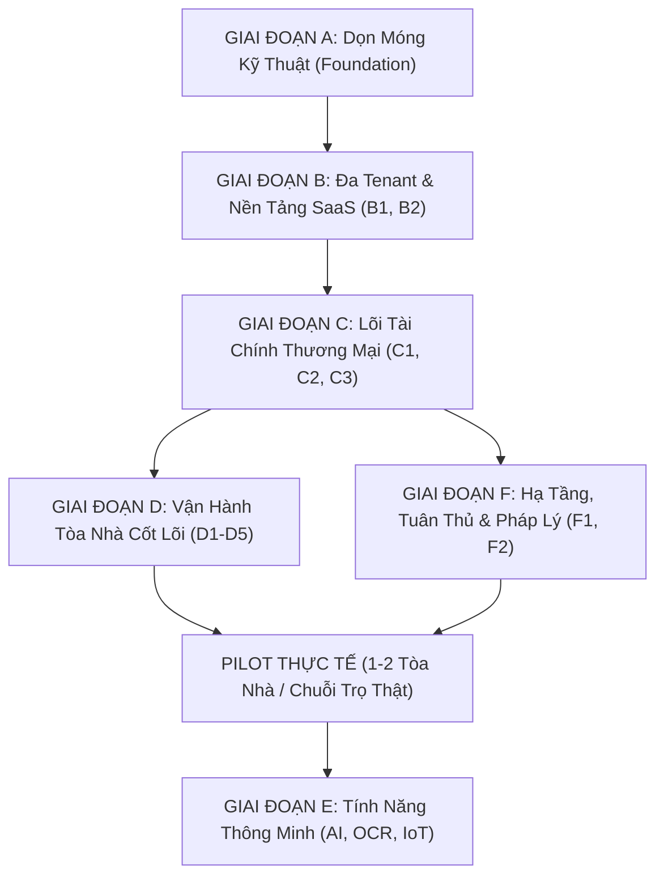

# Lộ Trình Phát Triển Sản Phẩm Thương Mại PKA-Home (Commercial Roadmap)

> **Mô hình kinh doanh:** B2B SaaS đa tenant dành cho (a) Các công ty quản lý vận hành chung cư, (b) Ban quản trị tòa nhà tự quản, (c) Chuỗi nhà trọ / căn hộ dịch vụ cho thuê chuyên nghiệp. Cư dân và khách thuê sử dụng ứng dụng di động miễn phí.

---

## PHẦN 1: Nguyên Tắc Định Hướng Sản Phẩm

### 3 Trụ Cột Giá Trị Cốt Lõi (Value Propositions để bán được):
1. **Thu phí đúng, đủ, nhanh:** Giảm tỷ lệ nợ đọng là lợi tức đầu tư (ROI) dễ chứng minh nhất đối với Ban Quản Lý và Chủ tòa nhà.
2. **Minh bạch:** Cư dân và khách thuê thấy rõ tiền của mình đi đâu (biên lai điện tử, quỹ bảo trì), sự cố kỹ thuật được xử lý tới đâu (timeline minh bạch).
3. **Giảm việc thủ công cho BQL:** Hóa đơn tự động, nhắc nợ thông minh đa tầng, sổ sách và đối soát ngân hàng tự động.

### Phạm Vi Pháp Lý Việt Nam Bắt Buộc Tuân Thủ:
- **Nghị định 13/2023/NĐ-CP:** Bảo vệ dữ liệu cá nhân (CCCD, SĐT, tài khoản ngân hàng).
- **Luật Nhà ở 2023:** Quản lý Quỹ bảo trì 2% tách biệt tài khoản, công bố thu chi, hội nghị nhà chung cư online.
- **Nghị định 123/2020/NĐ-CP:** Quy chuẩn hóa đơn điện tử và chứng từ thu chi.
- **Quy định PCCC:** Quản lý an toàn phòng cháy chữa cháy, thông báo khẩn cấp và bảo trì thiết bị định kỳ.

---

## PHẦN 2: Lộ Trình Triển Khai Theo Giai Đoạn

---

### GIAI ĐOẠN A: Dọn Móng Kỹ Thuật (Foundation Hardening)
- [x] **A1. Hợp nhất Database:** Rút gọn còn 8 migration chuẩn tiến lên (từ `20261027_01` đến `20261028_03`). Mỗi RPC có một định nghĩa duy nhất.
- [ ] **A2. Hợp đồng Client ↔ Server chặt chẽ:** DTO có kiểu strongly-typed, contract test cho mọi RPC, loại bỏ `Map<String, dynamic>` lỏng lẻo.
- [x] **A3. Bảng cấu hình tiền tệ:** `building_fee_configs` theo thời gian, chống hardcode giá.
- [ ] **A4. Bảo mật nền:** Xoay key, thống nhất bucket private + signed URL ngắn hạn, rate limit đăng nhập/OTP, MFA cho BQL/Kế toán.
- [x] **A5. Chất lượng:** 489 tests tự động, RLS security test, Static Analysis 0 issues.

---

### GIAI ĐOẠN B: Đa Tenant & Nền Tảng SaaS
- [x] **B1. Mô hình dữ liệu:** `organizations`, `buildings`, `apartments`. Thêm bảng `memberships` để 1 user có thể thuộc nhiều tòa/cơ sở với vai trò khác nhau.
- [ ] **B2. Onboarding khách hàng:** Bộ công cụ import hàng loạt căn hộ/cư dân/chỉ số điện nước từ Excel kèm validation và báo lỗi từng dòng.
- [ ] **B3. Gói dịch vụ & Billing cho khách:** Định giá theo quy mô số căn hộ (dưới 100 / 100–500 / trên 500 căn).
- [ ] **B4. Dashboard Web Quản Trị:** Giao diện web tối ưu cho kế toán và quản lý làm việc với bảng biểu lớn (đối soát, báo cáo, phát hành hóa đơn).

---

### GIAI ĐOẠN C: Lõi Tài Chính Đạt Chuẩn Thương Mại (Trọng Tâm Bán Hàng)
- [x] **C1. Sổ cái kế toán thật (`ledger_entries`):**
  - Bút toán sổ chi tiết công nợ từng căn hộ Append-Only (`apartment_ledger_entries`), tự động tính `balance_after` tức thời (DEBIT phát sinh, CREDIT thu tiền, CREDIT_NOTE giảm nợ, DEBIT_NOTE truy thu, REFUND hoàn tiền).
  - Phiếu điều chỉnh công nợ chính quy (`credit_notes` mã `CN-YYYYMM-XXXXX`) có căn cứ kiểm toán thay vì sửa đè hóa đơn.
  - Hóa đơn đã phát hành/thanh toán hoặc trong kỳ kế toán đã đóng mang tính bất biến (Trigger DB `trg_enforce_invoice_immutability` chặn sửa `total_amount` và chặn `DELETE`).
  - Chốt kỳ kế toán (`accounting_periods` & RPC `close_accounting_period`), khóa sổ mọi thay đổi dữ liệu cũ.
  - Chuẩn hóa 100% hiển thị thời gian (`dd/MM/yyyy HH:mm`), kỳ kế toán (`Tháng MM/yyyy`) và tiền tệ (`#,##0 đ`) cho người Việt.
  - UI `ApartmentLedgerScreen` (BQL) xem thẻ số dư, danh sách bút toán, lập phiếu điều chỉnh; UI `ResidentLedgerHistorySheet` (Cư dân) tra cứu minh bạch lịch sử đối soát công nợ.
- [x] **C2. Engine tính phí đa dạng:**
  - Bảng chính sách `fee_tier_policies` với RLS bảo mật & RPCs tính toán chính xác trên Supabase/PostgreSQL.
  - Điện sinh hoạt EVN 6 bậc lũy tiến chuẩn Quyết định Bộ Công Thương (1.893 đ -> 3.302 đ/kWh), tự động phân bổ sản lượng theo từng nấc thang.
  - Nước sinh hoạt theo định mức nhân khẩu (4 m³/người/tháng, nấc trong định mức 8.500 đ, vượt định mức đến 1.5x giá 12.000 đ, vượt trên 1.5x giá 18.000 đ).
  - Phân bổ phí gửi xe pro-rata theo ngày lẻ khi đăng ký giữa kỳ dựa trên số ngày thực tế trong tháng (`days_used / days_in_month`).
  - Lãi phạt trễ hạn tự động (0.05%/ngày tương đương 18.25%/năm) sau 3 ngày ân hạn theo quy chế quản lý vận hành.
  - Data model Dart (`FeeTierPolicyModel`, `TieredCalculationResultModel`) & Helper tính toán offline fallback `UtilityFeeCalculator` đảm bảo hoạt động liên tục ngay cả khi mất kết nối mạng.
  - UI Cư dân: Hộp thoại `TieredFeeBreakdownDialog` phân rã chi tiết bậc thang điện/nước trực quan kèm thanh phân bổ %, chip nhận diện phí xe theo ngày lẻ pro-rata, banner cảnh báo và tính toán lãi phạt trễ hạn tức thời trên thẻ hóa đơn.
  - UI Ban Quản Lý: Màn hình `FeePolicyManagementScreen` quản lý danh mục biểu phí đa dạng và `QuickFeeCalculatorSheet` mô phỏng/tính nhanh 4 loại biểu phí tương tác trực tiếp.
- [x] **C3. Thanh toán trực tuyến thật:**
  - Tích hợp VietQR động (chuẩn Napas 247) theo từng hóa đơn với `payment_code` ngắn gọn duy nhất (`INVYYMMxxxxxx`).
  - Webhook tự động gạch nợ `process_bank_payment_webhook(p_payload JSONB)` (Idempotency key, khóa bản ghi `FOR UPDATE`, xử lý nộp thừa/thiếu/trùng).
  - Tự động gạch nợ `status = 'paid'`, cấp biên lai điện tử, kích hoạt nhật ký kiểm toán bất biến và bắn thông báo tức thời tới cư dân.
  - UI `UnifiedPaymentSheet` & `ResidentInvoiceDetailScreen`: Realtime listener tự động chuyển sang biên lai thành công khi nhận được webhook, nút sao chép STK/Nội dung/Số tiền.
- [x] **C4. Hóa đơn điện tử & Chứng từ:**
  - CSDL & RPC: Cột `lookup_code` duy nhất cho mọi hóa đơn/biên lai (`INV-YYYYMM-XXXXX`), trigger tự động sinh mã và RPC `verify_document_lookup` tra cứu an toàn trực tuyến.
  - Bộ máy PDF vector `DocumentPdfBuilder` (chuẩn `pdf` & `printing`), nhúng font Unicode tiếng Việt Google Fonts với cơ chế fallback tự động thích ứng.
  - Hỗ trợ 3 mẫu chứng từ xuất xưởng:
    1. Hóa đơn dịch vụ A4 (bảng phí chi tiết, phân rã bậc thang, tổng tiền bằng số & bằng chữ tiếng Việt, mã VietQR nộp tiền hoặc mã QR tra cứu).
    2. Biên lai thu tiền điện tử A4 (thông tin đối soát ngân hàng, mã giao dịch, thời gian thu tiền `dd/MM/yyyy HH:mm:ss`, con dấu mộc số điện tử đỏ vector *"ĐÃ THU TIỀN"* của Ban Quản Lý).
    3. Phiếu in nhiệt cuộn 80mm (Thermal POS Roll) cho máy in hóa đơn quầy thu ngân / lễ tân.
  - Tiện ích `VietnameseCurrencyTextFormatter` đọc chính xác số tiền thành chữ tiếng Việt chuẩn mực.
  - Giao diện: Màn hình xem trước `DocumentPreviewScreen` (in trực tiếp qua AirPrint/Wifi/Bluetooth, lưu file PDF, chia sẻ qua Zalo/Email), màn hình tra cứu đối soát công khai `DocumentLookupScreen`, tích hợp nút xuất PDF trên cả màn hình cư dân và ban quản lý.
- [x] **C5. Quỹ bảo trì 2%:** Bảng sổ cái `maintenance_fund_ledger` tách biệt với quỹ vận hành, theo dõi lãi ngân hàng và giải ngân sửa chữa lớn.
- [ ] **C6. Báo cáo tài chính & Tuổi nợ:** Báo cáo dòng tiền, tuổi nợ aging (30/60/90 ngày), tỷ lệ thu theo kỳ/tòa/tầng.

---

### GIAI ĐOẠN D: Vận Hành Tòa Nhà Cốt Lõi (Core Operations)
- [ ] **D1. Cư dân & Hợp đồng:** Quản lý hợp đồng thuê (ngày bắt đầu, kết thúc, cọc giữ chỗ), mời thành viên qua link/QR.
- [ ] **D2. Phương tiện & Bãi xe:** Quản lý slot hầm, xe vãng lai tính phí theo giờ.
- [ ] **D3. Sự cố & SLA:** Cảnh báo quá hạn xử lý sự cố (SLA), phân công theo ca trực/chuyên môn, vật tư tiêu hao.
- [x] **D4. Tiện ích & Waitlist FIFO:** Đặt chỗ, hàng đợi First-In-First-Out, tự hủy hoàn cọc và đôn người trong danh sách chờ.
- [x] **D5. Thông báo đa kênh & Triggers:** Triggers tự động hóa thông báo, CDC Realtime Stream đẩy Heads-up notification, quét nhắc nợ định kỳ.
- [ ] **D6. An ninh & Khách:** Đăng ký khách trước (mã QR), quản lý bưu kiện tại quầy lễ tân.
- [ ] **D7. Biểu quyết & Cộng đồng:** Khảo sát online, kiến nghị cư dân.
- [x] **D8. Phân quyền chi tiết & Ủy quyền vai trò:** Ủy quyền có thời hạn (`role_delegations`), RPC `get_effective_user_role` kiểm tra quyền động.

---

### GIAI ĐOẠN E: Tính Năng Thông Minh (AI, OCR & Tối Ưu)
- [ ] **OCR đồng hồ điện nước thực tế:** Tích hợp ML Kit on-device, nhận diện số công tơ cơ, phát hiện số tiêu thụ bất thường.
- [ ] **AI phân loại sự cố:** Phân tích mô tả sự cố để tự động gán kỹ thuật viên phù hợp.
- [ ] **Dự báo nợ xấu & Nhắc nợ thông minh:** Dự đoán căn hộ có rủi ro trễ hạn để BQL chủ động chăm sóc.

---

### GIAI ĐOẠN F: Hạ Tầng, Tuân Thủ & Vận Hành
- [ ] **Hạ tầng môi trường tách bạch:** Dev / Staging / Production. Giám sát uptime, cảnh báo lỗi qua Telegram/Slack.
- [x] **Tuân thủ pháp lý & Bảo mật:** Nhật ký kiểm toán bất biến (`audit_logs` Append-Only, tự động ghi log qua Triggers hóa đơn/thẻ xe/ủy quyền).
- [ ] **Offline-First & Resilience:** Hoàn thiện hàng đợi đồng bộ khi mất sóng.
