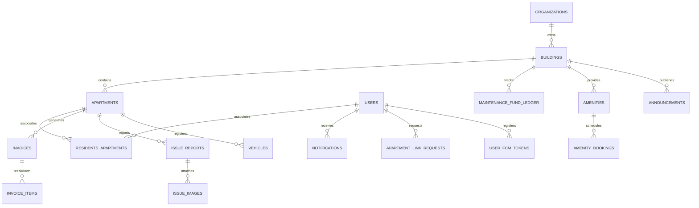

# Đặc Tả Cơ Sở Dữ Liệu PKA-Home (Database Schema)

> **Hệ quản trị CSDL:** PostgreSQL 15+ trên nền tảng Supabase  
> **Cơ chế bảo vệ dữ liệu:** Row Level Security (RLS) bắt buộc trên 100% các bảng  
> **Tính toàn vẹn dữ liệu:** Foreign Keys với Cascade Rules, Generated Columns, Check Constraints, PostgreSQL Triggers.

---

## 1. Sơ Đồ Thực Thể Quan Hệ Tổng Thể (ERD Overview)

Hệ thống quản lý dữ liệu xoay quanh mô hình Đa Cơ Sở (Multi-Tenancy):
- **Tổ chức (`organizations`)** sở hữu nhiều **Cơ sở / Tòa nhà (`buildings`)**.
- Mỗi cơ sở (`buildings`) chứa nhiều **Căn hộ / Phòng trọ (`apartments`)**.
- Người dùng (`users`) gắn kết với Căn hộ thông qua bảng trung gian quan hệ (`residents_apartments`).
- Toàn bộ các thực thể tài chính, sự cố, thông báo, tiện ích đều tham chiếu trực tiếp đến `building_id` và `apartment_id`.

---

## 2. Danh Mục 16 Bảng Dữ Liệu Cốt Lõi

### 2.1. Phân Hệ Tổ Chức, Cơ Sở & Căn Hộ
1. **`public.organizations`**: Quản lý thông tin công ty vận hành / chuỗi quản lý bất động sản.
   - Cột: `id (UUID PK)`, `name (TEXT)`, `code (VARCHAR 50 UNIQUE)`, `created_at`, `updated_at`.
2. **`public.buildings`**: Quản lý từng tòa nhà chung cư hoặc từng cơ sở nhà trọ cụ thể.
   - Cột: `id (UUID PK)`, `organization_id (UUID FK)`, `name (TEXT)`, `code (VARCHAR 20)`, `address (TEXT)`, `property_type (VARCHAR 30: 'apartment_building' | 'boarding_house' | 'serviced_apartment')`, `bank_account_number (TEXT)`, `bank_account_name (TEXT)`, `bank_name (TEXT)`, `created_at`, `updated_at`.
3. **`public.apartments`**: Danh mục căn hộ hoặc phòng trọ độc lập.
   - Cột: `id (UUID PK)`, `building_id (UUID FK)`, `code (VARCHAR 20)` *(VD: 'A0110', 'P101', 'Phòng 3')*, `area (NUMERIC 10,2)`, `is_empty (BOOLEAN)`, `rent_price (NUMERIC 15,2)`, `deposit_amount (NUMERIC 15,2)`, `max_occupants (INT)`, `created_at`, `updated_at`.
4. **`public.users`**: Thông tin người dùng đồng bộ từ Supabase Auth.
   - Cột: `id (UUID PK)`, `organization_id (UUID FK)`, `full_name (TEXT)`, `phone (VARCHAR 20)`, `role (VARCHAR 30: 'resident' | 'management' | 'admin' | 'accountant' | 'technician')`, `avatar_url (TEXT)`, `created_at`, `updated_at`.
5. **`public.residents_apartments`**: Quan hệ sở hữu hoặc cư trú giữa người dùng và căn hộ.
   - Cột: `id (UUID PK)`, `user_id (UUID FK)`, `apartment_id (UUID FK)`, `relation_role (VARCHAR 30: 'owner' | 'tenant' | 'family_member')`, `created_at`.
6. **`public.apartment_link_requests`**: Phiếu yêu cầu gia nhập căn hộ/phòng trọ của người dùng mới.
   - Cột: `id (UUID PK)`, `user_id (UUID FK)`, `apartment_id (UUID FK)`, `requested_relation_role (VARCHAR 30)`, `status (VARCHAR 20: 'pending' | 'approved' | 'rejected')`, `rejection_reason (TEXT)`, `created_at`, `updated_at`.

---

### 2.2. Phân Hệ Tài Chính, Hóa Đơn & Quỹ Bảo Trì
7. **`public.invoices`**: Hóa đơn thu phí tổng hợp theo kỳ.
   - Cột: `id (UUID PK)`, `building_id (UUID FK)`, `apartment_id (UUID FK)`, `period (DATE)`, `due_date (DATE)`, `total_amount (NUMERIC 15,2)`, `status (public.invoice_status: 'unpaid' | 'pending_confirmation' | 'paid')`, `payment_method (VARCHAR 30)`, `payment_reference (TEXT)`, `paid_at (TIMESTAMPTZ)`, `confirmed_by (UUID FK)`, `notes (TEXT)`, `created_at`, `updated_at`.
8. **`public.invoice_items`**: Chi tiết phân rã các khoản phí trong từng hóa đơn.
   - Cột: `id (UUID PK)`, `invoice_id (UUID FK)`, `fee_type (VARCHAR 50: 'rent' | 'electricity' | 'water' | 'management' | 'parking' | 'maintenance_fund')`, `unit_price (NUMERIC 15,2)`, `quantity (NUMERIC 10,2)`, `subtotal (NUMERIC 15,2 GENERATED ALWAYS AS (unit_price * quantity) STORED)`, `description (TEXT)`.
   > **An toàn dữ liệu tài chính:** Cột `subtotal` là **PostgreSQL Generated Column**, tuyệt đối không tính từ client, loại bỏ hoàn toàn rủi ro sai lệch dữ liệu tài chính.
9. **`public.building_fee_configs`**: Cấu hình biểu phí động cho từng cơ sở/tòa nhà.
   - Cột: `id (UUID PK)`, `building_id (UUID FK)`, `fee_type (VARCHAR 50)`, `unit_price (NUMERIC 15,2)`, `calculation_type (VARCHAR 30: 'fixed' | 'per_sqm' | 'per_head' | 'meter_reading')`, `is_active (BOOLEAN)`.
10. **`public.maintenance_fund_ledger`**: Sổ cái kiểm toán thu chi Quỹ Bảo Trì 2% của tòa nhà.
    - Cột: `id (UUID PK)`, `building_id (UUID FK)`, `transaction_type (VARCHAR 20: 'contribution' | 'expense' | 'interest')`, `amount (NUMERIC 15,2)`, `balance_after (NUMERIC 15,2)`, `reference_id (UUID)`, `description (TEXT)`, `created_by (UUID FK)`, `created_at`.

---

### 2.3. Phân Hệ Phản Ánh Sự Cố, Nghiệm Thu & Đánh Giá
11. **`public.issue_reports`**: Phiếu tiếp nhận và xử lý sự cố cơ sở hạ tầng.
    - Cột: `id (UUID PK)`, `building_id (UUID FK)`, `apartment_id (UUID FK)`, `reporter_id (UUID FK)`, `assigned_staff_id (UUID FK)`, `status (VARCHAR 30: 'pending' | 'in_progress' | 'completed' | 'cancelled')`, `priority (VARCHAR 20: 'low' | 'medium' | 'high' | 'urgent')`, `category (VARCHAR 50)`, `description (TEXT)`, `rating_score (INT)`, `rating_feedback (TEXT)`, `created_at`, `updated_at`.
12. **`public.issue_images`**: Hình ảnh đính kèm của sự cố (ảnh phản ánh ban đầu & ảnh nghiệm thu hoàn tất).
    - Cột: `id (UUID PK)`, `issue_report_id (UUID FK)`, `image_url (TEXT)`, `image_type (VARCHAR 20: 'report' | 'evidence_completion')`, `created_at`.

---

### 2.4. Phân Hệ Tiện Ích, Phương Tiện & Truyền Thông
13. **`public.amenities`**: Danh mục tiện ích nội khu (Hồ bơi, Sân Tennis, Phòng Gym, Máy giặt chung, BBQ).
    - Cột: `id (UUID PK)`, `building_id (UUID FK)`, `name (TEXT)`, `max_capacity (INT)`, `booking_type (VARCHAR 20: 'shared' | 'exclusive')`, `hourly_rate (NUMERIC 15,2)`, `deposit_required (NUMERIC 15,2)`, `open_time (TIME)`, `close_time (TIME)`, `is_active (BOOLEAN)`.
14. **`public.amenity_bookings`**: Phiếu đặt lịch tiện ích và danh sách chờ (`waitlist`).
    - Cột: `id (UUID PK)`, `amenity_id (UUID FK)`, `booked_by (UUID FK)`, `apartment_id (UUID FK)`, `booking_date (DATE)`, `start_time (TIME)`, `end_time (TIME)`, `guests_count (INT)`, `fee_amount (NUMERIC 15,2)`, `deposit_amount (NUMERIC 15,2)`, `status (VARCHAR 30: 'pending_payment' | 'confirmed' | 'waitlist' | 'cancelled' | 'checked_in')`, `created_at`.
15. **`public.vehicles`**: Danh mục phương tiện và thẻ xe điện tử của cư dân.
    - Cột: `id (UUID PK)`, `apartment_id (UUID FK)`, `owner_id (UUID FK)`, `vehicle_type (VARCHAR 20: 'motorbike' | 'car' | 'electric_bike')`, `license_plate (VARCHAR 20)`, `status (VARCHAR 20: 'pending' | 'approved' | 'rejected')`, `rejection_reason (TEXT)`, `created_at`.
16. **`public.notifications` & `public.user_fcm_tokens`**: Trung tâm thông báo đẩy thời gian thực và token thiết bị.
    - `user_fcm_tokens`: `(user_id, token, device_info, created_at, updated_at)`.
    - `notifications`: `(id, building_id, user_id, apartment_id, title, body, type, payload JSONB, is_read, created_at)`.
17. **`public.announcements`**: Bản tin và thông báo phân tầng đối tượng.
    - Cột: `id (UUID PK)`, `building_id (UUID FK)`, `title (TEXT)`, `content (TEXT)`, `is_urgent (BOOLEAN)`, `target_type (VARCHAR 20: 'all' | 'block' | 'floor' | 'apartment')`, `target_value (VARCHAR 50)`, `created_at`.

---

## 3. Danh Mục Triggers Tự Động Hóa (Automation Engine)

| Tên Trigger | Bảng Kích Hoạt | Sự Kiện | Hành Động Tự Động Hóa |
| :--- | :--- | :--- | :--- |
| `trg_notify_on_new_invoice` | `invoices` | `AFTER INSERT` | Quét cư dân của căn hộ trong `residents_apartments`, tự động INSERT thông báo nhắc hóa đơn mới tới máy cư dân. |
| `trg_notify_on_issue_status_change` | `issue_reports` | `AFTER UPDATE OF status` | Gửi thông báo tới người gửi sự cố (`reporter_id`) với nội dung cập nhật tiến độ tương ứng. |
| `trg_notify_on_link_request_status` | `apartment_link_requests` | `AFTER UPDATE OF status` | Báo kết quả phê duyệt hoặc lý do từ chối cho người nộp đơn. |
| `trg_notify_on_invoice_paid` | `invoices` | `AFTER UPDATE OF status` (`unpaid` -> `paid`) | Sinh thông báo xác nhận thanh toán thành công kèm mã biên lai điện tử. |
