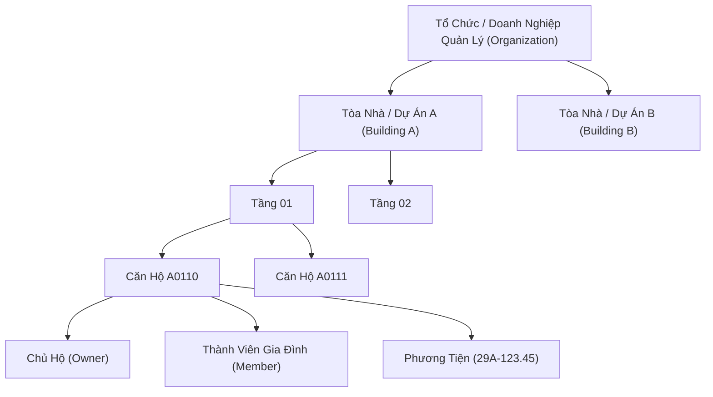
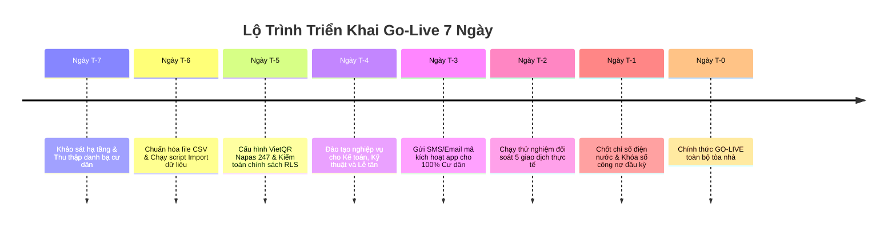

# Sổ Tay Triển Khai & Onboarding Khách Hàng (Deployment Playbook)

> **DÀNH CHO:** Đội ngũ Chuyên viên Triển khai (Onboarding Specialists), Quản trị viên Dự án (Project Managers) và Ban Quản Lý Vận Hành Tòa Nhà khi tiếp nhận và đưa PKA-Home B2B SaaS vào hoạt động thương mại thực tế.

---

## Chương 1: Kiến Trúc Phân Cấp Đa Cơ Sở (Multi-Tenant Hierarchy)

PKA-Home được thiết kế theo mô hình điện toán đám mây đa khách thuê bảo mật cao (Row Level Security & Organization Isolation). Mỗi đơn vị khách hàng được phân cấp quản trị như sau:



---

## Chương 2: Quy Chuẩn Mẫu Dữ Liệu Import Đầu Vào (Data Templates)

Để việc khởi tạo dữ liệu tòa nhà diễn ra tự động và chính xác, toàn bộ dữ liệu thô của Ban Quản Lý phải được chuyển đổi vào 4 tệp dữ liệu chuẩn định dạng CSV UTF-8:

### 2.1. Tệp Danh Mục Căn Hộ (`apartments_import.csv`)
- **Quy tắc định dạng mã căn:** Bắt buộc tuân thủ cấu trúc `<Block><Tầng 2 chữ số><Phòng 2 chữ số>` (Ví dụ: `A0110` là Block A, Tầng 01, Căn hộ số 10; `B1204` là Block B, Tầng 12, Căn hộ số 04).
- **Cấu trúc trường dữ liệu:**
  ```csv
  code,building_code,floor_number,area,empty_status,type
  A0110,A,1,75.5,false,residential
  A0111,A,1,92.0,false,residential
  A0201,A,2,110.0,true,penthouse
  ```

### 2.2. Tệp Danh Bạ Cư Dân & Nhân Khẩu (`residents_import.csv`)
- **Quy chuẩn số điện thoại:** Định dạng chuẩn quốc gia `090xxxxxxx` hoặc quốc tế E.164 `+8490xxxxxxx`.
- **Cấu trúc trường dữ liệu:**
  ```csv
  full_name,phone,national_id,apartment_code,relation_role,is_primary_contact
  Nguyễn Văn A,0901234567,001090123456,A0110,owner,true
  Trần Thị B,0907654321,001192654321,A0110,member,false
  Lê Văn C,0912345678,079085112233,A0111,tenant,true
  ```

### 2.3. Tệp Quản Lý Phương Tiện & Thẻ Bãi Xe (`vehicles_import.csv`)
- **Cấu trúc trường dữ liệu:**
  ```csv
  plate_number,vehicle_type,apartment_code,owner_phone,rfid_card_code,slot_code
  29A-888.99,car,A0110,0901234567,RFID-008129,B1-045
  29M1-555.66,motorcycle,A0110,0901234567,RFID-008130,M-112
  ```

### 2.4. Tệp Số Dư Công Nợ Đầu Kỳ (`beginning_debts_import.csv`)
- **Cấu trúc trường dữ liệu:**
  ```csv
  apartment_code,period,fee_type,amount,due_date,note
  A0110,09/2026,management_fee,755000,2026-10-15,Công nợ tồn tháng trước chuyển sang
  ```

---

## Chương 3: Ma Trận Phân Quyền Vai Trò Hệ Thống (RBAC Matrix)

PKA-Home cung cấp 6 nhóm quyền truy cập độc lập nhằm đảm bảo kiểm soát nội bộ và tính minh bạch nghiệp vụ:

| Nhóm Quyền (Role) | Phạm Vi Hoạt Động | Quyền Hạn Trọng Yếu |
| :--- | :--- | :--- |
| **Super Admin (Cấp Đơn Vị)** | Toàn bộ tổ chức | Tạo tòa nhà mới, cấp tài khoản Ban Quản Lý, cấu hình API thanh toán, kiểm toán hệ thống. |
| **Trưởng Ban Quản Lý** | Tòa nhà trực thuộc | Phê duyệt thông báo khẩn, xem báo cáo tài chính toàn diện, điều phối kỹ thuật, duyệt chi bảo trì. |
| **Kế Toán BQL** | Tòa nhà trực thuộc | Lập kỳ thu phí, phát hành hóa đơn, đối soát VietQR, quản lý phiếu thu/chi, xử lý hoàn tiền. |
| **Kỹ Thuật Viên** | Tòa nhà trực thuộc | Ghi nhận chỉ số điện nước, tiếp nhận phiếu sự cố, cập nhật vật tư sửa chữa, nghiệm thu kỹ thuật. |
| **Lễ Tân & Bảo Vệ** | Tòa nhà trực thuộc | Đăng ký khách vãng lai, quản lý gói hàng bưu kiện, kiểm soát ra vào bãi xe, quẹt thẻ RFID. |
| **Cư Dân & Khách Thuê** | Căn hộ cá nhân | Xem hóa đơn, quét VietQR gạch nợ tự động, gửi phản ánh sự cố, đặt tiện ích, biểu quyết hội nghị. |

---

## Chương 4: Lộ Trình Triển Khai Go-Live 7 Ngày (T-7 đến T-0)

Quy trình chuẩn hóa rút ngắn thời gian bàn giao hệ thống xuống chỉ còn 7 ngày làm việc:



### Chi Tiết Từng Ngày:

- **Ngày T-7 (Khảo sát & Thu thập dữ liệu):**
  - Chuyên viên triển khai làm việc với Ban Quản Lý thu thập danh sách căn hộ, hợp đồng thuê/sở hữu và biểu phí dịch vụ hiện hành.
- **Ngày T-6 (Làm sạch & Nhập khẩu dữ liệu):**
  - Sử dụng công cụ `Onboarding Importer` tự động nạp danh bạ vào hệ thống.
  - Kiểm tra tính toàn vẹn: Không trùng lặp số điện thoại chủ hộ, mã căn hộ chuẩn hóa định dạng.
- **Ngày T-5 (Kết nối Cổng tài chính):**
  - Nhập thông tin tài khoản ngân hàng của Ban Quản Lý (Mã ngân hàng, Số tài khoản, Tên tài khoản thụ hưởng).
  - Khởi tạo mẫu mã thanh toán VietQR với memo đối soát động.
- **Ngày T-4 (Tập huấn & Chuyển giao công nghệ):**
  - Tổ chức buổi đào tạo 4 tiếng cho Ban Quản Lý:
    - Kế toán: Thao tác xuất hóa đơn và đối soát tự động.
    - Kỹ thuật: Quy trình chụp ảnh công tơ thật và phân loại sự cố P1-P4.
    - Lễ tân: Quản lý bưu kiện bưu tá và đăng ký vé gửi xe.
- **Ngày T-3 (Truyền thông & Kích hoạt Cư dân):**
  - Phát hành thông báo giấy tại thang máy và sảnh đón tiếp.
  - Bắn mã kích hoạt tài khoản qua SMS/Email đến từng chủ hộ.
- **Ngày T-2 (Thử nghiệm thanh toán thực địa):**
  - Thực hiện 5 giao dịch nạp tiền thử nghiệm (10.000 VNĐ/giao dịch) bằng các ngân hàng Vietcombank, Techcombank, MB, BIDV để xác nhận webhook gạch nợ tức thì.
- **Ngày T-1 (Chốt chỉ số kỹ thuật):**
  - Kỹ thuật viên đi kiểm tra toàn bộ đồng hồ điện nước, ghi nhận chỉ số khởi điểm vào hệ thống.
- **Ngày T-0 (Chính thức Vận hành):**
  - Kích hoạt toàn bộ tính năng thương mại. Đội ngũ chuyên viên triển khai trực hỗ trợ On-site tại tòa nhà trong 3 ngày đầu.

---

## Chương 5: Cam Kết Hỗ Trợ Sau Bàn Giao (Hypercare Support SLA)

Trong 30 ngày đầu sau ngày Go-Live, khách hàng được hưởng chế độ bảo trợ cao cấp (Hypercare Period):
- **Đường dây nóng kỹ thuật:** Phản hồi sự cố vận hành trong vòng 15 phút (24/7).
- **Hỗ trợ On-site:** Có chuyên viên thường trực tại văn phòng Ban Quản Lý trong các ngày cao điểm thu phí (từ ngày 01 đến ngày 05 hàng tháng).
- **Báo cáo định kỳ:** Cung cấp báo cáo phân tích hiệu suất thu phí, tỷ lệ cư dân sử dụng app và thời gian xử lý sự cố hàng tuần cho Chủ đầu tư / Ban Quản Trị.

