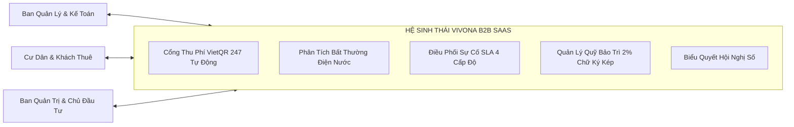

# Hồ Sơ Đề Xuất Giải Pháp & Bản Giới Thiệu Thương Mại (Pitch Deck & Commercial Proposal)

> **VIVONA PROPTECH SAAS PLATFORM**
> *Nền Tảng Quản Lý & Vận Hành Chung Cư Thông Minh Thế Hệ Mới*
> Chuẩn Hóa Vận Hành • Tự Động Thu Phí VietQR • Minh Bạch Tài Chính

---

## 1. Bối Cảnh Thị Trường & Nỗi Đau Vận Hành Bất Động Sản

Ngành quản lý vận hành bất động sản tại Việt Nam đang đối mặt với những thách thức nghiêm trọng về hiệu suất và sự hài lòng của cư dân:

```text
[Nỗi Đau 1: Đối Soát Thu Công Đầy Rủi Ro]
-> Kế toán mất 30 - 45 giờ/tháng dò từng dòng sao kê ngân hàng đối chiếu với danh sách nợ.
-> Lỗi gạch nợ nhầm, cư dân chuyển khoản sai cú pháp dẫn đến tranh chấp kéo dài.

[Nỗi Đau 2: Tỷ Lệ Nợ Đọng Phí Dịch Vụ Cao]
-> Thông báo giấy nhét cửa dễ thất lạc, tỷ lệ thanh toán đúng hạn chỉ đạt 70 - 78%.
-> Thiếu kênh thanh toán tiện lợi tức thì cho cư dân hiện đại.

[Nỗi Đau 3: Mâu Thuẫn Về Chỉ Số Tiêu Thụ Điện Nước]
-> Thợ kỹ thuật ghi chỉ số thủ công vào sổ tay dễ sai lệch; không có bằng chứng hình ảnh.
-> Khi phát sinh hóa đơn tiền nước nhảy vọt do rò rỉ ngầm, cư dân từ chối thanh toán.

[Nỗi Đau 4: Tranh Chấp Quỹ Bảo Trì 2% & Hội Nghị Nhà Chung Cư]
-> Báo cáo thu chi quỹ bảo trì thiếu tính minh bạch theo thời gian thực.
-> Tổ chức hội nghị trực tiếp khó đạt tỷ lệ tham dự trên 50% theo Luật Nhà ở 2023.
```

---

## 2. Giải Pháp Toàn Diện Vivona PropTech B2B SaaS

Vivona cung cấp hệ sinh thái khép kín kết nối đồng thời **Ban Quản Lý - Ban Quản Trị - Cư Dân - Khách Thuê** trên nền tảng đám mây:



---

## 3. Ma Trận So Sánh Năng Lực Cạnh Tranh (Feature Matrix)

| Tiêu Chí & Tính Năng | Phần Mềm Cũ / Excel | Các Ứng Dụng Đối Thủ | **Vivona SaaS** |
| :--- | :---: | :---: | :---: |
| **Gạch nợ VietQR Napas 247** | Thủ công | Thu phí cổng trung gian (1.1 - 2.2%) | **Tự động 3s trực tiếp tài khoản BQL (0% phí chiết khấu)** |
| **Bằng chứng ghi chỉ số điện nước** | Sổ tay / Ghi nhớ | Nhập số thô | **Bắt buộc chụp ảnh công tơ thật & Phát hiện bất thường 150%** |
| **Kiến trúc an toàn dữ liệu** | Không có | Cơ bản | **Fail-Closed Guard: Tuyệt đối không bịa dữ liệu giả lập** |
| **Quản lý Quỹ bảo trì 2%** | Báo cáo Excel | Liệt kê chi tiêu đơn giản | **Cơ chế chữ ký duyệt kép (Dual-Approval) minh bạch CSDL** |
| **Biểu quyết số Hội nghị nhà chung cư** | Giấy biểu quyết | Bình chọn theo đầu người | **Kiểm phiếu số hóa theo tỷ lệ m² diện tích (Luật Nhà ở 2023)** |
| **Bảo vệ dữ liệu cá nhân** | Không che mờ | Lộ số điện thoại cư dân | **Masking số điện thoại & Băm CCCD (Luật BV Dữ liệu 2026)** |

---

## 4. Bảng Giá Gói Dịch Vụ Thương Mại (Pricing Tiers)

Mô hình định giá linh hoạt theo tháng hoặc theo năm, phù hợp với mọi quy mô dự án:

| Gói Dịch Vụ | Quy Mô Tòa Nhà | Mức Phí Thuê Bao (VNĐ / Tháng) | Tính Năng Nổi Bật Kèm Theo |
| :--- | :--- | :--- | :--- |
| **Gói Khởi Nghiệp (Startup)** | Dưới 150 căn hộ (Chung cư mini / Căn hộ dịch vụ) | **1.500.000 VNĐ** *(Tương đương 10.000 đ/căn)* | Đầy đủ hóa đơn VietQR, quản lý xe, thông báo cư dân, phản ánh sự cố. |
| **Gói Tiêu Chuẩn (Standard)** | Từ 150 đến 500 căn hộ (Chung cư thương mại phân khúc vừa) | **3.500.000 VNĐ** *(Tương đương 7.000 đ/căn)* | Toàn bộ gói Khởi nghiệp + Phân tích bất thường điện nước + Bưu kiện lễ tân + SLA sự cố. |
| **Gói Đại Đô Thị (Enterprise)** | Trên 500 căn hộ hoặc Chuỗi nhiều tòa nhà | **6.000 VNĐ / Căn / Tháng** *(Chiết khấu 20% khi đóng năm)* | Toàn bộ tính năng cao cấp + Quản lý Quỹ bảo trì chữ ký kép + Biểu quyết số + Onboarding On-site. |

> **Chính sách ưu đãi:**
> - Miễn phí 100% chi phí chuyển đổi và nhập khẩu dữ liệu ban đầu cho hợp đồng từ 12 tháng trở lên.
> - Cam kết hoàn tiền 100% trong 30 ngày nếu không đáp ứng được quy trình vận hành thực tế.

---

## 5. Phân Tích Hiệu Quả Đầu Tư (ROI - Return on Investment)

Ví dụ tính toán cho một tòa nhà chung cư tiêu chuẩn quy mô **350 căn hộ**:

```text
[CHI PHÍ ĐẦU TƯ VIVONA]
- Gói Tiêu Chuẩn: 3.500.000 VNĐ/tháng -> 42.000.000 VNĐ / Năm.

[LỢI ÍCH KINH TẾ TIẾT KIỆM MỖI NĂM]
1. Tiết kiệm nhân sự kế toán đối soát:
   - Giảm 70% thời gian đối soát công nợ -> Tiết kiệm 0.5 định biên nhân sự = 60.000.000 VNĐ / Năm.
2. Tiết kiệm chi phí in ấn giấy tờ thông báo:
   - 350 căn x 12 tháng x 5.000 VNĐ (giấy + mực + giao phát) = 21.000.000 VNĐ / Năm.
3. Giảm thất thoát công nợ quá hạn:
   - Tỷ lệ thu đúng hạn tăng từ 78% lên 96%, thu hồi sớm dòng tiền phí quản lý = 140.000.000 VNĐ (giá trị luân chuyển vốn).
4. Giảm chi phí tranh chấp sự cố kỹ thuật:
   - Ảnh công tơ thật và phát hiện rò rỉ sớm giúp loại bỏ hoàn toàn các vụ khiếu nại bồi thường = 15.000.000 VNĐ / Năm.

-----------------------------------------------------------------------------------
TỔNG LỢI ÍCH TIẾT KIỆM TRỰC TIẾP: ~96.000.000 VNĐ / Năm (Chưa tính giá trị dòng tiền)
TỶ SUẤT HOÀN VỐN (ROI): 228%
THỜI GIAN HOÀN VỐN ĐẦU TƯ: 1.8 Tháng
```

---

## 6. Thông Tin Liên Hệ & Đăng Ký Trải Nghiệm Giải Pháp

- **Đơn vị phát triển:** Vivona PropTech Solutions JSC
- **Đường dây nóng tư vấn B2B:** 1900 xxxx (Nhánh 1 - Bộ phận Doanh Nghiệp)
- **Thư điện tử:** enterprise@vivona.vn
- **Cổng thông tin giải pháp:** https://vivona.vn

