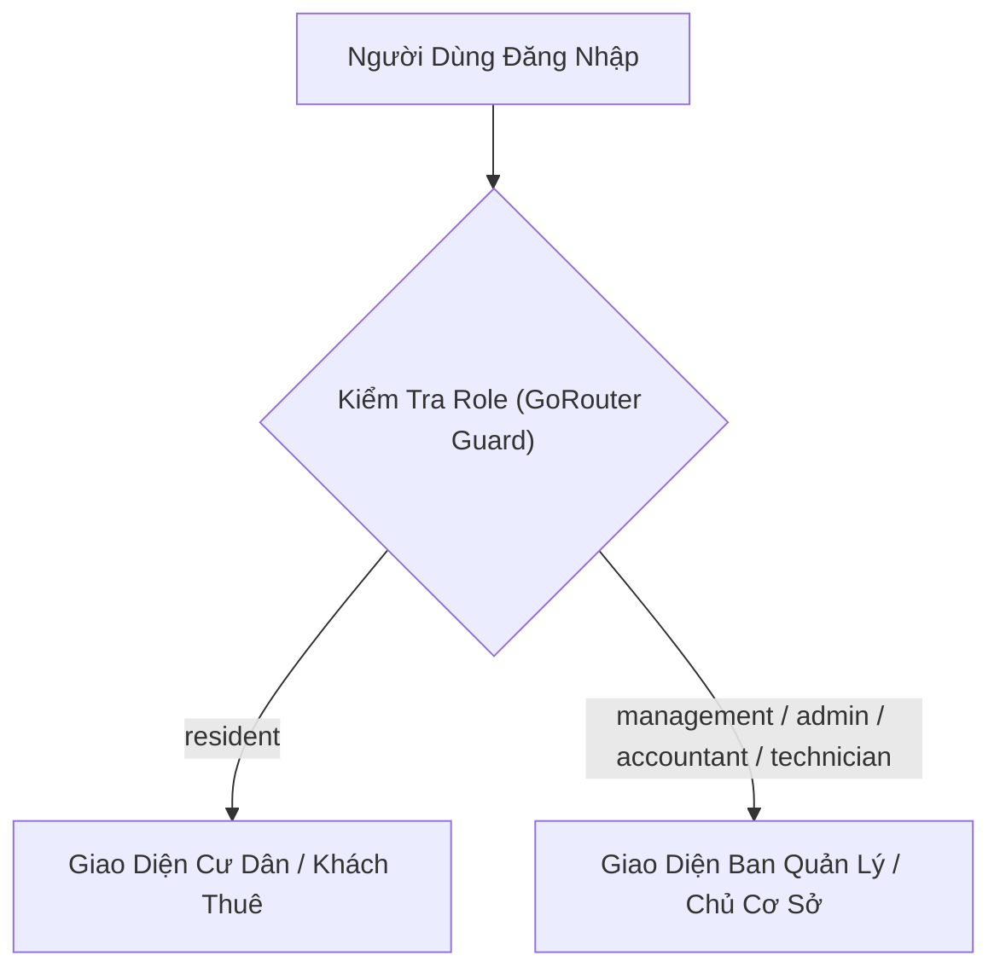

# Đặc Tả Tính Năng Sản Phẩm PKA-Home (Product Specification)

> **Phiên bản:** 2.0 (Production-Ready)  
> **Phạm vi ứng dụng:** Khu Đô Thị, Chung Cư Cao Tầng, Khu Căn Hộ Dịch Vụ, Hệ Thống Chuỗi Nhà Trọ Cho Thuê Đa Cơ Sở.  
> **Ngôn ngữ giao diện:** 100% Tiếng Việt tự nhiên chuẩn mực theo `design-rules.md`.

---

## 1. Mô Hình Nghiệp Vụ & Đối Tượng Sử Dụng (Actors)

Hệ thống hỗ trợ 2 nhóm giao diện chuyên biệt dựa trên phân quyền vai trò (Role-Based Access Control):

### 1.1. Nhóm Người Dùng Cư Dân & Khách Thuê (`resident`)
- **Chủ hộ (Owner):** Người sở hữu căn hộ, có toàn quyền quản lý thành viên gia đình, đăng ký thẻ xe, nhận hóa đơn và biểu quyết.
- **Khách thuê (Tenant):** Người thuê phòng trọ hoặc căn hộ, nhận thông báo, hóa đơn tiền phòng/điện nước định kỳ, đặt lịch tiện ích và báo sự cố.
- **Thành viên gia đình (Family Member):** Tài khoản phụ thuộc được chủ hộ/người thuê cấp quyền cùng sử dụng căn hộ.

### 1.2. Nhóm Vận Hành & Quản Lý (`management`)
- **Quản trị viên cấp cao (Admin / Super Admin):** Toàn quyền cấu hình tổ chức (`organizations`), cơ sở (`buildings`), tài khoản nhân sự và phân quyền.
- **Kế toán (Accountant):** Chuyên trách lập hóa đơn hàng loạt, cấu hình biểu phí dịch vụ động, đối soát giao dịch VietQR, quản lý Quỹ Bảo Trì và xuất báo cáo tài chính.
- **Kỹ thuật viên (Technician):** Tiếp nhận sự cố, xử lý hiện trường, tải ảnh nghiệm thu hoàn tất, theo dõi lịch bảo dưỡng thiết bị tòa nhà.
- **Chủ nhà trọ (Boarding House Host):** Quản lý danh sách phòng, theo dõi hợp đồng thuê, cọc giữ chỗ, lập phiếu thu tiền phòng cố định và chốt điện nước.

---

## 2. Ma Trận Tính Năng Sản Phẩm (Feature Matrix)

### 2.1. Phân Hệ Cư Dân & Khách Thuê (Resident Mobile App)

| Mã | Tính Năng | Mô Tả Chi Tiết Nghiệp Vụ | Điểm Nổi Bật |
| :--- | :--- | :--- | :--- |
| **RES-01** | **Xác thực & Bảo mật** | Đăng ký tài khoản bằng SĐT/Email, đăng nhập mật khẩu an toàn, quên mật khẩu xác thực OTP qua email. | Phân luồng vai trò tự động, mã hóa mật khẩu Supabase Auth. |
| **RES-02** | **Liên kết Căn hộ / Phòng trọ** | Nhập mã căn hộ/phòng (hỗ trợ cả định dạng chung cư `A0110` lẫn phòng trọ `P101`, `Phòng 3`), chọn vai trò liên kết. | Hỗ trợ chuyển đổi nhanh nhiều căn hộ (`ApartmentSwitcherChip`) nếu sở hữu nhiều nơi. |
| **RES-03** | **Bảng Tin & Thông Báo Đích** | Xem tin tức, thông báo khẩn cấp (màu đỏ nổi bật). Lọc theo: Tất cả, Hóa đơn & Phí, Sự cố, Tòa nhà. | Lắng nghe thời gian thực (Supabase CDC Realtime Stream) đẩy Heads-up Banner tức thì. |
| **RES-04** | **Tra Cứu Hóa Đơn & Tiền Phòng** | Xem hóa đơn từng kỳ, phân rã chi tiết: Tiền phòng (theo m² hoặc cố định), Điện, Nước, Phí dịch vụ, Thẻ xe. | Tự động tính toán tổng nợ, hiển thị trạng thái màu sắc trực quan (Đỏ: Chưa đóng, Xanh: Đã đóng). |
| **RES-05** | **Thanh Toán Đa Kênh & VietQR** | Thanh toán tức thì qua mã VietQR động chuẩn Napas, chuyển khoản ngân hàng (xác nhận 2 bước `PENDING`), đăng ký nộp tiền mặt tại quầy. | Nhận biên lai điện tử (`electronic_receipt_sheet.dart`) ngay sau khi thanh toán thành công. |
| **RES-06** | **Khai Báo Số Điện Nước** | Tự chụp ảnh công tơ điện nước và nhập chỉ số tiêu thụ hàng tháng gửi BQL/Chủ trọ thẩm định. | Chống gian lận: Yêu cầu ảnh chụp thực tế và đối chiếu với số tháng trước. |
| **RES-07** | **Đặt Lịch Tiện Ích Thông Minh** | Đặt trước tiện ích nội khu (Bể bơi, Gym, BBQ, Sân bóng), chọn ngày giờ và số lượng khách đi cùng (`guests_count`). | Tự động kiểm tra sức chứa khả dụng theo thời gian thực; tự động xếp vào danh sách chờ (`waitlist`) nếu hết chỗ. |
| **RES-08** | **Tự Hủy Tiện Ích An Toàn** | Cư dân có thể tự bấm hủy lịch đặt trực tiếp trên app. | Gọi RPC `cancel_amenity_booking` tự động hoàn tiền/cọc và đôn người trong danh sách chờ lên ngay lập tức. |
| **RES-09** | **Đăng Ký & Quản Lý Thẻ Xe** | Đăng ký biển số xe máy, ô tô theo hạn mức cho phép (tối đa 2 xe máy, 1 ô tô/căn hộ). Theo dõi trạng thái duyệt hoặc lý do từ chối. | Báo hủy phương tiện để giải phóng hạn mức khi chuyển đi. |
| **RES-10** | **Phản Ánh Sự Cố Đa Phương Tiện** | Chụp ảnh hiện trường sự cố, chọn danh mục (Điện, Nước, PCCC, Thang máy, An ninh), nhập mô tả. | Tự động phân loại độ ưu tiên, cập nhật tiến độ xử lý thời gian thực dạng Timeline. |
| **RES-11** | **Khảo Sát Đánh Giá Dịch Vụ** | Chấm điểm 1 - 5 sao và nhận xét kỹ thuật viên sau khi sự cố hoàn tất nghiệm thu. | Đánh giá minh bạch giúp BQL đo lường KPI đội ngũ kỹ thuật. |
| **RES-12** | **Cẩm Nang & Danh Bạ Khẩn Cấp** | Tra cứu nội quy tòa nhà/nhà trọ, danh bạ hotline BQL, bảo vệ, cứu hỏa, y tế với nút gọi 1 chạm. | Hoạt động offline mượt mà không lo mất mạng. |

---

### 2.2. Phân Hệ Ban Quản Lý & Chủ Cơ Sở (Management App)

| Mã | Tính Năng | Mô Tả Chi Tiết Nghiệp Vụ | Điểm Nổi Bật |
| :--- | :--- | :--- | :--- |
| **MGT-01** | **Smart Dashboard & KPIs** | Tổng quan tỷ lệ lấp đầy, biểu đồ doanh thu theo tháng (`RevenueTrendChart`), số lượng hóa đơn chưa thu, sự cố tồn đọng. | Quản lý đa cơ sở: Lọc theo từng tòa nhà hoặc xem toàn bộ tổ chức. |
| **MGT-02** | **Sơ Đồ Phòng & Quản Lý Cư Dân** | Danh mục phòng/căn hộ kèm trạng thái trống/đang ở, diện tích, giá thuê, tiền cọc. Duyệt/từ chối yêu cầu gia nhập căn hộ. | Hồ sơ Cư dân 360 độ: Lịch sử thanh toán, thẻ xe, thành viên gia đình trong 1 màn hình. |
| **MGT-03** | **Lập Hóa Đơn Đơn Lẻ & Hàng Loạt** | Lập hóa đơn linh hoạt: hỗ trợ tính theo diện tích m² (chung cư) hoặc tiền phòng cố định (nhà trọ). Hộp thoại thẩm định trước (Preflight Validation). | Gọi RPC `generate_valid_bulk_invoices` bảo toàn dữ liệu, chống phát hành trùng kỳ. |
| **MGT-04** | **Đối Soát & Xác Nhận Thu Tiền** | Danh sách giao dịch chờ duyệt (`pending_confirmation`), bấm xác nhận thanh toán chuyển sang `paid` hoặc thu tiền mặt trực tiếp tại quầy. | Tự động kích hoạt Database Trigger gửi biên lai điện tử tới điện thoại cư dân. |
| **MGT-05** | **Quản Lý Quỹ Bảo Trì Tòa Nhà** | Bảng cân đối thu chi Quỹ Bảo Trì 2%, theo dõi dòng tiền gửi ngân hàng sinh lãi, chi phí sửa chữa lớn. | Tự động ẩn thẻ Quỹ Bảo Trì khi cơ sở là mô hình nhà trọ. |
| **MGT-06** | **Thẩm Định Chỉ Số Điện Nước** | So sánh ảnh chụp công tơ thực tế của cư dân với số liệu khai báo, duyệt hoặc từ chối kèm lý do. | Tự động kết chuyển sản lượng tiêu thụ vào hóa đơn tháng. |
| **MGT-07** | **Điều Phối & Nghiệm Thu Sự Cố** | Phân công kỹ thuật viên theo chuyên môn, cập nhật tiến độ, tải ảnh nghiệm thu thực tế và đóng phiếu hỗ trợ. | Lưu trữ ảnh nghiệm thu trên Supabase Storage bảo mật. |
| **MGT-08** | **Quản Trị Tiện Ích 3 Tab Chuyên Sâu** | • Tab 1: Duyệt lịch đặt, điểm danh Check-in, thu cọc tại chỗ. • Tab 2: Điều chỉnh sức chứa thực tế (`max_capacity`), khung giờ, đơn giá. • Tab 3: Lập lịch vệ sinh, bảo trì định kỳ và tạm khóa khung giờ. | Bố cục co giãn không tràn viền trên mọi kích thước màn hình. |
| **MGT-09** | **Truyền Thông Đích Danh & Quét Nhắc Nợ** | Soạn thông báo phát tới: Toàn tòa, Theo Block, Theo Tầng, hoặc Căn hộ riêng biệt. Nút **"Quét nhắc nợ tự động"** đa tầng (trước hạn 3 ngày, đúng hạn, quá hạn). | Bắn thông báo đích danh tới điện thoại cư dân mà không làm phiền cư dân khác. |
| **MGT-10** | **Quản Trị Hệ Thống & Kiểm Toán (Audit)** | Quản lý ma trận phân quyền (`permissions.dart`), ủy quyền vai trò tạm thời, nhật ký kiểm toán hệ thống (`audit_logs`) ghi lại mọi thao tác quan trọng. | Phòng chống gian lận và truy vết sự cố kỹ thuật. |

---

## 3. Khả Năng Thích Ứng: Chung Cư Cao Tầng vs Nhà Trọ Cho Thuê

PKA-Home xử lý tinh tế sự khác biệt giữa 2 loại hình bất động sản mà không cần chia đôi mã nguồn:

| Tiêu Chí Nghiệp Vụ | Mô Hình Chung Cư (Condominium) | Mô Hình Nhà Trọ (Boarding House) | Cách PKA-Home Xử Lý Tự Động |
| :--- | :--- | :--- | :--- |
| **Mã căn hộ / phòng** | Chuẩn hóa `A0110` (Block + Tầng + Phòng) | `P101`, `Phòng 3`, `101`, v.v. | `validateApartmentCode` nới lỏng thông minh, cho phép tùy chọn `strictApartmentFormat`. |
| **Cơ cấu tính tiền nhà** | Tính theo diện tích m² nhân đơn giá | Giá thuê phòng cố định (`rent_price`) | Form tạo hóa đơn tự động chọn `rent_price` làm mặc định và ẩn/hiện trường diện tích. |
| **Hợp đồng & Cọc** | Hợp đồng mua bán / thuê lâu dài | Hợp đồng thuê ngắn hạn, tiền cọc 1-3 tháng (`deposit_amount`) | Bảng `apartments` mở rộng các trường `deposit_amount`, `max_occupants`. |
| **Quỹ bảo trì 2%** | Bắt buộc theo luật nhà ở | Không có quỹ bảo trì | `maintenance_fund_card.dart` tự động ẩn dựa trên cờ `building.isBoardingHouse`. |
| **Tiện ích nội khu** | Hồ bơi, Sân Tennis, BBQ, Phòng Gym | Thường chỉ có Máy giặt chung, Chỗ để xe, Khóa cổng vân tay | Module Tiện ích cho phép BQL bật/tắt từng tiện ích hoặc ẩn hoàn toàn module nếu không có. |
