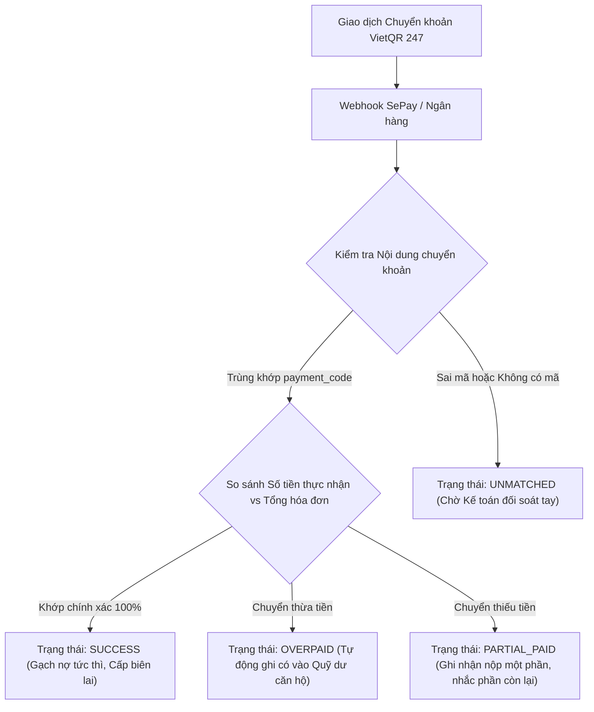
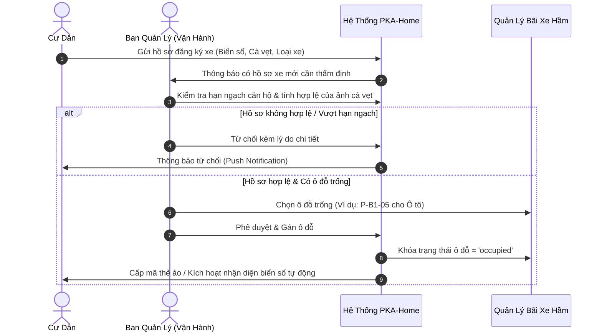
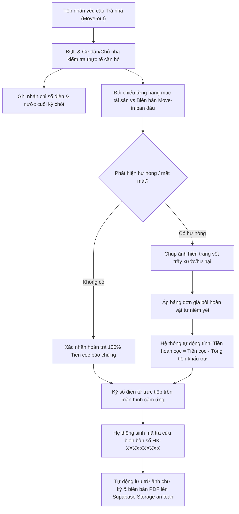
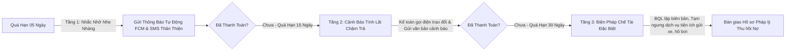

# Quy Trình Vận Hành Chuẩn Ban Quản Lý (SOP - Standard Operating Procedure)
## Hệ Thống Quản Trị Vận Hành Bất Động Sản & Tòa Nhà Chung Cư PKA-Home (B2B SaaS)

- **Mã tài liệu:** SOP-BQL-PKA-01
- **Phiên bản:** 2.0 (Commercial Production Edition)
- **Áp dụng cho:** Ban Quản Trị, Trưởng Ban Quản Lý, Bộ Phận Kế Toán, Đội Ngũ Kỹ Thuật, Bộ Phận Lễ Tân & An Ninh Tòa Nhà
- **Căn cứ pháp lý:** Luật Nhà ở 2023, Luật Bảo vệ dữ liệu cá nhân 2026, Nghị định số 123/2020/NĐ-CP về Hóa đơn điện tử và Thông tư số 05/2024/TT-BXD Quy chế quản lý sử dụng nhà chung cư.

---

## Mục Lục

1. [Quy Định Chung & Cơ Cấu Phân Quyền Vận Hành (RBAC)](#1-quy-định-chung--cơ-cấu-phân-quyền-vận-hành-rbac)
2. [SOP-01: Quy Trình Thu Phí Dịch Vụ & Đối Soát Thanh Toán Tự Động VietQR 247](#2-sop-01-quy-trình-thu-phí-dịch-vụ--đối-soát-thanh-toán-tự-động-vietqr-247)
3. [SOP-02: Quy Trình Quản Lý Hồ Sơ Phương Tiện & Điều Phối Ô Đỗ Bãi Xe Hầm B1/B2](#3-sop-02-quy-trình-quản-lý-hồ-sơ-phương-tiện--điều-phối-ô-đỗ-bãi-xe-hầm-b1b2)
4. [SOP-03: Quy Trình Điều Phối Sự Cố Kỹ Thuật, Quản Lý Vật Tư Kho & Cam Kết SLA 4 Cấp Độ](#4-sop-03-quy-trình-điều-phối-sự-cố-kỹ-thuật-quản-lý-vật-tư-kho--cam-kết-sla-4-cấp-độ)
5. [SOP-04: Quy Trình Kiểm Kê & Bàn Giao Căn Hộ Số (Move-in / Move-out Digital Handover)](#5-sop-04-quy-trình-kiểm-kê--bàn-giao-căn-hộ-số-move-in--move-out-digital-handover)
6. [SOP-05: Quy Trình Quản Lý Quỹ Bảo Trì 2% & Lập Kế Hoạch Bảo Dưỡng Thiết Bị Kỹ Thuật](#6-sop-05-quy-trình-quản-lý-quỹ-bảo-trì-2--lập-kế-hoạch-bảo-dưỡng-thiết-bị-kỹ-thuật)
7. [SOP-06: Quy Trình Lấy Ý Kiến Biểu Quyết Số & Xử Lý Kiến Nghị Cư Dân](#7-sop-06-quy-trình-lấy-ý-kiến-biểu-quyết-số--xử-lý-kiến-nghị-cư-dân)
8. [SOP-07: Quy Trình Lễ Tân Tiếp Nhận Bưu Kiện & Kiểm Soát Khách Ra Vào Tòa Nhà](#8-sop-07-quy-trình-lễ-tân-tiếp-nhận-bưu-kiện--kiểm-soát-khách-ra-vào-tòa-nhà)
9. [SOP-08: Quy Trình Giám Sát Rủi Ro Nợ Xấu & Đôn Đốc Thu Hồi Công Nợ Đa Tầng](#9-sop-08-quy-trình-giám-sát-rủi-ro-nợ-xấu--đôn-đốc-thu-hồi-công-nợ-đa-tầng)
10. [Tuân Thủ An Toàn Thông Tin & Bảo Vệ Dữ Liệu Cá Nhân (Data Governance)](#10-tuân-thủ-an-toàn-thông-tin--bảo-vệ-dữ-liệu-cá-nhân-data-governance)

---

## 1. Quy Định Chung & Cơ Cấu Phân Quyền Vận Hành (RBAC)

Hệ thống PKA-Home phân quyền kiểm soát truy cập dựa trên vai trò (Role-Based Access Control) nhằm bảo đảm nguyên tắc phân nhiệm và bảo mật dữ liệu tuyệt đối:

| Vai Trò | Mã Hệ Thống | Phạm Vi Quyền Hạn Nghiệp Vụ | Trách Nhiệm Chính |
| :--- | :--- | :--- | :--- |
| **Trưởng Ban Quản Lý** | `building_manager` | Toàn quyền kiểm soát tòa nhà/cụm tháp; phê duyệt ngân sách, giải ngân quỹ bảo trì; giám sát KPI tổng thể. | Chịu trách nhiệm trước Ban Quản Trị và Cư dân về toàn bộ chất lượng vận hành. |
| **Kế Toán Tòa Nhà** | `accountant` | Quản trị chính sách biểu giá; đối soát thanh toán VietQR; xử lý công nợ ngoại lệ; xuất hóa đơn điện tử. | Đảm bảo thu đúng, thu đủ, đối soát minh bạch dòng tiền và không để thất thoát tài chính. |
| **Kỹ Thuật Viên Trưởng** | `technician_lead` | Phân công phiếu sự cố kỹ thuật; quản lý định mức vật tư kho; giám sát lịch bảo trì định kỳ hệ thống cơ điện. | Đảm bảo tỷ lệ đáp ứng SLA xử lý sự cố >= 95%; an toàn vận hành hệ thống PCCC, thang máy, máy phát. |
| **Kỹ Thuật Viên** | `technician` | Nhận lệnh điều phối; kiểm tra hiện trường; xuất vật tư thực tế; cập nhật tiến độ và báo cáo nghiệm thu. | Có mặt xử lý đúng thời gian quy định; thao tác đúng quy chuẩn an toàn lao động. |
| **Lễ Tân & Bảo Vệ** | `front_desk` / `security` | Tiếp nhận bưu kiện, hàng hóa ký gửi; kiểm soát thẻ/mã QR khách vãng lai; điều phối xe ra vào hầm B1/B2. | Đảm bảo an ninh trật tự, kiểm soát chặt chẽ người lạ vào sảnh và hầm xe. |
| **Cư Dân / Khách Thuê** | `resident` / `tenant` | Khai báo chỉ số điện nước kèm ảnh thật; thanh toán VietQR; đăng ký vé khách; gửi phản ánh và biểu quyết số. | Tuân thủ nội quy tòa nhà, đóng phí dịch vụ đúng hạn quy định. |

---

## 2. SOP-01: Quy Trình Thu Phí Dịch Vụ & Đối Soát Thanh Toán Tự Động VietQR 247

### 2.1. Mục Tiêu
Tự động hóa hoàn toàn chu trình phát hành thông báo phí, nhận thanh toán qua chuyển khoản quét mã VietQR Napas 247, gạch nợ tự động trong 5 giây và xuất biên lai/hóa đơn điện tử hợp lệ theo Nghị định 123/2020/NĐ-CP.

### 2.2. Quy Trình 4 Bước Chuẩn

#### Bước 1: Khởi Tạo Kỳ Hóa Đơn & Mã Định Danh Thanh Toán (Fail-Closed)
1. Ngày 25 hàng tháng, Kế toán mở **Trạm Kế Toán Nghiệp Vụ** (`/management/invoices`).
2. Chọn chức năng **Lập bảng kê phí tháng** hoặc **Chốt số điện nước hàng loạt** từ dữ liệu Cư dân gửi lên.
3. Hệ thống máy chủ tự động thực thi hàm RPC `create_invoice_batch`:
   - Sinh mã hóa đơn chuẩn `INV-YYYYMM-XXXXX`.
   - Sinh mã thanh toán duy nhất `payment_code` theo định dạng `INVYYMM<MÃ CĂN HỘ>` (Ví dụ: `INV2610A0110`).
   - Khóa logic kiểm tra: Tuyệt đối không sinh mã ngẫu nhiên giả lập phía giao diện nếu máy chủ chưa ghi nhận thành công (P0 Fail-Closed).

#### Bước 2: Phát Hành Thông Báo Phí Tới Cư Dân
1. Kế toán nhấn **Phê duyệt & Phát hành thông báo phí**.
2. Hệ thống tự động gửi thông báo đẩy (Push Notification) qua FCM và thông báo trên ứng dụng Cư dân.
3. Màn hình Cư dân hiển thị đầy đủ chi tiết các mục phí: Phí dịch vụ quản lý, phí gửi xe, tiền điện bậc thang, tiền nước sạch, phí dịch vụ phát sinh.
4. Nút bấm **Thanh toán VietQR** tự động nhúng mã QR động chuẩn Napas với số tiền chính xác từng đồng và nội dung chuyển khoản bắt buộc là `payment_code`.

#### Bước 3: Tiếp Nhận Webhook Ngân Hàng & Phân Luồng Đối Soát
Hệ thống Webhook của cổng thanh toán SePay / Ngân hàng tiếp nhận biến động số dư và tự động phân loại trong 3 giây:

#### Bước 4: Xử Lý Ngoại Lệ & Phát Hành Hóa Đơn Điện Tử
1. **Đối với giao dịch UNMATCHED:** Kế toán mở tab **Đối soát thủ công** trên giao diện Web BQL, đối chiếu sao kê tài khoản ngân hàng với số điện thoại/chủ tài khoản chuyển tiền, tìm kiếm mã căn hộ tương ứng và nhấn **Khớp lệnh thủ công**.
2. **Xuất hóa đơn điện tử:** Đối với các hóa đơn đã thanh toán hoàn tất (`status = 'paid'`), hệ thống tự động sinh số biên nhận `receipt_number` (dạng `PT-202610-A0110`) và mã tra cứu hóa đơn điện tử `einvoice_lookup_code`. Cư dân có thể xem và tải file PDF hóa đơn có chữ ký số trực tiếp từ ứng dụng.

---

## 3. SOP-02: Quy Trình Quản Lý Hồ Sơ Phương Tiện & Điều Phối Ô Đỗ Bãi Xe Hầm B1/B2

### 3.1. Hạn Ngạch Phương Tiện Cho Phép Theo Loại Căn Hộ
- Căn hộ 1 phòng ngủ / Studio: Tối đa 02 xe máy, 00 ô tô (vào danh sách chờ nếu hầm còn chỗ).
- Căn hộ 2 phòng ngủ: Tối đa 02 xe máy, 01 ô tô (bắt buộc đăng ký ô đỗ định danh).
- Căn hộ 3 phòng ngủ / Penthouse: Tối đa 03 xe máy, 02 ô tô.

### 3.2. Quy Trình Cấp Quyền & Khóa Ô Đỗ

### 3.3. Quy Định Vé Khách Vãng Lai & Phí Theo Giờ
1. **Khách vãng lai gửi xe máy:** 5.000 VNĐ cho 2 giờ đầu; mỗi giờ tiếp theo tính 3.000 VNĐ/giờ. Phụ thu qua đêm (từ 23:00 đến 06:00 sáng hôm sau): 15.000 VNĐ.
2. **Khách vãng lai gửi ô tô:** 25.000 VNĐ cho 2 giờ đầu; mỗi giờ tiếp theo tính 15.000 VNĐ/giờ. Phụ thu qua đêm: 50.000 VNĐ.
3. Khi khách check-out tại trạm kiểm soát barie, hệ thống tự động tính toán tổng số tiền dựa trên `check_in_at` và `check_out_at`, hiển thị mã VietQR động trên màn hình cột kiểm soát để khách quét thanh toán không dùng tiền mặt.

---

## 4. SOP-03: Quy Trình Điều Phối Sự Cố Kỹ Thuật, Quản Lý Vật Tư Kho & Cam Kết SLA 4 Cấp Độ

### 4.1. Khung Cam Kết Mức Độ Dịch Vụ (Service Level Agreement - SLA)

| Cấp Độ Sự Cố | Định Nghĩa Nghiệp Vụ | Ví Dụ Điển Hình | Thời Gian Tiếp Nhận Tối Đa | Thời Gian Có Mặt Xử Lý | Thời Gian Khắc Phục Tối Đa |
| :---: | :--- | :--- | :---: | :---: | :---: |
| **P1 - Khẩn Cấp** | Đe dọa an toàn tính mạng, tài sản hoặc tê liệt toàn bộ tòa nhà. | Sự cố kẹt thang máy có người, kích hoạt báo cháy, mất điện/nước toàn khu, vỡ đường ống trục chính. | **05 phút** | **10 phút** | **02 giờ** |
| **P2 - Mức Cao** | Ảnh hưởng nghiêm trọng đến sinh hoạt cả tầng hoặc nguy cơ hư hỏng tài sản. | Rò rỉ nước ngập hành lang tầng, hỏng cửa cuốn hầm xe, mất điện cục bộ 1 căn hộ. | **15 phút** | **30 phút** | **04 giờ** |
| **P3 - Trung Bình** | Hư hỏng thiết bị kỹ thuật thông thường trong phạm vi căn hộ. | Hỏng bóng đèn trần, rò rỉ van vòi nước lavabo, tắc bồn cầu, aptomat nhảy liên tục. | **30 phút** | **02 giờ** | **12 giờ** |
| **P4 - Mức Thấp** | Yêu cầu kiểm tra, bảo trì thẩm mỹ, đề xuất sơn sửa, vệ sinh. | Bong tróc sơn tường hành lang, tiếng kêu nhẹ của quạt thông gió sảnh, góp ý cảnh quan. | **02 giờ** | **08 giờ** | **48 giờ** |

### 4.2. Điều Phối Thông Minh (Smart Triage) & Quản Lý Xuất Kho Vật Tư
1. **Tiếp nhận & Phân loại tự động:** Khi Cư dân tạo phản ánh trên ứng dụng kèm ảnh chụp và mô tả, thuật toán `IssueSmartTriageEngine` tự động phân tích từ khóa và gán chuyên môn tương ứng:
   - Từ khóa liên quan đến chập điện, mất nguồn, aptomat -> Gán nhóm **Điện dân dụng**.
   - Từ khóa liên quan đến rỉ nước, áp lực nước yếu, van xả -> Gán nhóm **Cấp thoát nước**.
   - Từ khóa liên quan đến cửa, khóa từ, tường, sàn -> Gán nhóm **Xây dựng / Mộc**.
   - Từ khóa liên quan đến chuông báo khói, đầu phun sprinkler -> Gán nhóm **PCCC**.
2. **Xuất kho vật tư bảo trì (`MaintenanceMaterialModel`):**
   - Kỹ thuật viên kiểm tra hiện trường, xác định vật tư cần thay thế (Bóng đèn LED, Van bi đồng, Dây cấp nước, Keo silicone...).
   - Mở màn hình **Phiếu xử lý sự cố** trên ứng dụng BQL, chọn chức năng **Xuất kho vật tư**.
   - Chọn loại vật tư và số lượng thực tế sử dụng.
   - Hệ thống tự động kiểm tra tồn kho tối thiểu (`min_stock_alert`); nếu số lượng xuất kho hợp lệ, hệ thống tự động trừ tồn kho thời gian thực và ghi log kiểm toán vào bảng `issue_materials`.
   - Đánh dấu rõ vật tư này thuộc diện: **Miễn phí theo gói bảo hành tòa nhà** hay **Thu phí căn hộ theo đơn giá niêm yết**.
3. **Nghiệm thu & Đánh giá mức độ hài lòng (CSAT Rating):**
   - Sau khi hoàn thành khắc phục, Kỹ thuật viên chụp ảnh hiện trường sau khi sửa và nhấn **Hoàn thành sự cố**.
   - Hệ thống tự động gửi thông báo mời Cư dân nghiệm thu và chấm điểm sao từ 1 đến 5 sao kèm phản hồi chất lượng phục vụ.
   - Các đánh giá 1-2 sao tự động kích hoạt cuộc gọi chăm sóc khách hàng của Trưởng Ban Quản Lý trong vòng 24 giờ.

---

## 5. SOP-04: Quy Trình Kiểm Kê & Bàn Giao Căn Hộ Số (Move-in / Move-out Digital Handover)

### 5.1. Mục Tiêu
Số hóa 100% biên bản bàn giao nhận nhà và trả nhà, loại bỏ hoàn toàn biên bản giấy dễ rách nát và tranh chấp, lưu trữ chứng cứ ảnh hiện trạng và chữ ký điện tử hai bên trên hạ tầng điện toán đám mây.

### 5.2. Danh Mục Kiểm Kê Chuẩn Theo Khu Vực
1. **Khu vực Sảnh & Phòng khách:** Khóa cửa thông minh (vân tay, mật mã, thẻ từ), chuông hình Intercom, hệ thống công tắc đèn, máy điều hòa trung tâm kèm remote điều khiển, sàn gỗ/gạch men.
2. **Khu vực Bếp:** Tủ bếp trên/dưới, mặt đá bếp, bếp từ/hồng ngoại âm, máy hút mùi, bồn rửa inox, vòi rửa tăng áp, bình lọc nước.
3. **Khu vực Phòng ngủ:** Tủ quần áo âm tường, điều hòa nhiệt độ, cửa phòng, ổ cắm điện, rèm cửa chống nắng.
4. **Khu vực Vệ sinh & Ban công:** Bồn cầu thông minh, lavabo, vòi sen tắm nóng lạnh, bình nước nóng gián tiếp, phễu thu sàn, giàn phơi thông minh, vòi cấp máy giặt.

### 5.3. Quy Trình Khấu Trừ Tiền Cọc & Ký Biên Bản Số

---

## 6. SOP-05: Quy Trình Quản Lý Quỹ Bảo Trì 2% & Lập Kế Hoạch Bảo Dưỡng Thiết Bị Kỹ Thuật

### 6.1. Nguyên Tắc Quản Trị Quỹ Bảo Trì Theo Luật Nhà Ở 2023
1. **Tách biệt tài khoản tuyệt đối:** Tài khoản Quỹ Bảo trì 2% bắt buộc phải là tài khoản có kỳ hạn mở tại Ngân hàng thương mại, đồng đứng tên bởi Trưởng Ban Quản Trị và một thành viên BQT đại diện cư dân. Tuyệt đối không nhập chung với tài khoản thu chi phí vận hành dịch vụ của Ban Quản Lý.
2. **Quy chế giải ngân minh bạch:**
   - Các khoản chi dưới 20.000.000 VNĐ phục vụ sửa chữa khẩn cấp (thay cáp thang máy, sửa máy bơm tăng áp): Cần chữ ký phê duyệt của Trưởng BQL và Trưởng BQT.
   - Các khoản chi từ 20.000.000 VNĐ đến 100.000.000 VNĐ: Bắt buộc thông qua biểu quyết biểu quyết đạt đa số phiếu của toàn bộ thành viên Ban Quản Trị.
   - Các khoản chi đại tu trên 100.000.000 VNĐ (sơn lại toàn bộ mặt ngoài tòa nhà, thay thế hệ thống chiller điều hòa trung tâm): Bắt buộc lấy ý kiến biểu quyết của Cư dân tại Hội nghị nhà chung cư thường niên hoặc bất thường với tỷ lệ đồng thuận tối thiểu theo quy định.

### 6.2. Kế Hoạch Bảo Dưỡng Thiết Bị Kỹ Thuật Định Kỳ
Hệ thống tự động kích hoạt cảnh báo bảo trì trước 07 ngày đối với các hạng mục hạ tầng kỹ thuật:
- **Thang máy chở khách & Thang hàng:** Bảo dưỡng định kỳ 01 tháng/lần bởi đơn vị ủy quyền chính hãng; kiểm định an toàn nghiêm ngặt 01 năm/lần.
- **Hệ thống PCCC & Máy bơm cứu hỏa:** Chạy thử không tải và có tải 01 tuần/lần; nạp sạc bình bọt khí định kỳ 06 tháng/lần.
- **Máy phát điện dự phòng:** Chạy thử định kỳ 02 tuần/lần; kiểm tra mức dầu diesel và ắc quy khởi động.
- **Bể ngầm sinh hoạt & Bể mái:** Súc rửa, khử trùng clo và kiểm nghiệm vi sinh mẫu nước định kỳ 06 tháng/lần theo tiêu chuẩn nước sinh hoạt QCVN 01-1:2018/BYT.

---

## 7. SOP-06: Quy Trình Lấy Ý Kiến Biểu Quyết Số & Xử Lý Kiến Nghị Cư Dân

### 7.1. Chuẩn Bị & Khởi Tạo Đợt Biểu Quyết Số (E-Voting)
1. Ban Quản Trị / BQL tạo đợt biểu quyết trên hệ thống (`/management/community/polls`).
2. Thiết lập cấu hình biểu quyết:
   - **Cách tính trọng số phiếu:** Tính theo đầu căn hộ (mỗi căn hộ = 1 phiếu) hoặc Tính theo diện tích sở hữu (diện tích căn hộ $m^2$ = trọng số biểu quyết theo Điều 102 Luật Nhà ở 2023).
   - **Tỷ lệ tham gia tối thiểu (Quorum):** Mặc định 50.0% tổng số căn hộ/diện tích tòa nhà.
   - **Tỷ lệ phê duyệt thông qua:** Mặc định 50.0% hoặc 60.0% tùy tính chất nghị quyết.
   - **Thời gian mở và đóng hòm phiếu:** Tối thiểu 03 ngày làm việc để Cư dân kịp tiếp cận thông tin.

### 7.2. Chống Gian Lận & Chống Bỏ Phiếu Lặp Lại (Anti-Replay / Double-Voting)
- Mỗi căn hộ chỉ có duy nhất một phiếu đại diện hợp lệ. Sau khi một thành viên được ủy quyền của căn hộ bấm gửi phiếu, hệ thống tự động khóa trạng thái `hasVoted = true` trên toàn bộ thiết bị khác của cùng căn hộ.
- Kết quả kiểm phiếu được tổng hợp tự động theo thời gian thực và tự động khóa sổ, hiển thị biểu đồ tỷ lệ phần trăm trực quan ngay khi hết giờ biểu quyết.

### 7.3. Tiếp Nhận & Phản Hồi Kiến Nghị Cư Dân (Petitions)
1. Cư dân khởi tạo kiến nghị trực tuyến kèm hình ảnh minh chứng.
2. Các căn hộ khác trong tòa nhà có thể bấm **Đồng thuận (Endorse)**.
3. Khi kiến nghị đạt ngưỡng tối thiểu (10 lượt đồng thuận trở lên), hệ thống tự động đưa vào danh mục **Ưu tiên xử lý của Ban Quản Lý**.
4. Thời hạn phản hồi chính thức của BQL: Không quá **48 giờ làm việc**. Văn bản phản hồi chính thức của BQL được công khai minh bạch trên hệ thống để toàn bộ cư dân theo dõi tiến độ giải quyết.

---

## 8. SOP-07: Quy Trình Lễ Tân Tiếp Nhận Bưu Kiện & Kiểm Soát Khách Ra Vào Tòa Nhà

### 8.1. Tiếp Nhận Bưu Kiện & Cấp Mã PIN Bảo Mật (Parcel Hub)
1. Nhân viên chuyển phát (Shipper) giao hàng tại quầy lễ tân sảnh tầng 1.
2. Lễ tân mở giao diện **Quản lý bưu kiện** (`/management/parcels`), nhập mã căn hộ nhận, đơn vị vận chuyển (SPX, GHTK, Viettel Post, Grab...), vị trí ô kệ lưu kho (Kệ A1, Kệ B2...) và chụp ảnh kiện hàng.
3. Nhấn **Xác nhận tiếp nhận bưu kiện**:
   - Hệ thống tự động sinh mã PIN bảo mật ngẫu nhiên 6 chữ số (Ví dụ: `482915`).
   - Tự động gửi thông báo tức thì kèm mã PIN tới ứng dụng Cư dân nhận hàng.
4. **Bàn giao bưu kiện:** Khi cư dân xuống nhận hàng, lễ tân yêu cầu đọc đúng mã PIN 6 số. Hệ thống xác thực mã PIN trùng khớp mới cho phép đổi trạng thái sang `collected`, ngăn chặn tuyệt đối tình trạng lấy nhầm hàng hoặc thất lạc tài sản.

### 8.2. Kiểm Soát Khách Viếng Thăm Qua Mã QR Đã Ký (Signed QR Pass)
1. Cư dân chủ động đăng ký vé khách trên app (Họ tên khách, số điện thoại, biển số xe, thời gian dự kiến đến).
2. Hệ thống sinh mã QR động được ký số chuẩn `PKAPASS.v1.<payload>.<signature>` có thời hạn hiệu lực cụ thể.
3. Khách xuất trình mã QR tại bàn lễ tân hoặc cổng an ninh:
   - Nhân viên quét mã bằng ứng dụng BQL.
   - Hệ thống đối soát chữ ký số mật mã; nếu hợp lệ, chuyển trạng thái sang `checked_in`.
   - Cơ chế bảo mật chống quét lặp lại (Anti-replay): Mã đã check-in không thể sử dụng lại lần thứ hai.
4. Khi khách rời tòa nhà, bảo vệ quét mã check-out để ghi nhận thời điểm xuất cảnh an toàn.

---

## 9. SOP-08: Quy Trình Giám Sát Rủi Ro Nợ Xấu & Đôn Đốc Thu Hồi Công Nợ Đa Tầng

### 9.1. Radar Định Lượng Điểm Rủi Ro Nợ Xấu (Debt Prediction Engine)
Hệ thống tự động chấm điểm rủi ro công nợ thang điểm 0 - 100 dựa trên 4 chỉ số trọng yếu:
- Số tiền nợ quá hạn so với mức phí trung bình tháng.
- Số ngày quá hạn thanh toán liên tục.
- Số lần thanh toán trễ hạn trong 6 tháng gần nhất.
- Tần suất tương tác và mở ứng dụng của chủ hộ.

### 9.2. Quy Trình Đôn Đốc Thu Hồi Công Nợ 3 Tầng (Dunning Process)

1. **Đôn đốc Tầng 1 (Quá hạn từ 05 đến 14 ngày):**
   - Hệ thống tự động gửi thông báo lịch sự trên app và tin nhắn: *"Kính gửi Quý cư dân căn hộ [MÃ PHÒNG], phí dịch vụ kỳ [KỲ] đã quá hạn [X] ngày. Kính mong Quý cư dân sớm hoàn tất thanh toán qua VietQR để Ban Quản Lý duy trì chất lượng vận hành tốt nhất."*
2. **Đôn đốc Tầng 2 (Quá hạn từ 15 đến 29 ngày):**
   - Kế toán gửi văn bản đôn đốc lần 2; hệ thống bắt đầu áp dụng tính lãi phạt chậm trả theo công thức chuẩn quy định trong Hợp đồng dịch vụ.
   - Nhân viên kế toán gọi điện thoại trực tiếp tìm hiểu lý do (cư dân đi công tác xa, quên lịch, hay có khiếu nại về chất lượng dịch vụ) để tháo gỡ kịp thời.
3. **Đôn đốc Tầng 3 (Quá hạn từ 30 ngày trở lên):**
   - Ban Quản Lý gửi Thông báo cảnh báo đặc biệt có dấu đỏ pháp nhân đơn vị vận hành.
   - Tạm dừng quyền sử dụng các dịch vụ tiện ích giá trị gia tăng (quyền đăng ký ô đỗ xe vãng lai, tiện ích hồ bơi, phòng gym, tiệc nướng BBQ).
   - Nếu quá hạn 60 ngày vẫn cố tình trây ỳ, BQL lập hồ sơ báo cáo Ban Quản Trị và đề nghị cơ quan có thẩm quyền xử lý theo quy định của pháp luật.

---

## 10. Tuân Thủ An Toàn Thông Tin & Bảo Vệ Dữ Liệu Cá Nhân (Data Governance)

Nhằm bảo đảm tuân thủ nghiêm ngặt Luật Bảo vệ dữ liệu cá nhân 2026 và Nghị định 13/2023/NĐ-CP của Chính phủ, toàn thể cán bộ nhân viên Ban Quản Lý có nghĩa vụ thực thi nghiêm túc các quy chuẩn kỹ thuật và tác nghiệp sau:

1. **Ẩn danh hóa dữ liệu định danh (PII Masking):**
   - Số điện thoại của cư dân trên toàn bộ danh sách hiển thị chung bắt buộc phải được che giấu 4 chữ số giữa (Ví dụ: `0912****78`).
   - Chỉ có Trưởng Ban Quản Lý hoặc Kế toán được cấp quyền giải mã (Reveal PII) khi thực hiện tác vụ liên hệ nghiệp vụ cần thiết, và mọi lượt bấm xem đều được ghi vết nhật ký kiểm toán (Audit Trail) không thể tẩy xóa.
2. **Bảo vệ dữ liệu công tơ điện nước:**
   - Cư dân chụp ảnh công tơ thật gửi lên; hệ thống mã hóa đường dẫn lưu trữ và chỉ cho phép nhân viên phụ trách căn hộ đó kiểm tra đối soát.
3. **Cấm tuyệt đối xuất trích dữ liệu ra thiết bị cá nhân:**
   - Cấm sao chép, chụp ảnh màn hình chứa thông tin danh sách cư dân để phát tán ra ngoài hoặc chia sẻ cho các bên thứ ba (môi giới bất động sản, tiếp thị bán hàng).
   - Mọi hành vi vi phạm sẽ bị xử lý kỷ luật sa thải ngay lập tức và chuyển hồ sơ tới cơ quan công an xử lý trách nhiệm hình sự theo quy định pháp luật hiện hành.

---
*Tài liệu này là tài sản bảo mật của Đơn Vị Vận Hành và Ban Quản Lý Tòa Nhà. Mọi sửa đổi, bổ sung quy trình phải được phê duyệt chính thức bằng văn bản của Trưởng Ban Quản Lý và Tổng Giám Đốc Công Ty Quản Lý Vận Hành.*
