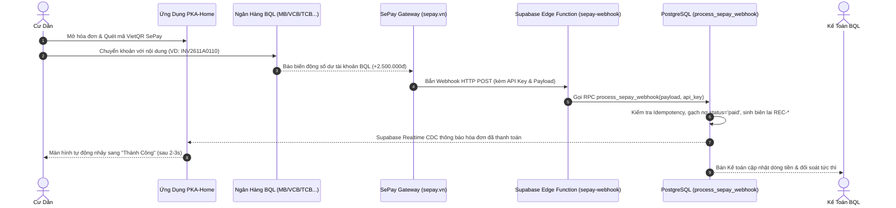

# Hướng Dẫn Tích Hợp Cổng Thanh Toán SePay & Tự Động Gạch Nợ Webhook

> **Tài liệu SOP Vận hành B2B SaaS**  
> Dành cho: Quản trị viên hệ thống (Admin), Ban Quản Lý (BQL) & Kỹ sư triển khai dự án PKA-Home.

---

## 1. Hiện Trạng Hệ Thống: Đã Liên Kết Chưa?

- **Về mặt mã nguồn & kiến trúc hệ thống**: **ĐÃ XÂY DỰNG XONG 100%**.
  - Đã có bảng CSDL `building_payment_configs` lưu thông tin ngân hàng & SePay API Key theo từng tòa nhà.
  - Đã có hàm RPC `process_sepay_webhook` tự động kiểm tra luồng tiền vào `in`, chống trùng lặp `Idempotency`, tự động bóc tách mã hóa đơn `payment_code`, gạch nợ `status = 'paid'`, sinh số biên lai `REC-*` và phân loại giao dịch chưa khớp `UNMATCHED`.
  - Đã có mã nguồn Edge Function `supabase/functions/sepay-webhook/index.ts`.
  - Ứng dụng di động của Cư dân (`UnifiedPaymentSheet`) và Bàn làm việc Kế toán Web (`AccountingWebWorkstationScreen`) đã tích hợp hoàn chỉnh.
- **Về mặt tài khoản thực tế**: **CHƯA LIÊN KẾT** vì hệ thống cần thông tin tài khoản ngân hàng thực tế của Ban Quản Lý và API Key từ tài khoản SePay của bạn.

---

## 2. Quy Trình 4 Bước Để Liên Kết Với SePay (Mất Khoảng 5 - 10 Phút)



---

### Bước 1: Đăng Ký Tài Khoản SePay & Kết Nối Ngân Hàng

1. Truy cập [https://my.sepay.vn](https://my.sepay.vn) và đăng ký tài khoản (miễn phí khởi tạo).
2. Tại thanh menu bên trái, chọn **Tài khoản ngân hàng** $\rightarrow$ **Thêm tài khoản**.
3. Chọn ngân hàng của Ban Quản Lý / Tòa nhà (hỗ trợ MBBank, Vietcombank, Techcombank, ACB, TPBank, VPBank, OCB, MSB...).
4. Đăng nhập hoặc quét mã bảo mật để SePay kết nối đọc thông báo biến động số dư qua Internet Banking.

---

### Bước 2: Triển Khai Supabase Edge Function Đón Webhook

Hệ thống PKA-Home đã chuẩn bị sẵn mã nguồn Edge Function tại:  
[`supabase/functions/sepay-webhook/index.ts`](file:///c:/Users/ADMIN/StudioProjects/pka_home/supabase/functions/sepay-webhook/index.ts)

Mở terminal tại thư mục gốc dự án và chạy lệnh sau để deploy lên Supabase:

```bash
# 1. Đăng nhập Supabase CLI (nếu chưa đăng nhập)
npx supabase login

# 2. Liên kết với dự án Supabase của bạn
npx supabase link --project-ref <MA_DU_AN_SUPABASE_CUA_BAN>

# 3. Deploy function sepay-webhook (cho phép nhận webhook public)
npx supabase functions deploy sepay-webhook --no-verify-jwt
```

> **URL Webhook của bạn sau khi deploy sẽ có dạng:**  
> `https://<MA_DU_AN_SUPABASE_CUA_BAN>.supabase.co/functions/v1/sepay-webhook`

---

### Bước 3: Cấu Hình Webhook Trên SePay Dashboard

1. Trên [https://my.sepay.vn](https://my.sepay.vn), vào menu **Tích hợp Webhook** $\rightarrow$ **Tạo Webhook mới**.
2. Điền thông tin:
   - **URL Webhook**: Dán URL ở Bước 2 (`https://<MA_DU_AN>.supabase.co/functions/v1/sepay-webhook`).
   - **Sự kiện (Event)**: Chọn **Giao dịch tiền vào** (`transferType = 'in'`).
   - **Phương thức**: `POST`.
   - **Kiểu dữ liệu**: `JSON`.
3. Bấm **Lưu** $\rightarrow$ SePay sẽ cấp cho bạn một **API Key** (Ví dụ dạng: `sepay_sec_xxxxxx` hoặc chuỗi ký tự ngẫu nhiên). Sao chép mã này để dùng ở Bước 4.

---

### Bước 4: Lưu Cấu Hình Tòa Nhà Vào Cơ Sở Dữ Liệu

Mở **Supabase Dashboard** $\rightarrow$ Chọn **SQL Editor** $\rightarrow$ Chạy lệnh sau để cấu hình tài khoản nhận tiền và SePay API Key cho tòa nhà của bạn:

```sql
-- Thay thế thông tin thực tế của Ban Quản Lý tòa nhà:
INSERT INTO public.building_payment_configs (
    building_id,
    bank_name,
    bank_account_number,
    bank_account_name,
    bank_bin,
    sepay_api_key,
    is_active
) VALUES (
    'b0000000-0000-0000-0000-000000000001',   -- ID của tòa nhà (lấy trong bảng buildings)
    'MBBank',                                  -- Tên ngân hàng nhận tiền
    '0988776655',                              -- Số tài khoản ngân hàng BQL
    'BAN QUAN LY TOA NHA PKA',                -- Tên chủ tài khoản (in hoa không dấu)
    '970422',                                  -- Mã BIN ngân hàng (MBBank: 970422, Vietcombank: 970436, ACB: 970416...)
    'sepay_sec_YOUR_API_KEY_HERE',             -- API Key lấy từ Bước 3
    true
)
ON CONFLICT (building_id) DO UPDATE SET
    bank_name = EXCLUDED.bank_name,
    bank_account_number = EXCLUDED.bank_account_number,
    bank_account_name = EXCLUDED.bank_account_name,
    bank_bin = EXCLUDED.bank_bin,
    sepay_api_key = EXCLUDED.sepay_api_key,
    is_active = true,
    updated_at = now();
```

---

## 3. Cách Kiểm Thử (Test) Ngay Mà Không Cần Chuyển Tiền Thật

Trên trang quản trị của SePay có tính năng **Gửi Webhook Thử Nghiệm**:

1. Vào [my.sepay.vn](https://my.sepay.vn) $\rightarrow$ Menu **Webhook** $\rightarrow$ Chọn webhook vừa tạo $\rightarrow$ Bấm nút **Gửi Test Webhook**.
2. Nhập nội dung chuyển khoản giả lập có chứa mã hóa đơn đang có trong app (Ví dụ: `INV2611A0110`).
3. Điền số tiền khớp với số tiền của hóa đơn.
4. Bấm **Gửi Test**:
   - Nếu phản hồi trả về HTTP 200 kèm `{"success": true, ...}`: Liên kết thành công 100%!
   - Mở app di động: Hóa đơn chuyển trạng thái sang **Đã thanh toán**.
   - Mở Bàn Kế toán Web: Giao dịch được tự động đối soát và khớp nợ vào sổ cái.
