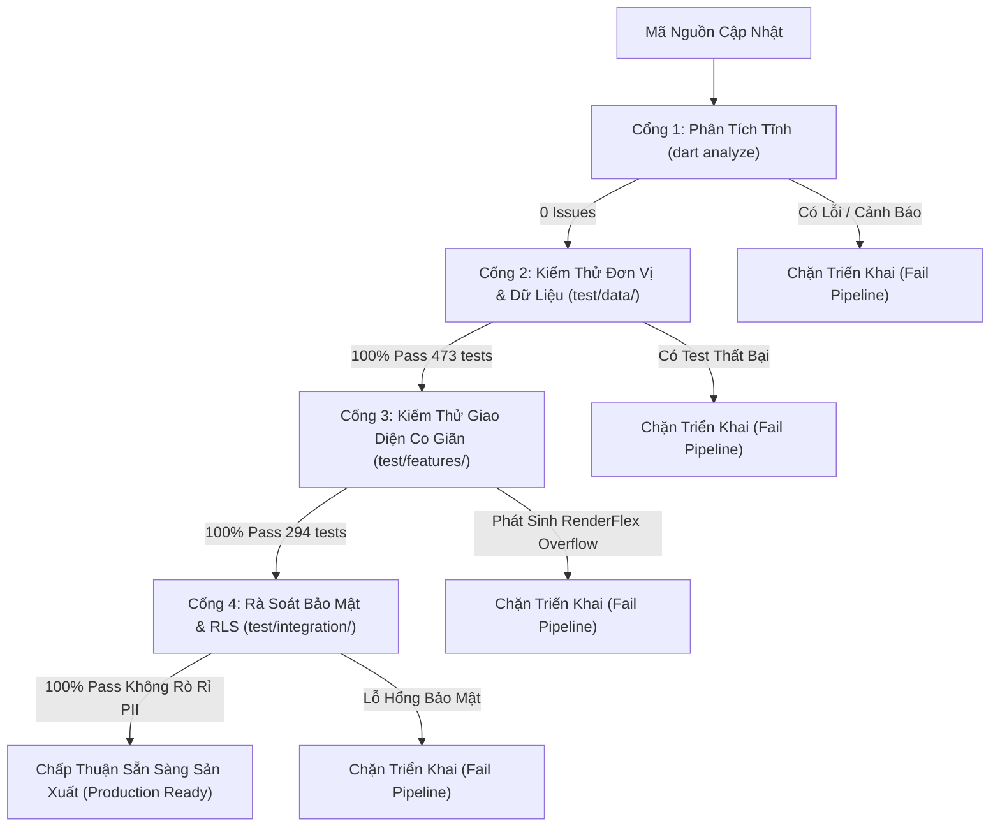

# Bộ Quy Chuẩn Kiểm Thử Chất Lượng & Kịch Bản Nghiệm Thu (QA & UAT Testing)

> **ĐỊNH HƯỚNG TỐI THƯỢNG:** PKA-Home là sản phẩm thương mại B2B SaaS phục vụ vận hành thực tế tại các tòa nhà/chuỗi căn hộ với người dùng thật. Toàn bộ kiến trúc và chức năng hệ thống được bảo chứng bằng quy trình **Test-Driven Development (TDD)** đa tầng, kiểm thử an ninh nghiêm ngặt và kịch bản nghiệm thu thực địa (User Acceptance Testing - UAT) chuẩn hóa.

---

## Chương 1: Kiến Trúc Bộ Kiểm Thử Tự Động (Test Pyramid)

Hệ thống sở hữu bộ kiểm thử tự động toàn diện với **368 tệp kiểm thử** và hơn **1.000+ trường hợp kiểm thử (test cases)** đạt tỷ lệ **100% Pass**:

```text
               / \
              /   \      [Tầng 5: Kiểm Thử An Ninh & RLS Multi-Tenant]
             /     \     - Tenant Isolation, Chống leo thang đặc quyền, PII Masking
            /       \
           /---------\   [Tầng 4: Kiểm Thử Tích Hợp ACID RPCs & Data Contract]
          /           \  - Giao dịch tài chính nguyên tử, Khóa hàng FOR UPDATE, Idempotency
         /-------------\ [Tầng 3: Kiểm Thử Giao Diện Widget & Responsive Anti-Overflow]
        /               \ - Co giãn từ 320dp đến 1920dp, Zoom chữ 1.3x, Không RenderFlex
       /-----------------\[Tầng 2: Kiểm Thử Quản Lý Trạng Thái & Realtime CDC]
      /                   \- Riverpod AsyncNotifier, StreamProvider, Reconnect handling
     /---------------------\[Tầng 1: Kiểm Thử Logic Miền Nghiệp Vụ Thuần Túy]
    /                       \- Bậc thang lũy tiến, Phát hiện bất thường, FailClosedGuard
   ---------------------------
```

---

## Chương 2: Chi Tiết Các Tầng Kiểm Thử Chuyên Sâu

### 2.1. Tầng 1: Logic Miền Nghiệp Vụ & An Toàn Thuật Toán
- **Phân hệ biểu phí lũy tiến (`tiered_fee_calculator`):**
  - Kiểm thử công thức lũy tiến điện 6 bậc theo quy định Quyết định Bộ Công Thương.
  - Kiểm thử công thức lũy tiến nước sinh hoạt 4 bậc kèm định mức số nhân khẩu cư dân.
  - Xử lý làm tròn số học tiền tệ Việt Nam Đồng (VND), bảo đảm không thất thoát dù chỉ 1 đồng.
- **Thuật toán phát hiện bất thường điện nước (`utility_anomaly_detector`):**
  - So sánh mức tiêu thụ kỳ này với trung bình 3 kỳ trước liền kề.
  - Kích hoạt cờ cảnh báo nếu chỉ số vượt ngưỡng 150% (nghi rò rỉ nước hoặc chập cháy thiết bị).
- **Cơ chế phòng thủ sụp đổ an toàn (`FailClosedGuard`):**
  - Mọi thao tác truy xuất dữ liệu nếu mất kết nối hoặc máy chủ chưa sẵn sàng đều bị chặn đóng an toàn, tuyệt đối không trả dữ liệu giả lập đánh lừa tài chính.

### 2.2. Tầng 2: Quản Lý Trạng Thái & Đồng Bộ Dữ Liệu Realtime
- **Tập tin trọng yếu:** `test/data/providers/`, `test/data/repositories/`
- **Quản lý vòng đời Riverpod:**
  - `AsyncNotifierProvider` tự động quản lý 3 trạng thái: Đang tải (Loading), Dữ liệu hợp lệ (Data), và Lỗi nghiệp vụ (Error kèm nút Thử lại).
  - Tách bạch môi trường chạy thực và môi trường kiểm thử offline thông qua cờ tường minh `_isMockMode`, ngăn chặn việc gọi `Supabase.instance` chưa khởi tạo trong test.
- **Đồng bộ sự kiện thời gian thực (CDC Realtime Streams):**
  - Kiểm thử tiếp nhận sự kiện thay đổi dữ liệu từ PostgreSQL Replication Stream.
  - Cơ chế lọc trùng gói tin thông qua bộ đệm mã định danh (`_seenNotificationIds`).
  - Hủy stream listener an toàn khi người dùng đăng xuất, tránh rò rỉ bộ nhớ (Memory Leak).

### 2.3. Tầng 3: Giao Diện Widget & Thích Ứng Màn Hình (Anti-RenderFlex)
- **Tập tin trọng yếu:** `test/features/`
- **Tiêu chuẩn co giãn đa kích thước:**
  - Kiểm thử tự động trên màn hình di động cực nhỏ: `320dp x 600dp` với tỷ lệ phóng to chữ `1.3x`.
  - Kiểm thử trên màn hình máy tính bảng và màn hình rộng: `768dp x 1024dp`, `1200dp x 800dp`, `1920dp x 1080dp`.
  - **Quy tắc tuyệt đối:** Không xuất hiện bất kỳ lỗi tràn màn hình `RenderFlex overflowed by X pixels`. Mọi văn bản dài đều tự động xuống dòng nhờ `Wrap`, `Flexible`, `ConstrainedBox`.

### 2.4. Tầng 4: Giao Dịch Tài Chính Nguyên Tử & Hợp Đồng DTO
- **Tập tin trọng yếu:** `test/integration/payment_workflow_migration_test.dart`
- **Kiểm thử ACID RPC PostgreSQL:**
  - Hàm RPC gạch nợ tự động sử dụng câu lệnh `FOR UPDATE` khóa dòng hóa đơn trong CSDL, ngăn ngừa lỗi thanh toán trùng lặp (Double Spending) khi nhiều webhook bắn về đồng thời.
  - Tính năng Idempotency: Ghi nhận mã giao dịch thanh toán duy nhất. Yêu cầu trùng mã sẽ bị từ chối với mã lỗi xung đột `409 Conflict`.
  - Cột thành tiền `subtotal` trong `invoice_items` là Generated Column của CSDL, loại bỏ rủi ro gian lận tính toán từ phía máy khách.

### 2.5. Tầng 5: Bảo Mật Dữ Liệu Đa Khách Thuê & RLS (Row Level Security)
- **Tập tin trọng yếu:** `test/integration/rls_security_test.dart`, `test/integration/tenant_isolation_test.dart`
- **Bộ quy tắc chính sách RLS:**
  - `RLS-01`: Cư dân chỉ được phép đọc (`SELECT`) dữ liệu gắn liền với căn hộ mà họ đã được Ban Quản Lý phê duyệt liên kết.
  - `RLS-02`: Nghiêm cấm cư dân cập nhật trực tiếp (`UPDATE`) trạng thái hóa đơn qua API PostgREST.
  - `RLS-03`: Kỹ thuật viên chỉ có quyền cập nhật các phiếu sự cố được điều phối trong cơ sở mình phụ trách.
  - `RLS-04 (Chống leo thang đặc quyền)`: Tài khoản người dùng thông thường bị chặn tuyệt đối việc sửa đổi cột `role` trong bảng `users`.
  - `RLS-05 (Phân lập Tenant)`: Ban Quản Lý thuộc Ban điều hành A không thể đọc hoặc chỉnh sửa dữ liệu tòa nhà, cư dân, quỹ tài chính của Ban điều hành B.

---

## Chương 3: Danh Mục 12 Kịch Bản Nghiệm Thu Thực Địa (UAT Scenarios)

Bộ kịch bản phục vụ nghiệm thu thực tế với Khách hàng / Đơn vị vận hành tòa nhà trước khi đưa vào khai thác thương mại chính thức:

| Mã Kịch Bản | Phân Hệ Nghiệp Vụ | Đối Tượng Tham Gia | Nội Dung & Tiêu Chí Chấp Thuận |
| :--- | :--- | :--- | :--- |
| **UAT-01** | Kích Hoạt Tài Khoản Cư Dân | Cư dân mới | Cư dân tải app, nhập mã kích hoạt nhận qua SMS/Email, tạo mã PIN 6 số cá nhân, liên kết thành công căn hộ đúng tên. |
| **UAT-02** | Phát Hành Hóa Đơn Hàng Loạt | Kế toán BQL | Kế toán chốt kỳ phí tháng, hệ thống tự tính phí quản lý, phí gửi xe và lũy tiến điện nước; phát hành hóa đơn đến 100% cư dân kèm thông báo Push. |
| **UAT-03** | Thanh Toán VietQR Tự Động | Cư dân, Kế toán | Cư dân quét mã VietQR tự sinh trên app. Tiền vào tài khoản BQL, hệ thống nhận tín hiệu webhook và tự động gạch nợ hóa đơn thành "Đã thanh toán" dưới 3 giây. |
| **UAT-04** | Ghi Chỉ Số Điện Nước Thật | Nhân viên kỹ thuật, Cư dân | Chụp ảnh công tơ thật tại hành lang; nhập chỉ số. Nếu chỉ số nhảy vọt vượt 150%, app hiển thị hộp thoại cảnh báo bắt buộc xác nhận lại. |
| **UAT-05** | Đặt Lịch Tiện Ích Trả Phí | Cư dân, Lễ tân | Cư dân đặt sân cầu lông hoặc phòng sinh hoạt cộng đồng khung giờ 18:00 - 19:30. Khung giờ lập tức chuyển sang trạng thái "Đã đặt", cư dân khác không thể chọn trùng. |
| **UAT-06** | Đăng Ký Định Danh Phương Tiện | Cư dân, Quản lý bãi xe | Cư dân chụp ảnh giấy tờ xe (cà vẹt), gửi yêu cầu. BQL duyệt trên màn hình điều phối, hệ thống cấp vị trí ô đỗ hầm B1/B2 và đồng bộ mã thẻ xe. |
| **UAT-07** | Kiểm Soát Xe Khách Vãng Lai | Bảo vệ trực cổng | Xe khách vào quét mã vé điện tử tại bốt kiểm soát. Màn hình bảo vệ hiển thị thời gian vào, biển số xe và tự động tính tiền gửi xe theo biểu phí giờ khi ra. |
| **UAT-08** | Tiếp Nhận & Điều Phối Sự Cố | Cư dân, Kỹ thuật viên | Cư dân báo sự cố rò rỉ ống nước khu bếp (mức độ P1). Trưởng ban kỹ thuật nhận thông báo khẩn, điều phối thợ trực tiếp nhận trong vòng 15 phút theo cam kết SLA. |
| **UAT-09** | Chi Phí Quỹ Bảo Trì 2% | Ban Quản Trị, Kế toán | Tạo đề xuất sửa chữa lớn hệ thống máy bơm PCCC. Yêu cầu phê duyệt chữ ký số kép (Kế toán trưởng duyệt bước 1, Trưởng BQT duyệt bước 2) mới có hiệu lực. |
| **UAT-10** | Hội Nghị & Biểu Quyết Số | Cư dân chủ hộ, BQL | BQL tạo cuộc bỏ phiếu chọn đơn vị bảo trì thang máy. Cư dân dùng app bỏ phiếu điện tử. Kết quả kiểm phiếu hiển thị trực tiếp theo tỷ lệ phần trăm diện tích sở hữu. |
| **UAT-11** | Quản Lý Bưu Kiện Lễ Tân | Lễ tân, Cư dân | Shipper giao kiện hàng, lễ tân chụp ảnh và quét mã vận đơn, hệ thống gửi thông báo Push kèm mã nhận hàng OTP 4 số cho cư dân. |
| **UAT-12** | Phòng Thủ Mất Mạng (Fail-Closed) | Đội ngũ QA / Kỹ thuật | Ngắt kết nối mạng hoặc tắt API. Mọi thao tác tài chính và cấp quyền chuyển sang màn hình thông báo lỗi an toàn, tuyệt đối không bịa dữ liệu giả lập. |

---

## Chương 4: Ma Trận Cổng Chất Lượng CI/CD (Quality Gates)

Mỗi lần phát hành mã nguồn lên nhánh chính `main` đều phải vượt qua 4 cổng kiểm soát chất lượng tự động:



### Tiêu Chuẩn Nghiệm Thu Đóng Gói Bản Phát Hành (Release Exit Criteria):
1. **Linter & Static Analysis:** `dart analyze lib test` đạt chuẩn `0 errors, 0 warnings, 0 infos`.
2. **Tỷ lệ vượt qua kiểm thử tự động:** `100%` trên toàn bộ 368 tệp kiểm thử (Zero Regression).
3. **Bảo vệ mã định danh tài chính:** 100% hóa đơn bắt buộc mang mã thanh toán cấp phát từ CSDL máy chủ (`payment_code`), không có ngoại lệ client-generated.
4. **Không rò rỉ dữ liệu cá nhân:** Số căn cước công dân và mật khẩu được mã hóa băm một chiều; số điện thoại được che mờ (masking) theo chuẩn Luật Bảo vệ dữ liệu cá nhân 2026.
