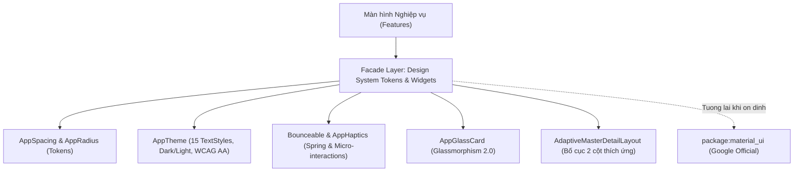

# Lộ Trình Kiến Trúc & Theo Dõi Tích Hợp Material 3 Expressive (`package:material_ui`)

> **Dự án:** Vivona - Nền tảng Quản lý Bất động sản Thương mại B2B SaaS  
> **Phiên bản Flutter nền tảng:** 3.44.0 (Dart 3.12.0)  
> **Trạng thái:** Tự chủ Design System Tokens — Chờ ổn định từ `package:material_ui` chính thức  
> **Cập nhật lần cuối:** 18/11/2026

---

## 1. Bối Cảnh Công Nghệ Flutter & Material Design (2026)

### 1.1. Sự Đóng Băng của Material SDK trong Flutter Framework
- Từ phiên bản **Flutter 3.44**, nhóm kỹ sư Flutter (Google) đã chính thức đóng băng (feature-freeze) việc bổ sung các thành phần giao diện mới vào thư viện gốc `flutter/material.dart` nhằm giữ cho lõi framework tinh gọn và giảm thiểu breaking changes cho các ứng dụng toàn cầu.
- Toàn bộ các cải tiến của ngôn ngữ thiết kế **Material 3 Expressive** (hình khối bo góc bất đối xứng, chuyển động spring physics, màu sắc tương phản cao, và các biến thể component mới) được tách riêng thành package độc lập: `package:material_ui`.

### 1.2. Hiện Trạng của `package:material_ui`
- Phiên bản hiện hành: `1.4.0`.
- Đánh giá mức độ hoàn thiện: Package mới chỉ thử nghiệm sơ khai cờ `StyleVariant` ở cấp độ ThemeData, chưa cung cấp đầy đủ các component Expressive sẵn sàng cho môi trường production thương mại (như Expressive Buttons, Expressive Cards, Split Buttons, Segmented Floating Action Buttons).
- Các package cộng đồng không chính thức trên pub.dev (ví dụ: `expressive_ui_kit`, `material_3_expressive`) thường xuyên thay đổi API đột ngột giữa các bản vá, thiếu kiểm thử trên đa nền tảng, và tiềm ẩn rủi ro phá vỡ tính ổn định của hệ thống B2B SaaS.

---

## 2. Chiến Lược Kiến Trúc Tự Chủ của Vivona

Thay vì phụ thuộc vào các thư viện trôi nổi hoặc chờ đợi thụ động, Vivona đã hiện thực hóa trọn vẹn tinh thần **Expressive 2026** thông qua hệ thống **Design System nội tại** cực kỳ vững chắc:

### 2.1. Các Trụ Cột Đã Hoàn Thiện
1. **Tokens Khoảng cách & Hình khối:**
   - `AppSpacing`: Hệ thống khoảng cách chuẩn 4, 8, 12, 16, 20, 24, 32dp (`p4` đến `p32`), xóa bỏ hoàn toàn 230+ chỗ padding viết tay.
   - `AppRadius`: Thang bo góc linh hoạt (`rXs` 4dp, `rSm` 8dp, `rMd` 12dp, `rLg` 16dp, `rXl` 24dp, `rFull` 999dp).
2. **Hệ Thống Kiểu Chữ & Màu Sắc Hoàn Thiện:**
   - Khai báo đầy đủ 15/15 styles trong `TextTheme` theo Material Design 3 Specification, loại bỏ hơn 1.200 chỗ `fontSize` hardcode.
   - Đảm bảo tỷ lệ tương phản WCAG AA trên cả Light Theme và Dark Theme.
3. **Chuyển Động & Phản Hồi Xúc Giác:**
   - `Bounceable`: Áp dụng động lực học lò xo (Spring physics scale 0.96) mang lại cảm giác phản hồi tự nhiên cho mọi nút bấm.
   - `AppHaptics`: Phủ phản hồi xúc giác tinh tế (`lightImpact`, `mediumImpact`, `selectionClick`) cho các thao tác chuyển trạng thái và thanh toán.
4. **Hiệu Ứng Bề Mặt Kính (Glassmorphism 2.0):**
   - `AppGlassCard`: Sử dụng `BackdropFilter` làm mờ kết hợp viền mờ bán trong suốt thích ứng theo theme, tôn trọng triết lý hiển thị của iOS 26 và Android 16.
5. **Bố Cục Thích Ứng (Adaptive Master-Detail):**
   - Hóa đơn và Phản ánh sự cố tự động mở rộng thành 2 cột độc lập trên màn hình $\ge 900$dp, đồng thời duy trì luồng di động chuẩn mực trên màn hình nhỏ.

---

## 3. Điều Kiện & Quy Trình Di Chuyển Khi `package:material_ui` Sẵn Sàng

### 3.1. Tiêu Chí Sẵn Sàng (Readiness Gate)
Vivona chỉ xem xét tích hợp `package:material_ui` khi hội đủ 4 điều kiện sau:
1. **Phiên bản chính thức:** Package đạt phiên bản $\ge 2.0.0$ và được bảo trợ trực tiếp bởi Flutter / Google team.
2. **Đầy đủ component cốt lõi:** Có các widget Expressive chính thức hỗ trợ Material You Dynamic Colors và Spring physics tích hợp sẵn.
3. **Không phá vỡ WCAG AA:** Đảm bảo khả năng kiểm soát độ tương phản màu sắc và hỗ trợ đầy đủ `Semantics` cho người khiếm thị.
4. **Chạy qua Golden Test Suite:** Mọi sự thay đổi từ package mới phải vượt qua bộ Golden Tests hiện hành của Vivona mà không làm vỡ giao diện.

### 3.2. Quy Trình Chuyển Đổi An Toàn (Migration Strategy)
Nhờ kiến trúc **Facade Pattern** của Vivona, quá trình nâng cấp trong tương lai sẽ diễn ra với chi phí tối thiểu và không gây xáo trộn:
1. Bổ sung `material_ui` vào `pubspec.yaml`.
2. Cập nhật `AppTheme.lightTheme` và `AppTheme.darkTheme` để kích hoạt `StyleVariant` và các component theme mới của `material_ui`.
3. Cập nhật các widget trong `lib/core/widgets/` (`AppCard`, `Bounceable`) để ủy quyền (delegate) xử lý cho component của `material_ui`.
4. Toàn bộ các màn hình trong `features/` giữ nguyên mã nguồn 100%, không cần refactor lại.
5. Chạy `flutter test test/goldens/ --update-goldens` để rà soát khác biệt hình ảnh và nghiệm thu.

