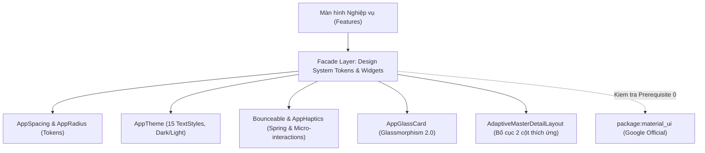

# Lộ Trình Kiến Trúc & Theo Dõi Tích Hợp Material 3 Expressive (`package:material_ui`)

> **Dự án:** Vivona - Nền tảng Quản lý Bất động sản Thương mại B2B SaaS  
> **Phiên bản Flutter nền tảng hiện tại:** 3.44.0 (Dart 3.12.0)  
> **Trạng thái:** Tự chủ Design System Tokens — Đang theo dõi và chờ phiên bản ổn định của `package:material_ui`  
> **Cập nhật lần cuối:** 18/11/2026 (Hiệu chỉnh số liệu kiểm toán thực tế)  

---

## 1. Bối Cảnh Công Nghệ Flutter & Material Design (2026)

### 1.1. Sự Đóng Băng của Material SDK trong Flutter Framework
- Từ phiên bản **Flutter 3.44**, nhóm kỹ sư Flutter (Google) đã chính thức đóng băng (feature-freeze) việc bổ sung các thành phần giao diện mới vào thư viện gốc `flutter/material.dart` nhằm giữ cho lõi framework tinh gọn và giảm thiểu breaking changes cho các ứng dụng toàn cầu.
- Toàn bộ các cải tiến của ngôn ngữ thiết kế **Material 3 Expressive** (hình khối bo góc bất đối xứng, chuyển động spring physics, màu sắc tương phản cao, và các biến thể component mới) được tách riêng thành package độc lập: `package:material_ui`.

### 1.2. Hiện Trạng của `package:material_ui`
- Phiên bản hiện hành: `1.4.0` (Yêu cầu Flutter SDK $\ge 3.47$).
- Đánh giá mức độ hoàn thiện: Package mới chỉ thử nghiệm sơ khai cờ `StyleVariant` ở cấp độ ThemeData, chưa cung cấp đầy đủ các component Expressive sẵn sàng cho môi trường production thương mại (như Expressive Buttons, Expressive Cards, Split Buttons, Segmented Floating Action Buttons).
- Các package cộng đồng không chính thức trên pub.dev (ví dụ: `expressive_ui_kit`, `material_3_expressive`) thường xuyên thay đổi API đột ngột giữa các bản vá, thiếu kiểm thử trên đa nền tảng, và tiềm ẩn rủi ro phá vỡ tính ổn định của hệ thống B2B SaaS.

---

## 2. Chiến Lược Kiến Trúc Tự Chủ của Vivona

Thay vì phụ thuộc vào các thư viện trôi nổi hoặc chờ đợi thụ động, Vivona áp dụng nguyên tắc **Expressive 2026** thông qua hệ thống **Design System nội tại** bọc qua Facade Pattern:

### 2.1. Hiện Trạng Triển Khai Thực Tế (Kiểm toán 18/11/2026)

| Trụ Cột Design System | Đã Hoàn Thiện (Core & Whitelist) | Khối Lượng Nợ Tồn Codebase (Backlog) |
| :--- | :--- | :--- |
| **Tokens Khoảng cách & Bo góc** | Xây dựng bộ `AppSpacing` (p4 - p32) & `AppRadius` (rXs - rFull). Đã chuẩn hóa toàn bộ widget core và 8 module Whitelist. | Còn 1.170 `EdgeInsets` và 649 `BorderRadius.circular` viết tay trên toàn dự án đang được cuốn chiếu dần. |
| **Hệ thống Kiểu chữ (Typography)** | Khai báo đủ 15/15 styles trong `TextTheme`. Đã dọn sạch 270+ chỗ `fontSize:` tại các màn hình trọng yếu. | Còn 936 `fontSize:` cứng trong các màn hình quản trị và form phụ cần tiếp tục chuyển đổi sang `textTheme.*`. |
| **Động lực học Spring Motion** | Xây dựng `Bounceable` (Spring physics scale 0.96) và áp dụng cho 8 nút/hành động chính (Avatar, Quick Actions, Hóa đơn). | Đang nhân rộng `Bounceable` cho các nút bấm phụ trên các danh sách và biểu mẫu. |
| **Phản hồi xúc giác (Haptics)** | Tích hợp `AppHaptics` vào bộ chuyển tab, thao tác chọn và xác nhận giao dịch. | Tiếp tục phủ kín các nút hành động nguy hiểm (xóa, từ chối, hủy). |
| **Hiệu ứng Kính (Glassmorphism 2.0)** | Triển khai `AppGlassCard` với viền mờ bán trong suốt, tích hợp vào thanh cảnh báo và header chip. | Golden tests bảo vệ trực quan Light & Dark mode. |
| **Khả năng Trợ năng (Accessibility)** | Cung cấp 15 thẻ `Semantics` tường minh cho các badge số lượng và nút icon điều hướng. | Cần mở rộng `Semantics` cho toàn bộ input form và xây dựng automated contrast testing cho WCAG AA. |

---

## 3. Điều Kiện & Quy Trình Di Chuyển Khi `package:material_ui` Sẵn Sàng

### 3.1. Tiêu Chí Sẵn Sàng (Readiness Gate)
Vivona chỉ xem xét tích hợp `package:material_ui` khi hội đủ 5 điều kiện sau:

1. **Prerequisite 0 (SDK Readiness Gate - Bắt buộc):**  
   - Hiện tại CI workflow của dự án (`.github/workflows/quality_gate.yml`) đang **ghim cố định `flutter-version: '3.44.0'`** để bảo đảm tính ổn định tuyệt đối cho sản phẩm Production SaaS.
   - `package:material_ui` yêu cầu môi trường Flutter SDK $\ge 3.47$.  
   - **Do đó, bước tiên quyết là phải thực hiện kế hoạch nâng cấp Flutter SDK lên $\ge 3.47$ (khi nhánh Stable chính thức hỗ trợ ổn định) và cập nhật CI trước khi có thể thêm dependency vào dự án.**
2. **Phiên bản chính thức:** Package đạt phiên bản $\ge 2.0.0$ và được bảo trợ trực tiếp bởi Flutter / Google team.
3. **Đầy đủ component cốt lõi:** Có các widget Expressive chính thức hỗ trợ Material You Dynamic Colors và Spring physics tích hợp sẵn.
4. **Không phá vỡ WCAG AA:** Đảm bảo khả năng kiểm soát độ tương phản màu sắc và hỗ trợ đầy đủ `Semantics` cho người khiếm thị.
5. **Chạy qua Golden Test Suite:** Mọi sự thay đổi từ package mới phải vượt qua bộ Golden Tests hiện hành của Vivona mà không làm vỡ giao diện.

### 3.2. Quy Trình Chuyển Đổi An Toàn (Migration Strategy)
Khi đáp ứng trọn vẹn Prerequisite 0 và Readiness Gate, việc chuyển đổi diễn ra mượt mà nhờ Facade Layer:
1. Nâng cấp Flutter SDK trong môi trường dev và CI lên phiên bản hỗ trợ.
2. Bổ sung `material_ui` vào `pubspec.yaml`.
3. Cập nhật `AppTheme.lightTheme` và `AppTheme.darkTheme` để kích hoạt `StyleVariant` và các component theme mới của `material_ui`.
4. Cập nhật các widget trong `lib/core/widgets/` (`AppCard`, `Bounceable`) để ủy quyền (delegate) xử lý cho component của `material_ui`.
5. Toàn bộ các màn hình trong `features/` giữ nguyên mã nguồn 100%, không cần refactor lại.
6. Chạy `flutter test test/goldens/ --update-goldens` để rà soát khác biệt hình ảnh và nghiệm thu.
