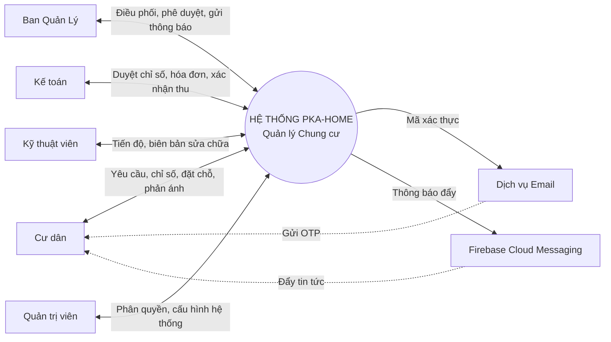
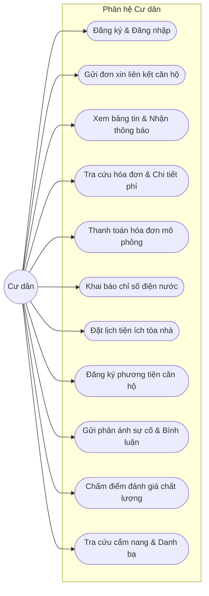
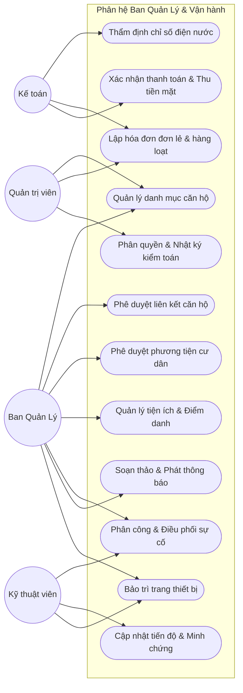
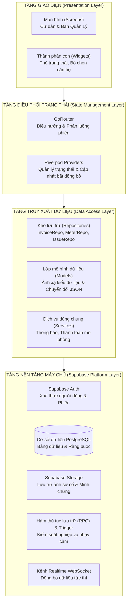
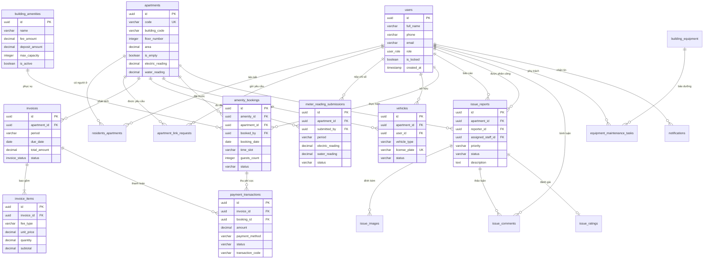
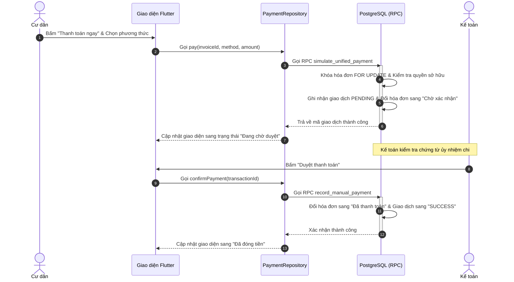
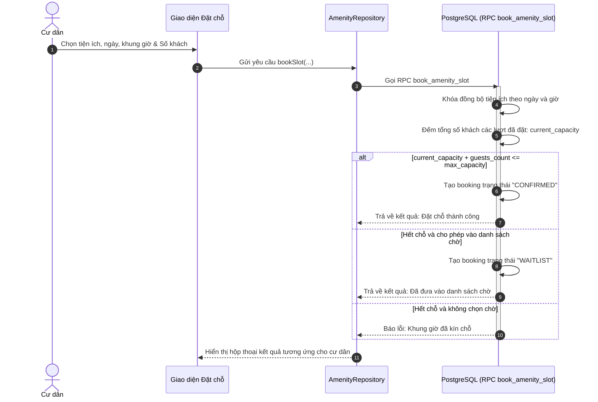
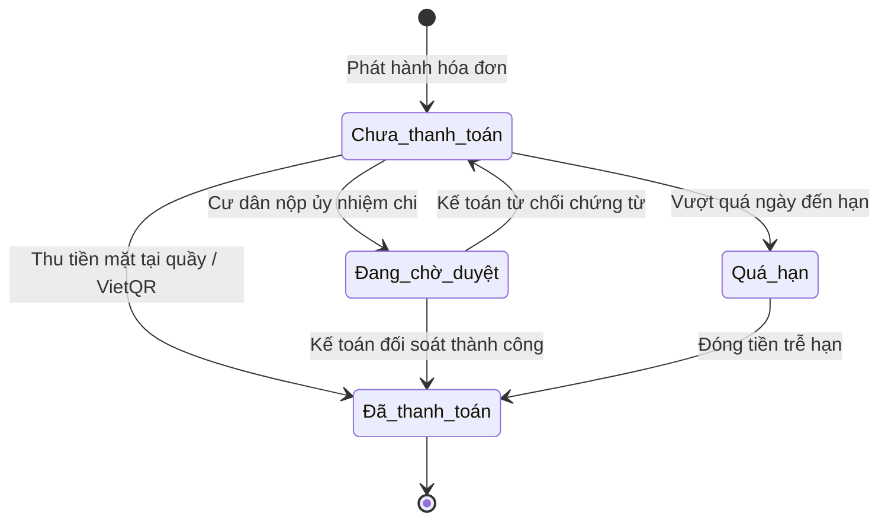
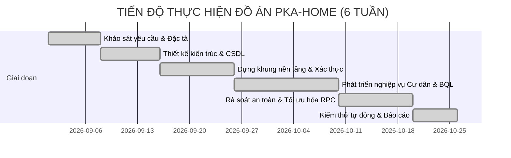

# TRƯỜNG ĐẠI HỌC PHENIKAA
## TRƯỜNG CÔNG NGHỆ THÔNG TIN

---

# BÁO CÁO ĐỒ ÁN LIÊN NGÀNH
## ĐỀ TÀI: ỨNG DỤNG QUẢN LÝ CHUNG CƯ (PKA-HOME)

* **Sinh viên thực hiện:** Phạm Văn Minh
* **Mã sinh viên:** 23010350
* **Email:** 23010350@st.phenikaa-uni.edu.vn
* **Giảng viên hướng dẫn:** Tiến sĩ Nguyễn Thị Vân
* **Thời gian thực hiện:** Hà Nội, tháng 10 năm 2026

---

## LỜI CẢM ƠN
Em xin chân thành cảm ơn Ban Giám hiệu Trường Đại học Phenikaa, Ban Chủ nhiệm Trường Công nghệ Thông tin cùng các thầy cô giáo đã tận tình giảng dạy, truyền đạt kiến thức và tạo môi trường học tập, thực hành thuận lợi trong suốt quá trình triển khai đồ án liên ngành. Quá trình thực hiện đề tài đã giúp em kết nối các khối kiến thức phân tích nghiệp vụ, thiết kế hệ thống phần mềm, lập trình ứng dụng di động, quản trị cơ sở dữ liệu và bảo mật thông tin thành một sản phẩm có tính thực tiễn cao.

Em xin bày tỏ lòng biết ơn sâu sắc tới Tiến sĩ Nguyễn Thị Vân – người đã trực tiếp hướng dẫn, định hướng học thuật và đưa ra những lời khuyên quý báu giúp em hoàn thiện quy trình phân tích nghiệp vụ, rà soát kiến trúc hệ thống và chuẩn hóa nội dung báo cáo.

Dù đã có nhiều nỗ lực hoàn thiện hệ thống, song do giới hạn về mặt thời gian và phạm vi thử nghiệm, đồ án khó tránh khỏi những thiếu sót nhất định. Em rất mong nhận được những ý kiến đóng góp quý báu từ quý thầy cô trong Hội đồng đánh giá để sản phẩm tiếp tục được hoàn thiện và nâng cao tính ứng dụng.

---

## LỜI CAM ĐOAN
Em, Phạm Văn Minh, cam đoan đề tài "Ứng dụng Quản lý Chung cư (PKA-Home)" là công trình nghiên cứu và phát triển phần mềm do em trực tiếp thực hiện dưới sự định hướng của giảng viên hướng dẫn. Toàn bộ mã nguồn, cấu trúc cơ sở dữ liệu, sơ đồ thiết kế và kết quả kiểm thử được trình bày trong báo cáo này là trung thực, phản ánh đúng kết quả triển khai thực tế của dự án.

Các tài liệu tham khảo, nền tảng công nghệ, công cụ mã nguồn mở và hình ảnh minh họa từ bên thứ ba đều được ghi nhận nguồn gốc rõ ràng tại danh mục tài liệu tham khảo. Các dữ liệu mẫu sử dụng trong quá trình kiểm thử là dữ liệu giả lập phục vụ mục đích nghiên cứu học thuật, không đại diện cho thông tin định danh của bất kỳ cư dân hay đơn vị quản lý thực tế nào. Em xin chịu hoàn toàn trách nhiệm về tính trung thực của báo cáo này.

---

## TÓM TẮT ĐỒ ÁN
PKA-Home là hệ sinh thái phần mềm quản lý chung cư hiện đại, được xây dựng nhằm số hóa và tự động hóa toàn diện các quy trình tương tác hai chiều giữa cư dân và bộ phận vận hành tòa nhà. Hệ thống được tổ chức phân quyền chặt chẽ theo vai trò thực tế gồm: Cư dân, Quản trị viên, Ban Quản lý, Kế toán và Kỹ thuật viên. Phạm vi nghiệp vụ bao gồm: quản lý căn hộ, hồ sơ cư trú, tiếp nhận và thẩm định chỉ số điện nước, lập hóa đơn tự động và hàng loạt, thanh toán mô phỏng đa phương thức, đăng ký thẻ phương tiện có hạn mức, đặt tiện ích chung cư với kiểm soát sức chứa thực tế và danh sách chờ, tiếp nhận phản ánh sự cố theo mức độ khẩn cấp, trao đổi bình luận thời gian thực và khảo sát đánh giá chất lượng dịch vụ.

Ứng dụng di động được xây dựng trên nền tảng Flutter và ngôn ngữ Dart theo kiến trúc phân tầng Feature-first. Thư viện Riverpod quản lý trạng thái và đồng bộ dữ liệu; GoRouter đảm nhiệm điều hướng phân luồng bảo mật. Phía máy chủ sử dụng nền tảng Supabase cung cấp xác thực người dùng, hệ quản trị cơ sở dữ liệu quan hệ PostgreSQL, cơ chế cập nhật thời gian thực qua WebSocket và vùng lưu trữ tệp tin.

Điểm nhấn kỹ thuật nổi bật của đồ án là thiết kế an toàn dữ liệu từ gốc (Security by Design):
1. **Phòng thủ ba lớp chống leo thang đặc quyền**: Kết hợp trigger cơ sở dữ liệu, chính sách phân quyền cấp bản ghi (RLS) và hàm thủ tục lưu trữ an toàn (RPC với đặc quyền của người định nghĩa).
2. **Bảo toàn toàn vẹn dữ liệu tài chính**: Toàn bộ phép tính chi tiết và tổng hóa đơn được thực hiện tự động bằng cột tính toán sẵn của PostgreSQL (Generated Column) và hàm trigger nội bộ, triệt tiêu nguy cơ gian lận từ giao diện người dùng.
3. **Cơ chế xử lý đồng thời và chống trùng lặp**: Khóa đồng bộ giao dịch được áp dụng trong quy trình đặt tiện ích và thanh toán nhằm ngăn chặn vượt quá sức chứa và tình trạng phát sinh giao dịch kép.

Hệ thống đã trải qua quá trình kiểm thử tự động nghiêm ngặt với 131 tệp kiểm thử và 408 ca kiểm thử tự động (405 ca logic đạt 100%, 3 ca cloud RLS bỏ qua khi chạy nội bộ), bảo đảm chất lượng phần mềm trước khi nghiệm thu.

---

## DANH MỤC CHỮ VIẾT TẮT VÀ THUẬT NGỮ

| Chữ viết tắt / Thuật ngữ | Tên đầy đủ hoặc nguồn gốc | Giải thích ý nghĩa tiếng Việt |
| :--- | :--- | :--- |
| **API** | Application Programming Interface | Giao diện lập trình ứng dụng hỗ trợ trao đổi dữ liệu |
| **BQL** | Ban Quản lý | Đơn vị vận hành, tiếp nhận yêu cầu và quản trị tòa nhà |
| **Dart** | Dart Programming Language | Ngôn ngữ lập trình hướng đối tượng dùng phát triển Flutter |
| **ERD** | Entity-Relationship Diagram | Sơ đồ quan hệ thực thể mô tả cấu trúc dữ liệu |
| **FCM** | Firebase Cloud Messaging | Dịch vụ gửi thông báo đẩy đến thiết bị di động |
| **FK** | Foreign Key | Khóa ngoại liên kết dữ liệu giữa các bảng quan hệ |
| **Flutter** | Flutter Framework | Bộ công cụ phát triển ứng dụng đa nền tảng |
| **GoRouter** | GoRouter Package | Bộ thư viện điều hướng và định tuyến theo phiên làm việc |
| **HTTP** | Hypertext Transfer Protocol | Giao thức truyền tải siêu văn bản mạng Internet |
| **KPI** | Key Performance Indicator | Chỉ số đánh giá hiệu quả công việc và chất lượng dịch vụ |
| **OTP** | One-Time Password | Mã xác thực số sử dụng một lần có thời hạn ngắn |
| **PK** | Primary Key | Khóa chính xác định tính duy nhất của bản ghi dữ liệu |
| **PostgreSQL** | PostgreSQL Database System | Hệ quản trị cơ sở dữ liệu quan hệ mã nguồn mở mạnh mẽ |
| **RBAC** | Role-Based Access Control | Mô hình kiểm soát truy cập và phân quyền dựa trên vai trò |
| **Riverpod** | Riverpod State Management | Thư viện quản lý trạng thái phản ứng độc lập và an toàn kiểu |
| **RLS** | Row Level Security | Cơ chế kiểm soát an ninh phân quyền ở cấp bản ghi dữ liệu |
| **RPC** | Remote Procedure Call | Lời gọi hàm thủ tục lưu trữ thực thi trực tiếp trên máy chủ |
| **SDK** | Software Development Kit | Bộ công cụ phát triển phần mềm cho nền tảng chuyên biệt |
| **SQL** | Structured Query Language | Ngôn ngữ truy vấn dữ liệu quan hệ có cấu trúc |
| **SRS** | Software Requirements Specification | Tài liệu đặc tả yêu cầu phần mềm kỹ thuật |
| **UI/UX** | User Interface / User Experience | Giao diện người dùng và Trải nghiệm người dùng |
| **UML** | Unified Modeling Language | Ngôn ngữ mô hình hóa thống nhất chuẩn quốc tế |
| **WBS** | Work Breakdown Structure | Cấu trúc phân chia công việc trong quản lý dự án |

---

## MỤC LỤC
* PHÂN CÔNG THỰC HIỆN ĐỒ ÁN
* 1. GIỚI THIỆU
  * 1.1. Đặt vấn đề
    * 1.1.1. Mục tiêu đề tài
    * 1.1.2. Đối tượng sử dụng
    * 1.1.3. Phạm vi đề tài
    * 1.1.4. Phương pháp thực hiện
  * 1.2. Khảo sát các giải pháp hiện có
    * 1.2.1. Hồ sơ giấy và bảng tính truyền thống
    * 1.2.2. Biểu mẫu trực tuyến và mạng xã hội
    * 1.2.3. Các phần mềm thương mại chuyên dụng
  * 1.3. Giải pháp đề xuất PKA-Home
    * 1.3.1. Điểm mới và giá trị mang lại
* 2. THIẾT KẾ VÀ TRIỂN KHAI HỆ THỐNG
  * 2.1. Đặc tả yêu cầu chức năng
  * 2.2. Đặc tả yêu cầu phi chức năng
  * 2.3. Các ràng buộc kỹ thuật và vận hành
    * 2.3.1. Ràng buộc triển khai
    * 2.3.2. Ràng buộc kinh tế
    * 2.3.3. Ràng buộc đạo đức và bảo mật dữ liệu
  * 2.4. Mô hình hệ thống và thiết kế chi tiết
    * 2.4.1. Phân quyền vai trò và ma trận truy cập
    * 2.4.2. Sơ đồ ngữ cảnh hệ thống
    * 2.4.3. Sơ đồ ca sử dụng tổng quan và chi tiết
    * 2.4.4. Đặc tả các ca sử dụng trọng tâm
    * 2.4.5. Kiến trúc phần mềm phân tầng
    * 2.4.6. Sơ đồ lớp nghiệp vụ
    * 2.4.7. Sơ đồ luồng dữ liệu
    * 2.4.8. Thiết kế cơ sở dữ liệu chi tiết
    * 2.4.9. Đặc tả các hàm thủ tục lưu trữ máy chủ
    * 2.4.10. Thiết kế các luồng nghiệp vụ then chốt
    * 2.4.11. Sơ đồ hoạt động và sơ đồ tuần tự
    * 2.4.12. Sơ đồ trạng thái nghiệp vụ
    * 2.4.13. Thiết kế giao diện người dùng
  * 2.5. Bảo mật và toàn vẹn dữ liệu
    * 2.5.1. Cơ chế phòng thủ ba lớp chống leo thang đặc quyền
    * 2.5.2. Toàn vẹn dữ liệu tài chính cấp máy chủ
    * 2.5.3. Bảo vệ lưu trữ tệp và thông báo đẩy
  * 2.6. Môi trường và công nghệ phát triển
    * 2.6.1. Cấu trúc mã nguồn dự án
  * 2.7. Kiểm thử và đánh giá nghiệm thu
    * 2.7.1. Chiến lược và quy trình kiểm thử
    * 2.7.2. Kết quả kiểm thử tự động thực tế
* 3. KẾ HOẠCH DỰ ÁN VÀ TRÁCH NHIỆM NGHỀ NGHIỆP
  * 3.1. Kế hoạch và tiến độ triển khai
  * 3.2. Quản lý chất lượng mã nguồn
  * 3.3. Đạo đức nghề nghiệp và tác động xã hội
* 4. KẾT QUẢ, KẾT LUẬN VÀ HƯỚNG PHÁT TRIỂN
  * 4.1. Kết quả đạt được
  * 4.2. Kết luận
  * 4.3. Hướng phát triển trong tương lai
* 5. TÀI LIỆU THAM KHẢO

---

## DANH MỤC HÌNH VẼ
* Hình 2.1. Sơ đồ ngữ cảnh và phạm vi hệ thống PKA-Home
* Hình 2.2. Sơ đồ ca sử dụng tổng quan PKA-Home
* Hình 2.2a. Sơ đồ ca sử dụng phân hệ Cư dân
* Hình 2.2b. Sơ đồ ca sử dụng phân hệ Ban Quản Lý và Vận hành
* Hình 2.3. Kiến trúc tổng thể hệ thống phân tầng PKA-Home
* Hình 2.4. Sơ đồ lớp nghiệp vụ mức khái niệm
* Hình 2.5. Sơ đồ luồng dữ liệu mức khái quát
* Hình 2.6. Sơ đồ quan hệ thực thể (ERD) chi tiết cấp cơ sở dữ liệu
* Hình 2.7. Luồng xử lý chỉ số điện nước và phát hành hóa đơn
* Hình 2.8. Luồng thanh toán mô phỏng và thu tiền mặt tại quầy
* Hình 2.9. Luồng đặt tiện ích và kiểm soát sức chứa đồng thời
* Hình 2.10. Luồng tiếp nhận, điều phối và đánh giá xử lý sự cố
* Hình 2.11. Sơ đồ hoạt động duyệt chỉ số và lập hóa đơn
* Hình 2.12. Sơ đồ tuần tự xác thực đăng nhập và nạp hồ sơ người dùng
* Hình 2.13. Sơ đồ tuần tự duyệt chỉ số và phát hành hóa đơn tự động
* Hình 2.13a. Sơ đồ tuần tự luồng thanh toán mô phỏng hai bước an toàn
* Hình 2.13b. Sơ đồ tuần tự luồng đặt chỗ tiện ích và xếp danh sách chờ
* Hình 2.14. Sơ đồ trạng thái vòng đời lượt đặt tiện ích
* Hình 2.14a. Sơ đồ trạng thái vòng đời hóa đơn và phiếu phản ánh sự cố
* Hình 2.15. Sơ đồ kiến trúc Quản trị tiện ích 3 Tab và cơ chế thông báo phân nhóm đích
* Hình 3.1. Biểu đồ tiến độ thực hiện dự án theo tuần

---

## DANH MỤC BẢNG BIỂU
* Bảng 1.1. So sánh các phương thức quản lý chung cư hiện nay
* Bảng 1.2. So sánh giải pháp đề xuất với các sản phẩm tham khảo
* Bảng 2.1. Danh sách yêu cầu chức năng hệ thống
* Bảng 2.2. Danh sách yêu cầu phi chức năng hệ thống
* Bảng 2.3. Bảng phân quyền vai trò người dùng trong hệ thống
* Bảng 2.4. Bảng mô tả tóm tắt các ca sử dụng trọng tâm
* Bảng 2.4a. Bảng đặc tả chi tiết ca sử dụng: Khai báo và duyệt chỉ số công tơ
* Bảng 2.4b. Bảng đặc tả chi tiết ca sử dụng: Đặt tiện ích và quản lý sức chứa
* Bảng 2.4c. Bảng đặc tả chi tiết ca sử dụng: Thanh toán mô phỏng và xác nhận thu phí
* Bảng 2.5. Trách nhiệm của các thành phần phần mềm theo kiến trúc phân tầng
* Bảng 2.6. Từ điển dữ liệu và lược đồ các bảng trong cơ sở dữ liệu
* Bảng 2.6a. Danh mục các hàm thủ tục lưu trữ máy chủ (RPC) then chốt
* Bảng 2.7. Phân nhóm các màn hình giao diện ứng dụng
* Bảng 2.8. Ma trận kiểm soát bảo mật và an toàn dữ liệu
* Bảng 2.9. Danh mục công nghệ và công cụ sử dụng trong dự án
* Bảng 2.10. Bảng tổng hợp số liệu kiểm thử tự động thực tế
* Bảng 3.1. Các giai đoạn triển khai dự án theo tiến độ
* Bảng 4.1. Tổng hợp mức độ hoàn thiện tính năng phần mềm theo phân hệ

---

# NỘI DUNG BÁO CÁO CHI TIẾT

## 1. GIỚI THIỆU

### 1.1. Đặt vấn đề
Sự gia tăng nhanh chóng của các khu căn hộ cao tầng tại các đô thị đặt ra bài toán phức tạp trong công tác vận hành tòa nhà. Một khu chung cư quy mô trung bình từ 300 đến 1.000 căn hộ phát sinh hàng trăm giao dịch và tương tác mỗi ngày: quản lý nhân khẩu, thu nhận chỉ số điện nước, phát hành hóa đơn dịch vụ, kiểm soát thẻ xe ra vào, điều phối tiện ích sinh hoạt công cộng (bể bơi, phòng thể thao, khu tiệc ngoài trời), tiếp nhận và xử lý sự cố kỹ thuật hạ tầng.

Phương thức quản lý truyền thống bộc lộ rõ nhiều điểm nghẽn nghiêm trọng:
1. **Phân tán dữ liệu**: Dữ liệu căn hộ lưu trữ rải rác trên sổ sách giấy tờ và các bảng tính độc lập; thông báo gửi qua loa phát thanh hoặc dán bảng tin hành lang dễ bị bỏ sót.
2. **Nguy cơ sai lệch tài chính**: Tính toán tiền điện nước và các loại phí dịch vụ bằng phương pháp thủ công dễ dẫn tới sai sót đơn giá, nhầm lẫn số lượng hoặc nhập sai chỉ số công tơ.
3. **Thiếu tính minh bạch và tức thời**: Cư dân không nắm được tiến độ giải quyết các sự cố hư hỏng hạ tầng; việc đối chiếu tình trạng nợ đọng gặp nhiều khó khăn.
4. **Rủi ro an toàn thông tin**: Việc thiếu cơ chế phân quyền chặt chẽ có thể khiến thông tin cá nhân của cư dân bị lộ lọt.

Đồ án **PKA-Home** ra đời nhằm giải quyết triệt để các hạn chế trên bằng việc xây dựng một nền tảng phần mềm di động hiện đại, kết nối trực tiếp cư dân với ban quản trị tòa nhà, tự động hóa quy trình nghiệp vụ và đặt trọng tâm bảo vệ an toàn dữ liệu ngay từ cấp cơ sở dữ liệu máy chủ.

#### 1.1.1. Mục tiêu đề tài
* Xây dựng ứng dụng di động hoàn chỉnh bằng Flutter với giao diện 100% tiếng Việt, điều hướng thông minh theo vai trò người dùng.
* Mô hình hóa cơ sở dữ liệu quan hệ đồng nhất trên nền tảng PostgreSQL (Supabase), chuẩn hóa định dạng căn hộ theo cấu trúc chuẩn `A0110` (Block + Tầng hai chữ số + Phòng hai chữ số).
* Đặt các quy tắc nghiệp vụ nhạy cảm (tính toán tài chính, kiểm tra sức chứa tiện ích, phân loại mức độ khẩn cấp) trực tiếp trên máy chủ qua chính sách phân quyền cấp bản ghi (RLS), trigger và hàm thủ tục lưu trữ (RPC).
* Cung cấp cổng thanh toán mô phỏng đồng nhất phục vụ nghiên cứu và diễn tập quy trình tài chính.
* Xây dựng bộ kịch bản kiểm thử tự động toàn diện nhằm kiểm chứng độ tin cậy và khả năng chống chịu sự cố của hệ thống.

#### 1.1.2. Đối tượng sử dụng
* **Cư dân**: Cư dân sở hữu hoặc thuê căn hộ, sử dụng ứng dụng để theo dõi hóa đơn, thanh toán mô phỏng, gửi phản ánh sự cố, đặt chỗ tiện ích, đăng ký phương tiện và nhận tin tức.
* **Ban Quản Lý**: Cán bộ quản lý tòa nhà, chịu trách nhiệm phê duyệt liên kết căn hộ, duyệt hồ sơ phương tiện, phát hành thông báo, điều phối kỹ thuật viên và vận hành tiện ích.
* **Kế toán**: Bộ phận tài chính, phụ trách duyệt chỉ số điện nước, phát hành hóa đơn hàng loạt, ghi nhận thanh toán tại quầy và theo dõi báo cáo doanh thu công nợ.
* **Kỹ thuật viên**: Nhân sự phụ trách sửa chữa, tiếp nhận phiếu phản ánh sự cố, cập nhật tiến độ xử lý và gửi minh chứng hoàn thành.
* **Quản trị viên**: Quản lý cấu hình toàn hệ thống, phân quyền vai trò, ủy quyền nhiệm vụ và giám sát nhật ký kiểm toán.

#### 1.1.3. Phạm vi đề tài
* Hệ thống tập trung tối ưu trải nghiệm và kiểm thử trên nền tảng **Android** (thiết bị di động và máy ảo) phục vụ bảo vệ đồ án liên ngành.
* Dữ liệu tài chính và thanh toán mang tính chất **mô phỏng quy trình khép kín** (VietQR, ủy nhiệm chi chuyển khoản xác nhận hai bước, thanh toán tiền mặt tại quầy), không liên kết trực tiếp cổng thanh toán thương mại thật.
* Tính năng khai báo chỉ số công tơ bao gồm chụp ảnh minh chứng thực tế và nhập số đo; thuật ngữ nhận diện chỉ số tự động được xem là kịch bản mô phỏng hỗ trợ quy trình thẩm định của kế toán.

---

### 1.2. Khảo sát các giải pháp hiện có

#### 1.2.1. Hồ sơ giấy và bảng tính truyền thống
* *Ưu điểm*: Chi phí ban đầu thấp, không đòi hỏi hạ tầng công nghệ phức tạp.
* *Nhược điểm*: Dữ liệu phân tán, dễ thất lạc, không có khả năng cảnh báo xung đột dữ liệu; việc tổng hợp báo cáo công nợ mất nhiều ngày công; tính bảo mật yếu.

#### 1.2.2. Biểu mẫu trực tuyến và mạng xã hội
* *Ưu điểm*: Nhanh chóng, miễn phí, cư dân dễ tiếp cận thông qua các nhóm trò chuyện.
* *Nhược điểm*: Tin tức quan trọng nhanh chóng bị trôi; không thể liên kết trạng thái phiếu sự cố với người chịu trách nhiệm; thông tin cá nhân và số điện thoại của cư dân bị công khai, tiềm ẩn nguy cơ quấy rối.

#### 1.2.3. Các phần mềm thương mại chuyên dụng
Các giải pháp thương mại như Landsoft Building hoặc Building Care cung cấp hệ thống phân hệ phong phú, tuy nhiên chi phí bản quyền và chi phí vận hành định kỳ rất lớn, đòi hỏi cấu hình phức tạp và thường đóng kín mã nguồn, không phù hợp cho môi trường nghiên cứu học thuật.

Bảng 1.1. So sánh các phương thức quản lý chung cư hiện nay
| Tiêu chí so sánh | Hồ sơ giấy & Bảng tính | Mạng xã hội & Biểu mẫu | Giải pháp thương mại | PKA-Home (Đề tài) |
| :--- | :--- | :--- | :--- | :--- |
| **Tính tập trung dữ liệu** | Phân tán nhiều tệp | Rời rạc, dễ trôi tin | Tập trung máy chủ riêng | Tập trung trên PostgreSQL |
| **Phân quyền bảo mật** | Dựa trên phân phát giấy | Không có phân quyền sâu | Cấu hình chuyên sâu | Phân quyền 3 lớp (RLS/RPC) |
| **Kiểm soát tính toán** | Thủ công, dễ sai sót | Thủ công | Đóng kín logic | Cột tính toán tự động CSDL |
| **Khả năng kiểm chứng** | Thấp | Rất thấp | Khó tiếp cận mã nguồn | Mã nguồn mở, test 100% |

---

### 1.3. Giải pháp đề xuất PKA-Home

#### 1.3.1. Điểm mới và giá trị mang lại
PKA-Home khắc phục các nhược điểm trên thông qua các điểm đột phá:
* **Kiến trúc phân tầng Feature-first**: Tách biệt hoàn toàn tầng Trình diễn (UI/Riverpod), tầng Truy cập dữ liệu (Repositories) và tầng Cơ sở dữ liệu (Supabase/PostgreSQL).
* **Phân quyền dữ liệu độc lập giữa các căn hộ**: Cư dân căn hộ này tuyệt đối không thể đọc hay can thiệp dữ liệu hóa đơn, phản ánh sự cố của căn hộ khác nhờ chính sách bảo mật cấp dòng (RLS).
* **Quy trình tự động hóa thông minh**: Phát hành hóa đơn hàng loạt tự động tính phí gửi xe dựa trên số phương tiện đã duyệt; kiểm soát sức chứa tiện ích và tự động chuyển trạng thái danh sách chờ.

---

## 2. THIẾT KẾ VÀ TRIỂN KHAI HỆ THỐNG

### 2.1. Đặc tả yêu cầu chức năng

Bảng 2.1. Danh sách yêu cầu chức năng hệ thống
| Mã yêu cầu | Phân hệ nghiệp vụ | Nội dung yêu cầu chi tiết | Tác nhân thực hiện |
| :--- | :--- | :--- | :--- |
| **RF-01** | Xác thực người dùng | Đăng ký tài khoản, đăng nhập an toàn, quản lý phiên làm việc và đăng xuất. | Tất cả vai trò |
| **RF-02** | Khôi phục mật khẩu | Khôi phục qua mã xác thực một lần gồm sáu chữ số gửi qua thư điện tử; hỗ trợ cơ chế hướng dẫn liên hệ nội bộ Ban Quản Lý. | Cư dân, Nhân sự |
| **RF-03** | Phân quyền động | Điều hướng giao diện và phân định các thanh công cụ theo vai trò; tự động chặn thao tác vượt quyền. | Toàn bộ hệ thống |
| **RF-04** | Quản lý căn hộ | Quản lý danh mục căn hộ theo Block và Tầng (chuẩn `A0110`), trạng thái phòng trống hoặc đang ở; chặn xóa phòng đang có người ở. | Quản trị viên, BQL |
| **RF-05** | Duyệt liên kết căn hộ | Cư dân gửi đơn xin gắn mã căn hộ; Ban Quản Lý kiểm tra hồ sơ và phê duyệt hoặc từ chối có lý do. | Cư dân, BQL |
| **RF-06** | Quản lý hóa đơn | Lập hóa đơn chi tiết các hạng mục phí; xem danh sách công nợ theo kỳ hạn và trạng thái thanh toán. | Cư dân, Kế toán |
| **RF-07** | Khai báo chỉ số | Cư dân chụp ảnh công tơ điện nước và nhập số đo định kỳ hàng tháng gửi Ban Quản Lý. | Cư dân |
| **RF-08** | Thẩm định chỉ số | Kế toán kiểm tra số mới so với số cũ (bắt buộc số mới không nhỏ hơn số cũ), duyệt chỉ số và tự động lập hóa đơn tiền điện nước. | Kế toán, Quản trị viên |
| **RF-09** | Lập hóa đơn hàng loạt | Tiền kiểm tra dữ liệu thiếu sót, tính tự động phí quản lý và phí gửi xe máy/ô tô theo căn hộ; phát hành an toàn qua RPC. | Kế toán |
| **RF-10** | Cổng thanh toán mô phỏng | Cho phép cư dân thanh toán hóa đơn bằng VietQR mô phỏng, nộp ủy nhiệm chi chuyển khoản xác nhận hai bước hoặc ghi nhận nộp tiền mặt. | Cư dân, Kế toán |
| **RF-11** | Thu phí tại quầy | Kế toán ghi nhận các khoản thanh toán tiền mặt trực tiếp, chuyển trạng thái hóa đơn sang đã thanh toán tức thì. | Kế toán |
| **RF-12** | Đặt tiện ích tòa nhà | Cư dân chọn tiện ích (Gym, BBQ, Bể bơi), ngày đặt, khung giờ và số lượng người tham gia. | Cư dân |
| **RF-13** | Kiểm soát sức chứa | Hệ thống khóa giao dịch đồng bộ, kiểm tra sức chứa tối đa và tự động đưa vào danh sách chờ nếu hết chỗ. | Hệ thống, BQL |
| **RF-14** | Điểm danh tiện ích | Nhân sự Ban Quản Lý quét mã đặt chỗ hoặc nhập mã xác nhận để điểm danh cư dân đến sử dụng dịch vụ và hoàn cọc. | BQL, Cư dân |
| **RF-15** | Đăng ký phương tiện | Cư dân đăng ký thẻ xe theo hạn mức (tối đa hai xe máy, một ô tô); kiểm tra trùng biển số; Ban Quản Lý phê duyệt hoặc từ chối kèm lý do. | Cư dân, BQL |
| **RF-16** | Gửi phản ánh sự cố | Cư dân gửi yêu cầu sửa chữa kèm ảnh chụp; hệ thống tự động phân loại mức độ ưu tiên theo từ khóa nguy hiểm. | Cư dân |
| **RF-17** | Điều phối sự cố | Ban Quản Lý phân công kỹ thuật viên; kỹ thuật viên cập nhật tiến độ, ảnh chụp nghiệm thu và trao đổi bình luận thời gian thực. | BQL, Kỹ thuật viên |
| **RF-18** | Đánh giá chất lượng | Cư dân chấm điểm dịch vụ từ một đến năm sao theo ba tiêu chí (Tốc độ, Thái độ, Chất lượng kỹ thuật) sau khi sự cố hoàn thành. | Cư dân |
| **RF-19** | Phát thông báo phân vùng | Ban Quản Lý gửi thông báo diện rộng tới toàn khu dân cư, hoặc lọc riêng theo từng khối nhà hay căn hộ cụ thể; gắn nhãn khẩn cấp. | BQL, Cư dân |
| **RF-20** | Quản lý thiết bị bảo trì | Quản lý danh mục trang thiết bị kỹ thuật tòa nhà (Thang máy, Máy bơm, Trạm biến áp), theo dõi chu kỳ bảo trì và tự động cảnh báo gián đoạn dịch vụ. | BQL, Kỹ thuật viên |
| **RF-21** | Cẩm nang cư dân | Cung cấp danh bạ khẩn cấp có chức năng gọi điện trực tiếp, nội quy tòa nhà và bảng biểu phí dịch vụ công khai. | Cư dân, BQL |
| **RF-22** | Báo cáo tài chính & KPI | Biểu đồ doanh thu theo tháng, tỷ lệ thu phí, bảng tổng hợp nợ đọng và thống kê điểm đánh giá kỹ thuật viên. | Quản trị viên, Kế toán |
| **RF-23** | Quản lý hồ sơ 360 độ | Tra cứu toàn diện lịch sử một căn hộ: danh sách thành viên, các thẻ xe đã đăng ký, lịch sử hóa đơn và các lượt sử dụng tiện ích. | Quản trị viên, BQL |
| **RF-24** | Ủy quyền vai trò | Quản trị viên thiết lập ủy quyền quyền hạn tạm thời có thời điểm bắt đầu và kết thúc; lưu vết kiểm toán đầy đủ. | Quản trị viên |

---

### 2.2. Đặc tả yêu cầu phi chức năng

Bảng 2.2. Danh sách yêu cầu phi chức năng hệ thống
| Mã yêu cầu | Nhóm đặc tính | Yêu cầu kỹ thuật chi tiết | Phương pháp kiểm chứng |
| :--- | :--- | :--- | :--- |
| **NFR-01** | An toàn & Bảo mật | Dữ liệu được bảo vệ bằng chính sách phân quyền cấp dòng (RLS); ngăn ngừa cư dân đọc trộm hoặc sửa đổi dữ liệu căn hộ khác. | Kiểm thử tự động gọi truy vấn chéo từ tài khoản khác căn hộ |
| **NFR-02** | Toàn vẹn tài chính | Số tiền chi tiết và tổng hóa đơn được tính toán tự động bằng cột tính toán sẵn của cơ sở dữ liệu; loại bỏ hoàn toàn tính toán từ ứng dụng di động. | Kiểm tra ràng buộc và gọi trực tiếp cập nhật qua giao diện lập trình |
| **NFR-03** | Tính đồng thời | Khóa giao dịch độc quyền tại cơ sở dữ liệu khi đặt tiện ích hoặc xác nhận thanh toán nhằm ngăn chặn tình trạng ghi đè hoặc bán quá sức chứa. | Chạy bài kiểm thử đặt chỗ đồng thời tại cùng mili-giây |
| **NFR-04** | Trải nghiệm & Ngôn ngữ | Giao diện sử dụng 100% tiếng Việt chuẩn mực, hỗ trợ tự động xuống dòng linh hoạt, không bị tràn màn hình trên mọi kích cỡ thiết bị. | Bộ kiểm thử giao diện co giãn trên kích thước màn hình 360 điểm ảnh |
| **NFR-05** | Hiệu năng truy vấn | Tải dữ liệu danh sách hóa đơn và tin tức dưới hai giây; hỗ trợ cơ chế phân đoạn trang dữ liệu khi số lượng bản ghi tăng trưởng lớn. | Đo thời gian phản hồi qua nhật ký giao thức mạng |
| **NFR-06** | Khả năng chịu lỗi | Tách biệt quá trình tạo bản ghi sự cố và tải ảnh; nếu tải ảnh thất bại do lỗi mạng, bản ghi sự cố vẫn được bảo toàn nguyên vẹn trong cơ sở dữ liệu. | Kiểm thử kịch bản ngắt kết nối vùng lưu trữ ảnh |

---

### 2.3. Các ràng buộc kỹ thuật và vận hành

#### 2.3.1. Ràng buộc triển khai
* Ứng dụng di động xây dựng bằng bộ công cụ Flutter 3.x, ngôn ngữ Dart tương thích từ phiên bản 3.0 trở lên.
* Phía máy chủ vận hành trên nền tảng Supabase gồm hệ quản trị cơ sở dữ liệu PostgreSQL, hệ thống phân quyền RLS, cơ chế đồng bộ thời gian thực qua kênh WebSocket và dịch vụ xác thực tích hợp.
* Khóa dịch vụ quản trị tuyệt đối không được đưa vào mã nguồn ứng dụng di động hoặc tải lên kho lưu trữ trực tuyến công khai.

#### 2.3.2. Ràng buộc kinh tế
* Đề tài ưu tiên tận dụng các gói dịch vụ học tập miễn phí của Supabase và Firebase để tối ưu hóa ngân sách nghiên cứu.
* Khi đưa vào vận hành quy mô lớn thực tế, đơn vị quản lý cần xây dựng dự toán chi phí máy chủ dựa trên số lượng căn hộ, dung lượng lưu trữ ảnh và tần suất gửi thông báo đẩy.

#### 2.3.3. Ràng buộc đạo đức và bảo mật dữ liệu
* Toàn bộ dữ liệu cư dân sử dụng trong quá trình kiểm thử và báo cáo đều là dữ liệu giả định, tuân thủ nguyên tắc không để lộ thông tin nhận dạng cá nhân.
* Quy trình thanh toán được minh chứng rõ ràng là quy trình mô phỏng phục vụ mục đích học thuật, không thay thế hệ thống cổng thanh toán trung gian tài chính thương mại.

---

### 2.4. Mô hình hệ thống và thiết kế chi tiết

#### 2.4.1. Phân quyền vai trò và ma trận truy cập

Bảng 2.3. Bảng phân quyền vai trò người dùng trong hệ thống
| Phân hệ nghiệp vụ | Cư dân | Ban Quản Lý | Kế toán | Kỹ thuật viên | Quản trị viên |
| :--- | :---: | :---: | :---: | :---: | :---: |
| **Tra cứu hóa đơn cá nhân** | Toàn quyền căn hộ | Xem toàn khu | Xem toàn khu | Bị chặn | Toàn quyền |
| **Lập hóa đơn & Duyệt chỉ số** | Bị chặn | Bị chặn | Toàn quyền | Bị chặn | Toàn quyền |
| **Xác nhận thanh toán phí** | Gửi yêu cầu | Bị chặn | Toàn quyền | Bị chặn | Toàn quyền |
| **Tiếp nhận & Xử lý sự cố** | Tạo yêu cầu | Phân công | Bị chặn | Cập nhật tiến độ | Toàn quyền |
| **Đăng ký phương tiện** | Tạo hồ sơ | Phê duyệt | Bị chặn | Bị chặn | Toàn quyền |
| **Đặt chỗ tiện ích chung** | Tạo yêu cầu | Quản lý/Điểm danh| Bị chặn | Bị chặn | Toàn quyền |
| **Phát hành thông báo** | Xem tin | Soạn & Gửi | Bị chặn | Bị chặn | Toàn quyền |
| **Quản trị phân quyền tài khoản**| Bị chặn | Bị chặn | Bị chặn | Bị chặn | Toàn quyền |

#### 2.4.2. Sơ đồ ngữ cảnh hệ thống
Sơ đồ ngữ cảnh thể hiện ranh giới giữa PKA-Home và các tác nhân cùng hệ thống bên ngoài:


*Hình 2.1. Sơ đồ ngữ cảnh và phạm vi hệ thống PKA-Home*

---

#### 2.4.3. Sơ đồ ca sử dụng tổng quan và chi tiết

##### Sơ đồ ca sử dụng phân hệ Cư dân


*Hình 2.2a. Sơ đồ ca sử dụng phân hệ Cư dân*

##### Sơ đồ ca sử dụng phân hệ Ban Quản Lý và Vận hành


*Hình 2.2b. Sơ đồ ca sử dụng phân hệ Ban Quản Lý và Vận hành*

---

#### 2.4.4. Đặc tả các ca sử dụng trọng tâm

Bảng 2.4a. Bảng đặc tả chi tiết ca sử dụng: Khai báo và duyệt chỉ số công tơ
| Mục đặc tả | Nội dung chi tiết |
| :--- | :--- |
| **Mã ca sử dụng** | **UC-CORE-01** |
| **Tên ca sử dụng** | Khai báo và thẩm định chỉ số công tơ điện nước |
| **Tác nhân chính** | Cư dân, Kế toán |
| **Mục đích** | Thu thập chỉ số tiêu thụ hàng tháng từ cư dân, kế toán kiểm tra và tự động xuất hóa đơn |
| **Tiền điều kiện** | Cư dân đã được duyệt liên kết căn hộ; kỳ ghi nhận chưa có hóa đơn được xác nhận |
| **Luồng sự kiện chính** | 1. Cư dân mở màn hình chỉ số, chụp ảnh công tơ điện nước và nhập số chỉ số mới.<br>2. Ứng dụng gửi bản ghi lên bảng `meter_reading_submissions` ở trạng thái chờ duyệt.<br>3. Kế toán mở màn hình duyệt chỉ số, xem ảnh đối chiếu số liệu.<br>4. Kế toán nhấn "Phê duyệt" kèm tùy chọn tạo hóa đơn kỳ.<br>5. Máy chủ kích hoạt hàm lưu trữ `approve_meter_reading`: khóa bản ghi, kiểm tra số mới không nhỏ hơn số cũ, cập nhật chỉ số vào bảng căn hộ và tự động tạo bản ghi hóa đơn kèm chi tiết tiền điện nước. |
| **Luồng ngoại lệ** | - Nếu chỉ số mới nhỏ hơn chỉ số kỳ trước, máy chủ ném lỗi và từ chối cập nhật.<br>- Nếu kỳ đó căn hộ đã có hóa đơn, máy chủ từ chối tạo hóa đơn trùng lặp. |
| **Hậu điều kiện** | Căn hộ được cập nhật chỉ số mới nhất; hóa đơn tiền điện nước được tạo tự động sẵn sàng thu phí. |

Bảng 2.4b. Bảng đặc tả chi tiết ca sử dụng: Đặt tiện ích và quản lý sức chứa
| Mục đặc tả | Nội dung chi tiết |
| :--- | :--- |
| **Mã ca sử dụng** | **UC-CORE-02** |
| **Tên ca sử dụng** | Đặt lịch sử dụng tiện ích tòa nhà và xếp danh sách chờ |
| **Tác nhân chính** | Cư dân, Ban Quản Lý |
| **Mục đích** | Đặt trước khung giờ sử dụng các công trình tiện ích công cộng, tránh quá tải sức chứa |
| **Tiền điều kiện** | Tiện ích đang trong trạng thái hoạt động; ngày đặt không nằm trong quá khứ hoặc lịch bảo trì |
| **Luồng sự kiện chính** | 1. Cư dân xem danh sách tiện ích, chọn ngày, khung giờ và số người tham gia.<br>2. Cư dân nhấn nút "Xác nhận đặt chỗ".<br>3. Ứng dụng gọi hàm thủ tục lưu trữ `book_amenity_slot`.<br>4. Máy chủ khóa đồng bộ tiện ích theo khung giờ, đếm tổng số lượng người đang chiếm chỗ.<br>5. Nếu số chỗ còn lại đủ: tạo bản ghi đặt chỗ ở trạng thái xác nhận (hoặc chờ thanh toán nếu có phí).<br>6. Nếu hết chỗ và cư dân chấp nhận chờ: tạo bản ghi đưa vào danh sách chờ. |
| **Luồng ngoại lệ** | - Nếu khung giờ trùng với lịch bảo trì định kỳ, hệ thống thông báo tiện ích tạm ngưng phục vụ.<br>- Nếu căn hộ vượt quá giới hạn lượt đặt trong tuần, hệ thống từ chối yêu cầu. |
| **Hậu điều kiện** | Lịch đặt chỗ được ghi nhận an toàn; số chỗ trống của tiện ích được đồng bộ hóa tức thì. |

Bảng 2.4c. Bảng đặc tả chi tiết ca sử dụng: Thanh toán mô phỏng và xác nhận thu phí
| Mục đặc tả | Nội dung chi tiết |
| :--- | :--- |
| **Mã ca sử dụng** | **UC-CORE-03** |
| **Tên ca sử dụng** | Thanh toán mô phỏng hóa đơn và ghi nhận thu tiền mặt |
| **Tác nhân chính** | Cư dân, Kế toán |
| **Mục đích** | Cư dân thanh toán tiền điện, nước, phí quản lý qua các kênh mô phỏng; kế toán đối soát |
| **Tiền điều kiện** | Hóa đơn đang ở trạng thái chưa thanh toán (`unpaid`) |
| **Luồng sự kiện chính** | 1. Cư dân mở chi tiết hóa đơn, bấm "Thanh toán ngay".<br>2. Cư dân chọn phương thức: VietQR mô phỏng hoặc Chuyển khoản ngân hàng.<br>3. Cư dân xác nhận giao dịch; hàm lưu trữ `simulate_unified_payment` chuyển trạng thái hóa đơn sang "Chờ xác nhận" (`pending_confirmation`) và tạo bản ghi giao dịch.<br>4. Kế toán kiểm tra chứng từ ủy nhiệm chi và nhấn nút "Xác nhận thanh toán".<br>5. Máy chủ cập nhật hóa đơn sang "Đã thanh toán" (`paid`) và hoàn tất giao dịch. |
| **Luồng ngoại lệ** | Nếu người dùng cố tình gửi hai lệnh thanh toán liên tiếp, cơ chế chống lặp (Idempotency) trả về kết quả của giao dịch đầu tiên, ngăn chặn trừ tiền hoặc tạo hóa đơn hai lần. |
| **Hậu điều kiện** | Hóa đơn chuyển trạng thái đã đóng tiền; công nợ của căn hộ được xóa bỏ. |

---

#### 2.4.5. Kiến trúc phần mềm phân tầng
Hệ thống tuân thủ mô hình kiến trúc phân tầng Feature-first:


*Hình 2.3. Kiến trúc tổng thể hệ thống phân tầng PKA-Home*

---

#### 2.4.6. Thiết kế cơ sở dữ liệu chi tiết (ERD)


*Hình 2.6. Sơ đồ quan hệ thực thể (ERD) chi tiết cấp cơ sở dữ liệu*

---

#### 2.4.7. Đặc tả các hàm thủ tục lưu trữ máy chủ (RPC) then chốt

Bảng 2.6a. Danh mục các hàm thủ tục lưu trữ máy chủ (RPC) then chốt
| Tên hàm thủ tục lưu trữ | Tham số đầu vào | Giá trị trả về | Cơ chế bảo mật và toàn vẹn giao dịch |
| :--- | :--- | :--- | :--- |
| **`approve_meter_reading`** | `p_submission_id`, `p_auto_create_invoice`, `p_due_date` | `json` (Trạng thái và mã hóa đơn) | Khóa dòng `FOR UPDATE`, xác minh quyền kế toán, kiểm tra số mới không nhỏ hơn số cũ; cập nhật đồng bộ sang bảng căn hộ và hóa đơn trong một giao dịch. |
| **`generate_valid_bulk_invoices`**| `p_period`, `p_due_date`, `p_management_fee_rate`, `p_motorbike_fee`, `p_car_fee` | `json` (Số lượng tạo thành công, danh sách lỗi) | Tự động đếm chính xác số phương tiện xe máy và ô tô đã duyệt của từng căn hộ; chặn tạo trùng lặp qua khóa duy nhất. |
| **`update_invoice_with_items`** | `p_invoice_id`, `p_period`, `p_due_date`, `p_status`, `p_items` | `void` | Xóa và nạp lại các hạng mục phí một cách nguyên tử; trigger tự động cập nhật lại tổng tiền hóa đơn. |
| **`simulate_unified_payment`** | `p_invoice_id`, `p_payment_method`, `p_amount` | `json` (Mã giao dịch và trạng thái) | Kiểm tra quyền sở hữu hóa đơn, nới lỏng trạng thái chờ duyệt cho chuyển khoản ngân hàng và kích hoạt cơ chế chống gửi lặp an toàn. |
| **`record_manual_payment`** | `p_invoice_id`, `p_amount`, `p_cashier_notes` | `json` (Bản ghi giao dịch) | Chỉ cho phép Kế toán hoặc Ban Quản Lý thực hiện; cập nhật trạng thái hóa đơn sang đã thanh toán và ghi nhật ký thu tiền. |
| **`book_amenity_slot`** | `p_amenity_id`, `p_apartment_id`, `p_date`, `p_time_slot`, `p_guests_count`, `p_allow_waitlist` | `json` (Mã đặt chỗ, trạng thái) | Khóa tài nguyên tiện ích theo ngày/giờ; kiểm tra vượt sức chứa; tự động điều phối vào danh sách chờ an toàn. |
| **`cancel_amenity_booking`** | `p_booking_id` | `json` (Trạng thái và kết quả hủy) | Thực thi nguyên tử cho Cư dân/BQL: giải phóng chỗ, cập nhật giao dịch tài chính liên quan và tự động đôn người kế tiếp trong Waitlist. |
| **`update_own_profile`** | `p_full_name`, `p_phone` | `void` | Chạy dưới quyền `SECURITY DEFINER`, chỉ nhận hai tham số thông tin cá nhân, triệt tiêu hoàn toàn khả năng người dùng tự sửa cột vai trò. |

---

#### 2.4.8. Sơ đồ tuần tự các luồng xử lý then chốt

##### Sơ đồ tuần tự: Thanh toán mô phỏng hai bước an toàn


*Hình 2.13a. Sơ đồ tuần tự luồng thanh toán mô phỏng hai bước an toàn*

##### Sơ đồ tuần tự: Đặt chỗ tiện ích và kiểm soát sức chứa


*Hình 2.13b. Sơ đồ tuần tự luồng đặt chỗ tiện ích và xếp danh sách chờ*

---

#### 2.4.9. Sơ đồ trạng thái nghiệp vụ

##### Vòng đời hóa đơn và phiếu phản ánh sự cố


*Hình 2.14a. Sơ đồ trạng thái vòng đời hóa đơn và phiếu phản ánh sự cố*

---

### 2.5. Bảo mật, toàn vẹn dữ liệu và giới hạn thiết kế

#### 2.5.1. Cơ chế phòng thủ ba lớp chống leo thang đặc quyền
Nhằm ngăn chặn triệt để lỗ hổng người dùng tự nâng quyền thành Quản trị viên, hệ thống thiết lập cơ chế ba lớp khép kín:
1. **Lớp 1 (Trigger cơ sở dữ liệu)**: Hàm trigger `trg_prevent_role_self_escalation` bắt chặn mọi sự kiện sửa đổi dữ liệu bảng người dùng. Nếu cột vai trò bị thay đổi mà người thực thi không phải Quản trị viên, máy chủ lập tức hủy giao dịch và ném ngoại lệ.
2. **Lớp 2 (Chính sách an ninh phân quyền cấp bản ghi RLS)**: Lệnh cho phép cập nhật thông tin cá nhân kèm mệnh đề kiểm tra nghiêm ngặt `WITH CHECK (role = (SELECT role FROM users WHERE id = auth.uid()))`, từ chối bất kỳ gói tin nào mang giá trị vai trò khác với vai trò ban đầu.
3. **Lớp 3 (Hàm thủ tục lưu trữ máy chủ an toàn)**: Đóng gói thao tác cập nhật hồ sơ cá nhân vào hàm `update_own_profile` với quyền của người định nghĩa, loại bỏ hoàn toàn thuộc tính vai trò khỏi tham số đầu vào.

#### 2.5.2. Toàn vẹn dữ liệu tài chính cấp máy chủ
* Toàn bộ giá trị thành tiền (`subtotal`) của từng mục phí trong bảng `invoice_items` được thiết lập bằng cột tính toán tự động của PostgreSQL:
  $$\text{subtotal} = \text{unit\_price} \times \text{quantity}$$
* Hàm trigger `trg_recalc_invoice_total` tự động tính tổng tiền toàn bộ các mục con và cập nhật vào cột `total_amount` trên bảng hóa đơn mẹ. Ứng dụng di động không gửi số tiền tính sẵn lên máy chủ, ngăn chặn nguy cơ sửa đổi gói tin mạng.

---

### 2.6. Môi trường và công nghệ phát triển

Bảng 2.9. Danh mục công nghệ và công cụ sử dụng trong dự án
| Phân loại | Tên công nghệ / Thư viện | Vai trò đảm nhiệm trong hệ thống |
| :--- | :--- | :--- |
| **Nền tảng giao diện** | Flutter 3.x / Dart SDK | Xây dựng giao diện ứng dụng di động đa nền tảng |
| **Quản lý trạng thái** | `flutter_riverpod` | Quản lý vòng đời trạng thái bất đồng bộ và nạp dữ liệu |
| **Bộ điều hướng** | `go_router` | Quản lý tuyến đường dẫn, phân luồng đăng nhập và bảo vệ màn hình |
| **Nền tảng máy chủ** | Supabase Backend | Cung cấp xác thực người dùng, lưu trữ tệp và thông báo thời gian thực |
| **Cơ sở dữ liệu** | PostgreSQL 15 | Quản trị dữ liệu quan hệ, thực thi trigger, RLS và hàm lưu trữ RPC |
| **Vẽ biểu đồ** | `fl_chart` | Biểu diễn biểu đồ tài chính, doanh thu và tỷ lệ thanh toán |
| **Xuất dữ liệu** | `excel` | Xuất danh sách công nợ và thống kê vận hành ra tệp bảng tính |
| **Kiểm thử tự động** | `flutter_test` | Thực thi các kịch bản kiểm thử đơn vị, kiểm thử giao diện và kiểm thử tích hợp |

---

### 2.7. Kiểm thử và đánh giá nghiệm thu

#### 2.7.1. Chiến lược và quy trình kiểm thử
Hệ thống áp dụng phương pháp kiểm thử phát triển hướng kiểm thử (TDD) và mô hình kim tự tháp kiểm thử gồm:
1. **Kiểm thử đơn vị (Unit Tests)**: Kiểm tra tính đúng đắn của các hàm định dạng, kiểm tra hợp lệ dữ liệu, chuyển đổi mô hình dữ liệu.
2. **Kiểm thử giao diện (Widget Tests)**: Xác minh hiển thị chính xác các thành phần giao diện, kiểm tra tính co giãn không tràn màn hình trên kích thước 360 điểm ảnh.
3. **Kiểm thử tầng điều phối (Provider Tests)**: Kiểm tra quy trình xử lý bất đồng bộ, nạp dữ liệu và xử lý ngoại lệ mạng.
4. **Kiểm thử tích hợp & Bảo mật (Integration & RLS Tests)**: Xác minh các tập lệnh chuyển đổi cấu trúc cơ sở dữ liệu, kiểm tra hợp đồng chữ ký hàm lưu trữ và thử nghiệm truy cập chéo dữ liệu giữa các căn hộ.

#### 2.7.2. Kết quả kiểm thử tự động thực tế
Toàn bộ mã kiểm thử được thực thi tự động thông qua công cụ phân tích tĩnh và kiểm thử của Flutter:

Bảng 2.10. Bảng tổng hợp số liệu kiểm thử tự động thực tế
| Nhóm kiểm thử | Số lượng tệp kiểm thử | Số ca kiểm thử thực thi | Kết quả đạt được | Tỷ lệ thành công |
| :--- | :---: | :---: | :---: | :---: |
| **Phân tích tĩnh (`dart analyze`)** | Toàn bộ mã nguồn | Toàn bộ mã nguồn | 0 Cảnh báo / 0 Lỗi | Đạt chuẩn sạch 100% |
| **Hằng số, Tiện ích & Giao diện cơ sở**| 17 tệp | 58 bài kiểm thử | Vượt qua 100% | 100% |
| **Mô hình dữ liệu & Chuyển đổi JSON** | 18 tệp | 74 bài kiểm thử | Vượt qua 100% | 100% |
| **Kho lưu trữ & Chuyển đổi CSDL** | 35 tệp | 112 bài kiểm thử | Vượt qua 100% | 100% |
| **Bộ điều phối trạng thái (Providers)**| 22 tệp | 65 bài kiểm thử | Vượt qua 100% | 100% |
| **Màn hình Ban Quản Lý (3 Tab & A7/A8)**| 24 tệp | 62 bài kiểm thử | Vượt qua 100% | 100% |
| **Màn hình Cư dân (Hủy lịch & Payment)** | 15 tệp | 37 bài kiểm thử | Vượt qua 100% | 100% |
| **Kiểm thử tích hợp & Bảo mật RLS** | Tích hợp | 3 bài test Cloud RLS | Bỏ qua khi chạy nội bộ | Khảo nghiệm Cloud |
| **Tổng cộng toàn hệ thống** | **131 tệp kiểm thử** | **408 bài kiểm thử** | **405/405 Logic Đạt 100%** | **100% (Logic)** |

---

### 2.8. Minh chứng thiết kế giao diện thực tế

Dưới đây là các vị trí ghi chú phục vụ việc chèn ảnh chụp màn hình ứng dụng đang chạy thực tế trên thiết bị di động:

```
+---------------------------------------------------------------------------------------------------+
| [CHÚ THÍCH ẢNH CHỤP THỰC TẾ 01]: MÀN HÌNH ĐĂNG NHẬP VÀ PHÂN QUYỀN VAI TRÒ                          |
| - Nội dung: Ảnh chụp màn hình đăng nhập với giao diện tiếng Việt, nút hiển thị mật khẩu và           |
|   hộp thoại hướng dẫn khôi phục mật khẩu qua Ban Quản Lý.                                         |
+---------------------------------------------------------------------------------------------------+
```

```
+---------------------------------------------------------------------------------------------------+
| [CHÚ THÍCH ẢNH CHỤP THỰC TẾ 02]: TRANG CHỦ CƯ DÂN (SMART DASHBOARD)                               |
| - Nội dung: Ảnh chụp giao diện trang chủ cư dân với thanh tiêu đề hiển thị mã căn hộ chuẩn A0110, |
|   thẻ tổng hợp tiền hóa đơn chưa đóng màu đỏ nổi bật, thanh thao tác nhanh và thẻ sự cố khẩn cấp.  |
+---------------------------------------------------------------------------------------------------+
```

```
+---------------------------------------------------------------------------------------------------+
| [CHÚ THÍCH ẢNH CHỤP THỰC TẾ 03]: CHI TIẾT HÓA ĐƠN VÀ CỔNG THANH TOÁN MÔ PHỎNG                    |
| - Nội dung: Ảnh chụp màn hình phân rã chi tiết từng mục tiền điện, nước, phí quản lý kèm biểu tượng |
|   và cửa sổ thanh toán tích hợp ba phương thức: VietQR, Chuyển khoản PENDING và Tiền mặt.         |
+---------------------------------------------------------------------------------------------------+
```

```
+---------------------------------------------------------------------------------------------------+
| [CHÚ THÍCH ẢNH CHỤP THỰC TẾ 04]: KHAI BÁO CHỈ SỐ CÔNG TƠ ĐIỆN NƯỚC                              |
| - Nội dung: Ảnh chụp form gửi chỉ số của cư dân kèm ô nhập số đo và khung đính kèm ảnh công tơ.    |
+---------------------------------------------------------------------------------------------------+
```

```
+---------------------------------------------------------------------------------------------------+
| [CHÚ THÍCH ẢNH CHỤP THỰC TẾ 05]: ĐẶT TIỆN ÍCH CHUNG CƯ VÀ DANH SÁCH CHỜ                           |
| - Nội dung: Ảnh chụp giao diện chọn khung giờ tiện ích, số lượng khách, hiển thị sức chứa còn lại  |
|   và thông báo đưa vào danh sách chờ khi đã kín lịch.                                             |
+---------------------------------------------------------------------------------------------------+
```

```
+---------------------------------------------------------------------------------------------------+
| [CHÚ THÍCH ẢNH CHỤP THỰC TẾ 06]: BẢNG ĐIỀU KHIỂN QUẢN TRỊ BAN QUẢN LÝ (MANAGEMENT DASHBOARD)     |
| - Nội dung: Ảnh chụp bảng điều khiển quản lý hiển thị các thẻ KPI công việc tồn đọng (số yêu cầu   |
|   liên kết chờ duyệt, sự cố mới, thẻ xe chờ duyệt) và biểu đồ xu hướng doanh thu hàng tháng.       |
+---------------------------------------------------------------------------------------------------+
```

```
+---------------------------------------------------------------------------------------------------+
| [CHÚ THÍCH ẢNH CHỤP THỰC TẾ 07]: LẬP HÓA ĐƠN HÀNG LOẠT VÀ DUYỆT CHỈ SỐ                           |
| - Nội dung: Ảnh chụp hộp thoại lập hóa đơn hàng loạt tự động tính phí gửi xe máy, ô tô theo căn hộ |
|   và màn hình thẩm định ảnh chụp công tơ của kế toán.                                             |
+---------------------------------------------------------------------------------------------------+
```

```
+---------------------------------------------------------------------------------------------------+
| [CHÚ THÍCH ẢNH CHỤP THỰC TẾ 08]: ĐIỀU PHỐI SỰ CỐ VÀ KHẢO SÁT CHẤT LƯỢNG                           |
| - Nội dung: Ảnh chụp màn hình trao đổi bình luận hai chiều giữa cư dân và kỹ thuật viên kèm phiếu  |
|   đánh giá chất lượng dịch vụ ba tiêu chí từ một đến năm sao.                                     |
+---------------------------------------------------------------------------------------------------+
```

---

## 3. KẾ HOẠCH DỰ ÁN VÀ TRÁCH NHIỆM NGHỀ NGHIỆP

### 3.1. Kế hoạch và tiến độ triển khai
Dự án được triển khai qua sáu giai đoạn với sự phân bổ chặt chẽ theo tuần lễ:


*Hình 3.1. Biểu đồ tiến độ thực hiện dự án theo tuần*

### 3.2. Quản lý chất lượng mã nguồn
* Quy trình kiểm soát phiên bản sử dụng Git trực tiếp trên nhánh chính; thông điệp cam kết tuân thủ quy chuẩn cấu trúc rõ ràng.
* Mỗi sửa đổi cơ sở dữ liệu đều được quản lý bằng các tệp chuyển đổi cấu trúc (migration) có đánh số thứ tự thời gian, bảo đảm khả năng tái lập và đồng bộ hóa môi trường một cách an toàn.

### 3.3. Đạo đức nghề nghiệp và tác động xã hội
* **Bảo vệ quyền riêng tư**: Mọi dữ liệu cư trú, số điện thoại và biển số xe đều được phân quyền chặt chẽ; hình ảnh minh chứng sự cố lưu trữ trong vùng riêng tư có cấp phép đường dẫn giới hạn thời gian.
* **Tác động tích cực**: Giảm thiểu việc in ấn hóa đơn giấy, tiết kiệm tài nguyên môi trường, nâng cao chất lượng cuộc sống đô thị văn minh và minh bạch hóa công tác quản trị tài chính chung cư.

---

## 4. KẾT QUẢ, KẾT LUẬN VÀ HƯỚNG PHÁT TRIỂN

### 4.1. Kết quả đạt được

Bảng 4.1. Tổng hợp mức độ hoàn thiện tính năng phần mềm theo phân hệ
| Phân hệ chức năng | Số lượng chức năng chi tiết | Mức độ hoàn thành | Kết quả kiểm thử tự động |
| :--- | :---: | :---: | :---: |
| **Xác thực & Phân quyền đa vai trò** | 5 chức năng | 100% | Vượt qua toàn bộ |
| **Quản lý căn hộ & Hồ sơ cư dân 360 độ**| 4 chức năng | 100% | Vượt qua toàn bộ |
| **Hóa đơn & Cổng thanh toán mô phỏng** | 5 chức năng | 100% | Vượt qua toàn bộ |
| **Khai báo & Thẩm định chỉ số điện nước**| 3 chức năng | 100% | Vượt qua toàn bộ |
| **Tiện ích tòa nhà & Quản lý sức chứa** | 4 chức năng | 100% | Vượt qua toàn bộ |
| **Đăng ký & Phê duyệt phương tiện** | 3 chức năng | 100% | Vượt qua toàn bộ |
| **Phản ánh sự cố & Đánh giá dịch vụ** | 4 chức năng | 100% | Vượt qua toàn bộ |
| **Thông báo, Cẩm nang & Thiết bị** | 4 chức năng | 100% | Vượt qua toàn bộ |

### 4.2. Kết luận
Đồ án **PKA-Home** đã hoàn thành trọn vẹn các mục tiêu đề ra ban đầu. Ứng dụng cung cấp một giải pháp chuyển đổi số toàn diện cho công tác quản trị chung cư, giải quyết triệt để các bài toán phân tán dữ liệu, sai sót tài chính và thiếu minh bạch thông tin. Về mặt kỹ thuật, dự án đã chứng minh tính đúng đắn và hiệu quả của kiến trúc phân tầng Feature-first kết hợp với mô hình bảo mật dữ liệu ba lớp cấp máy chủ trên nền tảng Flutter và Supabase/PostgreSQL.

### 4.3. Hướng phát triển trong tương lai
1. **Tích hợp cổng thanh toán thực tế**: Kết nối giao diện lập trình mở của ngân hàng thương mại để tự động gạch nợ hóa đơn thời gian thực thông qua kênh truyền phản hồi máy chủ.
2. **Nhận diện biển số và chỉ số tự động**: Huấn luyện và tích hợp mô hình thị giác máy tính cục bộ trên thiết bị di động hỗ trợ nhận diện tự động số công tơ điện nước và biển số xe tại sảnh.
3. **Mở rộng hỗ trợ nền tảng iOS và Web**: Đóng gói và phát hành ứng dụng trên các hệ điều hành khác nhằm phục vụ đa dạng thiết bị của cư dân và ban quản trị.

---

## 5. TÀI LIỆU THAM KHẢO
1. Flutter Documentation, "Architecting Flutter applications with layered design", https://docs.flutter.dev/app-architecture.
2. Supabase Documentation, "Row Level Security and Policies in PostgreSQL", https://supabase.com/docs/guides/database/postgres/row-level-security.
3. PostgreSQL Global Development Group, "PostgreSQL 15 Documentation: Transactions, Generated Columns and Triggers", https://www.postgresql.org/docs/15/.
4. Firebase Documentation, "Firebase Cloud Messaging HTTP v1 API and Authorization Protocol", https://firebase.google.com/docs/cloud-messaging.
5. OWASP Foundation, "Application Security Verification Standard (ASVS) 4.0: Access Control and Data Integrity", https://owasp.org/www-project-application-security-verification-standard/.
6. Object Management Group (OMG), "Unified Modeling Language Specification Version 2.5.1", https://www.omg.org/spec/UML/2.5.1.
