# BỘ MÃ NGUỒN & PROMPT TẠO SƠ ĐỒ HỆ THỐNG PKA-HOME TRÊN LUCIDCHART
**Dự án: Ứng Dụng Quản Lý Chung Cư (PKA-Home)**  
**Nền tảng mục tiêu: Lucidchart (Hỗ trợ PlantUML, Mermaid, PostgreSQL DDL & Lucidchart AI Prompt)**

---

## MỤC LỤC BỘ SƠ ĐỒ

1. [Hướng Dẫn Nhanh Cách Nhập Vào Lucidchart](#i-hướng-dẫn-cách-nhập-vào-lucidchart)
2. [Sơ Đồ 1: Ngữ Cảnh Hệ Thống (System Context Diagram)](#1-sơ-đồ-ngữ-cảnh-hệ-thống-system-context-diagram)
3. [Sơ Đồ 2: Ca Sử Dụng Tổng Quan & Chi Tiết (Use Case Diagram - 25 Use Cases)](#2-sơ-đồ-ca-sử-dụng-tổng-quan--chi-tiết-use-case-diagram)
4. [Sơ Đồ 3: Quan Hệ Thực Thể CSDL Chi Tiết (ERD - Full 16 Tables)](#3-sơ-đồ-quan-hệ-thực-thể-cơ-sở-dữ-liệu-erd---16-bảng)
5. [Sơ Đồ 4: Sơ Đồ Tuần Tự Nghiệp Vụ Trọng Tâm (Sequence Diagrams)](#4-sơ-đồ-tuần-tự-nghiệp-vụ-trọng-tâm-sequence-diagrams)
   - 4.1. Đặt lịch tiện ích, kiểm soát sức chứa động & tự hủy lịch nguyên tử
   - 4.2. Khai báo chỉ số điện nước, duyệt ảnh & thanh toán mô phỏng 2 bước
6. [Sơ Đồ 5: Sơ Đồ Hoạt Động Nghiệp Vụ (Activity Diagrams có Phân Làn)](#5-sơ-đồ-hoạt-động-nghiệp-vụ-activity-diagrams)
   - 5.1. Hoạt động Đặt tiện ích, sức chứa động & đôn danh sách chờ
   - 5.2. Hoạt động Thẩm định chỉ số & Lập hóa đơn hàng loạt (Preflight)
   - 5.3. Hoạt động Xử lý sự cố, nghiệm thu ảnh & khảo sát 1-5 sao
7. [Sơ Đồ 6: Sơ Đồ Trạng Thái Vòng Đời Thực Thể (State Machine Diagrams)](#6-sơ-đồ-trạng-thái-vòng-đời-thực-thể-state-machine-diagrams)
8. [Sơ Đồ 7: Kiến Trúc Phân Tầng Phần Mềm (Layered Architecture Diagram)](#7-sơ-đồ-kiến-trúc-phân-tầng-phần-mềm-layered-architecture)
9. [Sơ Đồ 8: Triển Khai Hạ Tầng & Dịch Vụ (Deployment Diagram)](#8-sơ-đồ-triển-khai-hạ-tầng-và-dịch-vụ-deployment-diagram)

---

## I. HƯỚNG DẪN CÁCH NHẬP VÀO LUCIDCHART

Bạn có thể đưa các sơ đồ dưới đây vào Lucidchart theo **3 cách linh hoạt nhất**:

### Cách 1: Sử dụng tính năng "Import PlantUML" (Khuyên dùng cho Use Case, Sequence, Activity, Deployment)
1. Mở trang vẽ mới trong **Lucidchart**.
2. Chọn menu **File** $\rightarrow$ **Import Data** $\rightarrow$ Chọn **PlantUML** (hoặc nhấn nút Insert $\rightarrow$ PlantUML).
3. Sao chép (Copy) toàn bộ đoạn mã trong khối `@startuml ... @enduml` tương ứng dán vào ô nhập.
4. Bấm **Insert** $\rightarrow$ Lucidchart sẽ tự động kết xuất ra sơ đồ vector chuẩn UML đẹp mắt, có thể chỉnh sửa màu sắc tùy ý.

### Cách 2: Sử dụng tính năng "Import Mermaid" (Khuyên dùng cho Flowchart, State Machine, Sequence)
1. Mở thanh công cụ bên trái hoặc menu **Insert** $\rightarrow$ Chọn **Mermaid**.
2. Sao chép đoạn mã `mermaid` tương ứng dán vào khung mã.
3. Bấm **Preview** và **Insert Diagram**.

### Cách 3: Sử dụng tính năng "Import SQL DDL" (Dành riêng cho Sơ đồ CSDL / ERD)
1. Trong thanh công cụ Shapes bên trái, tìm nhóm **Entity Relationship**.
2. Bấm nút **Import** ở góc bảng shapes $\rightarrow$ Chọn hệ quản trị **PostgreSQL**.
3. Sao chép toàn bộ khối mã **SQL DDL** ở Mục 3 dán vào.
4. Lucidchart sẽ tự động tạo bảng, các trường dữ liệu (PK, FK, data types) và tự nối các đường quan hệ 1-N chính xác 100%.

### Cách 4: Dùng trực tiếp cho "Lucidchart AI Prompt" (Nhắc lệnh AI)
- Ở mỗi mục sơ đồ bên dưới đều có sẵn đoạn văn bản **Prompt AI** (bằng cả tiếng Việt và tiếng Anh). Bạn chỉ cần bấm vào nút **Generate with AI** (biểu tượng tia sét/ngôi sao) của Lucidchart rồi dán đoạn Prompt đó vào.

---

## 1. SƠ ĐỒ NGỮ CẢNH HỆ THỐNG (SYSTEM CONTEXT DIAGRAM)

### 1.1. Mã PlantUML
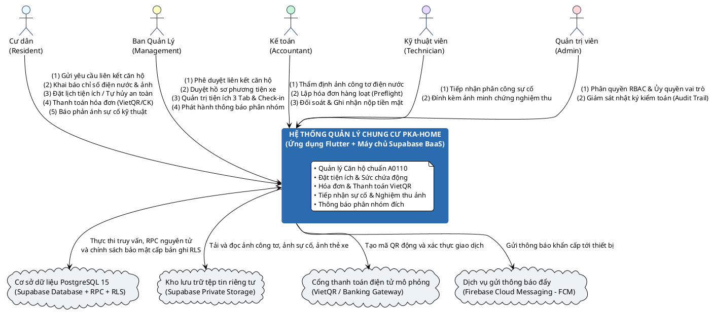

### 1.2. Prompt cho Lucidchart AI
> **Prompt:**  
> "Vẽ Sơ đồ Ngữ cảnh Hệ thống (System Context Diagram) cho ứng dụng Quản lý Chung cư PKA-Home. Ở trung tâm là hệ thống PKA-Home (Ứng dụng Flutter kết hợp Backend Supabase). Xung quanh có 5 tác nhân người dùng: Cư dân, Ban Quản Lý, Kế toán, Kỹ thuật viên, Quản trị viên. Hệ thống kết nối với 4 dịch vụ máy chủ bên ngoài: Cơ sở dữ liệu PostgreSQL (chứa RLS và RPC), Kho lưu trữ tệp tin Supabase Storage (lưu ảnh công tơ và sự cố), Cổng thanh toán mô phỏng VietQR, và Dịch vụ gửi thông báo đẩy Firebase Cloud Messaging. Các đường mũi tên có nhãn mô tả rõ nghiệp vụ trao đổi dữ liệu."

---

## 2. SƠ ĐỒ CA SỬ DỤNG TỔNG QUAN & CHI TIẾT (USE CASE DIAGRAM)

### 2.1. Phân hệ Cư Dân (Resident Use Cases - 12 Use Cases)
#### Mã PlantUML
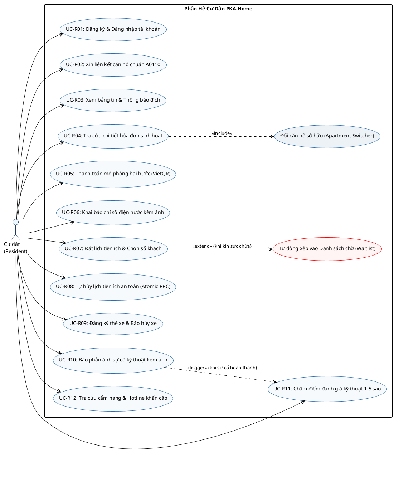

### 2.2. Phân hệ Ban Quản Lý & Vận Hành (Management Use Cases - 13 Use Cases)
#### Mã PlantUML
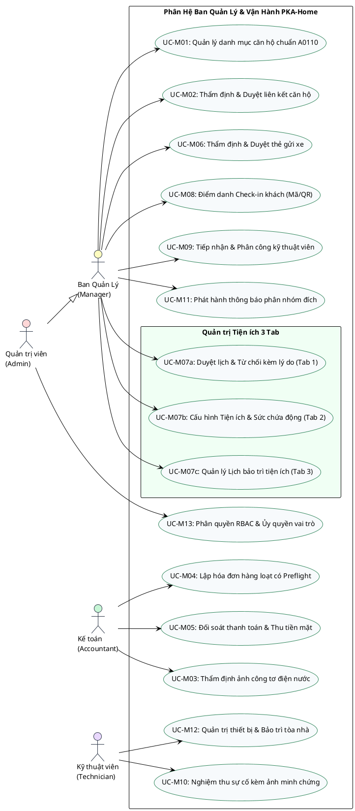

### 2.3. Prompt cho Lucidchart AI
> **Prompt:**  
> "Vẽ Sơ đồ Use Case chuẩn UML cho hệ thống quản lý chung cư PKA-Home gồm 2 phân hệ rõ ràng: Phân hệ Cư dân (12 ca sử dụng: đăng ký, liên kết căn hộ A0110, nhận thông báo đích, xem hóa đơn, thanh toán VietQR, nộp chỉ số điện nước kèm ảnh, đặt lịch tiện ích theo số người, tự hủy lịch tiện ích, đăng ký xe, báo sự cố, đánh giá 5 sao, cẩm nang) và Phân hệ Quản trị (13 ca sử dụng: duyệt liên kết, kiểm tra ảnh công tơ, lập hóa đơn hàng loạt có bước Preflight, đối soát thu tiền, duyệt xe, phân hệ Tiện ích 3 Tab gồm duyệt lịch A7/A8, cấu hình sức chứa động, lịch bảo trì, quét QR check-in, phân công kỹ thuật, nghiệm thu đính kèm ảnh, phát thông báo theo Block/Tầng/Căn hộ, và phân quyền RBAC)."

---

## 3. SƠ ĐỒ QUAN HỆ THỰC THỂ CƠ SỞ DỮ LIỆU (ERD - 16 BẢNG)

### 3.1. Mã PostgreSQL DDL (Nhập trực tiếp vào tính năng ERD của Lucidchart)
*Cách dùng:* Mở Lucidchart $\rightarrow$ Shapes (bên trái) $\rightarrow$ Entity Relationship $\rightarrow$ **Import** $\rightarrow$ Chọn **PostgreSQL** $\rightarrow$ Dán toàn bộ mã dưới đây $\rightarrow$ Lucidchart tự động dựng bảng và nối dây quan hệ:

```sql
-- 1. Bảng người dùng
CREATE TABLE users (
    id UUID PRIMARY KEY,
    full_name VARCHAR(100) NOT NULL,
    phone VARCHAR(20),
    email VARCHAR(100) UNIQUE NOT NULL,
    role VARCHAR(20) NOT NULL DEFAULT 'resident',
    is_locked BOOLEAN DEFAULT FALSE,
    created_at TIMESTAMP WITH TIME ZONE DEFAULT NOW(),
    updated_at TIMESTAMP WITH TIME ZONE DEFAULT NOW()
);

-- 2. Bảng căn hộ
CREATE TABLE apartments (
    id UUID PRIMARY KEY,
    code VARCHAR(10) UNIQUE NOT NULL,
    building_code VARCHAR(10) NOT NULL,
    floor_number INTEGER NOT NULL,
    area NUMERIC(8,2) NOT NULL,
    is_empty BOOLEAN DEFAULT TRUE,
    electric_reading NUMERIC(10,2) DEFAULT 0,
    water_reading NUMERIC(10,2) DEFAULT 0,
    created_at TIMESTAMP WITH TIME ZONE DEFAULT NOW(),
    updated_at TIMESTAMP WITH TIME ZONE DEFAULT NOW()
);

-- 3. Quan hệ cư dân - căn hộ
CREATE TABLE residents_apartments (
    id UUID PRIMARY KEY,
    user_id UUID NOT NULL REFERENCES users(id) ON DELETE CASCADE,
    apartment_id UUID NOT NULL REFERENCES apartments(id) ON DELETE RESTRICT,
    relation_role VARCHAR(20) NOT NULL DEFAULT 'tenant',
    is_verified BOOLEAN DEFAULT TRUE,
    created_at TIMESTAMP WITH TIME ZONE DEFAULT NOW()
);

-- 4. Yêu cầu liên kết căn hộ
CREATE TABLE apartment_link_requests (
    id UUID PRIMARY KEY,
    user_id UUID NOT NULL REFERENCES users(id) ON DELETE CASCADE,
    apartment_id UUID NOT NULL REFERENCES apartments(id) ON DELETE CASCADE,
    requested_relation_role VARCHAR(20) NOT NULL,
    status VARCHAR(20) NOT NULL DEFAULT 'pending',
    rejection_reason TEXT,
    reviewed_by UUID REFERENCES users(id),
    created_at TIMESTAMP WITH TIME ZONE DEFAULT NOW()
);

-- 5. Hóa đơn
CREATE TABLE invoices (
    id UUID PRIMARY KEY,
    apartment_id UUID NOT NULL REFERENCES apartments(id) ON DELETE RESTRICT,
    period VARCHAR(7) NOT NULL,
    due_date DATE NOT NULL,
    total_amount NUMERIC(12,2) DEFAULT 0,
    status VARCHAR(25) NOT NULL DEFAULT 'unpaid',
    created_at TIMESTAMP WITH TIME ZONE DEFAULT NOW(),
    updated_at TIMESTAMP WITH TIME ZONE DEFAULT NOW()
);

-- 6. Chi tiết hạng mục phí hóa đơn
CREATE TABLE invoice_items (
    id UUID PRIMARY KEY,
    invoice_id UUID NOT NULL REFERENCES invoices(id) ON DELETE CASCADE,
    fee_type VARCHAR(50) NOT NULL,
    unit_price NUMERIC(12,2) NOT NULL,
    quantity NUMERIC(8,2) NOT NULL,
    subtotal NUMERIC(12,2) NOT NULL,
    created_at TIMESTAMP WITH TIME ZONE DEFAULT NOW()
);

-- 7. Khai báo chỉ số điện nước
CREATE TABLE meter_reading_submissions (
    id UUID PRIMARY KEY,
    apartment_id UUID NOT NULL REFERENCES apartments(id) ON DELETE RESTRICT,
    submitted_by UUID NOT NULL REFERENCES users(id),
    period VARCHAR(7) NOT NULL,
    electric_reading NUMERIC(10,2) NOT NULL,
    water_reading NUMERIC(10,2) NOT NULL,
    image_url TEXT,
    status VARCHAR(20) DEFAULT 'pending',
    rejection_reason TEXT,
    created_at TIMESTAMP WITH TIME ZONE DEFAULT NOW()
);

-- 8. Quản lý phương tiện cư dân
CREATE TABLE vehicles (
    id UUID PRIMARY KEY,
    apartment_id UUID NOT NULL REFERENCES apartments(id) ON DELETE CASCADE,
    user_id UUID NOT NULL REFERENCES users(id) ON DELETE CASCADE,
    vehicle_type VARCHAR(20) NOT NULL,
    license_plate VARCHAR(20) UNIQUE NOT NULL,
    status VARCHAR(20) DEFAULT 'pending',
    rejection_reason TEXT,
    created_at TIMESTAMP WITH TIME ZONE DEFAULT NOW()
);

-- 9. Danh mục tiện ích tòa nhà
CREATE TABLE building_amenities (
    id UUID PRIMARY KEY,
    name VARCHAR(100) NOT NULL,
    booking_type VARCHAR(20) DEFAULT 'shared',
    slot_duration_minutes INTEGER DEFAULT 60,
    fee_amount NUMERIC(12,2) DEFAULT 0,
    deposit_amount NUMERIC(12,2) DEFAULT 0,
    requires_deposit BOOLEAN DEFAULT FALSE,
    max_capacity INTEGER NOT NULL DEFAULT 10,
    is_active BOOLEAN DEFAULT TRUE,
    created_at TIMESTAMP WITH TIME ZONE DEFAULT NOW()
);

-- 10. Phiếu đặt chỗ tiện ích
CREATE TABLE amenity_bookings (
    id UUID PRIMARY KEY,
    amenity_id UUID NOT NULL REFERENCES building_amenities(id) ON DELETE RESTRICT,
    apartment_id UUID NOT NULL REFERENCES apartments(id) ON DELETE RESTRICT,
    booked_by UUID NOT NULL REFERENCES users(id),
    booking_date DATE NOT NULL,
    time_slot VARCHAR(20) NOT NULL,
    guests_count INTEGER NOT NULL DEFAULT 1,
    status VARCHAR(25) NOT NULL DEFAULT 'confirmed',
    deposit_status VARCHAR(20) DEFAULT 'none',
    checked_in_at TIMESTAMP WITH TIME ZONE,
    created_at TIMESTAMP WITH TIME ZONE DEFAULT NOW()
);

-- 11. Giao dịch thanh toán
CREATE TABLE payment_transactions (
    id UUID PRIMARY KEY,
    invoice_id UUID REFERENCES invoices(id) ON DELETE SET NULL,
    booking_id UUID REFERENCES amenity_bookings(id) ON DELETE SET NULL,
    amount NUMERIC(12,2) NOT NULL,
    payment_method VARCHAR(20) NOT NULL,
    status VARCHAR(20) NOT NULL DEFAULT 'pending',
    transaction_code VARCHAR(50) UNIQUE,
    proof_image_url TEXT,
    cashier_notes TEXT,
    confirmed_by UUID REFERENCES users(id),
    created_at TIMESTAMP WITH TIME ZONE DEFAULT NOW()
);

-- 12. Phản ánh sự cố kỹ thuật
CREATE TABLE issue_reports (
    id UUID PRIMARY KEY,
    apartment_id UUID NOT NULL REFERENCES apartments(id) ON DELETE RESTRICT,
    reporter_id UUID NOT NULL REFERENCES users(id),
    assigned_staff_id UUID REFERENCES users(id),
    priority VARCHAR(20) DEFAULT 'medium',
    status VARCHAR(20) DEFAULT 'pending',
    title VARCHAR(200) NOT NULL,
    description TEXT NOT NULL,
    resolution_proof_url TEXT,
    created_at TIMESTAMP WITH TIME ZONE DEFAULT NOW(),
    updated_at TIMESTAMP WITH TIME ZONE DEFAULT NOW()
);

-- 13. Hình ảnh sự cố
CREATE TABLE issue_images (
    id UUID PRIMARY KEY,
    issue_report_id UUID NOT NULL REFERENCES issue_reports(id) ON DELETE CASCADE,
    image_url TEXT NOT NULL,
    created_at TIMESTAMP WITH TIME ZONE DEFAULT NOW()
);

-- 14. Đánh giá chất lượng xử lý sự cố
CREATE TABLE issue_ratings (
    id UUID PRIMARY KEY,
    issue_report_id UUID UNIQUE NOT NULL REFERENCES issue_reports(id) ON DELETE CASCADE,
    rated_by UUID NOT NULL REFERENCES users(id),
    speed_rating INTEGER NOT NULL,
    attitude_rating INTEGER NOT NULL,
    quality_rating INTEGER NOT NULL,
    comment TEXT,
    created_at TIMESTAMP WITH TIME ZONE DEFAULT NOW()
);

-- 15. Thông báo tòa nhà phân nhóm đối tượng
CREATE TABLE announcements (
    id UUID PRIMARY KEY,
    title VARCHAR(255) NOT NULL,
    content TEXT NOT NULL,
    is_urgent BOOLEAN DEFAULT FALSE,
    target_type VARCHAR(20) DEFAULT 'ALL',
    target_building VARCHAR(10),
    target_floor INTEGER,
    target_apartment_id UUID REFERENCES apartments(id) ON DELETE SET NULL,
    created_by UUID REFERENCES users(id),
    created_at TIMESTAMP WITH TIME ZONE DEFAULT NOW()
);

-- 16. Thiết bị trọng yếu tòa nhà
CREATE TABLE building_equipment (
    id UUID PRIMARY KEY,
    name VARCHAR(100) NOT NULL,
    equipment_type VARCHAR(50) NOT NULL,
    location VARCHAR(100) NOT NULL,
    status VARCHAR(20) DEFAULT 'operational',
    next_maintenance_date DATE,
    created_at TIMESTAMP WITH TIME ZONE DEFAULT NOW()
);
```

### 3.2. Mã Mermaid ERD
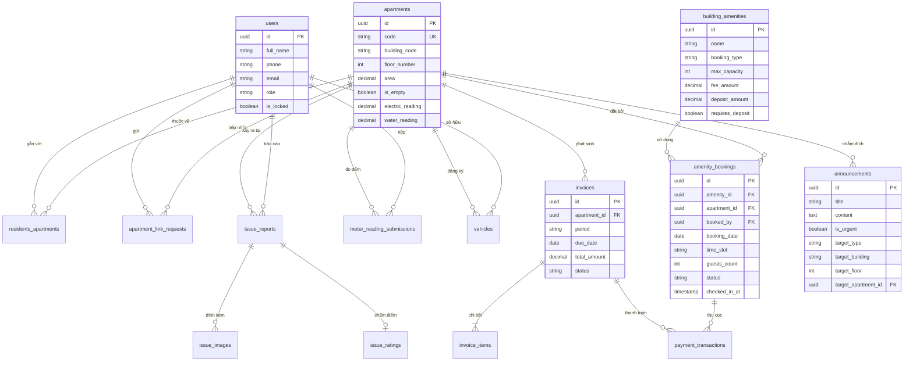

---

## 4. SƠ ĐỒ TUẦN TỰ NGHIỆP VỤ TRỌNG TÂM (SEQUENCE DIAGRAMS)

### 4.1. Tuần tự Đặt Tiện Ích, Xử Lý Sức Chứa Động & Tự Hủy Lịch An Toàn
#### Mã PlantUML
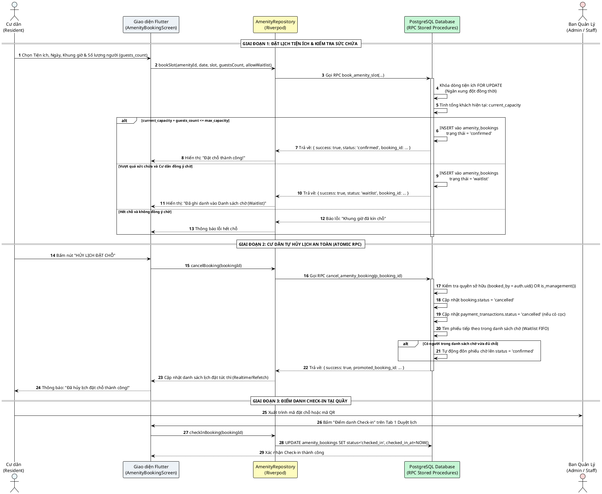

### 4.2. Tuần tự Khai Báo Chỉ Số Điện Nước & Thanh Toán Hai Bước (VietQR)
#### Mã PlantUML
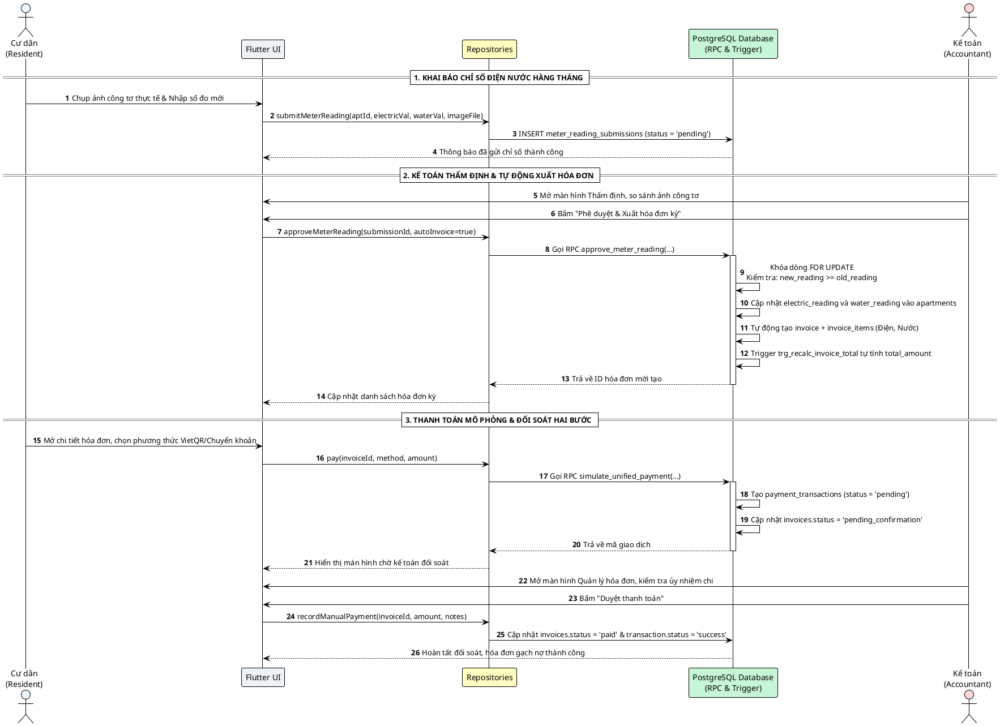

---

## 5. SƠ ĐỒ HOẠT ĐỘNG NGHIỆP VỤ (ACTIVITY DIAGRAMS)

### 5.1. Hoạt động Đặt Tiện Ích, Sức Chứa Động & Tự Hủy Lịch
#### Mã PlantUML
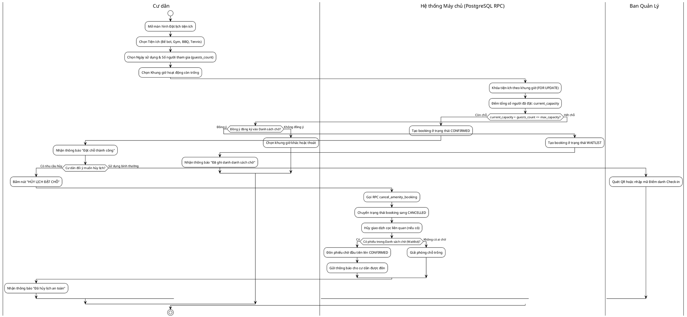

### 5.2. Hoạt động Thẩm Định Chỉ Số & Lập Hóa Đơn Hàng Loạt (Preflight)
#### Mã PlantUML
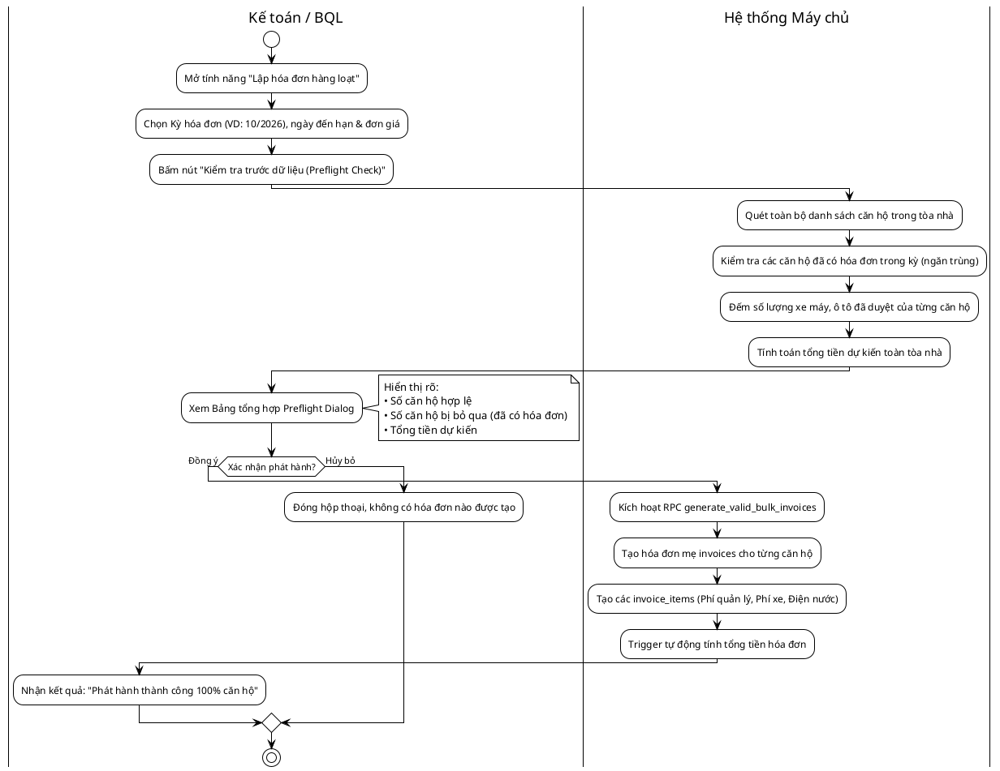

---

## 6. SƠ ĐỒ TRẠNG THÁI VÒNG ĐỜI THỰC THỂ (STATE MACHINE DIAGRAMS)

### 6.1. Mã Mermaid State Diagram (Cả 3 Vòng Đời: Hóa Đơn, Tiện Ích, Sự Cố)
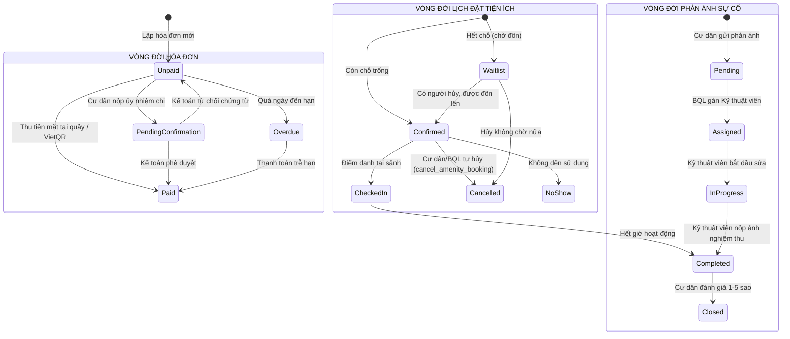

---

## 7. SƠ ĐỒ KIẾN TRÚC PHÂN TẦNG PHẦN MỀM (LAYERED ARCHITECTURE)

### 7.1. Mã PlantUML Component Diagram
```plantuml
@startuml
!theme plain
skinparam defaultFontName "Segoe UI"
skinparam componentStyle uml2

package "TẦNG TRÌNH DIỄN (PRESENTATION LAYER - FLUTTER)" #EBF8FF {
    [Màn hình Cư dân\n(Home, Invoice, Issue, Amenity, Vehicle)] as ResScreens
    [Màn hình Ban Quản Lý\n(Dashboard, 3-Tab Amenity, Bulk Invoices, RBAC)] as MgmtScreens
    [Thành phần dùng chung\n(AppCard, StatusBadge, ShimmerLoading, ErrorView)] as CoreWidgets
    [Hệ thống Theme & Trợ năng\n(Light/Dark Mode, FontSizeScaleProvider)] as ThemeSystem
}

package "TẦNG TRẠNG THÁI (STATE MANAGEMENT - RIVERPOD)" #FEFCBF {
    [AuthNotifier & UserProfileProvider] as AuthProvider
    [InvoiceListProvider & PaymentNotifier] as InvoiceProvider
    [AmenityBookingNotifier & CapacityProvider] as AmenityProvider
    [IssueReportNotifier & RatingProvider] as IssueProvider
    [TargetedAnnouncementProvider] as AnnouncementProvider
}

package "TẦNG DỮ LIỆU & ÁNH XẠ (DATA & REPOSITORY LAYER)" #C6F6D5 {
    [AuthRepository] as AuthRepo
    [InvoiceRepository] as InvoiceRepo
    [AmenityRepository] as AmenityRepo
    [IssueRepository] as IssueRepo
    [AnnouncementRepository] as AnnouncementRepo
    [Data Models (DTO / fromJson - toJson)] as Models
}

package "TẦNG MÁY CHỦ & AN TOÀN (SUPABASE BACKEND CLOUD)" #FED7D7 {
    [Supabase Auth (JWT & Roles)] as SupaAuth
    [Hàm lưu trữ RPC nguyên tử\n(book_amenity_slot, cancel_amenity_booking,\ngenerate_valid_bulk_invoices, approve_meter_reading)] as RPCs
    [Chính sách Phân quyền cấp bản ghi (RLS Policies)\nFail-Closed Security] as RLS
    [PostgreSQL Triggers & Generated Columns\n(trg_prevent_role_escalation, trg_recalc_invoice_total)] as Triggers
    [Private Storage Buckets\n(meter-images, issue-images, proof)] as Buckets
}

ResScreens --> CoreWidgets
MgmtScreens --> CoreWidgets
ResScreens --> ThemeSystem
MgmtScreens --> ThemeSystem

ResScreens --> AuthProvider
ResScreens --> InvoiceProvider
ResScreens --> AmenityProvider
ResScreens --> IssueProvider
ResScreens --> AnnouncementProvider

MgmtScreens --> AuthProvider
MgmtScreens --> InvoiceProvider
MgmtScreens --> AmenityProvider
MgmtScreens --> IssueProvider
MgmtScreens --> AnnouncementProvider

AuthProvider --> AuthRepo
InvoiceProvider --> InvoiceRepo
AmenityProvider --> AmenityRepo
IssueProvider --> IssueRepo
AnnouncementProvider --> AnnouncementRepo

AuthRepo --> Models
InvoiceRepo --> Models
AmenityRepo --> Models
IssueRepo --> Models
AnnouncementRepo --> Models

AuthRepo --> SupaAuth
InvoiceRepo --> RPCs
AmenityRepo --> RPCs
IssueRepo --> Buckets
AnnouncementRepo --> RLS

RPCs --> Triggers
RLS --> Triggers
@enduml
```

---

## 8. SƠ ĐỒ TRIỂN KHAI HẠ TẦNG VÀ DỊCH VỤ (DEPLOYMENT DIAGRAM)

### 8.1. Mã PlantUML Deployment Diagram
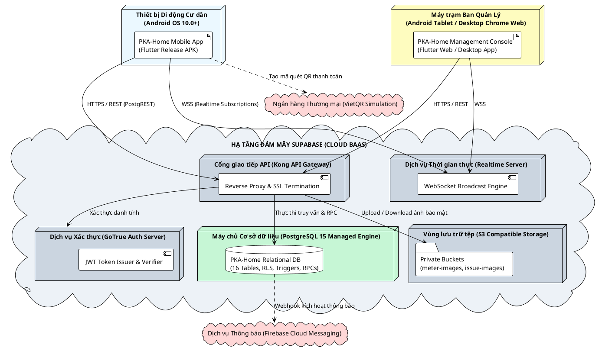

### 8.2. Prompt cho Lucidchart AI
> **Prompt:**  
> "Vẽ Sơ đồ Triển khai (Deployment Diagram) chuẩn UML thể hiện cấu trúc phân tán của ứng dụng Quản lý Chung cư PKA-Home: Thiết bị di động của Cư dân chạy Flutter APK kết nối qua HTTPS/WSS tới Nền tảng Đám mây Supabase Cloud. Máy trạm Ban Quản lý kết nối qua Web Browser. Cụm máy chủ Supabase Cloud gồm API Gateway Kong, Dịch vụ xác thực GoTrue, Cơ sở dữ liệu quan hệ PostgreSQL 15 (với RLS và RPC), Dịch vụ WebSocket Realtime và Vùng lưu trữ tệp riêng tư S3 Storage. Hệ thống đồng thời tích hợp với Firebase Cloud Messaging để đẩy thông báo và Cổng VietQR để tạo mã quét thanh toán."

---

## KẾT LUẬN & BẢN QUYỀN TÀI LIỆU

Tài liệu này bao gồm đầy đủ mã nguồn chuẩn hóa (PlantUML, Mermaid, PostgreSQL DDL) và câu lệnh nhắc (AI Prompts) cho mọi loại sơ đồ kỹ thuật cần thiết trong đồ án liên ngành PKA-Home. Bạn có thể sử dụng bất kỳ sơ đồ nào để import trực tiếp vào Lucidchart chỉ trong 1 thao tác copy-paste mà không lo sai lệch cú pháp hoặc bị thiếu trường dữ liệu.
