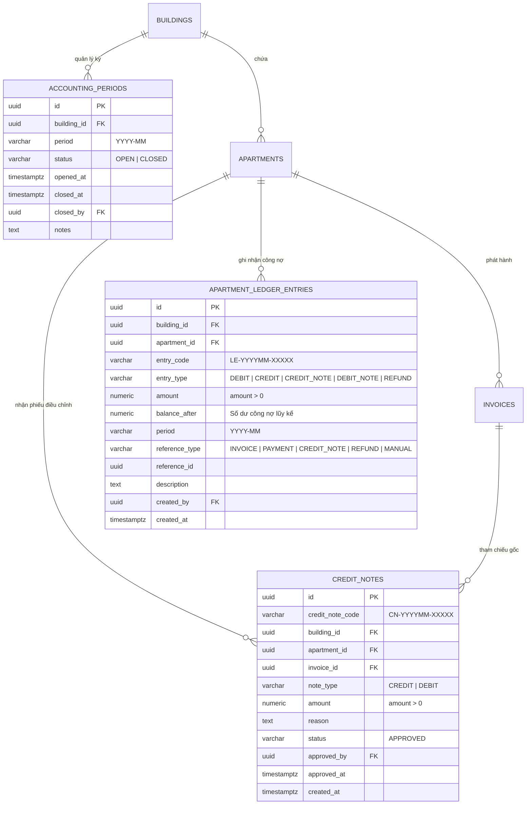

# Tài Liệu Thiết Kế Kỹ Thuật: Sổ Cái Công Nợ Căn Hộ, Phiếu Điều Chỉnh & Hóa Đơn Bất Biến (C1)

> **Mã tính năng:** C1 - Phase C (Lõi Tài Chính Đạt Chuẩn Thương Mại)  
> **Ngày phê duyệt:** 29/10/2026  
> **Trạng thái:** Đã duyệt thiết kế (Design Approved)  
> **Quy chuẩn thời gian:** Định dạng ngày tháng người Việt (`dd/MM/yyyy`, `dd/MM/yyyy HH:mm`, `Tháng MM/yyyy`)

---

## 1. Mục Tiêu & Bối Cảnh Nghiệp Vụ

Trong mô hình B2B SaaS quản lý vận hành chung cư và tòa nhà cho thuê, các tranh chấp tài chính và sai lệch số liệu thường xuyên phát sinh do:
1. Thiếu sổ cái theo dõi công nợ độc lập, chỉ dựa vào trạng thái trên từng hóa đơn rời rạc.
2. Hóa đơn đã phát hành hoặc đã thanh toán bị chỉnh sửa đè số liệu khi phát hiện sai chỉ số điện/nước, làm mất tính toàn vẹn và không thể kiểm toán.
3. Không ghi nhận được số dư nợ cũ mang sang hoặc số tiền cư dân nộp thừa để cấn trừ vào kỳ tiếp theo.
4. Thiếu cơ chế khóa sổ kỳ kế toán định kỳ, dẫn đến dữ liệu báo cáo tài chính của các tháng trước bị thay đổi sau khi đã nộp báo cáo.

### Giá trị cốt lõi đạt được:
- **Tính bất biến (Immutability):** Hóa đơn đã thanh toán hoặc trong kỳ kế toán đã đóng được bảo vệ tuyệt đối ở tầng cơ sở dữ liệu (Trigger chặn UPDATE/DELETE).
- **Minh bạch sổ cái (Sub-Ledger):** Mọi biến động công nợ (Phát sinh, Thu tiền, Điều chỉnh, Hoàn tiền) đều là bút toán nối thêm (Append-Only) trong `apartment_ledger_entries`.
- **Phiếu điều chỉnh chính quy (Credit Note / Debit Note):** Khi có sai lệch chỉ số hoặc miễn giảm, lập phiếu điều chỉnh có số hiệu kiểm toán thay vì sửa đè hóa đơn gốc.
- **Khóa sổ kỳ kế toán (Period Close):** BQL chốt sổ hàng tháng, bảo vệ tính toàn vẹn của báo cáo thuế và hội nghị nhà chung cư.
- **Trải nghiệm 100% người Việt:** Toàn bộ ngày tháng, giờ giấc và kỳ kế toán hiển thị chuẩn mực theo thói quen người Việt (`dd/MM/yyyy HH:mm`, `Tháng MM/yyyy`, tiền tệ `#,##0 đ`).

---

## 2. Kiến Trúc Cơ Sở Dữ Liệu & Ràng Buộc Toàn Vẹn



### 2.1 Bảng `accounting_periods`
Quản lý trạng thái đóng/mở sổ kế toán cho từng tòa nhà:
- `id` (UUID, PK, default `gen_random_uuid()`)
- `building_id` (UUID, FK -> `buildings.id`, NOT NULL)
- `period` (VARCHAR(7), NOT NULL, định dạng `YYYY-MM`)
- `status` (VARCHAR(20), NOT NULL, default `'OPEN'`, CHECK in `'OPEN'`, `'CLOSED'`)
- `opened_at` (TIMESTAMPTZ, default `now()`)
- `closed_at` (TIMESTAMPTZ, NULL)
- `closed_by` (UUID, FK -> `users.id`, NULL)
- `notes` (TEXT, NULL)
- `created_at`, `updated_at` (TIMESTAMPTZ, default `now()`)
- Ràng buộc: `UNIQUE(building_id, period)`

### 2.2 Bảng `apartment_ledger_entries` (Sổ cái công nợ căn hộ Append-Only)
- `id` (UUID, PK, default `gen_random_uuid()`)
- `building_id` (UUID, FK -> `buildings.id`, NOT NULL)
- `apartment_id` (UUID, FK -> `apartments.id`, NOT NULL)
- `entry_code` (VARCHAR(30), UNIQUE, NOT NULL) — VD: `LE-202610-00001`
- `entry_type` (VARCHAR(20), NOT NULL) — Giá trị:
  - `DEBIT`: Phát sinh công nợ phải thu (Phát hành hóa đơn, phụ phí phát sinh) -> Tăng nợ.
  - `CREDIT`: Thu tiền thanh toán (Chuyển khoản VietQR, nộp tiền mặt BQL) -> Giảm nợ.
  - `CREDIT_NOTE`: Phiếu giảm nợ điều chỉnh (Giảm trừ sai sót chỉ số, chiết khấu) -> Giảm nợ.
  - `DEBIT_NOTE`: Phiếu tăng nợ bổ sung (Phạt quá hạn, truy thu) -> Tăng nợ.
  - `REFUND`: Hoàn trả tiền thừa/ký quỹ cho cư dân -> Tăng nợ/Giảm trả trước.
- `amount` (NUMERIC(15,2), NOT NULL, CHECK `amount > 0`)
- `balance_after` (NUMERIC(15,2), NOT NULL) — Số dư nợ của căn hộ ngay sau bút toán:
  - `> 0`: Căn hộ còn nợ tòa nhà.
  - `= 0`: Căn hộ đã thanh toán đầy đủ, không còn nợ.
  - `< 0`: Căn hộ đã trả thừa / có khoản tiền ký quỹ gửi trước.
- `period` (VARCHAR(7), NOT NULL)
- `reference_type` (VARCHAR(30), NOT NULL) — `'INVOICE'`, `'PAYMENT'`, `'CREDIT_NOTE'`, `'REFUND'`, `'MANUAL'`
- `reference_id` (UUID, NULL)
- `description` (TEXT, NOT NULL)
- `created_by` (UUID, FK -> `users.id`, NULL)
- `created_at` (TIMESTAMPTZ, default `now()`, NOT NULL)

### 2.3 Bảng `credit_notes` (Phiếu điều chỉnh công nợ)
- `id` (UUID, PK, default `gen_random_uuid()`)
- `credit_note_code` (VARCHAR(30), UNIQUE, NOT NULL) — VD: `CN-202610-00001`
- `building_id` (UUID, FK -> `buildings.id`, NOT NULL)
- `apartment_id` (UUID, FK -> `apartments.id`, NOT NULL)
- `invoice_id` (UUID, FK -> `invoices.id`, NULLABLE — có thể gắn vào 1 hóa đơn cụ thể hoặc điều chỉnh công nợ chung)
- `note_type` (VARCHAR(20), NOT NULL, default `'CREDIT'`, CHECK in `'CREDIT'`, `'DEBIT'`)
- `amount` (NUMERIC(15,2), NOT NULL, CHECK `amount > 0`)
- `reason` (TEXT, NOT NULL)
- `status` (VARCHAR(20), NOT NULL, default `'APPROVED'`)
- `approved_by` (UUID, FK -> `users.id`, NOT NULL)
- `approved_at` (TIMESTAMPTZ, default `now()`)
- `created_at` (TIMESTAMPTZ, default `now()`)

### 2.4 Triggers Bảo Vệ Toàn Vẹn & Bất Biến

1. **Trigger `enforce_invoice_immutability` trên bảng `invoices`**:
   - Khi hóa đơn có `status IN ('paid', 'pending_confirmation')`:
     - Chặn sửa: `total_amount`, `apartment_id`, `period`.
     - Chặn `DELETE` hóa đơn.
   - Khi hóa đơn thuộc kỳ kế toán đã `CLOSED` trong `accounting_periods`:
     - Chặn mọi thao tác `UPDATE` (ngoại trừ ghi chú kiểm toán) và `DELETE`.

2. **Trigger `prevent_closed_period_mutation` trên bảng `apartment_ledger_entries`**:
   - Chặn chèn thêm hoặc sửa đổi bút toán có `period` đã bị `CLOSED`. Bút toán phát sinh mới phải thuộc kỳ `OPEN` hiện tại.

3. **Trigger tự động hạch toán sổ cái khi thanh toán**:
   - Khi hóa đơn chuyển `status = 'paid'` (từ webhook hoặc duyệt tay): Tự động gọi logic hạch toán ghi bút toán `CREDIT` vào `apartment_ledger_entries` nếu chưa có bút toán thanh toán cho giao dịch đó.

---

## 3. Danh Sách Remote Procedure Calls (RPCs)

### 3.1 `record_apartment_ledger_entry`
```sql
record_apartment_ledger_entry(
    p_building_id UUID,
    p_apartment_id UUID,
    p_entry_type VARCHAR(20),
    p_amount NUMERIC(15,2),
    p_period VARCHAR(7),
    p_reference_type VARCHAR(30),
    p_reference_id UUID,
    p_description TEXT,
    p_created_by UUID
) RETURNS JSONB
```
- Khóa bản ghi `apartments` bằng `SELECT ... FOR UPDATE` để chống Race Condition.
- Lấy số dư nợ mới nhất của căn hộ từ bản ghi `apartment_ledger_entries` gần nhất (nếu chưa có thì số dư ban đầu là 0.00).
- Tính `balance_after`:
  - Nếu `entry_type` IN (`DEBIT`, `DEBIT_NOTE`, `REFUND`) -> `balance_after = current_balance + amount`
  - Nếu `entry_type` IN (`CREDIT`, `CREDIT_NOTE`) -> `balance_after = current_balance - amount`
- Sinh mã bút toán `LE-YYYYMM-XXXXX` tự động tăng theo kỳ.
- Trả về JSON: `{ "success": true, "entry_id": "...", "entry_code": "...", "balance_after": 1250000.00 }`.

### 3.2 `issue_credit_note`
```sql
issue_credit_note(
    p_building_id UUID,
    p_apartment_id UUID,
    p_invoice_id UUID,
    p_note_type VARCHAR(20),
    p_amount NUMERIC(15,2),
    p_reason TEXT,
    p_approved_by UUID
) RETURNS JSONB
```
- Kiểm tra quyền BQL/Kế toán.
- Sinh mã phiếu điều chỉnh `CN-YYYYMM-XXXXX`.
- Chèn vào `credit_notes`.
- Tự động gọi `record_apartment_ledger_entry` với `entry_type = 'CREDIT_NOTE'` (hoặc `'DEBIT_NOTE'`), `reference_type = 'CREDIT_NOTE'`, `reference_id = credit_note.id`.
- Ghi log vào `audit_logs` (Nhật ký kiểm toán bất biến).

### 3.3 `close_accounting_period`
```sql
close_accounting_period(
    p_building_id UUID,
    p_period VARCHAR(7),
    p_closed_by UUID,
    p_notes TEXT
) RETURNS JSONB
```
- Kiểm tra quyền Quản trị / Kế toán trưởng.
- Kiểm tra kỳ đã đóng chưa. Nếu chưa:
- Cập nhật `accounting_periods` sang `status = 'CLOSED'`, `closed_at = now()`, `closed_by = p_closed_by`.
- Ghi nhận nhật ký kiểm toán.
- Tự động tạo bản ghi kỳ mới tiếp theo ở trạng thái `OPEN` nếu chưa tồn tại.

### 3.4 `get_apartment_ledger_balance`
```sql
get_apartment_ledger_balance(
    p_apartment_id UUID
) RETURNS NUMERIC(15,2)
```
- Trả về số dư công nợ hiện tại của căn hộ.

---

## 4. Đặc Tả Giao Diện & Trải Nghiệm Người Dùng (UI/UX)

### 4.1 Quy Chuẩn Định Dạng Thời Gian & Tiền Tệ 100% Người Việt
- **Ngày tháng tiêu chuẩn:** `dd/MM/yyyy` (Ví dụ: `29/10/2026`).
- **Thời gian chi tiết:** `dd/MM/yyyy HH:mm` (Ví dụ: `29/10/2026 17:05`).
- **Tên kỳ kế toán hiển thị:** `Tháng MM/yyyy` (Ví dụ: `Tháng 10/2026`).
- **Số tiền tiền tệ:** `#,##0 đ` (Ví dụ: `1.250.000 đ`).
- **Ngôn ngữ:** 100% tiếng Việt chuẩn mực, rõ ràng, không thuật ngữ tiếng Anh lai tạp.

### 4.2 Màn Hình Quản Trị BQL: Sổ Cái Công Nợ Căn Hộ (`ApartmentLedgerScreen`)
1. **Thanh điều khiển:**
   - Bộ chọn Căn hộ (Định dạng chuẩn `A0110`), bộ lọc Kỳ kế toán (`Tháng 10/2026`).
2. **Thẻ Thống Kê Công Nợ Nổi Bật:**
   - Số dư công nợ hiện tại:
     - Nợ đọng: Hiển thị màu đỏ cam `Colors.deepOrange` kèm icon cảnh báo.
     - Đã thanh toán đủ (0 đ): Hiển thị màu xanh lá `Colors.green` kèm icon hoàn tất.
     - Có tiền trả trước (< 0 đ): Hiển thị màu xanh dương `Colors.blue` kèm icon nộp thừa cấn trừ kỳ sau.
3. **Danh Sách Bút Toán Dòng Thời Gian (Ledger Entries List):**
   - Mỗi mục hiển thị:
     - Thời gian: `dd/MM/yyyy HH:mm`
     - Mã bút toán: `LE-202610-00001`
     - Badge loại nghiệp vụ (Phát sinh hóa đơn, Thu tiền Napas/Tiền mặt, Phiếu giảm nợ, Phiếu tăng nợ, Hoàn tiền).
     - Diễn giải chi tiết nội dung giao dịch.
     - Số tiền phát sinh: `+1.250.000 đ` (Đỏ) hoặc `-1.250.000 đ` (Xanh lá).
     - Dư nợ sau giao dịch: `balance_after`.
4. **Nút Thao Tác Chuyên Nghiệp:**
   - **"Lập phiếu điều chỉnh"**: Mở Bottom Sheet tạo Credit Note (Chọn hóa đơn, nhập lý do, số tiền điều chỉnh).
   - **"Khóa sổ kỳ kế toán"**: Mở Dialog xác nhận chốt số liệu tháng, hiển thị tổng thu/tổng nợ của tòa.

### 4.3 Màn Hình Cư Dân: Chi Tiết Nghĩa Vụ Hóa Đơn (`ResidentInvoiceDetailScreen`)
- Thẻ tóm tắt nghĩa vụ thanh toán minh bạch 3 dòng:
  1. `Dư nợ kỳ trước mang sang`: `...,... đ` (nếu có nợ cũ hoặc số tiền nộp thừa âm).
  2. `Phí dịch vụ phát sinh kỳ này`: `...,... đ` (chi tiết từng khoản phí).
  3. `Phiếu giảm nợ/cấn trừ kỳ trước`: `-...,... đ` (nếu có).
  4. **`Tổng tiền cần thanh toán`**: `...,... đ`.
- Mọi mốc ngày phát hành, hạn thanh toán, ngày thu đều hiển thị `dd/MM/yyyy`.

---

## 5. Kế Hoạch Kiểm Thử & Đảm Bảo Chất Lượng (TDD)

1. **Migration & DB Constraints Test:**
   - Kiểm tra các bảng `accounting_periods`, `apartment_ledger_entries`, `credit_notes` được khởi tạo đầy đủ cột, kiểu dữ liệu, ràng buộc CHECK và khóa ngoại.
   - Kiểm tra trigger `enforce_invoice_immutability` ném lỗi khi cố tình cập nhật hóa đơn đã `paid` hoặc trong kỳ đã `CLOSED`.
2. **RPC Unit Tests (Dart/Mock):**
   - Test hạch toán `record_apartment_ledger_entry` tính toán đúng `balance_after` cho các loại DEBIT/CREDIT/CREDIT_NOTE.
   - Test `issue_credit_note` tạo đúng phiếu điều chỉnh và tự động ghi sổ cái.
   - Test `close_accounting_period` khóa sổ thành công và không cho ghi đè kỳ đã đóng.
3. **UI & Formatting Tests:**
   - Kiểm tra hiển thị ngày tháng đúng chuẩn `dd/MM/yyyy HH:mm` và kỳ `Tháng MM/yyyy`.
   - Kiểm tra màn hình `ApartmentLedgerScreen` hiển thị đúng thẻ trạng thái số dư, danh sách bút toán và form lập phiếu điều chỉnh.
   - Kiểm tra chi tiết hóa đơn cư dân hiển thị đúng nghĩa vụ nợ cũ + phát sinh mới.

