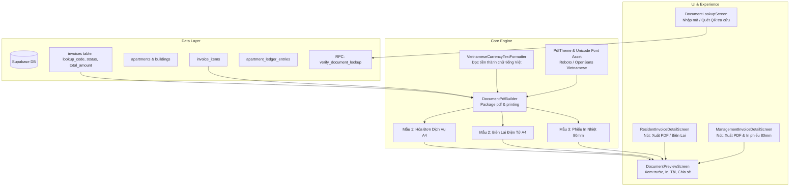

# Tài Liệu Thiết Kế Kỹ Thuật: Hóa Đơn Điện Tử, Biên Lai PDF & Tra Cứu Mã QR (C4)

> **Mã Milestone:** C4  
> **Tác giả:** Đội ngũ Kỹ thuật Antigravity  
> **Ngày phê duyệt:** 29/10/2026  
> **Nhánh thực hiện:** `main`  
> **Trạng thái:** Bản thiết kế hoàn chỉnh (Ready for Implementation)

---

## 1. Tổng Quan & Mục Tiêu

### 1.1. Bối cảnh
Trong hệ thống quản lý chung cư thương mại PKA-Home, các mốc tài chính trước đó đã hoàn thành vững chắc:
- **C1**: Sổ cái kế toán `apartment_ledger_entries`, phiếu điều chỉnh `credit_notes`, khóa sổ bất biến.
- **C2**: Engine tính phí lũy tiến đa dạng (Điện 6 bậc EVN, Nước định mức nhân khẩu, Phí gửi xe pro-rata, Lãi phạt trễ hạn).
- **C3**: Thanh toán trực tuyến tự động qua VietQR động và Webhook gạch nợ tức thời.

Tuy nhiên, hệ thống vẫn thiếu **chứng từ xuất xưởng chuẩn hóa**:
- Cư dân cần bản Hóa đơn / Thông báo thu phí dịch vụ dạng PDF chính quy để lưu trữ hoặc trình công ty/chủ nhà thanh toán.
- Sau khi thanh toán, cư dân và kế toán cần **Biên lai thu tiền điện tử** có giá trị pháp lý nội bộ, có mã giao dịch đối soát, thời gian nộp tiền và con dấu mộc số điện tử của Ban Quản Lý (*"ĐÃ THU TIỀN"*).
- Quầy lễ tân / văn phòng BQL cần in nhanh biên lai dạng **phiếu in nhiệt 80mm (Thermal POS Roll)** cho cư dân nộp tiền trực tiếp.
- Mọi chứng từ cần có **Mã tra cứu bảo mật (Lookup Code)** và **Mã QR tra cứu trực tuyến** để bất kỳ ai cũng có thể quét và xác thực tính nguyên bản, tránh làm giả hóa đơn.

### 1.2. Mục tiêu cụ thể
1. **Mã Tra Cứu & Xác Thực DB**: Bổ sung `lookup_code` duy nhất cho mọi hóa đơn/biên lai và RPC `verify_document_lookup` tra cứu an toàn.
2. **Bộ Máy Sinh PDF Vector Đa Dạng (`DocumentPdfBuilder`)**:
   - Mẫu 1: **Hóa đơn dịch vụ A4** (Service Invoice) có bảng phí chi tiết, phân rã bậc thang, tổng tiền bằng số & chữ tiếng Việt, mã VietQR nộp tiền (nếu chưa thanh toán) hoặc mã tra cứu.
   - Mẫu 2: **Biên lai thu tiền điện tử A4** (Electronic Receipt) có thông tin đối soát ngân hàng, ngày giờ nộp tiền, con dấu mộc số điện tử *"ĐÃ THU TIỀN"*.
   - Mẫu 3: **Phiếu in nhiệt 80mm** (Thermal POS Receipt) cho máy in cuộn quầy thu ngân.
3. **Thao Tác Toàn Diện**: Xem trước (In-app Preview), In trực tiếp (Direct Print tới máy in Wifi/Bluetooth/AirPrint), Tải tệp PDF, Chia sẻ (Share Plus tới Zalo/Email).
4. **Màn Hình Tra Cứu Chứng Từ (`DocumentLookupScreen`)**: Nhập mã tra cứu hoặc quét camera QR code để kiểm tra tính hợp lệ và thông tin xác thực của chứng từ.
5. **Tiện ích Đọc Tiền Bằng Chữ (`VietnameseCurrencyTextFormatter`)**: Chuyển đổi chính xác số tiền sang chữ tiếng Việt chuẩn mực (VD: 1.250.000 đ -> *"Một triệu hai trăm năm mươi nghìn đồng chẵn"*).

---

## 2. Kiến Trúc & Luồng Dữ Liệu



---

## 3. Thiết Kế Cơ Sở Dữ Liệu (Supabase Migration)

### 3.1. File migration: `supabase/migrations/20261029_05_electronic_invoice_and_lookup_engine.sql`
1. Bổ sung cột trên bảng `public.invoices`:
   ```sql
   ALTER TABLE public.invoices 
   ADD COLUMN IF NOT EXISTS lookup_code VARCHAR(32) UNIQUE;

   CREATE INDEX IF NOT EXISTS idx_invoices_lookup_code ON public.invoices(lookup_code);
   ```
2. Trigger tự động sinh `lookup_code` nếu chưa có khi INSERT:
   - Cấu trúc: `INV-` + `YYYYMM` + `-` + 5 ký tự ngẫu nhiên in hoa (VD: `INV-202610-A7F9B`).
   - Cập nhật tự động mã tra cứu cho toàn bộ các hóa đơn hiện hữu.
3. RPC Tra Cứu Chứng Từ Công Khai `verify_document_lookup(p_lookup_code TEXT)`:
   - `SECURITY DEFINER` (cho phép gọi tra cứu mà không cần đăng nhập sâu vào bảng nội bộ).
   - Kiểm tra mã `p_lookup_code`, trả về JSONB thông tin chuẩn mực:
     ```json
     {
       "valid": true,
       "lookup_code": "INV-202610-A7F9B",
       "document_type": "BIÊN LAI ĐIỆN TỬ",
       "period": "2026-10",
       "apartment_code": "A0110",
       "building_code": "Tòa A",
       "total_amount": 1250000,
       "formatted_amount": "1.250.000 đ",
       "status": "paid",
       "status_text": "Đã thanh toán / Đã thu tiền",
       "issued_date": "2026-10-25",
       "paid_date": "2026-10-28 14:30:00",
       "payment_method": "Chuyển khoản VietQR",
       "issuer": "Ban Quản Lý Chung Cư PKA-Home"
     }
     ```
     Nếu không tìm thấy hoặc mã sai, trả về `{"valid": false, "message": "Không tìm thấy chứng từ hợp lệ"}`.

---

## 4. Mô Tả Chi Tiết Các Mẫu Tài Liệu PDF

### 4.1. Mẫu A4 Hóa Đơn Phí Dịch Vụ (Service Invoice)
- **Kích thước**: Chuẩn ISO A4 (210 x 297 mm), lề trang 24pt.
- **Tiêu đề & Header**:
  - Logo PKA-Home (vector) & Tên tòa nhà/Ban quản lý.
  - Hotline, Email hỗ trợ.
  - Tiêu đề in hoa đậm: **THÔNG BÁO PHÍ DỊCH VỤ / HÓA ĐƠN THÁNG MM/YYYY**.
  - Mã tra cứu: `Mã tra cứu: INV-YYYYMM-XXXXX` (Góc trên bên phải).
- **Thông tin căn hộ**:
  - Mã căn hộ (VD: `A0110`), Tên chủ hộ/cư dân, Diện tích, Số lượng phương tiện/nhân khẩu.
  - Ngày phát hành, Hạn thanh toán (`dd/MM/yyyy`).
- **Bảng chi tiết các khoản phí**:
  - Các cột: STT | Khoản mục | Đơn giá | Số lượng/Chỉ số | Thành tiền.
  - Hiển thị rõ các khoản: Điện sinh hoạt, Nước sinh hoạt, Phí quản lý vận hành, Phí gửi xe, Khoản truy thu/giảm nợ (nếu có).
- **Tổng kết tài chính**:
  - Tổng tiền thanh toán (`1.250.000 đ`).
  - Số tiền bằng chữ: *"Một triệu hai trăm năm mươi nghìn đồng chẵn"*.
- **Khu vực thanh toán / Mã QR**:
  - Nếu trạng thái `unpaid`: Hiển thị khung hướng dẫn thanh toán kèm **Mã VietQR động** (Napas 247) có sẵn STK, cú pháp và số tiền chính xác để quét chuyển khoản ngay.
  - Mã QR tra cứu chứng từ ở góc chân trang kèm lời nhắc: *"Quét mã QR để kiểm tra tính xác thực của hóa đơn"*.

### 4.2. Mẫu A4 Biên Lai Thu Tiền Điện Tử (Electronic Payment Receipt)
- **Tiêu đề**: **BIÊN LAI THU TIỀN ĐIỆN TỬ (BẢN GỐC)**.
- **Mã biên lai**: `REC-YYYYMM-XXXXX` tương ứng mã hóa đơn.
- **Thông tin nộp tiền**:
  - Người nộp tiền: Họ tên cư dân.
  - Căn hộ: `A0110`.
  - Lý do thu: Thanh toán phí dịch vụ chung cư kỳ Tháng MM/yyyy.
  - Phương thức thanh toán: Chuyển khoản ngân hàng (VietQR Napas 247) / Tiền mặt.
  - Mã đối soát giao dịch ngân hàng: `INV2610...`.
  - Ngày giờ thu tiền: `dd/MM/yyyy HH:mm:ss`.
- **Con dấu mộc số điện tử (Digital Stamp Vector)**:
  - Khung con dấu đỏ/xanh chuẩn nhận diện:
    - Vòng tròn hoặc elip nét kép: *"BAN QUẢN LÝ TÒA NHÀ PKA-HOME"*.
    - Tâm con dấu: Chữ **"ĐÃ THU TIỀN"** và ngày giờ xác nhận.
- **Chân trang**: Chữ ký điện tử của Kế toán trưởng và Người lập phiếu.

### 4.3. Mẫu Phiếu In Nhiệt 80mm (Thermal POS Receipt)
- **Độ rộng**: 80mm (226.77 pt), chiều cao linh hoạt (Roll paper).
- **Bố cục**: Gọn gàng, độ tương phản cao, cỡ chữ 8-10pt tối ưu cho đầu kim / in nhiệt.
- Header tên tòa nhà, ngày giờ in, mã căn hộ `A0110`.
- Bảng vắn tắt các mục phí, tổng tiền in đậm lớn.
- Dòng chữ xác nhận: `*** ĐÃ THU TIỀN QUA VIETQR ***`.
- Mã QR nhỏ ở đáy cuộn giấy phục vụ tra cứu.

---

## 5. Cấu Trúc File & Mã Nguồn

```text
lib/
├── core/
│   └── utils/
│       ├── vietnamese_currency_text_formatter.dart  # Tiện ích đọc số tiền thành chữ tiếng Việt
│       └── document_pdf_builder.dart               # Bộ máy dựng 3 mẫu PDF chuẩn vector
├── data/
│   ├── models/
│   │   └── document_lookup_result_model.dart       # Model kết quả tra cứu chứng từ
│   ├── repositories/
│   │   └── document_repository.dart                # Gọi RPC tra cứu, sinh PDF bytes
│   └── providers/
│       └── document_providers.dart                 # Riverpod providers cho Document Engine
├── features/
│   ├── document/
│   │   ├── screens/
│   │   │   ├── document_preview_screen.dart        # Màn hình xem trước, in, tải, chia sẻ
│   │   │   └── document_lookup_screen.dart         # Màn hình tra cứu chứng từ công khai
│   │   └── widgets/
│   │       └── digital_stamp_widget.dart           # Widget con dấu điện tử mô phỏng
│   ├── resident/
│   │   └── screens/
│   │       └── resident_invoice_detail_screen.dart # Nút "Xuất hóa đơn / Biên lai PDF"
│   └── management/
│       └── screens/
│           └── management_invoice_detail_screen.dart # Menu chọn mẫu A4 / In nhiệt 80mm
```

---

## 6. Kế Hoạch Kiểm Thử TDD & Độ Tin Cậy

1. **Unit Test Tiện ích Đọc Tiền Bằng Chữ (`VietnameseCurrencyTextFormatter`)**:
   - `0 đ` -> "Không đồng"
   - `150.000 đ` -> "Một trăm năm mươi nghìn đồng"
   - `1.250.000 đ` -> "Một triệu hai trăm năm mươi nghìn đồng"
   - `23.456.789 đ` -> Đọc đúng các hàng chục, trăm, linh, mốt, lăm.
2. **Unit Test DocumentPdfBuilder**:
   - Dựng mẫu A4 Hóa đơn: trả về bytes `Uint8List` hợp lệ, bắt đầu bằng header PDF `%PDF-1.`.
   - Dựng mẫu A4 Biên lai: bytes hợp lệ, chứa các trường đối soát.
   - Dựng mẫu 80mm: bytes hợp lệ, page format khổ cuộn.
3. **Integration Test Migration & RPC**:
   - Migration tạo đúng cột `lookup_code`, tự sinh mã duy nhất khi insert.
   - RPC `verify_document_lookup` trả về đúng định dạng JSON xác thực.
4. **Widget Test UI**:
   - `DocumentPreviewScreen`: Hiển thị trang tài liệu, có các nút In, Tải, Chia sẻ.
   - `DocumentLookupScreen`: Nhập mã hợp lệ -> hiển thị card kết quả xác thực màu xanh; nhập mã sai -> hiển thị cảnh báo lỗi.
   - Tích hợp nút xuất chứng từ trên cả màn hình cư dân và màn hình ban quản lý.

---

## 7. Tiêu Chí Nghiệm Thu (Acceptance Criteria)
- [x] 100% tests mới và toàn bộ test suite hiện có đều PASS.
- [x] `flutter analyze` đạt 0 warning, 0 error.
- [x] Không bị lỗi font tiếng Việt khi sinh file PDF (Unicode chuẩn tiếng Việt đầy đủ thanh dấu).
- [x] Xuất được đầy đủ 3 mẫu: Hóa đơn A4, Biên lai A4, Phiếu nhiệt 80mm.
- [x] Commit trực tiếp vào nhánh `main` theo quy định dự án.
