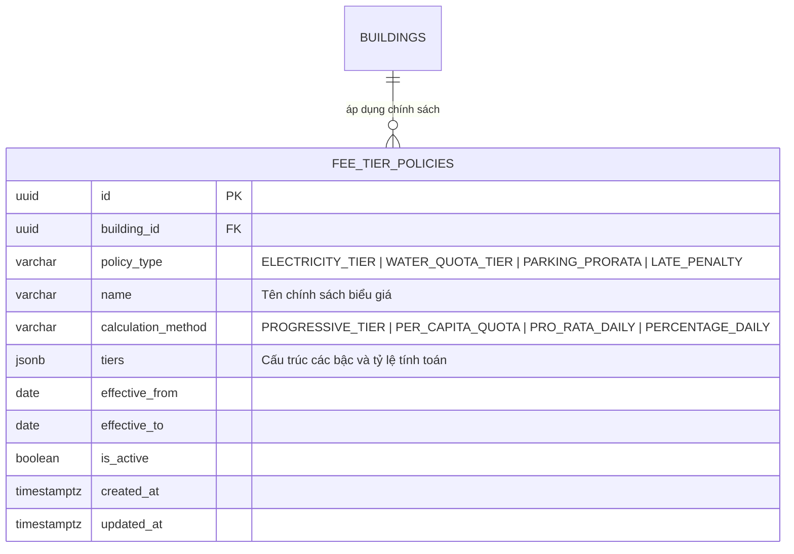

# Tài Liệu Thiết Kế Kỹ Thuật: Engine Tính Phí Đa Dạng, Bậc Thang EVN, Phí Xe Pro-rata & Phạt Trễ Hạn (C2)

> **Mã tính năng:** C2 - Phase C (Lõi Tài Chính Đạt Chuẩn Thương Mại)  
> **Ngày phê duyệt:** 29/10/2026  
> **Trạng thái:** Đã duyệt thiết kế (Design Approved)  
> **Quy chuẩn thời gian & tiền tệ:** Định dạng người Việt (`dd/MM/yyyy`, `Tháng MM/yyyy`, `#,##0 đ`)

---

## 1. Mục Tiêu & Bối Cảnh Nghiệp Vụ

Trong vận hành chung cư và tòa nhà dịch vụ thương mại tại Việt Nam, bài toán tính phí dịch vụ rất đa dạng và phức tạp:
1. **Điện sinh hoạt bậc thang:** Phải áp dụng đúng biểu giá 6 bậc của Tập đoàn Điện lực Việt Nam (EVN) theo Thông tư của Bộ Công Thương, hoặc cho phép thỏa thuận đơn giá khoán/bậc thang riêng đối với chuỗi căn hộ mini/nhà trọ.
2. **Nước sinh hoạt định mức nhân khẩu:** Căn hộ có đăng ký nhân khẩu được cấp hạn mức tiêu chuẩn (thường là 4 m³/người/tháng) với giá ưu đãi, phần vượt định mức tính lũy tiến theo các mức lũy tiến.
3. **Phí gửi xe phân bổ ngày lẻ (Pro-rata):** Cư dân đăng ký gửi xe vào giữa tháng (ví dụ ngày 16 của tháng 30 ngày) không thể bị thu trọn vẹn cả tháng; hệ thống phải tự động tính tiền cho 15 ngày thực tế sử dụng.
4. **Lãi phạt trễ hạn tự động (Late Payment Penalty):** Khi hóa đơn quá hạn thanh toán (`due_date`), hệ thống áp dụng thời gian ân hạn 3 ngày đầu miễn phạt, từ ngày thứ 4 tính phạt lũy tiến theo tỷ lệ quy định (ví dụ 0.05%/ngày) để khuyến khích cư dân đóng phí đúng hạn.
5. **Tính minh bạch tuyệt đối:** Cả BQL và Cư dân đều phải xem được bảng phân rã chi tiết từng bậc tính tiền (số lượng x đơn giá = thành tiền) thay vì chỉ nhìn thấy một con số tổng duy nhất.

---

## 2. Kiến Trúc Cơ Sở Dữ Liệu & Ràng Buộc Toàn Vẹn



### 2.1 Bảng `fee_tier_policies`
Quản lý các chính sách tính phí động theo tòa nhà hoặc mặc định hệ thống:
- `id` (UUID, PK, default `gen_random_uuid()`)
- `building_id` (UUID, FK -> `buildings.id`, NULLABLE — nếu NULL là chính sách áp dụng mặc định)
- `policy_type` (VARCHAR(30), NOT NULL) — Giá trị:
  - `ELECTRICITY_TIER`: Bậc thang điện sinh hoạt EVN.
  - `WATER_QUOTA_TIER`: Nước sinh hoạt theo định mức nhân khẩu.
  - `PARKING_PRORATA`: Phí gửi xe chia theo ngày lẻ.
  - `LATE_PENALTY`: Lãi phạt chậm thanh toán.
  - `MANAGEMENT_FEE`: Phí quản lý theo m² hoặc khoán căn.
- `name` (VARCHAR(100), NOT NULL) — VD: "Điện sinh hoạt EVN 6 bậc (Quyết định 2024)", "Nước sinh hoạt định mức 4m3/người", "Phạt quá hạn 0.05%/ngày"
- `calculation_method` (VARCHAR(30), NOT NULL) — `PROGRESSIVE_TIER`, `PER_CAPITA_QUOTA`, `PRO_RATA_DAILY`, `PERCENTAGE_DAILY`
- `tiers` (JSONB, NOT NULL) — Cấu trúc dữ liệu chi tiết cho từng loại:
  - **Điện EVN 6 bậc:**
    ```json
    [
      {"tier": 1, "name": "Bậc 1 (0 - 50 kWh)", "from": 0, "to": 50, "rate": 1893},
      {"tier": 2, "name": "Bậc 2 (51 - 100 kWh)", "from": 50, "to": 100, "rate": 1956},
      {"tier": 3, "name": "Bậc 3 (101 - 200 kWh)", "from": 100, "to": 200, "rate": 2271},
      {"tier": 4, "name": "Bậc 4 (201 - 300 kWh)", "from": 200, "to": 300, "rate": 2860},
      {"tier": 5, "name": "Bậc 5 (301 - 400 kWh)", "from": 300, "to": 400, "rate": 3197},
      {"tier": 6, "name": "Bậc 6 (Trên 400 kWh)", "from": 400, "to": null, "rate": 3302}
    ]
    ```
  - **Nước sinh hoạt định mức nhân khẩu:**
    ```json
    {
      "quota_per_resident": 4.0,
      "base_rate": 8500,
      "excess_tier_1_ratio": 1.5,
      "excess_tier_1_rate": 12000,
      "excess_tier_2_rate": 18000
    }
    ```
  - **Lãi phạt trễ hạn:**
    ```json
    {
      "grace_period_days": 3,
      "penalty_rate_per_day": 0.0005
    }
    ```
- `effective_from` (DATE, NOT NULL, default `CURRENT_DATE`)
- `effective_to` (DATE, NULLABLE)
- `is_active` (BOOLEAN, NOT NULL, default `true`)
- `created_at`, `updated_at` (TIMESTAMPTZ, default `now()`)

### 2.2 RLS Policies
- `fee_tier_policies_read`: Cho phép mọi user đã đăng nhập đọc danh mục chính sách biểu giá để đảm bảo tính minh bạch.
- `fee_tier_policies_manage`: Chỉ các vai trò quản trị (`admin`, `manager`, `accountant`) được quyền thêm, sửa, đổi trạng thái biểu giá.

---

## 3. Remote Procedure Calls (RPCs) Tính Toán Độc Lập

### 3.1 `calculate_progressive_electricity_fee`
```sql
calculate_progressive_electricity_fee(
    p_consumption NUMERIC,
    p_building_id UUID DEFAULT NULL
) RETURNS JSONB
```
- Lấy chính sách `ELECTRICITY_TIER` có hiệu lực của tòa nhà (hoặc chính sách mặc định).
- Phân bổ số kWh tiêu thụ lần lượt qua các bậc từ 1 đến 6.
- Kết quả trả về:
  ```json
  {
    "consumption": 265,
    "total_amount": 622350,
    "breakdown": [
      {"tier": 1, "name": "Bậc 1 (0 - 50 kWh)", "kwh": 50, "rate": 1893, "amount": 94650},
      {"tier": 2, "name": "Bậc 2 (51 - 100 kWh)", "kwh": 50, "rate": 1956, "amount": 97800},
      {"tier": 3, "name": "Bậc 3 (101 - 200 kWh)", "kwh": 100, "rate": 2271, "amount": 227100},
      {"tier": 4, "name": "Bậc 4 (201 - 300 kWh)", "kwh": 65, "rate": 2860, "amount": 185900},
      {"tier": 5, "name": "Bậc 5 (301 - 400 kWh)", "kwh": 0, "rate": 3197, "amount": 0},
      {"tier": 6, "name": "Bậc 6 (Trên 400 kWh)", "kwh": 0, "rate": 3302, "amount": 0}
    ]
  }
  ```

### 3.2 `calculate_quota_water_fee`
```sql
calculate_quota_water_fee(
    p_consumption NUMERIC,
    p_resident_count INT DEFAULT 1,
    p_building_id UUID DEFAULT NULL
) RETURNS JSONB
```
- Lấy chính sách `WATER_QUOTA_TIER`.
- Định mức cơ sở = `p_resident_count * 4 m³`.
- Phân rã 3 mức: Trong định mức, Vượt mức 1, Vượt mức 2.
- Kết quả trả về:
  ```json
  {
    "consumption": 18,
    "resident_count": 3,
    "base_quota": 12,
    "total_amount": 186000,
    "breakdown": [
      {"tier": 1, "name": "Trong định mức (<= 12 m³)", "m3": 12, "rate": 8500, "amount": 102000},
      {"tier": 2, "name": "Vượt định mức cấp 1 (12 - 18 m³)", "m3": 6, "rate": 12000, "amount": 72000},
      {"tier": 3, "name": "Vượt định mức cấp 2 (> 18 m³)", "m3": 0, "rate": 18000, "amount": 0}
    ]
  }
  ```

### 3.3 `calculate_prorated_vehicle_fee`
```sql
calculate_prorated_vehicle_fee(
    p_monthly_rate NUMERIC,
    p_start_date DATE,
    p_period VARCHAR(7)
) RETURNS JSONB
```
- Xác định số ngày trong tháng của kỳ `p_period` (28/29/30/31 ngày).
- Nếu `p_start_date` trước ngày mùng 1 của kỳ: `days_used = days_in_month`, `total_amount = p_monthly_rate`.
- Nếu `p_start_date` nằm trong kỳ:
  - `days_used = (last_day_of_month - p_start_date) + 1`.
  - `total_amount = ROUND((p_monthly_rate / days_in_month) * days_used, 0)`.
- Kết quả trả về:
  ```json
  {
    "monthly_rate": 120000,
    "period": "2026-10",
    "days_in_month": 31,
    "days_used": 16,
    "is_prorated": true,
    "total_amount": 61935
  }
  ```

### 3.4 `calculate_late_payment_penalty`
```sql
calculate_late_payment_penalty(
    p_invoice_id UUID,
    p_as_of_date DATE DEFAULT CURRENT_DATE
) RETURNS JSONB
```
- Lấy `due_date`, `total_amount`, `status` từ hóa đơn.
- Nếu `p_as_of_date <= due_date`: Tiền phạt = 0 đ, `days_overdue = 0`.
- Nếu quá hạn:
  - `days_overdue = p_as_of_date - due_date`.
  - Nếu `days_overdue <= grace_period_days` (3 ngày): Tiền phạt = 0 đ (trong thời gian ân hạn).
  - Nếu `days_overdue > grace_period_days`:
    - `penalty_amount = ROUND(total_amount * penalty_rate_per_day * days_overdue, 0)`.
- Kết quả trả về:
  ```json
  {
    "invoice_id": "...",
    "due_date": "2026-10-15",
    "as_of_date": "2026-10-29",
    "days_overdue": 14,
    "in_grace_period": false,
    "penalty_rate_per_day": 0.0005,
    "penalty_amount": 10500
  }
  ```

---

## 4. Đặc Tả Giao Diện & Trải Nghiệm Người Dùng (UI/UX)

### 4.1 Chi Tiết Bậc Thang Trên Hóa Đơn Cư Dân (`ResidentInvoiceDetailScreen`)
- Với mục phí Tiền điện hoặc Tiền nước:
  - Thẻ mục phí hiển thị tổng kWh/m³ và tổng tiền.
  - Có nút bấm **"Chi tiết bậc thang tiêu thụ"** (hoặc icon mở rộng).
  - Khi bấm, hiển thị Modal/Card phân rã đẹp mắt:
    - Danh sách các bậc kèm badge số lượng và đơn giá.
    - Thanh tiến trình trực quan minh họa tỷ lệ tiêu thụ trong từng bậc.
- Với xe đăng ký giữa kỳ:
  - Hiển thị chip màu cam nhạt: `Phí theo ngày lẻ (16/31 ngày)`.
- Với hóa đơn quá hạn:
  - Banner cảnh báo: `Đã quá hạn 14 ngày - Lãi phạt chậm nộp: 10.500 đ`.

### 4.2 Màn Hình Quản Lý Biểu Giá & Xem Trước Cho BQL
- **Biểu giá động:** BQL có thể xem và cập nhật biểu giá điện EVN hoặc thiết lập đơn giá riêng cho chuỗi phòng trọ.
- **Công cụ tính toán nhanh (Quick Fee Calculator):** Nhập số cũ, số mới, số nhân khẩu -> Trả về kết quả phân rã chi tiết tức thời.

---

## 5. Kế Hoạch Kiểm Thử TDD & Tiêu Chuẩn Nghiệm Thu

1. **Migration & DB Tests:**
   - Kiểm tra bảng `fee_tier_policies` được tạo đúng cấu trúc, ràng buộc và seed sẵn biểu giá 6 bậc EVN và nước định mức.
   - Kiểm tra các RPCs tính toán chính xác số liệu với các biên dữ liệu (Boundary testing: 0 kWh, 50 kWh, 100 kWh, 450 kWh; 1 nhân khẩu, 4 nhân khẩu; ngày 1, ngày 16, ngày 31).
2. **Dart Models & Services Tests:**
   - `FeeTierPolicyModel`, `TieredCalculationResultModel`, `ProratedFeeResultModel`.
   - Unit tests các helper tính toán và format tiếng Việt.
3. **UI Widget Tests:**
   - Kiểm tra hiển thị bảng phân rã bậc thang điện/nước.
   - Kiểm tra hiển thị badge pro-rata xe ngày lẻ.
   - Kiểm tra banner cảnh báo phạt trễ hạn.
