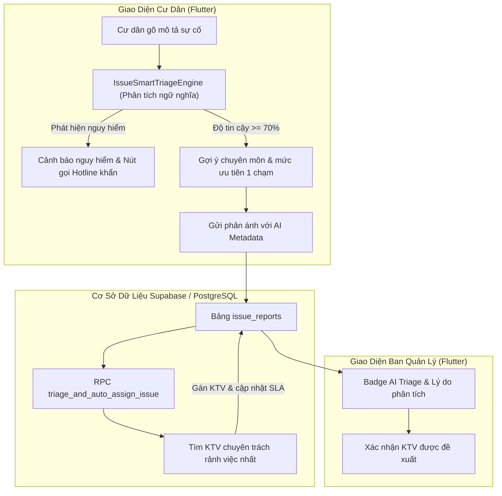

# Đặc Tả Thiết Kế: E2 - AI Phân Loại Sự Cố & Tự Động Gán Kỹ Thuật Viên

**Mã chức năng:** `FEAT-E2-ISSUE-SMART-TRIAGE`  
**Thuộc lộ trình:** GIAI ĐOẠN E - Tính Năng Thông Minh (AI, OCR & Tối Ưu Vận Hành)  
**Tài liệu tham chiếu:** [`docs/COMMERCIAL_PRODUCT_ROADMAP.md`](file:///c:/Users/ADMIN/StudioProjects/pka_home/docs/COMMERCIAL_PRODUCT_ROADMAP.md)

---

## 1. Mục Tiêu & Vấn Đề Nghiệp Vụ

1. **Phân loại sai hoặc chủ quan:** Cư dân khi gặp sự cố khẩn cấp (chập điện, khói, vỡ ống nước, kẹt thang) thường không biết chọn đúng mức độ ưu tiên hoặc chọn sai danh mục kỹ thuật, dẫn đến phiếu bị trôi vào hàng đợi xử lý định kỳ (72h).
2. **Chậm trễ trong phân công kỹ thuật:** Ban Quản Lý phải đọc từng phiếu thủ công rồi mới tìm xem nhân viên kỹ thuật nào phụ trách mảng điện, nước hay thang máy, làm chậm thời gian phản hồi vàng (SLA ban đầu).
3. **An toàn tòa nhà:** Các sự cố rủi ro cao (cháy nổ, ngập nước tòa nhà, kẹt người trong thang máy) đòi hỏi phải kích hoạt chuông cảnh báo và hotline khẩn cấp ngay trên màn hình người gửi.

**Mục tiêu của E2:**
- Cung cấp Engine phân tích ngữ nghĩa tiếng Việt (`IssueSmartTriageEngine`) để tự động nhận diện:
  - Danh mục kỹ thuật chính xác (`electrical`, `plumbing`, `elevator`, `fire_safety`, `construction`, `other`).
  - Mức độ khẩn cấp (`high`, `medium`, `low`) kèm cảnh báo an toàn.
  - Nhận diện các sự cố nguy hiểm cần can thiệp hotline tức thời (cháy, khói, gas, kẹt người).
- Engine đề xuất & tự động gán kỹ thuật viên (`triage_and_auto_assign_issue`):
  - Tìm kỹ thuật viên phù hợp chuyên môn đang có khối lượng công việc thấp nhất (load balancing).
  - Gắn nhãn AI Confidence và lý do phân loại rõ ràng.
- Tích hợp trải nghiệm trực quan: Gợi ý 1 chạm cho Cư dân khi soạn phản ánh và Bảng phân bổ thông minh cho Ban Quản Lý.

---

## 2. Kiến Trúc Giải Pháp & Luồng Xử Lý

---

## 3. Quy Tắc Thuật Toán Phân Tích Ngữ Nghĩa (`IssueSmartTriageEngine`)

### 3.1. Phân loại Danh mục Kỹ thuật (`category`)
- **Điện (`electrical`):** Các từ khóa: `điện, bóng đèn, ổ cắm, công tắc, chập, attomat, aptomat, mất điện, nhảy cb, sập nguồn, cầu dao, dây điện, tủ điện, rò điện, đoản mạch, bóng tuýp, đèn led, đứt cầu chì`.
- **Nước (`plumbing`):** Các từ khóa: `nước, rò rỉ, vòi sen, bồn cầu, bồn rửa, ống nước, rỉ nước, xì nước, tắc cống, vỡ ống, mất nước, ngập, cống nghẹt, van nước, phao nước, rò rỉ téc, đồng hồ nước, bể nước, áp lực yếu`.
- **Thang máy (`elevator`):** Các từ khóa: `thang máy, kẹt thang, rơi thang, thang đứng im, cửa thang, kẹt cửa, nút bấm thang máy, thẻ thang, bảng điều khiển thang, rung lắc thang, thang tụt`.
- **PCCC & An toàn (`fire_safety`):** Các từ khóa: `cháy, khói, mùi khét, chuông báo cháy, vòi cứu hỏa, bình chữa cháy, xì gas, rò khí gas, nổ, báo khói, họng nước vách tường, cửa thoát hiểm`.
- **Xây dựng / Hoàn thiện (`construction`):** Các từ khóa: `nứt tường, thấm trần, dột, rạn nứt, rơi gạch, bong sơn, ổ khóa, bản lề, cửa hỏng, tay nắm cửa, sàn gỗ phồng, vỡ kính, lan can, ban công lỏng`.
- **Khác (`other`):** Các từ khóa: `rác thải, mùi hôi, tiếng ồn, thú cưng, chó mèo, đỗ xe bừa bãi, tranh chấp, bảo vệ, vệ sinh`.

### 3.2. Đánh giá Mức độ Ưu tiên (`priority`) & Cảnh Báo Nguy Hiểm
- **Khẩn cấp (`high` - Cam kết SLA $\le 2$ giờ, phản hồi $\le 15$ phút):**
  - Chứa từ khóa nguy hiểm cao: `cháy, nổ, khói, khét, xì gas, rò gas, kẹt người, giật điện, chập điện, vỡ ống nước chính, tràn ngập, rơi thang, sập trần`.
  - Cờ `isHazardous = true` -> Kích hoạt hotline khẩn cấp Ban Quản Lý ngay trên màn hình.
- **Ưu tiên (`medium` - Cam kết SLA $\le 24$ giờ):**
  - Chứa từ khóa: `mất nước, mất điện, tắc bồn cầu, ngấm trần, rỉ nước liên tục, khóa cửa kẹt không vào được nhà`.
- **Bình thường (`low` - Cam kết SLA $\le 72$ giờ):**
  - Chứa từ khóa: `đèn chớp nháy, xước sơn, bản lề kêu, vòi nhỏ giọt nhẹ, kiến nghị vệ sinh`.

### 3.3. Độ Tin Cậy Phân Loại (Confidence Score)
- Tính toán dựa trên mật độ và trọng số từ khóa trong văn bản.
- Trả về độ tin cậy từ $0.00$ đến $1.00$. Nếu $\ge 0.70$, tự động gợi ý cho người dùng.

---

## 4. Thiết Kế Cơ Sở Dữ Liệu (PostgreSQL / Supabase)

Bổ sung các trường vào bảng `issue_reports`:
- `ai_category_confidence NUMERIC(4,3) DEFAULT 0.000`
- `ai_suggested_category VARCHAR(50)`
- `ai_suggested_priority VARCHAR(20)`
- `ai_triage_reason TEXT`
- `is_hazardous BOOLEAN DEFAULT false`
- `auto_assigned BOOLEAN DEFAULT false`

RPC PostgreSQL: `triage_and_auto_assign_issue(p_issue_id UUID)`
- Đọc thông tin mô tả sự cố.
- Nếu chưa có `assigned_staff_id`, truy vấn danh sách nhân viên kỹ thuật có chuyên môn tương ứng hoặc vai trò kỹ thuật/bảo trì (`role IN ('staff', 'technician')`).
- Chọn nhân viên có ít sự cố đang xử lý nhất (`status IN ('assigned', 'in_progress')`).
- Tự động gán `assigned_staff_id`, cập nhật trạng thái `status = 'assigned'` và ghi lịch sử phân công.
