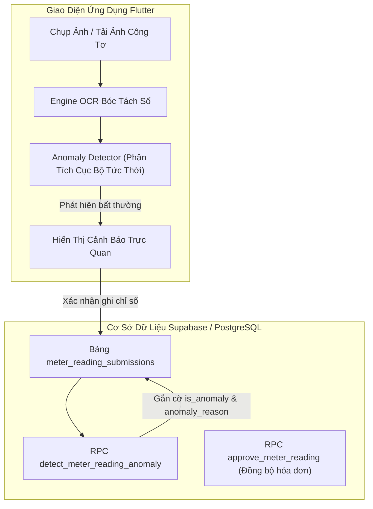

# Đặc Tả Thiết Kế: E1 - OCR Đồng Hồ Điện / Nước & Cảnh Báo Tiêu Thụ Bất Thường

**Mã chức năng:** `FEAT-E1-METER-OCR-ANOMALY`  
**Thuộc lộ trình:** GIAI ĐOẠN E - Tính Năng Thông Minh (AI, OCR & Tối Ưu Vận Hành)  
**Tài liệu tham chiếu:** [`docs/COMMERCIAL_PRODUCT_ROADMAP.md`](file:///c:/Users/ADMIN/StudioProjects/pka_home/docs/COMMERCIAL_PRODUCT_ROADMAP.md)

---

## 1. Mục Tiêu & Bối Cảnh Nghiệp Vụ

Trong quản lý vận hành chung cư và tòa nhà:
1. **Sai sót nhập liệu:** Cư dân hoặc nhân viên bảo vệ/kỹ thuật ghi chép thủ công chỉ số điện nước rất dễ bị nhầm số (ví dụ: 125.4 thành 1254 hoặc đọc nhầm chữ số màu đỏ trên đồng hồ nước cơ).
2. **Tranh chấp hóa đơn:** Khi hóa đơn tiền nước hoặc tiền điện tăng vọt gấp 3-5 lần mà không được phát hiện sớm, cư dân sẽ khiếu nại gay gắt, từ chối thanh toán gây chậm trễ thu phí.
3. **Sự cố rò rỉ ngầm:** Nứt vỡ đường ống nước ngầm hoặc chập chạm rò rỉ điện âm tường nếu không được cảnh báo ngay khi chốt chỉ số sẽ gây lãng phí tài nguyên và rủi ro cháy nổ / ngập úng.

**Mục tiêu của E1:**
- Cung cấp Engine phân tích thị giác máy tính OCR bóc tách chuỗi số trên mặt công tơ điện và đồng hồ nước cơ/điện tử với độ chính xác cao và chấm điểm tin cậy (confidence score).
- Thuật toán nhận diện bất thường (`UtilityAnomalyDetector`): Tự động so sánh số tiêu thụ kỳ hiện tại với chỉ số cũ và mức tiêu thụ trung bình các kỳ trước:
  - Cảnh báo tiêu thụ tăng vọt (> 50% hoặc > 100% so với mức bình quân).
  - Cảnh báo tiêu thụ âm / chỉ số lùi (`current < previous`).
  - Cảnh báo công tơ đứng kim (tiêu thụ = 0 kéo dài).
- Tích hợp cảnh báo thời gian thực trên cả giao diện Cư dân (khi khai báo) và giao diện Ban Quản Lý (khi duyệt và phát hành hóa đơn).

---

## 2. Kiến Trúc Giải Pháp & Luồng Dữ Liệu

---

## 3. Quy Tắc Thuật Toán Phân Tích & OCR

### 3.1. Engine OCR Bóc Tách Số (`UtilityMeterOcrEngine`)
- **Đầu vào:** Văn bản thô (raw OCR text) hoặc ảnh công tơ.
- **Quy tắc bóc tách cho Đồng Hồ Điện:**
  - Nhận diện các mẫu định dạng: `12345.6 kWh`, `12345 kWh`, `00124.5`.
  - Loại bỏ các thông số kỹ thuật in trên mặt kính: điện áp `220V`, dòng điện `5(20)A` hoặc `10(40)A`, tần số `50Hz`, hằng số công tơ `450 rev/kWh`, năm sản xuất.
  - Trích xuất cụm số chỉ thị điện năng tiêu thụ chính.
- **Quy tắc bóc tách cho Đồng Hồ Nước:**
  - Nhận diện chỉ số m³: phần số màu đen là mét khối nguyên, phần kim đỏ hoặc chữ số đỏ là hàng lít/thập phân.
  - Chuẩn hóa về dạng số thực `m³` (ví dụ: `154.2 m³`).
- **Độ tin cậy (Confidence Score):** Từ 0.0 đến 1.0 (trên 0.85 là đáng tin cậy).

### 3.2. Thuật Toán Cảnh Báo Bất Thường (`UtilityAnomalyDetector`)
So sánh mức tiêu thụ kỳ này `usage = currentReading - previousReading` với mức tiêu thụ trung bình các kỳ trước `avgUsage`:
1. **Lỗi đảo chiều / Chỉ số lùi (Negative Consumption):**
   - Điều kiện: `currentReading < previousReading`.
   - Mức độ: **NGHIÊM TRỌNG (ERROR)**.
   - Nguyên nhân: Nhập sai chỉ số hoặc công tơ bị đấu ngược / thay mới chưa reset.
2. **Tiêu thụ tăng vọt bất thường (Spike):**
   - Điều kiện: `usage > avgUsage * 1.5` và `(usage - avgUsage) >= thresholdMinDelta` (ví dụ: tăng > 50% và chênh lệch trên 50 kWh với điện, trên 5 m³ với nước).
   - Mức độ: **CẢNH BÁO CAO (WARNING)**.
   - Nguyên nhân: Nghi ngờ rò rỉ nước ngầm, chập điện, sử dụng thiết bị công suất cao đột biến.
3. **Tiêu thụ nhảy vọt cực đại (Extreme Spike):**
   - Điều kiện: `usage > avgUsage * 2.5` (tăng gấp 2.5 lần trở lên).
   - Mức độ: **BÁO ĐỘNG (DANGER)**.
4. **Công tơ đứng kim (Zero Consumption):**
   - Điều kiện: `usage == 0` trong khi các tháng trước có tiêu thụ.
   - Mức độ: **LƯU Ý (INFO/WARNING)**.
   - Nguyên nhân: Nhà vắng người dài ngày hoặc công tơ bị kẹt bánh răng cơ khí / chết nguồn.

---

## 4. Thiết Kế Cơ Sở Dữ Liệu (Supabase/PostgreSQL)

Bổ sung các trường vào bảng `meter_reading_submissions`:
- `ocr_confidence NUMERIC(4,3)`: Độ tin cậy OCR (0.000 -> 1.000).
- `is_anomaly BOOLEAN NOT NULL DEFAULT false`: Cờ phát hiện bất thường.
- `anomaly_severity VARCHAR(20)`: Mức độ (`normal`, `warning`, `danger`).
- `anomaly_reason TEXT`: Mô tả chi tiết nguyên nhân bất thường bằng tiếng Việt chuẩn.
- `previous_reading_val NUMERIC(10,2)`: Chỉ số kỳ liền trước dùng để đối soát.
- `average_usage NUMERIC(10,2)`: Tiêu thụ trung bình 3 kỳ gần nhất.

RPC PostgreSQL: `detect_meter_reading_anomaly(p_apartment_id UUID, p_meter_type VARCHAR, p_current_reading NUMERIC, p_period VARCHAR)`
- Trả về JSONB chứa: `is_anomaly`, `severity`, `reason`, `previous_reading`, `avg_usage`, `delta_usage`, `percent_change`.

---

## 5. Thiết Kế Giao Diện Người Dùng (UI/UX)

1. **Giao diện Cư dân (`ResidentMeterReadingScreen`):**
   - Quét camera / OCR giả lập nâng cao kèm bóc tách thông minh.
   - Khung xem trước thông tin quét: Hiển thị chỉ số nhận diện, đơn vị và thanh chỉ số tin cậy (Confidence).
   - Banner cảnh báo động khi phát hiện bất thường:
     - Màu cam nếu tăng > 50%: *"Cảnh báo: Tiêu thụ nước dự kiến (22 m³) cao hơn 83% so với mức trung bình (12 m³). Vui lòng kiểm tra rò rỉ van nước hoặc đối soát lại công tơ."*
     - Nút xác nhận tiếp tục gửi sau khi đã kiểm tra.
2. **Giao diện Ban Quản Lý (`ManagementMeterReadingScreen`):**
   - Thêm tab / bộ lọc "Bất thường" lọc nhanh các bản ghi có cờ `is_anomaly = true`.
   - Thẻ hiển thị có viền màu ngữ nghĩa và icon cảnh báo cảnh giác.
   - Nút "Yêu cầu kỹ thuật kiểm tra lại" hoặc "Duyệt đặc cách".

