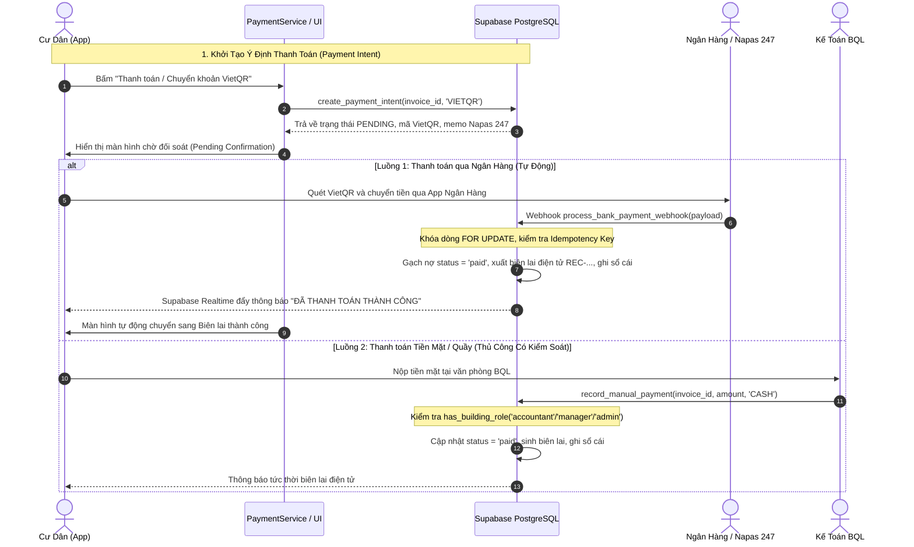

# Đặc Tả Thiết Kế: Tính Toàn Vẹn Tài Chính, Thanh Toán Thực Tế & Bảo Mật Sổ Quỹ (FIN-01, FIN-02, FIN-03, SEC-04, SEC-05, OPS-FIX)

**Mã tài liệu:** `SPEC-FINANCIAL-INTEGRITY-01`  
**Thuộc lộ trình:** `GIAI ĐOẠN 0: Product Hardening & Real Commercial SaaS`  
**Ngày lập:** 04/11/2026  
**Trạng thái:** Đã phê duyệt  
**Căn cứ pháp lý:** 
- Luật Nhà ở 27/2023/QH15 & Nghị định hướng dẫn thi hành (Minh bạch Quỹ bảo trì 2%).
- Nghị định 254/2026/NĐ-CP (Hóa đơn, biên lai điện tử & chứng từ thu chi).
- Luật Bảo vệ dữ liệu cá nhân 91/2025/QH15 & Nghị định 356/2025/NĐ-CP.

---

## 1. Bối Cảnh & Vấn Đề Cần Khắc Phục

Từ đợt kiểm toán mã nguồn thương mại, hệ thống phát hiện 3 lỗ hổng tài chính và vận hành nghiêm trọng:

### 1.1. Lỗ hổng P0: Thanh toán giả lập `simulate_unified_payment`
- **Hiện trạng:** `PaymentService.pay()` gọi RPC `simulate_unified_payment` với tham số `p_outcome = 'SUCCESS'`. RPC này ngay lập tức cập nhật trạng thái hóa đơn `invoices.status = 'paid'` và sinh số biên lai mà không có bất kỳ bước xác minh giao dịch thực tế từ ngân hàng.
- **Rủi ro:** Bất kỳ người dùng nào có tài khoản đăng nhập đều có thể gọi trực tiếp RPC này để tự gạch nợ hóa đơn của mình mà không cần trả một đồng nào.
- **Giải pháp:**
  - Thu hồi quyền gọi `simulate_unified_payment` từ vai trò `authenticated` đối với các hóa đơn thương mại thực tế.
  - Ban hành RPC mới `create_payment_intent`: Client chỉ được phép khởi tạo ý định thanh toán với trạng thái `PENDING`, nhận mã VietQR Napas 247 và thông tin đối soát.
  - Hóa đơn chỉ chuyển sang `paid` thông qua:
    1. Webhook ngân hàng tự động: `process_bank_payment_webhook(p_payload JSONB)`.
    2. Ban Quản Lý xác nhận thu tiền mặt/chuyển khoản tại quầy: `record_manual_payment` (có kiểm tra quyền kế toán).

### 1.2. Lỗ hổng P0: Sổ Quỹ Bảo Trì 2% (`record_maintenance_fund_transaction`)
- **Hiện trạng:**
  - Tham số `p_created_by` được nhận tùy ý từ client thay vì lấy danh tính định danh an toàn từ JWT (`auth.uid()`).
  - RPC không kiểm tra quyền kế toán hoặc quyền quản lý của người gọi tại tòa nhà tương ứng (`p_building_id`).
  - Số chứng từ phiếu thu/chi được sinh bằng câu lệnh `SELECT COUNT(*) + 1`, tiềm ẩn nguy cơ xung đột số chứng từ (Race Condition) khi hai kế toán cùng lập phiếu đồng thời.
- **Giải pháp:**
  - Lấy danh tính người lập phiếu an toàn: `v_created_by := auth.uid()`.
  - Kiểm tra thẩm quyền nghiêm ngặt bằng hàm bảo mật đã xây dựng ở Gói 1: `public.has_building_role(p_building_id, ARRAY['accountant', 'manager', 'admin'])`.
  - Sinh số chứng từ phiếu thu (`PT-YYYYMM-XXXXX`) và phiếu chi (`PC-YYYYMM-XXXXX`) thông qua PostgreSQL `SEQUENCE` độc lập (`maintenance_fund_pt_seq`, `maintenance_fund_pc_seq`) kết hợp ràng buộc `UNIQUE(building_id, voucher_number)`.

### 1.3. Lỗ hổng P1: Bỏ qua kiểm soát lỗi khi hủy tiện ích (`AmenityBookingRepository.cancelBooking`)
- **Hiện trạng:** Khi RPC `cancel_amenity_booking` thất bại (do hết hạn hủy, có xung đột cọc, hoặc lỗi quyền), khối `catch` âm thầm chạy lệnh `UPDATE amenity_bookings SET status = 'cancelled'`.
- **Rủi ro:** Phá vỡ tính toàn vẹn nghiệp vụ (không hoàn cọc, không hủy giao dịch chờ, không đôn người trong danh sách chờ Waitlist).
- **Giải pháp:**
  - Triệt tiêu hoàn toàn khối lệnh cập nhật lén.
  - Áp dụng nguyên tắc **Fail-Closed**: nếu RPC thất bại, ném ngoại lệ rõ ràng để UI thông báo cho người dùng, bảo toàn 100% dữ liệu kế toán và lịch đặt chỗ.

---

## 2. Kiến Trúc Giải Pháp & Luồng Dữ Liệu

### 2.1. Luồng Thanh Toán Thực Tế (Real Payment Lifecycle)



### 2.2. Chi Tiết RPCs Cơ Sở Dữ Liệu (`20261104_01_financial_integrity_and_real_payment.sql`)

#### 1. RPC `create_payment_intent`
```sql
CREATE OR REPLACE FUNCTION public.create_payment_intent(
    p_reference_id UUID,
    p_payment_type TEXT DEFAULT 'INVOICE',
    p_payment_method TEXT DEFAULT 'VIETQR'
)
RETURNS JSONB
LANGUAGE plpgsql
SECURITY DEFINER
SET search_path = public, pg_catalog;
```
- **Nhiệm vụ:**
  - Xác thực `auth.uid()`.
  - Khóa dòng hóa đơn hoặc lịch đặt tiện ích `FOR UPDATE`.
  - Kiểm tra xem hóa đơn/booking đã được thanh toán chưa. Nếu đã `paid` -> trả về lỗi.
  - Tạo một bản ghi trong `public.payment_transactions` với `status = 'PENDING'`, lưu vết `payment_method` và thời điểm khởi tạo.
  - Trả về JSON:
    ```json
    {
      "success": true,
      "status": "PENDING",
      "is_pending": true,
      "transaction_id": "...",
      "reference_code": "INV-...",
      "amount": 1500000,
      "message": "Đã khởi tạo giao dịch chờ thanh toán. Vui lòng chuyển khoản đúng nội dung."
    }
    ```

#### 2. Vô hiệu hóa `simulate_unified_payment`
```sql
-- Thu hồi quyền gọi của authenticated, chỉ giữ lại cho service_role / kiểm thử nội bộ
REVOKE EXECUTE ON FUNCTION public.simulate_unified_payment(UUID, TEXT, TEXT, TEXT, TEXT) FROM authenticated, anon, PUBLIC;
```

#### 3. Củng cố RPC `record_maintenance_fund_transaction`
- Tạo hai PostgreSQL Sequences:
  ```sql
  CREATE SEQUENCE IF NOT EXISTS public.maintenance_fund_pt_seq START WITH 1 INCREMENT BY 1;
  CREATE SEQUENCE IF NOT EXISTS public.maintenance_fund_pc_seq START WITH 1 INCREMENT BY 1;
  ```
- Kiểm tra thẩm quyền kế toán:
  ```sql
  IF NOT public.has_building_role(p_building_id, ARRAY['accountant', 'manager', 'admin', 'head_of_management']) THEN
      RAISE EXCEPTION 'Bạn không có quyền kế toán để ghi sổ quỹ bảo trì tại tòa nhà này.';
  END IF;
  ```
- Lấy `v_created_by := COALESCE(auth.uid(), p_created_by);` và kiểm tra không được NULL.
- Sinh số chứng từ an toàn từ SEQUENCE:
  ```sql
  IF p_transaction_type = 'INCOME' THEN
      v_seq := nextval('public.maintenance_fund_pt_seq');
      v_prefix := 'PT-';
  ELSE
      v_seq := nextval('public.maintenance_fund_pc_seq');
      v_prefix := 'PC-';
  END IF;
  v_voucher_number := v_prefix || v_period || '-' || LPAD(v_seq::text, 5, '0');
  ```
- Bổ sung ràng buộc tính duy nhất:
  ```sql
  ALTER TABLE public.maintenance_fund_transactions 
  ADD CONSTRAINT uq_maintenance_fund_building_voucher UNIQUE (building_id, voucher_number);
  ```

---

## 3. Thiết Kế Tầng Ứng Dụng Dart / Flutter

### 3.1. `PaymentService` & `PaymentController`
- Sửa hàm `pay()` trong `lib/data/services/payment_service.dart`:
  - Gọi RPC `create_payment_intent` thay vì `simulate_unified_payment`.
  - Trả về `PaymentResult` với `isPending = true` và `status = 'PENDING'`.
- `PaymentController`:
  - Khi khởi tạo intent thành công, kích hoạt màn hình chờ xác nhận và lắng nghe stream realtime.

### 3.2. `AmenityBookingRepository`
- Xóa bỏ khối fallback cập nhật trực tiếp `cancelled`.
- Giữ logic fail-closed: nếu RPC ném lỗi, bắt lỗi và ném ra `Exception` tường minh cho tầng UI hiển thị SnackBar cảnh báo.

---

## 4. Kế Hoạch Kiểm Thử & Tiêu Chí Nghiệm Thu (Quality Gate)

1. **Kiểm thử Database (`test/database/financial_integrity_migration_test.dart`):**
   - Kiểm tra `create_payment_intent` được khai báo, cấp quyền `authenticated`.
   - Kiểm tra `simulate_unified_payment` đã bị thu hồi quyền từ `authenticated`.
   - Kiểm tra `record_maintenance_fund_transaction` có kiểm tra `has_building_role` và dùng sequence.
   - Kiểm tra sequence `maintenance_fund_pt_seq` và `maintenance_fund_pc_seq` tồn tại.
2. **Kiểm thử Tầng Dịch Vụ (`test/data/services/payment_service_real_test.dart`):**
   - Kiểm tra `PaymentService.pay()` gọi RPC `create_payment_intent` và nhận diện đúng trạng thái `PENDING`.
   - Kiểm tra `PaymentResult.fromJson` xử lý trơn tru các trường hợp `PENDING`, `SUCCESS`, `OVERPAID`, `PARTIAL_PAID`.
3. **Kiểm thử Fail-Closed (`test/data/repositories/amenity_booking_fail_closed_test.dart`):**
   - Kiểm tra `cancelBooking()` ném `Exception` khi RPC thất bại, không có bất kỳ lệnh gọi `update` ngầm nào.
4. **Phân tích tĩnh:** `dart analyze lib test` đạt 0 issues, 0 errors, 0 warnings.
5. **Git:** Toàn bộ commit trực tiếp vào `main`.
