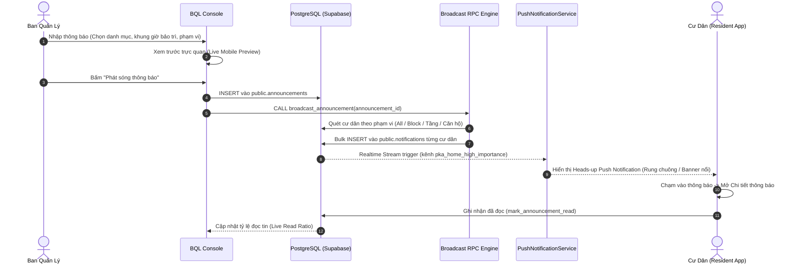

# Thiết Kế: Module Quản Lý Thông Báo Toàn Tòa & Push Notification (Broadcast Engine)

- **Ngày tạo**: 2026-11-06
- **Tác giả**: Antigravity & Đội ngũ PKA-Home
- **Trạng thái**: Approved / Đang triển khai
- **Phạm vi**: Backend PostgreSQL, Realtime Push Notification, BQL Management Console, Resident App

---

## 1. Bối cảnh & Vấn đề Cần Giải Quyết

Trong quản lý vận hành chung cư thực tế, Ban Quản Lý (BQL) thường xuyên phải phát đi các thông báo khẩn cấp và định kỳ:
1. **Sự cố khẩn cấp (Emergency)**: Báo cháy, diễn tập PCCC, sự cố vỡ đường ống cấp nước tổng, cắt điện khẩn cấp.
2. **Bảo trì thang máy & Hạ tầng kỹ thuật (Maintenance)**: Bảo trì định kỳ thang máy Block A/B từ 08:00 đến 12:00, súc rửa bể nước ngầm.
3. **Cúp điện / Cắt nước định kỳ (Utility Outages)**: Có khung giờ bắt đầu và kết thúc cụ thể để cư dân chủ động dự trữ nước.
4. **Họp Cư Dân & Bầu Ban Quản Trị (Resident Meeting)**: Kèm địa điểm và thời gian tổ chức.
5. **Thông báo Chung (General)**: Quy chế rác thải, lịch thu gom cây xanh, lễ tết.

**Vấn đề hiện tại**:
- Hệ thống mới chỉ lưu thông báo vào bảng `announcements`. Khi cư dân khóa máy hoặc không mở tab bảng tin, họ **hoàn toàn không nhận được cảnh báo**.
- BQL không chọn được danh mục chuyên biệt, không có khung giờ hiệu lực bảo trì và không đo đếm được tỷ lệ cư dân đã đọc thông báo.

---

## 2. Kiến Trúc Giải Pháp & Luồng Dữ Liệu



---

## 3. Thiết Kế Cơ Sở Dữ Liệu (PostgreSQL)

### 3.1. Bổ sung trường cho bảng `public.announcements`
```sql
ALTER TABLE public.announcements
    ADD COLUMN IF NOT EXISTS category VARCHAR(30) NOT NULL DEFAULT 'general',
    ADD COLUMN IF NOT EXISTS event_start_at TIMESTAMPTZ,
    ADD COLUMN IF NOT EXISTS event_end_at TIMESTAMPTZ,
    ADD COLUMN IF NOT EXISTS is_pinned BOOLEAN NOT NULL DEFAULT FALSE,
    ADD COLUMN IF NOT EXISTS broadcast_count INT NOT NULL DEFAULT 0,
    ADD COLUMN IF NOT EXISTS read_count INT NOT NULL DEFAULT 0,
    ADD COLUMN IF NOT EXISTS hotline_contact VARCHAR(20);

ALTER TABLE public.announcements
    DROP CONSTRAINT IF EXISTS chk_announcements_category;
ALTER TABLE public.announcements
    ADD CONSTRAINT chk_announcements_category 
    CHECK (category IN ('emergency', 'elevator_maintenance', 'utility_outage', 'resident_meeting', 'general'));
```

### 3.2. Stored Procedure: `public.broadcast_announcement(p_announcement_id UUID)`
- Quét danh sách người dùng thuộc đối tượng nhận tin:
  - `target_type = 'all'`: Toàn bộ cư dân có trạng thái `is_active = true` trong tòa nhà.
  - `target_type = 'block'`: Cư dân gắn với căn hộ có `block = UPPER(target_value)`.
  - `target_type = 'floor'`: Cư dân gắn với căn hộ có `floor = target_value::INT`.
  - `target_type = 'apartment'`: Cư dân thuộc căn hộ `code = UPPER(target_value)`.
- Bulk insert vào `public.notifications` với `type = 'announcement'`, payload chứa `announcement_id`, `category`, `is_urgent`, `event_start_at`, `event_end_at`.
- Cập nhật số lượng phát tán `broadcast_count`.

### 3.3. Stored Procedure: `public.mark_announcement_read(p_announcement_id UUID, p_user_id UUID)`
- Cập nhật `is_read = true` cho thông báo tương ứng trong bảng `notifications`.
- Tăng `read_count` trong bảng `announcements`.

---

## 4. Thiết Kế Tầng Ứng Dụng Flutter

### 4.1. Model `AnnouncementModel`
- Các trường mới: `category`, `eventStartAt`, `eventEndAt`, `isPinned`, `broadcastCount`, `readCount`, `hotlineContact`.
- Helper getters:
  - `categoryDisplayName`: "Khẩn cấp", "Bảo trì thang máy", "Cắt điện / nước", "Họp cư dân", "Thông báo chung".
  - `categoryIcon`: `Icons.warning_amber`, `Icons.elevator`, `Icons.power_off`, `Icons.groups`, `Icons.campaign`.
  - `categoryColor`: Đỏ, Cam, Xanh lam, Tím, Xanh lá.
  - `isOngoing`: Kiểm tra xem sự kiện/bảo trì có đang trong thời gian diễn ra hay không.

### 4.2. Giao diện Ban Quản Lý (`AnnouncementManagementScreen`)
- **Dialog Tạo Thông Báo Nâng Cấp**:
  - Dropdown chọn Danh mục với Icon trực quan.
  - Bộ chọn Khung giờ bảo trì / sự kiện (`event_start_at` $\rightarrow$ `event_end_at`).
  - Ô nhập Hotline hỗ trợ kỹ thuật nhanh.
  - Switch Ghim đầu trang & Bật còi rung/thông báo đẩy.
  - **Live Mobile Preview Tab**: Xem ngay bản hiển thị thu nhỏ như trên điện thoại cư dân.
- **Card Thông Báo Nâng Cấp**:
  - Badge danh mục và nhãn thời gian bảo trì rõ ràng.
  - Thanh tiến trình tỷ lệ đọc: `Đã đọc: 85/100 (85%)`.
  - Nút "Phát lại thông báo đẩy" (Re-broadcast push) cho cư dân chưa đọc.

### 4.3. Giao diện Cư Dân (`ResidentHomeScreen` & `ResidentAnnouncementDetailScreen`)
- **Sticky Emergency Bar (Banner Nổi Bật Trang Chủ)**:
  - Nếu có thông báo khẩn cấp hoặc bảo trì thang máy đang diễn ra, hiển thị một banner màu đỏ/cam ghim ngay trên đầu trang chủ cư dân với icon nhấp nháy, tiêu đề ngắn và nút "Xem chi tiết".
- **Chi Tiết Thông Báo (`ResidentAnnouncementDetailScreen`)**:
  - Thẻ thông tin sự kiện: Thời gian bắt đầu - kết thúc, đếm ngược còn lại.
  - Nút bấm quay số gọi ngay Hotline kỹ thuật trực ban.
  - Đánh dấu đã đọc tự động khi mở xem.

---

## 5. Chiến Lược Kiểm Thử (TDD & Verification)

1. **Unit Test Models**:
   - `test/data/models/announcement_model_broadcast_test.dart`: Serialization/Deserialization các trường mới (`category`, `event_start_at`, `read_count`), formatters tiếng Việt, getter `isOngoing`.
2. **Repository & Provider Test**:
   - `test/data/repositories/announcement_broadcast_repository_test.dart`: Kiểm tra gọi RPC `broadcast_announcement`, fallback mock offline an toàn.
   - `test/data/providers/announcement_emergency_provider_test.dart`: Lọc danh sách thông báo khẩn cấp đang diễn ra cho banner trang chủ.
3. **Widget Test**:
   - `test/features/management/screens/announcement_management_broadcast_test.dart`: Render form tạo thông báo mới có danh mục, live preview, và tỷ lệ đọc tin.
   - `test/features/resident/widgets/sticky_emergency_bar_test.dart`: Render banner khẩn cấp trên màn hình cư dân khi có thông báo cấp bách.
4. **Static Analysis & Graphify**:
   - `dart analyze lib test`: 0 errors, 0 warnings.
   - `graphify update .`: Cập nhật AST knowledge graph.

