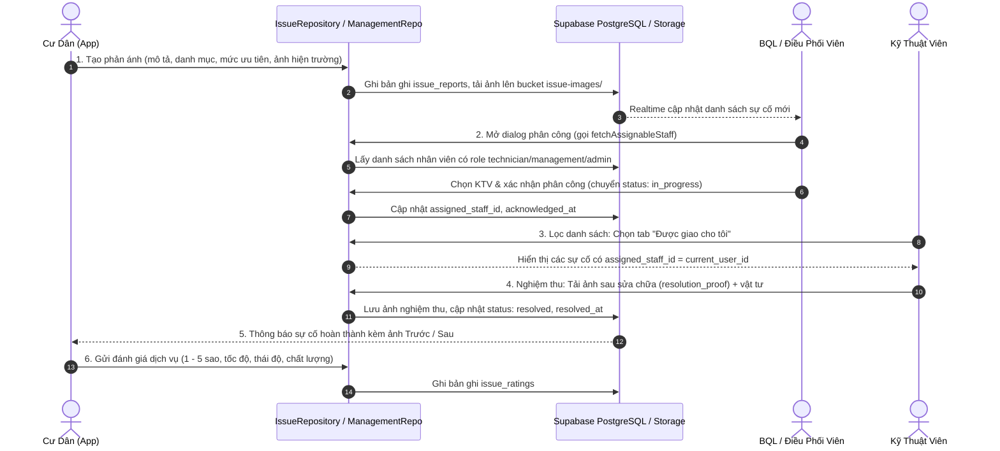

# Đặc Tả Thiết Kế: Quản Lý Phản Ánh Sự Cố & Điều Phối Kỹ Thuật Viên (Issue Reporting & Staff Dispatch)

- **Mã tính năng:** `FEAT-ISSUE-DISPATCH-2026`
- **Tác giả:** Antigravity Engineering
- **Ngày tạo:** 2026-11-06
- **Trạng thái:** Đã phê duyệt (Approved)

---

## 1. Mục Tiêu & Vấn Đề Nghiệp Vụ

Trong quy trình vận hành chung cư PKA-Home, tương tác giải quyết sự cố kỹ thuật giữa Cư dân, Ban Quản Lý (BQL) và Đội ngũ Kỹ thuật viên (KTV) là kênh nghiệp vụ 2 chiều cốt lõi.

### 1.1. Các vấn đề cần giải quyết triệt để:
1. **Vi phạm kiến trúc phân tầng trong UI:** `issue_management_screen.dart` đang gọi trực tiếp `SupabaseConfig.client.from('users')` để tải danh sách nhân viên phân công, vi phạm quy tắc coding (không gọi Supabase trực tiếp từ Widget mà phải qua Repository).
2. **Kỹ thuật viên thiếu chế độ xem tập trung:** Khi kỹ thuật viên đăng nhập vào hệ thống, danh sách sự cố hiển thị toàn bộ tòa nhà mà không có bộ lọc nhanh "Sự cố giao cho tôi" (Assigned to Me), gây mất thời gian tìm kiếm sự cố mình phụ trách.
3. **Quy trình phân công & nghiệm thu minh bạch:** Đảm bảo luồng phân công kỹ thuật viên kèm mốc thời gian tiếp nhận, đính kèm ảnh nghiệm thu sau sửa chữa (Proof of Resolution) và cư dân đánh giá sao (CSAT) minh bạch.

---

## 2. Kiến Trúc Luồng Nghiệp Vụ (Workflow Diagram)



---

## 3. Thiết Kế Chi Tiết Các Tầng

### 3.1. Tầng Dữ Liệu (Repositories & Models)

#### A. Cải tiến `ManagementRepository` (`lib/data/repositories/management_repository.dart`)
Bổ sung phương thức `fetchAssignableStaff()`:
```dart
Future<List<Map<String, dynamic>>> fetchAssignableStaff() async {
  final response = await _client
      .from('users')
      .select('id, full_name, role')
      .inFilter('role', ['technician', 'admin', 'management'])
      .order('full_name', ascending: true);

  return (response as List).map((u) {
    final role = u['role'] as String?;
    final roleLabel = role == 'technician'
        ? 'Kỹ thuật viên'
        : (role == 'admin' ? 'Quản trị viên' : 'Ban Quản lý');
    final name = (u['full_name'] as String?) ?? 'Nhân viên';
    return {
      'id': u['id'] as String,
      'name': '$name ($roleLabel)',
      'role': role,
    };
  }).toList();
}
```

#### B. Cập nhật `IssueModel` & `IssueRepository`
- Tận dụng cấu trúc `IssueModel` hiện có với đầy đủ `assignedStaff`, `images` (`isReport`, `isResolutionProof`), `materials`, `rating`.
- Chuẩn hóa việc phân loại ảnh:
  - `report`: Ảnh hiện trường do cư dân gửi khi báo sự cố.
  - `resolution_proof`: Ảnh nghiệm thu do kỹ thuật viên tải lên khi hoàn tất.

---

### 3.2. Tầng Giao Diện (UI/UX)

#### A. Màn hình Ban Quản Lý & Điều Phối (`issue_management_screen.dart`)
1. **Refactor gọi Repository:**
   - Thay thế toàn bộ đoạn code gọi `SupabaseConfig.client.from('users')` trong `_showAssignStaffDialog` bằng:
     ```dart
     final staffList = await ref.read(managementRepositoryProvider).fetchAssignableStaff();
     ```
2. **Bổ sung Bộ lọc "Được giao cho tôi" (Assigned to Me):**
   - Thêm trạng thái `_onlyAssignedToMe` (boolean) hoặc tùy chọn lọc cạnh các FilterChip hiện tại (`Tất cả`, `Chờ xử lý`, `Đang xử lý`, `Đã giải quyết`).
   - Lấy `currentUserId` từ `ref.watch(authStateProvider).value?.user?.id` hoặc `SupabaseConfig.client.auth.currentUser?.id`.
   - Khi bật bộ lọc này, danh sách chỉ hiển thị các sự cố có `issue.assignedStaffId == currentUserId`.
3. **Hiển thị trực quan:**
   - Badge hiển thị Kỹ thuật viên phụ trách trên từng thẻ sự cố kèm ảnh đại diện/icon công cụ (`Icons.build_circle_outlined`).
   - Hiển thị nút "Gán KTV" hoặc "Đổi KTV" linh hoạt.

#### B. Màn hình Cư Dân (`create_issue_screen.dart` & `issue_detail_screen.dart`)
- **Tạo phản ánh (`create_issue_screen.dart`):** Cho phép chọn ảnh từ camera/gallery, tự động gắn mã căn hộ (`A0110`), phân loại danh mục (Điện, Nước, Xây dựng, Thang máy, PCCC, Khác), cảnh báo sự cố khẩn cấp.
- **Chi tiết phản ánh (`issue_detail_screen.dart`):** Timeline tiến độ 3 giai đoạn (Tiếp nhận $\rightarrow$ Đang xử lý $\rightarrow$ Hoàn thành), hiển thị đối chiếu 2 tab/khối: **Ảnh ban đầu (Hiện trường)** và **Ảnh sau sửa chữa (Nghiệm thu)**.
- **Đánh giá CSAT (`issue_rating_bottom_sheet.dart`):** Hiển thị ngay khi sự cố chuyển sang `resolved`, chấm điểm 3 tiêu chí: Tốc độ xử lý, Thái độ phục vụ, Chất lượng kỹ thuật.

---

## 4. Kế Hoạch Kiểm Thử (Testing & Quality Assurance)

1. **Unit Test Repository:**
   - `test/data/repositories/management_repository_test.dart`: Kiểm tra `fetchAssignableStaff()` định dạng đúng danh sách nhân viên và xử lý phân vai trò chuẩn xác.
2. **Widget Test Giao Diện:**
   - Kiểm tra `issue_management_screen`:
     - Bật bộ lọc "Được giao cho tôi" lọc chính xác sự cố của user đang đăng nhập.
     - Modal `_showAssignStaffDialog` hiển thị đúng danh sách KTV lấy từ Repository.
3. **Static Analysis & Regression:**
   - `dart analyze lib test` đạt 0 issues.
   - Toàn bộ suite test hiện tại của module Issue và Management tiếp tục pass 100%.

---

## 5. Tiêu Chuẩn Tuân Thủ (Compliance Checklist)

- [x] **Ngôn ngữ:** 100% Tiếng Việt chuẩn mực trên giao diện người dùng.
- [x] **Icon:** Sử dụng Material Design (`Icons.*`), tuyệt đối không dùng Emoji trong mã nguồn hoặc UI.
- [x] **Kiến trúc:** Tuân thủ Feature-First và Riverpod Provider, không gọi Supabase trực tiếp từ Widget.
- [x] **Git Workflow:** Commit trực tiếp vào nhánh `main` với commit message chuẩn mực.
