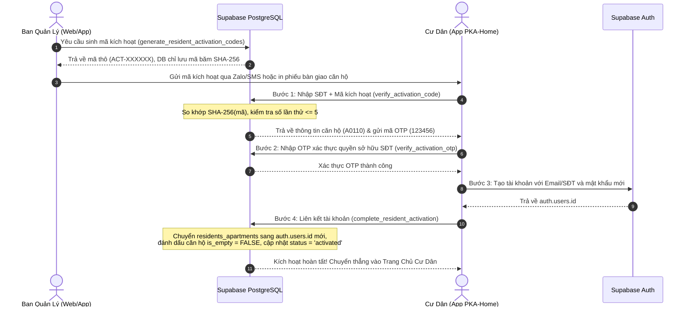

# Đặc Tả Thiết Kế: Module Kích Hoạt Tài Khoản Cư Dân Lần Đầu (Resident First-Time Activation)

> **Mục tiêu**: Cung cấp quy trình kích hoạt tài khoản an toàn, tiện lợi cho cư dân mới sau khi BQL nhập danh sách từ Excel/CSV. Đảm bảo bảo mật nhiều lớp (Mã kích hoạt một lần đã băm SHA-256, Xác thực OTP, Giới hạn lượt thử, Chống kích hoạt trùng và chiếm quyền tài khoản).

---

## 1. Yêu Cầu Nghiệp Vụ & Luồng Hoạt Động (User Flow)



---

## 2. Thiết Kế Cơ Sở Dữ Liệu (PostgreSQL / Supabase)

### 2.1. Cấu trúc bảng `public.resident_activations`
- `id` (UUID, Primary Key)
- `user_id` (UUID, Foreign Key tới `public.users(id)`)
- `apartment_id` (UUID, Foreign Key tới `public.apartments(id)`)
- `phone` (VARCHAR(20), Chỉ chứa số)
- `activation_code` (VARCHAR(32), Mã thô hiển thị nội bộ cho BQL)
- `activation_code_hash` (VARCHAR(64), Băm SHA-256 dùng để so khớp)
- `otp_code` (VARCHAR(10))
- `otp_expires_at` (TIMESTAMPTZ)
- `code_attempts` (INT, Mặc định 0, Tối đa 5 lần)
- `status` (VARCHAR(20), Gồm: `pending`, `otp_sent`, `activated`, `revoked`, `expired`, `locked`)
- `invited_by` (UUID, Tham chiếu tới user BQL)
- `revoked_at` (TIMESTAMPTZ)
- `created_at`, `updated_at` (TIMESTAMPTZ)

### 2.2. Các Stored Procedures (RPCs)
1. `generate_resident_activation_codes(p_building_id UUID)`: Sinh mã mới cho toàn bộ cư dân chưa kích hoạt, tự động tính hash SHA-256.
2. `regenerate_resident_activation(p_user_id UUID)`: Hủy mã cũ và cấp mã mới cho 1 cư dân cụ thể.
3. `revoke_resident_activation(p_activation_id UUID)`: Thu hồi lời mời ngay lập tức (chuyển status thành `revoked`).
4. `verify_activation_code(p_phone TEXT, p_activation_code TEXT)`: Kiểm tra hash mã, tăng `code_attempts`, khóa nếu $> 5$ lần, phát sinh OTP.
5. `verify_activation_otp(p_phone TEXT, p_activation_code TEXT, p_otp_code TEXT)`: Kiểm tra OTP trong vòng 10 phút.
6. `complete_resident_activation(p_phone TEXT, p_activation_code TEXT, p_otp_code TEXT, p_auth_user_id UUID, p_email TEXT)`: Liên kết hồ sơ với `auth.users`, cập nhật căn hộ.
7. `get_building_activation_list(p_building_id UUID)`: Trả về danh sách chi tiết cho màn hình BQL.

---

## 3. Thiết Kế Giao Diện & Trải Nghiệm (UI/UX)

### 3.1. Giao diện Ban Quản Lý (`ResidentActivationManagementSheet`)
- Thống kê: **Tổng cư dân**, **Đã kích hoạt**, **Chờ kích hoạt**, **Chưa cấp mã**.
- Danh sách cư dân: Hiển thị Tên, Căn hộ, SĐT, Trạng thái (Chip màu).
- Menu thao tác:
  - **Sao chép thư mời Zalo/SMS**: Tạo tin nhắn mẫu tiếng Việt:
    ```text
    [PKA-Home] Ban Quản Lý trân trọng gửi mã kích hoạt tài khoản căn hộ {apartment_code} cho cư dân {full_name}:
    Mã kích hoạt: {activation_code}
    Vui lòng tải ứng dụng PKA-Home và chọn "Kích hoạt tài khoản lần đầu" để sử dụng dịch vụ tòa nhà.
    ```
  - **Cấp lại mã mới** (`regenerate`).
  - **Thu hồi mã** (`revoke`).
- Xuất danh sách Excel toàn tòa để phục vụ lễ tân.

### 3.2. Giao diện Cư Dân (`ResidentActivationScreen`)
- Màn hình 3 bước (Stepper):
  - **Bước 1**: Nhập SĐT và Mã kích hoạt (ví dụ: `ACT-123456`).
  - **Bước 2**: Nhập mã OTP 6 số (đếm ngược 60s, nút gửi lại).
  - **Bước 3**: Nhập mật khẩu mới, xác nhận mật khẩu, đồng ý điều khoản.
- Chuyển tiếp tự động vào Trang chủ Cư dân khi thành công.

---

## 4. Kế Hoạch Kiểm Thử (Verification & Testing)
1. **Unit Tests**:
   - `ResidentActivationModel`: Đầy đủ serialization/deserialization.
   - `ResidentActivationRepository`: Bao phủ các hàm `verifyCode`, `verifyOtp`, `completeActivation`, `revoke`, `regenerate`.
   - `ResidentActivationNotifier`: Bao phủ state machine các bước chuyển đổi và validation.
2. **Widget Tests**:
   - `ResidentActivationScreen`: Kiểm tra flow tương tác từ bước 1 tới bước 3.
   - `ResidentActivationManagementSheet`: Kiểm tra render dashboard thống kê, tìm kiếm, các nút hành động.
3. **Static Analysis**: `dart analyze lib test` đạt 0 issues.

