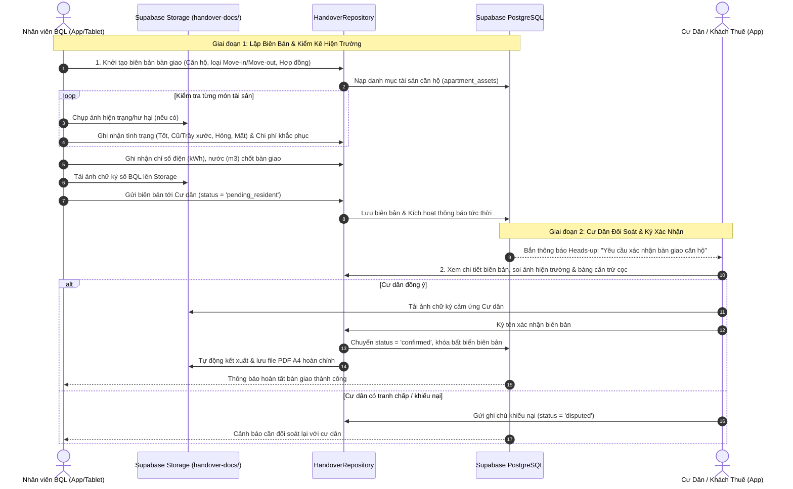

# Đặc Tả Thiết Kế: Biên Bản Bàn Giao & Kiểm Kê Tài Sản Căn Hộ Số Hóa (Digital Move-in/Move-out & Asset Inspection)

- **Mã tính năng:** `FEAT-DIGITAL-ASSET-HANDOVER-2026`
- **Tác giả:** Antigravity Engineering
- **Ngày tạo:** 2026-11-07
- **Trạng thái:** Đã phê duyệt (Approved)
- **Định hướng sản phẩm:** Commercial Production B2B SaaS (Phần mềm thương mại dành cho Ban Quản Lý chung cư, ban quản trị tự quản, công ty vận hành căn hộ dịch vụ và chuỗi nhà trọ chuyên nghiệp).

---

## 1. Mục Tiêu & Bối Cảnh Nghiệp Vụ

Trong mô hình vận hành bất động sản cho thuê (căn hộ dịch vụ, chung cư, nhà trọ cao cấp), quy trình **Bàn giao nhận nhà (Move-in)** và **Kiểm kê trả nhà kết thúc hợp đồng (Move-out)** là điểm chạm pháp lý và tài chính quan trọng bậc nhất giữa Ban Quản Lý/Chủ nhà và Cư dân/Khách thuê.

### 1.1. Các vấn đề nghiệp vụ thực tế cần giải quyết:
1. **Tranh chấp hư hỏng và mất mát tài sản:** Khi trả nhà, việc trừ tiền đặt cọc thường xuyên dẫn đến tranh cãi gay gắt do thiếu bằng chứng tình trạng ban đầu (biên bản giấy thất lạc, hình ảnh phân tán trên Zalo cá nhân).
2. **Sai lệch chỉ số công tơ điện nước đầu/cuối kỳ:** Gây thiệt hại tài chính hoặc tính nhầm tiền sử dụng của cư dân cũ vào kỳ hóa đơn của cư dân mới.
3. **Quy trình thủ công tốn thời gian:** Nhân viên phải in giấy tờ, điền tay từng món đồ, sau đó về văn phòng scan hoặc nhập lại máy tính.
4. **Thiếu tính pháp lý số:** Cần cơ chế ký tên điện tử trực tiếp trên thiết bị (di động/máy tính bảng), mã tra cứu độc bản (`HO-YYYYMM-XXXXX`) và xuất file PDF lưu trữ vĩnh viễn trên Cloud.

---

## 2. Kiến Trúc Luồng Nghiệp Vụ (Workflow Diagram)



---

## 3. Thiết Kế Cơ Sở Dữ Liệu & Storage (Supabase)

### 3.1. Bảng `public.apartment_assets` (Danh mục tài sản căn hộ)
Quản lý trang thiết bị, nội thất gắn với từng căn hộ để tái sử dụng qua nhiều kỳ bàn giao.
```sql
CREATE TABLE IF NOT EXISTS public.apartment_assets (
    id UUID PRIMARY KEY DEFAULT gen_random_uuid(),
    apartment_id UUID NOT NULL REFERENCES public.apartments(id) ON DELETE CASCADE,
    building_id UUID NOT NULL REFERENCES public.buildings(id) ON DELETE CASCADE,
    room_area VARCHAR(50) NOT NULL, -- 'living_room', 'bedroom', 'kitchen', 'bathroom', 'balcony', 'other'
    name VARCHAR(100) NOT NULL,     -- VD: 'Điều hòa Daikin 1.5HP Inverter'
    asset_code VARCHAR(50),         -- Mã thiết bị / Serial nếu có
    quantity INT NOT NULL DEFAULT 1,
    condition VARCHAR(30) NOT NULL DEFAULT 'good', -- 'brand_new', 'good', 'worn', 'damaged', 'missing'
    replacement_price NUMERIC(12, 2) NOT NULL DEFAULT 0, -- Giá trị quy đổi bồi thường
    note TEXT,
    created_at TIMESTAMPTZ NOT NULL DEFAULT now(),
    updated_at TIMESTAMPTZ NOT NULL DEFAULT now()
);

CREATE INDEX IF NOT EXISTS idx_apt_assets_apt ON public.apartment_assets(apartment_id);
CREATE INDEX IF NOT EXISTS idx_apt_assets_bld ON public.apartment_assets(building_id);
```

### 3.2. Bảng `public.apartment_handovers` (Biên bản bàn giao tổng thể)
```sql
CREATE TABLE IF NOT EXISTS public.apartment_handovers (
    id UUID PRIMARY KEY DEFAULT gen_random_uuid(),
    apartment_id UUID NOT NULL REFERENCES public.apartments(id) ON DELETE RESTRICT,
    building_id UUID NOT NULL REFERENCES public.buildings(id) ON DELETE RESTRICT,
    resident_id UUID REFERENCES public.users(id) ON DELETE SET NULL,
    contract_id UUID REFERENCES public.residents_apartments(id) ON DELETE SET NULL,
    handover_type VARCHAR(20) NOT NULL CHECK (handover_type IN ('move_in', 'move_out')),
    report_code VARCHAR(30) NOT NULL UNIQUE, -- HO-YYYYMM-XXXXX
    handover_date DATE NOT NULL DEFAULT CURRENT_DATE,
    conducted_by UUID NOT NULL REFERENCES public.users(id), -- Nhân viên BQL
    initial_electricity_reading NUMERIC(10, 2) NOT NULL DEFAULT 0,
    initial_water_reading NUMERIC(10, 2) NOT NULL DEFAULT 0,
    deposit_held NUMERIC(12, 2) NOT NULL DEFAULT 0,
    total_deduction NUMERIC(12, 2) NOT NULL DEFAULT 0,
    deposit_refund NUMERIC(12, 2) NOT NULL DEFAULT 0,
    status VARCHAR(30) NOT NULL DEFAULT 'draft' CHECK (status IN ('draft', 'pending_resident', 'confirmed', 'disputed', 'cancelled')),
    staff_signature_url TEXT,
    staff_signed_at TIMESTAMPTZ,
    resident_signature_url TEXT,
    resident_signed_at TIMESTAMPTZ,
    resident_notes TEXT,
    staff_notes TEXT,
    pdf_url TEXT,
    lookup_code VARCHAR(32) NOT NULL UNIQUE,
    created_at TIMESTAMPTZ NOT NULL DEFAULT now(),
    updated_at TIMESTAMPTZ NOT NULL DEFAULT now()
);

CREATE INDEX IF NOT EXISTS idx_handovers_apt ON public.apartment_handovers(apartment_id);
CREATE INDEX IF NOT EXISTS idx_handovers_resident ON public.apartment_handovers(resident_id);
CREATE INDEX IF NOT EXISTS idx_handovers_code ON public.apartment_handovers(report_code);
CREATE INDEX IF NOT EXISTS idx_handovers_status ON public.apartment_handovers(status);
```

### 3.3. Bảng `public.handover_items` (Hạng mục kiểm kê chi tiết)
```sql
CREATE TABLE IF NOT EXISTS public.handover_items (
    id UUID PRIMARY KEY DEFAULT gen_random_uuid(),
    handover_id UUID NOT NULL REFERENCES public.apartment_handovers(id) ON DELETE CASCADE,
    asset_id UUID REFERENCES public.apartment_assets(id) ON DELETE SET NULL,
    item_name VARCHAR(100) NOT NULL,
    room_area VARCHAR(50) NOT NULL,
    quantity INT NOT NULL DEFAULT 1,
    condition VARCHAR(30) NOT NULL DEFAULT 'good', -- 'good', 'minor_scratch', 'damaged', 'missing'
    repair_cost NUMERIC(12, 2) NOT NULL DEFAULT 0,
    note TEXT,
    photos JSONB NOT NULL DEFAULT '[]'::jsonb, -- Danh sách Object paths trên Storage
    created_at TIMESTAMPTZ NOT NULL DEFAULT now()
);

CREATE INDEX IF NOT EXISTS idx_handover_items_parent ON public.handover_items(handover_id);
```

### 3.4. Supabase Storage: Bucket `handover-docs`
- Cấu trúc thư mục:
  - `photos/<handover_id>/<filename>.jpg`: Ảnh hiện trạng tài sản hư hỏng/cũ.
  - `signatures/<handover_id>_<role>.png`: File ảnh chữ ký tay PNG.
  - `reports/<report_code>.pdf`: File PDF biên bản hoàn chỉnh.
- Bảo mật: Chỉ cho phép upload/xem có thẩm quyền theo RLS và Signed URLs.

### 3.5. Row Level Security & Triggers
1. **Trigger sinh mã tự động:** Sinh mã `HO-YYYYMM-XXXXX` và `lookup_code` ngẫu nhiên bảo mật 16 ký tự.
2. **Trigger khóa bất biến:** Khi `apartment_handovers.status = 'confirmed'`, chặn mọi thao tác UPDATE hoặc DELETE các bản ghi `apartment_handovers` và `handover_items` tương ứng để bảo toàn giá trị pháp lý.
3. **RLS Policies:**
   - Cư dân chỉ SELECT các biên bản mà `resident_id = auth.uid()` hoặc gắn với căn hộ mình thuê/sở hữu.
   - Nhân viên BQL có quyền SELECT/INSERT/UPDATE trên các tòa nhà mà mình quản lý.

---

## 4. Thiết Kế Tầng Dữ Liệu (Dart Models & Repository)

### 4.1. Models (`lib/data/models/`)
- `ApartmentAssetModel`:
  - `id`, `apartmentId`, `buildingId`, `roomArea`, `name`, `assetCode`, `quantity`, `condition`, `replacementPrice`, `note`.
  - Getters: `roomAreaDisplayName`, `conditionDisplayName`, `isDamaged`.
- `ApartmentHandoverModel`:
  - `id`, `apartmentId`, `buildingId`, `residentId`, `contractId`, `handoverType`, `reportCode`, `handoverDate`, `conductedBy`, `initialElectricityReading`, `initialWaterReading`, `depositHeld`, `totalDeduction`, `depositRefund`, `status`, `staffSignatureUrl`, `staffSignedAt`, `residentSignatureUrl`, `residentSignedAt`, `residentNotes`, `staffNotes`, `pdfUrl`, `lookupCode`.
  - Getters: `isConfirmed`, `isPendingResident`, `isMoveIn`, `handoverTypeDisplayName`, `statusDisplayName`.
- `HandoverItemModel`:
  - `id`, `handoverId`, `assetId`, `itemName`, `roomArea`, `quantity`, `condition`, `repairCost`, `note`, `photos`.
  - Getters: `hasPhotos`, `hasDamage`, `conditionDisplayName`.

### 4.2. Repository (`HandoverRepository`)
- `fetchHandoversByBuilding(String buildingId, {String? status, String? type})`: Lấy danh sách biên bản BQL.
- `fetchHandoversByResident(String residentId)`: Lấy danh sách biên bản của cư dân.
- `fetchHandoverDetail(String handoverId)`: Lấy đầy đủ thông tin biên bản kèm danh sách items.
- `createHandover(...)`: BQL lập biên bản mới (kèm nạp tài sản mặc định).
- `updateHandoverItem(...)`: Cập nhật tình trạng, ghi chú, chi phí khắc phục và ảnh của từng item.
- `signHandoverByStaff(String handoverId, Uint8List signatureBytes)`: BQL ký tên và gửi cư dân.
- `signHandoverByResident(String handoverId, Uint8List signatureBytes, {String? notes})`: Cư dân ký xác nhận hoàn tất.
- `disputeHandoverByResident(String handoverId, String disputeReason)`: Cư dân khiếu nại.
- `uploadHandoverPhoto(String handoverId, File photoFile)`: Tải ảnh hiện trạng lên `handover-docs`.

---

## 5. Thiết Kế Giao Diện (UI/UX)

### 5.1. Phía Ban Quản Lý (Web/Tablet/Mobile):
1. **Màn hình Danh sách Bàn Giao (`HandoverManagementScreen`):**
   - KPI Header: Tổng biên bản, Chờ cư dân ký, Đã hoàn tất, Khiếu nại.
   - Thanh tìm kiếm theo mã căn hộ hoặc mã `HO-YYYYMM-XXXXX`.
   - Lọc theo loại (Nhận nhà / Trả nhà) và trạng thái.
   - Nút hành động nổi bật: "Tạo biên bản mới".
2. **Trạm Kiểm Kê Hiện Trường (`InspectionWorkstationScreen`):**
   - Bước 1: Chọn Căn hộ, Người thuê đại diện, Loại bàn giao, ngày giờ.
   - Bước 2: Nhập chỉ số công tơ điện (kWh) và nước ($m^3$) kèm nút chụp ảnh đồng hồ.
   - Bước 3: Duyệt danh mục tài sản theo từng phòng (Phòng khách, Bếp, Ngủ...):
     - Chip trạng thái màu trực quan: Tốt (Xanh), Cũ nhẹ (Vàng), Hỏng/Mất (Đỏ).
     - Nếu phát hiện hư hỏng: Mở bottom-sheet chụp ảnh hiện trạng và nhập chi phí bồi thường dự kiến.
   - Bước 4: Khung tính toán tài chính tự động (nếu là `move_out`):
     - `Tiền cọc giữ - Tổng hư hại = Số tiền hoàn trả cho khách`.
   - Bước 5: Khung vẽ cảm ứng để Nhân viên BQL ký tên, bấm "Gửi Cư Dân Ký Duyệt".

### 5.2. Phía Cư Dân (Mobile App):
1. **Thẻ Dịch Vụ Mới:** Thêm mục "Bàn giao căn hộ" trên menu màn hình Cư dân (`ResidentHomeScreen`).
2. **Màn hình Chi Tiết Biên Bản Bàn Giao (`ResidentHandoverDetailScreen`):**
   - Thẻ thông tin căn hộ, ngày giờ, nhân viên BQL phụ trách.
   - Thẻ chỉ số đồng hồ điện nước đã chốt kèm ảnh đồng hồ.
   - Danh sách tài sản từng phòng: Hiển thị rõ tình trạng và thumbnail ảnh lỗi (chạm để phóng to xem chi tiết).
   - Bảng tài chính cấn trừ cọc minh bạch.
   - Vùng chữ ký xác nhận:
     - Nút "Khiếu nại / Ý kiến khác": Mở dialog nhập phản hồi gửi BQL.
     - Nút "Ký tên xác nhận": Mở hộp thoại chữ ký cảm ứng `SignaturePadDialog`.

### 5.3. Khung Vẽ Chữ Ký Cảm Ứng (`SignaturePadWidget`):
- Sử dụng Flutter `CustomPainter` mượt mà, không phụ thuộc package ngoài nặng nề, hỗ trợ nét vẽ mượt (smooth bezier curve), nút "Ký lại" và "Lưu chữ ký" xuất ra `Uint8List` định dạng PNG trong suốt.

### 5.4. Xuất Biên Bản PDF (`HandoverPdfBuilder`):
- Mở rộng hệ thống PDF của PKA-Home (sử dụng thư viện `pdf` và `printing`), tạo mẫu văn bản A4 chuẩn mực tiếng Việt:
  - Tiêu đề: "CỘNG HÒA XÃ HỘI CHỦ NGHĨA VIỆT NAM" / Tiêu đề Đơn vị Vận hành BQL.
  - Tên biên bản: "BIÊN BẢN BÀN GIAO & KIỂM KÊ TÀI SẢN CĂN HỘ".
  - Thông tin hai bên bàn giao.
  - Bảng kê chi tiết hiện trạng thiết bị kèm ảnh chụp hư hại thu nhỏ.
  - Chỉ số điện nước và đối soát tài chính cọc.
  - Hai khung chữ ký số có đóng dấu thời gian chuẩn mực.

---

## 6. Chiến Lược Kiểm Thử Tự Động (TDD & Quality Gates)

1. **Database & Trigger Tests:**
   - Test sinh mã `HO-YYYYMM-XXXXX` và `lookup_code`.
   - Test khóa bất biến dữ liệu khi trạng thái là `confirmed`.
2. **Unit & Repository Tests:**
   - Test chuyển đổi JSON <-> Models (`ApartmentAssetModel`, `ApartmentHandoverModel`, `HandoverItemModel`).
   - Test các hàm tính toán cấn trừ cọc (`depositRefund = depositHeld - totalDeduction`).
   - Test luồng ký số của BQL và Cư dân trên repository.
3. **Widget Tests:**
   - Test màn hình `HandoverManagementScreen` hiển thị danh sách và lọc trạng thái.
   - Test widget `SignaturePadWidget` ghi nhận nét vẽ và xuất ảnh PNG.
   - Test màn hình `ResidentHandoverDetailScreen` cho phép xem chi tiết và mở hộp thoại ký tên.
4. **Static Analysis Quality Gate:**
   - Đảm bảo `dart analyze lib test` đạt 0 issues.
   - Đồng bộ hóa kiến thức vào Knowledge Graph (`graphify update .`).

