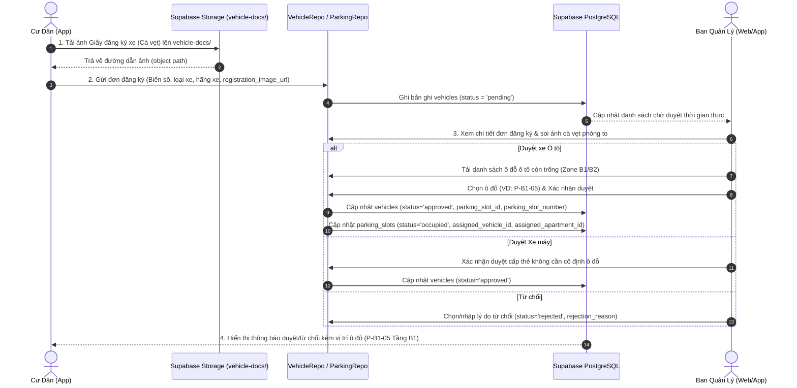

# Đặc Tả Thiết Kế: Đăng Ký Phương Tiện Kèm Minh Chứng & Phê Duyệt Gán Ô Đỗ Hầm (Vehicle Registration, Proof & Slot Allocation)

- **Mã tính năng:** `FEAT-VEHICLE-SLOT-ALLOCATION-2026`
- **Tác giả:** Antigravity Engineering
- **Ngày tạo:** 2026-11-07
- **Trạng thái:** Đã phê duyệt (Approved)

---

## 1. Mục Tiêu & Bối Cảnh Nghiệp Vụ

Trong vận hành nhà chung cư, phương tiện (ô tô, xe máy) là tài sản có giá trị cao, đồng thời diện tích hầm gửi xe (đặc biệt là chỗ đỗ ô tô) là nguồn tài nguyên khan hiếm cần được quản lý chặt chẽ.

### 1.1. Các vấn đề nghiệp vụ cần giải quyết:
1. **Thiếu minh chứng chính chủ:** Cư dân đăng ký xe chỉ nhập biển số bằng văn bản mà không có ảnh Giấy đăng ký xe (Cà vẹt) hoặc ảnh xe, khiến BQL không thể đối soát biển số thật và quyền sở hữu trước khi cấp thẻ gửi xe.
2. **Thiếu liên kết giữa xe ô tô và ô đỗ hầm:** Khi BQL duyệt cấp thẻ ô tô, chưa có bước chọn và gán vị trí ô đỗ cố định (`parking_slots` ở tầng B1/B2) cho căn hộ, dẫn đến tình trạng ô đỗ trên sơ đồ và danh sách xe được duyệt không đồng bộ.
3. **Giải phóng ô đỗ an toàn:** Khi xe bị xóa, từ chối hoặc cư dân hủy đăng ký, hệ thống phải tự động giải phóng vị trí ô đỗ hầm về trạng thái sẵn sàng (`available`).

---

## 2. Kiến Trúc Luồng Nghiệp Vụ (Workflow Diagram)



---

## 3. Thiết Kế Cơ Sở Dữ Liệu & Storage

### 3.1. Cập nhật bảng `public.vehicles`
```sql
ALTER TABLE public.vehicles
  ADD COLUMN IF NOT EXISTS registration_image_url TEXT,
  ADD COLUMN IF NOT EXISTS approved_at TIMESTAMPTZ,
  ADD COLUMN IF NOT EXISTS approved_by UUID REFERENCES public.users(id);
```
- `registration_image_url`: Đường dẫn object path ảnh Cà vẹt xe trên Supabase Storage.
- `parking_slot_id`: UUID tham chiếu tới `public.parking_slots(id)` (đã có sẵn trong CSDL).
- `parking_slot_number`: Tên ô đỗ (VD: `P-B1-05`).
- `approved_at`: Thời điểm phê duyệt.
- `approved_by`: Người phê duyệt (BQL/Admin).

### 3.2. Migration CSDL: `supabase/migrations/20261107_01_vehicle_registration_and_slot_allocation.sql`
- Bổ sung các cột mới trên bảng `vehicles`.
- Tạo bucket lưu trữ `vehicle-docs` trong `storage.buckets` (nếu chưa có).
- RLS Policies cho `storage.objects` thuộc bucket `vehicle-docs`:
  - `SELECT`: Cư dân xem ảnh của căn hộ mình; Ban Quản Lý xem ảnh toàn bộ tòa nhà.
  - `INSERT`: Người dùng đã xác thực được tải ảnh vào thư mục căn hộ của mình.

---

## 4. Thiết Kế Tầng Dữ Liệu & Repositories

### 4.1. Data Model `VehicleModel`
- Bổ sung các trường:
  - `final String? registrationImageUrl;`
  - `final String? parkingSlotId;`
  - `final String? parkingSlotNumber;`
  - `final DateTime? approvedAt;`
  - `final String? approvedBy;`
- Getter tiện ích:
  - `bool get hasRegistrationImage => registrationImageUrl != null && registrationImageUrl!.isNotEmpty;`
  - `bool get hasAssignedSlot => parkingSlotNumber != null && parkingSlotNumber!.isNotEmpty;`

### 4.2. `VehicleRepository`
- `registerVehicle(...)`: Bổ sung tham số `String? registrationImageUrl` hoặc `File? registrationImageFile`.
- `uploadRegistrationImage(String apartmentId, String userId, File imageFile)`: Tải ảnh Cà vẹt lên bucket `vehicle-docs`.
- `approveVehicle(String vehicleId, {String? parkingSlotId, String? parkingSlotNumber, String? approvedBy})`:
  - Cập nhật `vehicles`: `status = 'approved'`, `parking_slot_id = parkingSlotId`, `parking_slot_number = parkingSlotNumber`, `approved_at = DateTime.now()`, `approved_by = approvedBy`.
  - Nếu có `parkingSlotId`: Đồng bộ cập nhật `parking_slots` sang `occupied`.
- `rejectVehicle(String vehicleId, {String? reason})`:
  - Cập nhật `vehicles`: `status = 'rejected'`, `rejection_reason = reason`.
  - Nếu xe trước đó có gán ô đỗ: Tự động giải phóng ô đỗ (`releaseSlot`).

### 4.3. `ParkingRepository`
- Khắc phục lỗi gán slot: Khi gọi `assignSlot`, gán đúng `slotNumber` (mã ô đỗ) vào `parking_slot_number` thay vì `licensePlate`.
- Cung cấp phương thức lấy các ô đỗ ô tô còn trống: `fetchAvailableCarSlots({String? buildingId})`.

---

## 5. Thiết Kế Giao Diện Người Dùng (UI/UX)

### 5.1. Màn hình Cư Dân (`vehicle_management_screen.dart`)
1. **Modal Đăng ký phương tiện mới (`_showAddVehicleDialog`):**
   - Thêm nút "Tải ảnh Giấy đăng ký xe (Cà vẹt)" cho phép chụp ảnh từ Camera hoặc chọn từ Thư viện (`ImagePicker`).
   - Hiển thị ảnh thu nhỏ (preview thumbnail) kèm nút "Xóa ảnh" hoặc "Chụp lại".
   - Tự động tải ảnh lên storage và gắn `registration_image_url` khi lưu.
2. **Thẻ xe cư dân (`VehicleCard`):**
   - Hiển thị ảnh thu nhỏ Cà vẹt xe góc phải, bấm vào mở xem phóng to bằng [`PhotoViewerScreen`](file:///c:/Users/ADMIN/StudioProjects/pka_home/lib/core/widgets/photo_viewer_screen.dart).
   - Nếu là ô tô đã phê duyệt: Hiển thị Badge vị trí đỗ: `Vị trí ô đỗ: P-B1-05 (Tầng B1)` với icon `Icons.local_parking`.
   - Nếu bị từ chối: Hiển thị banner cảnh báo màu đỏ có lý do cụ thể và nút "Đăng ký lại".

### 5.2. Màn hình Ban Quản Lý (`vehicle_approval_screen.dart`)
1. **Thẻ duyệt phương tiện:**
   - Hiển thị thông tin xe, căn hộ, chủ xe, ngày nộp.
   - Hiển thị khung ảnh Cà vẹt xe thu nhỏ kèm nút "Xem ảnh đăng ký" (icon `Icons.visibility_outlined`).
2. **Modal Phê duyệt xe (`_approveVehicle`):**
   - Nếu duyệt **Ô tô**:
     - Tự động gọi `ParkingRepository.fetchSlots(slotType: 'car', status: 'available')` để nạp danh sách ô đỗ ô tô còn trống ở hầm B1/B2.
     - Dropdown chọn ô đỗ (VD: `P-B1-01 (Tầng B1)`, `P-B1-02 (Tầng B1)`...).
     - Khi BQL chọn và bấm "Xác nhận duyệt", hệ thống cập nhật đồng thời trạng thái xe và gán ô đỗ.
   - Nếu duyệt **Xe máy**:
     - Giữ nguyên modal phê duyệt theo hạn mức 2 xe máy/căn hộ.
3. **Modal Từ chối xe (`_rejectVehicle`):**
   - Tích hợp các lý do từ chối mẫu thông dụng:
     - *"Ảnh đăng ký xe mờ / không đọc được số khung, số máy"*
     - *"Biển số xe không trùng khớp với giấy đăng ký"*
     - *"Căn hộ chưa hoàn thành nghĩa vụ tài chính phí dịch vụ"*
     - *"Tòa nhà hiện đã hết chỗ đỗ ô tô tầng hầm"*
   - Cập nhật lý do và giải phóng ô đỗ nếu có.

---

## 6. Tiêu Chuẩn Tuân Thủ (Compliance Checklist)

- [x] **Ngôn ngữ:** 100% Tiếng Việt chuẩn mực trên giao diện, thông báo lỗi và hộp thoại.
- [x] **Icon:** Sử dụng Material Design (`Icons.*`), tuyệt đối không dùng Emoji trong mã nguồn hoặc UI.
- [x] **Bảo mật:** Không gọi Supabase trực tiếp từ Widget, luôn qua Repository.
- [x] **Git Workflow:** Commit trực tiếp vào nhánh `main` theo quy định dự án.
