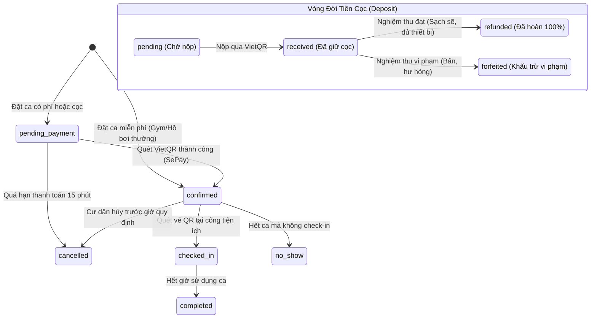

# Đặc Tả Thiết Kế: Module Đặt & Quản Lý Tiện Ích Nội Khu Khép Kín (Amenity Booking & Deposit Lifecycle)

> **Tài liệu Thiết kế Kỹ thuật (Technical Design Spec) B2B SaaS**  
> Dự án: PKA-Home (Commercial Production PropTech Platform)  
> Ngày lập: 2026-11-08  
> Trạng thái: Chờ Phê Duyệt (Draft $\rightarrow$ Under Review)

---

## 1. Bối Cảnh Nghiệp Vụ & Nỗi Đau Vận Hành Thực Tế

Tại các khu chung cư, căn hộ dịch vụ cao cấp và tòa nhà đô thị, việc vận hành các tiện ích dùng chung (Hồ bơi, Phòng Gym, Sân nướng BBQ ngoài trời, Phòng sinh hoạt cộng đồng, Sân Tennis) thường gặp các vấn đề nghiêm trọng:

1. **Tranh chấp khung giờ & Đầu cơ giữ chỗ**: Cư dân đặt trước nhưng không đến (No-show), hoặc một số căn hộ đặt chiếm dụng toàn bộ các khung giờ "vàng" (cuối tuần, chiều tối), gây bức xúc cho cư dân khác.
2. **Tranh chấp tiền cọc vệ sinh & hư hỏng thiết bị**: Đối với sân BBQ hoặc phòng tiệc cộng đồng, cư dân tụ tập ăn uống, làm bẩn sàn, làm cháy hỏng vỉ nướng hoặc không dọn rác. Ban Quản Lý (BQL) thu cọc bằng tiền mặt hoặc chuyển khoản rời rạc, dẫn đến khiếu nại cấn trừ tiền cọc gay gắt do thiếu bằng chứng nghiệm thu rõ ràng.
3. **Kiểm soát người ngoài tràn vào sử dụng lậu**: Người ngoài tòa nhà mượn tài khoản hoặc lẻn vào hồ bơi/gym vì bảo vệ không có công cụ đối soát vé tại cổng.

### Mục Tiêu Của Module Này
Xây dựng một chu trình khép kín 100% tự động và minh bạch:  
`Cư dân chọn ca` $\rightarrow$ `Thanh toán VietQR phí & cọc` $\rightarrow$ `Nhận vé điện tử QR Code` $\rightarrow$ `Bảo vệ quét QR Check-in tại cổng` $\rightarrow$ `Nghiệm thu hiện trường có ảnh chụp` $\rightarrow$ `Tự động hoàn cọc / Khấu trừ minh bạch`.

---

## 2. Kiến Trúc Cơ Sở Dữ Liệu & Vòng Đời Trạng Thái (State Machine)

### 2.1. Cập Nhật Bảng `building_amenities` & `amenity_bookings`

```sql
-- Mở rộng cấu hình tiện ích tòa nhà
ALTER TABLE public.building_amenities
    ADD COLUMN IF NOT EXISTS max_advance_days INT NOT NULL DEFAULT 7,
    ADD COLUMN IF NOT EXISTS max_slots_per_week INT NOT NULL DEFAULT 3,
    ADD COLUMN IF NOT EXISTS rules_and_regulations TEXT;

-- Mở rộng thông tin vé check-in và nghiệm thu hoàn cọc
ALTER TABLE public.amenity_bookings
    ADD COLUMN IF NOT EXISTS qr_ticket_token UUID DEFAULT gen_random_uuid(),
    ADD COLUMN IF NOT EXISTS checked_in_by UUID REFERENCES public.users(id),
    ADD COLUMN IF NOT EXISTS inspected_by UUID REFERENCES public.users(id),
    ADD COLUMN IF NOT EXISTS inspected_at TIMESTAMPTZ,
    ADD COLUMN IF NOT EXISTS inspection_result TEXT DEFAULT 'pending', -- 'passed', 'violated'
    ADD COLUMN IF NOT EXISTS forfeited_amount NUMERIC(12,2) DEFAULT 0.0,
    ADD COLUMN IF NOT EXISTS refund_amount NUMERIC(12,2) DEFAULT 0.0,
    ADD COLUMN IF NOT EXISTS inspection_notes TEXT,
    ADD COLUMN IF NOT EXISTS inspection_image_urls JSONB DEFAULT '[]'::jsonb;
```

### 2.2. Vòng Đời Trạng Thái Đặt Chỗ (Booking Status) & Tiền Cọc (Deposit Status)



---

## 3. Các Hàm Thủ Tục ACID PostgreSQL (Stored Procedures)

1. **`book_amenity_slot(p_amenity_id, p_booking_date, p_time_slot, p_guests_count, ...)`**:
   - Khóa Advisory Transaction `pg_advisory_xact_lock` chống race-condition tuyệt đối.
   - Kiểm tra hạn mức tuần (`max_slots_per_week`): Mỗi căn hộ không được đặt quá số ca/tuần quy định để đảm bảo công bằng.
   - Phân loại `exclusive` (Sân BBQ) vs `shared` (Hồ bơi/Gym theo số người).
   - Tự động sinh `qr_ticket_token` duy nhất cho vé điện tử.
   - Nếu có phí hoặc cọc $\rightarrow$ chuyển trạng thái `pending_payment` với thời hạn giữ chỗ 15 phút.

2. **`check_in_amenity_ticket(p_qr_ticket_token)`**:
   - Dành cho Bảo vệ / Lễ tân / BQL quét vé tại hiện trường.
   - Kiểm tra token vé hợp lệ, đúng ngày và đúng khung giờ.
   - Chuyển `status = 'checked_in'`, lưu `check_in_time = now()`, `checked_in_by = auth.uid()`.
   - Trả về thông tin căn hộ, tên cư dân và số lượng khách đăng ký.

3. **`inspect_and_settle_amenity_deposit(p_booking_id, p_result, p_forfeited_amount, p_notes, p_image_urls)`**:
   - Dành cho BQL thực hiện nghiệm thu mặt bằng sau ca tiệc BBQ hoặc sự kiện:
   - Nếu `p_result = 'passed'`: Cọc chuyển sang `refunded`, ghi nhận số tiền hoàn trả 100%.
   - Nếu `p_result = 'violated'`: Cọc chuyển sang `forfeited`, ghi nhận số tiền khấu trừ đền bù, phần còn lại (nếu có) hoàn trả cho cư dân.
   - Lưu vết lịch sử và gửi thông báo Realtime kèm ảnh chụp hiện trường tới cư dân.

---

## 4. Đặc Tả Giao Diện Người Dùng (UI/UX Specification)

### 4.1. Giao Diện Cư Dân (`AmenityBookingScreen`)
- **Bộ chọn ngày thông minh**: Cuộn ngang 7 ngày, hiển thị thứ/ngày, tự động highlight ngày đang chọn.
- **Lưới ca sử dụng (Time Slots Grid)**:
  - Thẻ giờ hiển thị rõ: Giờ bắt đầu - Giờ kết thúc, Sức chứa còn lại (VD: `Còn 12/20 chỗ`), Tiền phí & Tiền cọc.
  - Phân màu trực quan: *Xanh lá (Còn trống)*, *Cam (Sắp đầy)*, *Xám (Đã kín chỗ / Đã qua)*, *Đỏ (Bảo trì)*.
  - Hỗ trợ nút **"Vào danh sách chờ (Waitlist)"** khi ca đã kín.
- **Vé Điện Tử QR Code**:
  - Tab "Lịch của tôi" hiển thị thẻ vé sang trọng: Tên tiện ích, Khung giờ, Mã căn hộ, Mã QR lớn rõ nét để quét nhanh tại cổng, kèm hướng dẫn nội quy (trang phục bơi, không mang thú cưng, giữ vệ sinh).

### 4.2. Giao Diện Ban Quản Lý (`AmenityManagementScreen`)
- **Tab 1: Bàn Điều Phối & Quét Vé Check-in**:
  - Thống kê thời gian thực: *Số khách đang sử dụng*, *Số ca sắp diễn ra*, *Tỷ lệ lấp đầy*.
  - Nút bấm **"Quét Vé QR"** (hỗ trợ nhập mã hoặc quét camera trực tiếp).
- **Tab 2: Trạm Nghiệm Thu & Quản Lý Cọc**:
  - Danh sách các ca BBQ / Phòng sinh hoạt vừa kết thúc cần kiểm tra bàn giao.
  - Hộp thoại nghiệm thu hiện trường: Tải lên 1-4 ảnh hiện trạng, nhập lý do vi phạm (nếu có), chiết tính tiền hoàn cọc và bấm xác nhận hoàn tiền.
- **Tab 3: Cấu Hình Tiện Ích & Lịch Bảo Trì**:
  - Bật/tắt tiện ích, chỉnh giờ mở/đóng cửa, thiết lập tiền cọc, tạo lịch bảo dưỡng định kỳ (khóa ca).

---

## 5. Kế Hoạch Kiểm Thử TDD & Tiêu Chuẩn Nghiệm Thu

1. **Database & RPC Unit Tests**:
   - Test kiểm tra khóa chống trùng lịch (Exclusive lock).
   - Test kiểm tra hạn mức tuần (Quota enforcement).
   - Test xác thực mã vé QR Token hợp lệ và từ chối vé sai ngày/sai giờ.
   - Test tính toán tiền hoàn cọc và khấu trừ cọc chính xác.
2. **Widget Tests**:
   - `amenity_booking_screen_test.dart`: Kiểm tra hiển thị slot, đặt chỗ, chuyển sang bottom sheet VietQR và hiển thị vé QR.
   - `amenity_management_screen_test.dart`: Kiểm tra tab nghiệm thu hoàn cọc, danh sách ca và cập nhật trạng thái.
3. **Static Analysis**: `dart analyze lib test` 0 lỗi.
