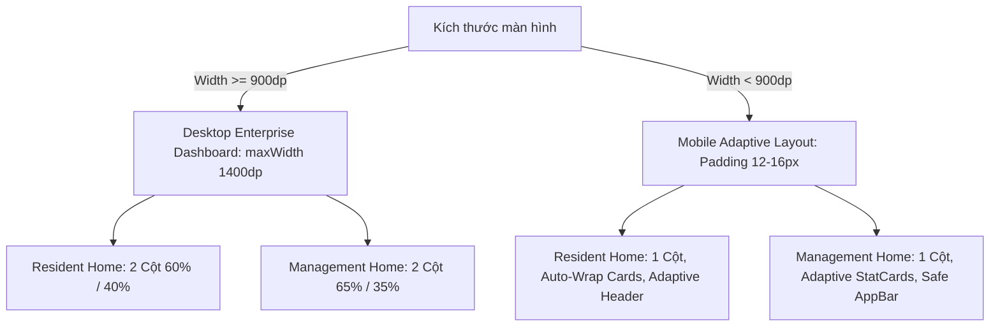

# Đặc Tả Thiết Kế: Cải Tiến Giao Diện Bộ Đôi Trang Chủ Cốt Lõi (Resident Home & Management Executive Dashboard)

- **Mục tiêu:** Nâng cấp toàn diện trải nghiệm giao diện người dùng (UI/UX) cho `ResidentHomeScreen` (Trang chủ Cư dân) và `ManagementHomeScreen` (Executive Dashboard Ban Quản Lý) theo tiêu chuẩn **Impeccable Taste** kết hợp cơ chế **Anti-RenderFlex Guarantee (chống tràn 100%)** trên mọi kích thước màn hình từ Mobile hẹp 320dp (với tỷ lệ phóng đại chữ 1.3x) đến Web Enterprise Desktop $\ge 900$dp (giới hạn tối đa 1400dp).
- **Phạm vi tác động:**
  - `lib/features/resident/screens/resident_home_screen.dart`
  - `lib/features/management/screens/management_home_screen.dart`
  - Các widget con liên quan: `ApartmentSwitcherChip`, `StatCard`, Quick Action Grid, Services Section.
- **Tuân thủ quy chuẩn:** Clean Architecture, Feature-First, Riverpod Reactive State, 100% tiếng Việt chuẩn mực SaaS B2B, commit trực tiếp trên nhánh `main`.

---

## 1. Kiến Trúc Bố Cục Thích Ứng (Responsive Multi-Column Architecture)

Hệ thống sử dụng ngưỡng chuyển đổi giao diện (Breakpoint):
- **Desktop Enterprise ($\ge 900$dp, maxWidth: 1400dp):** Bố cục đa cột (Multi-column dashboard), giúp người dùng BQL và cư dân trên Web/Tablet quan sát toàn bộ chỉ số, thông tin khẩn và lối tắt mà không cần cuộn trang dài vô tận.
- **Mobile & Tablet nhỏ (< 900dp, tối ưu tới 320dp + Text Scale 1.3x):** Bố cục đơn cột linh hoạt tự động cuộn (SingleChildScrollView/CustomScrollView), các phần tử tự động co giãn (Fluid Wrap / Adaptive Columns) để không bao giờ xảy ra lỗi RenderFlex overflow.

---

## 2. Đặc Tả Chi Tiết: `ResidentHomeScreen` (Trang Chủ Cư Dân)

### 2.1. SliverAppBar & Khối Header Định Danh
- **Vấn đề cũ:** `expandedHeight: 140` cố định khiến khi người dùng bật tỷ lệ chữ to (1.3x) hoặc tên cư dân/căn hộ dài sẽ bị tràn dọc bên trong `FlexibleSpaceBar`.
- **Giải pháp Impeccable:**
  - Chuyển sang tính toán chiều cao linh hoạt hoặc sử dụng `SliverToBoxAdapter` kết hợp gradient banner nhẹ nhàng với bo góc mềm mại, phân tách rõ ràng giữa phần chào mừng và phần chuyển đổi căn hộ.
  - Avatar cư dân kết hợp `AppAvatar`, tên cư dân bọc trong `Expanded(Text(..., overflow: TextOverflow.ellipsis))`.
  - Icon thông báo và đăng xuất có vùng bấm chuẩn tiếp cận ($\ge 40$x$40$dp) với badge số lượng thông báo chưa đọc bo tròn tinh tế.

### 2.2. Khối Tổng Quan Hóa Đơn (Billing & VietQR Hero Card)
- Sử dụng dải màu gradient thương hiệu sắc nét (`AppGradients.brandPrimary`) với bo góc 20px và viền mỏng trong suốt `white12`.
- Số tiền tổng cộng cần đóng được bọc trong `FittedBox(fit: BoxFit.scaleDown, alignment: Alignment.centerLeft)` đảm bảo các con số hàng chục triệu/trăm triệu đồng không bao giờ bị tràn cạnh màn hình.
- Nút "THANH TOÁN NGAY" với icon VietQR nổi bật, khi ấn lập tức chuyển sang Tab Hóa đơn hoặc mở BottomSheet thanh toán nhanh.

### 2.3. Lưới Thao Tác Nhanh (Quick Actions)
- Trên Mobile hẹp (< 360dp): Tự động tính toán bề rộng với `LayoutBuilder`. Đảm bảo khoảng cách và padding hợp lý, nhãn văn bản có `maxLines: 2` và `FittedBox` nhẹ để không bị che khuất.
- Màu sắc biểu tượng phân tầng nhận diện:
  - Thanh toán: Sapphire Blue (`#0F52BA`)
  - Báo sự cố: Amber Orange (`#E65100`)
  - Hotline khẩn cấp: Carmine Red (`#D32F2F`)
  - Cẩm nang cư dân: Teal Green (`#00897B`)

### 2.4. Dịch Vụ & Tiện Ích Cư Dân (Services Section)
- **Vấn đề cũ:** Cặp thẻ `Số điện nước` và `Đăng ký gửi xe` đặt trong `Row(Expanded, Expanded)` khiến trên 320dp mỗi thẻ chỉ còn < 60dp hiển thị chữ.
- **Giải pháp Impeccable:**
  - Áp dụng `LayoutBuilder`: nếu chiều rộng khả dụng $< 380$dp, tự động xếp dọc (1 cột full-width) cho từng thẻ dịch vụ, đảm bảo hiển thị trọn vẹn cả tiêu đề và dòng mô tả phụ (`subtitle`).
  - Khi chiều rộng $\ge 380$dp: hiển thị dạng lưới 2 cột cân xứng.
  - Thẻ dịch vụ dùng hiệu ứng viền mờ `AppCard` đồng bộ chuẩn dark mode/light mode.

### 2.5. Chế Độ Desktop Enterprise ($\ge 900$dp)
- Hiển thị 2 cột:
  - **Cột Trái (60%):** Chào mừng + Thẻ tổng quan hóa đơn + Lưới 4 nút thao tác nhanh + Toàn bộ danh mục Dịch vụ & Tiện ích cư dân.
  - **Cột Phải (40%):** Dải cảnh báo gián đoạn kỹ thuật (`EquipmentInterruptionBanner`) + Quỹ bảo trì (`MaintenanceFundCard`) + Tiến độ phản ánh gần nhất + Thông báo bảng tin mới nhất từ BQL.

---

## 3. Đặc Tả Chi Tiết: `ManagementHomeScreen` (Executive Dashboard BQL)

### 3.1. An Toàn Thanh Tiêu Đề AppBar Trên Mobile Hẹp
- **Vấn đề cũ:** Title chứa cả nhãn "Ban Quản Lý", badge chức vụ, dropdown chọn tòa nhà, icon lịch sử audit, popup menu và nút đăng xuất — trên mobile 320dp gây tràn và đè lẫn nhau.
- **Giải pháp Impeccable:**
  - Trên Mobile (< 600dp): Gom các action phụ vào `PopupMenuButton` hợp nhất. Dropdown chọn tòa nhà tự động co gọn `isDense: true` với bề rộng tối đa được kiểm soát.
  - Trên Desktop ($\ge 900$dp): Trình bày đầy đủ thanh công cụ điều hành với bộ chọn tòa nhà trực quan và thông tin tài khoản đăng nhập.

### 3.2. Lưới Thẻ Chỉ Số Vận Hành (StatCard Responsive Grid)
- **Vấn đề cũ:** `GridView.count` với `childAspectRatio` cứng làm thẻ chỉ số bị tràn chữ khi số lượng cư dân hoặc doanh thu tăng cao trên font zoom 1.3x.
- **Giải pháp Impeccable:**
  - Áp dụng `LayoutBuilder` tính toán linh hoạt `childAspectRatio`:
    - Mobile hẹp (< 380dp): tỷ lệ `1.0` đến `1.05` để tăng chiều cao cho thẻ.
    - Tablet / Desktop: tỷ lệ `1.35` đến `1.55`.
  - Giá trị số liệu (`StatCard.value`) luôn bọc trong `FittedBox(fit: BoxFit.scaleDown)` để chống tràn ngang khi số lớn.

### 3.3. Công Việc Cần Xử Lý Gấp (Urgent Action Center)
- Thẻ sự cố khẩn cấp và hóa đơn chờ đối soát:
  - Trên Mobile: Dùng `LayoutBuilder`, nếu bề rộng khả dụng $< 360$dp, nút bấm hành động ("Xem ngay", "Đối soát") tự động chuyển xuống dưới tiêu đề thay vì ép buộc nằm ở `trailing` của `ListTile`.
  - Trên Desktop: Trình bày dạng hàng bảng đối soát với badge ưu tiên đỏ cảnh báo nổi bật.

### 3.4. Chế Độ Desktop Executive Command Center ($\ge 900$dp)
- Bọc toàn bộ nội dung trong `Center(ConstrainedBox(maxWidth: 1400))`.
- Hiển thị 2 cột đối xứng:
  - **Cột Trái (65%):**
    1. Dải thẻ chỉ số KPI chính (Tổng căn hộ, Cư dân, Tỷ lệ lấp đầy, Chờ duyệt).
    2. Danh mục Việc cần xử lý ngay (Sự cố khẩn, Đối soát chuyển khoản, Yêu cầu liên kết).
    3. Biểu đồ xu hướng doanh thu (`RevenueTrendChart`) & Tiến độ thu phí.
  - **Cột Phải (35%):**
    1. Trung tâm thao tác nhanh (Quick Action Workstation) chia theo phân quyền.
    2. Quỹ bảo trì tòa nhà (`MaintenanceFundCard(isManagement: true)`).
    3. Danh sách 5 giao dịch thanh toán gần nhất.

---

## 4. Bảng Cam Đoan Chống Tràn Bố Cục (Anti-RenderFlex Checklist)

| Quy tắc kỹ thuật | Cơ chế thực hiện | Màn hình áp dụng |
| :--- | :--- | :--- |
| **Bọc văn bản co giãn** | Mọi `Text` trong `Row` bắt buộc bọc `Expanded` hoặc `Flexible` kèm `TextOverflow.ellipsis`. | `ResidentHomeScreen`, `ManagementHomeScreen` |
| **Co giãn số tiền & chỉ số lớn** | Dùng `FittedBox(fit: BoxFit.scaleDown, alignment: Alignment.centerLeft)` cho tổng tiền và số đếm KPI. | Thẻ tổng quan hóa đơn, StatCards, Urgent work tiles. |
| **Thích ứng lưới thẻ hẹp** | Dùng `LayoutBuilder` chuyển từ 2 cột sang 1 cột khi chiều rộng khả dụng $< 380$dp. | Thẻ dịch vụ cư dân, Nút hành động BQL. |
| **Giới hạn khung nhìn Web** | Bọc `Center(ConstrainedBox(maxWidth: 1400))` cho toàn bộ nội dung. | Màn hình chính Desktop của cả 2 phân hệ. |

---

## 5. Kịch Bản Kiểm Thử & Nghiệm Thu (QA & Verification)

1. **`resident_home_responsive_test.dart`**:
   - Test 1: Desktop Web (1200dp x 800dp) — Hiển thị đầy đủ 2 cột, không bị kéo dãn toàn màn hình.
   - Test 2: Mobile chuẩn (390dp x 844dp) — Hiển thị mượt mà các thành phần chính.
   - Test 3: Mobile hẹp & Font to (320dp x 600dp, Text Scale 1.3x) — Cam đoan 0 lỗi RenderFlex overflow.
2. **`management_home_responsive_test.dart`**:
   - Test 1: Web Executive Workstation (1400dp x 900dp) — Hiển thị Command Center 2 cột, đầy đủ KPI và lối tắt.
   - Test 2: Mobile hẹp & Font to (320dp x 600dp, Text Scale 1.3x) — Thẻ chỉ số và thanh tiêu đề không bị tràn cạnh.
3. **Static Analysis Quality Gate:**
   - Chạy `dart analyze lib test` đạt 0 warning, 0 error.
