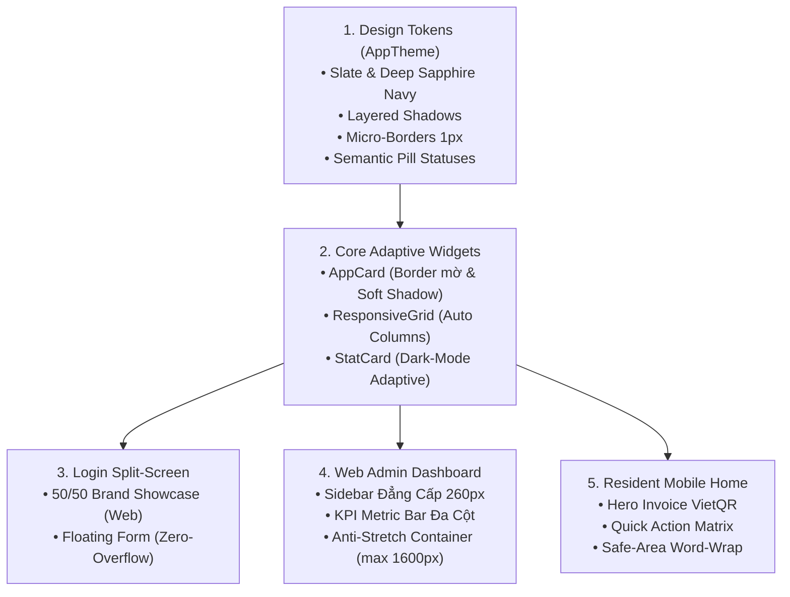

# Đặc Tả Thiết Kế: Cải Tiến Giao Diện Toàn Diện Chuẩn "Impeccable Taste" & Chống Tràn Bố Cục (Anti-RenderFlex)

> **Mục tiêu:** Tái thiết kế toàn bộ hệ thống giao diện PKA-Home dựa trên triết lý **`pbakaus/impeccable`** (loại bỏ triệt để các khuôn mẫu "AI slop", nâng cao gu thẩm mỹ B2B SaaS đỉnh cao) kết hợp bộ quy chuẩn **Flutter Responsive & Anti-Overflow** (loại bỏ 100% lỗi `RenderFlex overflowed` trên cả Mobile nhỏ, Tablet và Web Admin Dashboard màn hình lớn).

---

## 1. Bối Cảnh & Các Vấn Đề Cần Khắc Phục

### 1.1. Các vấn đề thẩm mỹ & khuôn mẫu AI (Anti-Patterns theo `pbakaus/impeccable`)
- **Card lồng trong Card (Nested Cards Madness):** Sử dụng quá nhiều lớp thẻ hộp lồng nhau gây nặng nề, thiếu khoảng thở (breathing room).
- **Màu sắc thô cứng & Hardcode:** Còn xuất hiện `Colors.white`, `Colors.grey.shade200` cứng trong một số widget (như `StatCard`), khiến giao diện Dark Mode bị loang lổ.
- **Màn hình lớn bị kéo dãn biến dạng:** Trên Web/Desktop 1920px, các thẻ KPI và nút thao tác nhanh bị kéo dãn thành các khối khổng lồ 500–800px mất cân đối.
- **Màn hình đăng nhập đơn điệu:** Trang Login chỉ có một hộp thoại nhỏ nằm giữa màn hình đen, chưa thể hiện được đẳng cấp của một nền tảng PropTech B2B SaaS quy mô doanh nghiệp.

### 1.2. Các điểm nghẽn gây lỗi tràn bố cục (`RenderFlex overflowed`)
- **`GridView.count` với `crossAxisCount` và `childAspectRatio` cố định:**
  - Ở `management_home_screen.dart`, `crossAxisCount: 3` và `childAspectRatio: 1.05` cố định. Khi chạy trên màn hình hẹp (320px-360px) hoặc khi người dùng tăng cỡ chữ (Accessibility Font Scaling), 2 dòng chữ tiếng Việt cộng với Icon 28px sẽ vượt quá chiều cao ô, gây sọc vàng đen `RenderFlex overflowed by X pixels`.
- **Cột (`Column`) chứa văn bản không bọc `Flexible`/`Expanded` bên trong `Row`.**
- **Thiếu giới hạn chiều rộng tối đa (`maxWidth`) trên Web:** Dẫn đến giao diện bị tràn hoặc dãn vô tận trên màn hình 2K/4K.

---

## 2. Kiến Trúc Thiết Kế "Impeccable Design System"

---

## 3. Chi Tiết Các Hạng Mục Nâng Cấp

### 3.1. Hạng Mục 1: Nền Tảng Design System & Tokens (`lib/core/theme/app_theme.dart` & `app_card.dart`)
- **Bảng màu Modern Enterprise PropTech:**
  - Nền Light: Slate 50 (`#F8FAFC`), Bề mặt thẻ: Pure White (`#FFFFFF`).
  - Nền Dark: Deep Midnight Slate (`#0B0F19`), Bề mặt thẻ: Dark Slate (`#111827`).
  - Màu thương hiệu chính (Primary): Sapphire Indigo (`#2563EB` & `#1D4ED8`).
  - Màu bổ trợ (Accent): Cyan Slate (`#0EA5E9`).
  - Màu trạng thái ngữ nghĩa: Emerald (`#10B981` cho Đã thanh toán / Thành công), Amber (`#F59E0B` cho Chờ duyệt / Cảnh báo), Rose (`#F43F5E` cho Quá hạn / Khẩn cấp).
- **Hệ thống viền siêu mỏng & đổ bóng đa tầng (Subtle Micro-Borders & Layered Shadows):**
  - Viền mờ `Border.all(color: theme.dividerColor.withOpacity(0.08))` thay vì viền xám đậm.
  - BoxShadow kép tinh tế: 
    - Lớp 1: `BoxShadow(color: Colors.black.withOpacity(0.03), blurRadius: 4, offset: Offset(0, 1))`
    - Lớp 2: `BoxShadow(color: Colors.black.withOpacity(0.05), blurRadius: 12, offset: Offset(0, 4))`
- **Nâng cấp `AppCard` & `StatCard`:**
  - Loại bỏ hoàn toàn màu trắng hardcode (`Colors.white`). Tự động thích ứng màu nền theo `Theme.of(context).colorScheme.surface`.
  - Hỗ trợ cờ `isHoverable` có hiệu ứng nâng nhẹ trên Web/Desktop.

### 3.2. Hạng Mục 2: Giải Pháp Triệt Để Chống Tràn Bố Cục (Anti-RenderFlex Engine)
- **Thay thế `GridView.count` cứng bằng `LayoutBuilder` tính toán số cột động:**
  - Với khu vực Thao tác nhanh (`QuickActions`):
    - Chiều rộng $< 450\text{dp}$ (Điện thoại nhỏ): 3 cột, icon 24px, cỡ chữ 11px, `maxLines: 2`, `childAspectRatio: 0.95`.
    - Chiều rộng $450\text{dp} - 800\text{dp}$ (Phablet / Màn hình ngang): 4 cột.
    - Chiều rộng $800\text{dp} - 1200\text{dp}$ (Tablet / Laptop nhỏ): 6 cột.
    - Chiều rộng $\ge 1200\text{dp}$ (Desktop Web): 8 cột, icon 26px, padding thoáng đãng.
  - Với khu vực Thẻ thống kê (`StatCard Grid`):
    - Chiều rộng $< 600\text{dp}$: 2 cột.
    - Chiều rộng $600\text{dp} - 1100\text{dp}$: 3 cột.
    - Chiều rộng $\ge 1100\text{dp}$: 4 cột trải dài theo hàng ngang chuẩn mực Dashboard quốc tế.
- **Nguyên tắc an toàn không gian chữ (Text Safety Constraints):**
  - Mọi thẻ chứa icon và chữ được bảo vệ bằng `Flexible` hoặc `Expanded` trong `Row`/`Column`.
  - Không bao giờ đặt chiều cao cố định `SizedBox(height: ...)` chứa văn bản có thể bị phóng to.
  - Luôn sử dụng `SingleChildScrollView(physics: AlwaysScrollableScrollPhysics())` bao bọc toàn bộ màn hình để chống tràn khi bàn phím ảo hiển thị.

### 3.3. Hạng Mục 3: Màn Hình Đăng Nhập Đẳng Cấp Split-Screen (`login_screen.dart`)
- **Giao diện Web / Màn hình rộng ($\ge 900\text{dp}$):**
  - **Bên trái (50%): Hero Brand Showcase:**
    - Nền Deep Slate Gradient huyền ảo (`#0F172A` $\rightarrow$ `#1E293B`).
    - Logo PKA-Home 3D phát sáng tinh tế.
    - Tiêu đề thương hiệu: *"PKA-Home PropTech Platform"*.
    - Slogan: *"Hệ thống Quản trị & Vận hành Tòa nhà Thông minh Chuẩn B2B SaaS"*.
    - 3 Thẻ thành tựu/bảo chứng:
      - 🛡️ *Tuân thủ Luật Dữ liệu cá nhân 2026 & Luật Nhà ở 2023*.
      - ⚡ *Đối soát & gạch nợ VietQR tự động trong 2 giây*.
      - 📊 *Sổ cái công nợ bất biến Append-Only & Kiểm toán minh bạch*.
  - **Bên phải (50%): Form Đăng Nhập Tinh Tế:**
    - Thẻ form đăng nhập nổi bật, không gian đệm rộng rãi.
    - Trường nhập Thư điện tử & Mật khẩu viền mỏng mượt mà, khi focus sáng viền Sapphire Blue.
    - Nút "Đăng nhập" dạng gradient Sapphire tinh xảo.
    - Nút "Kích hoạt tài khoản lần đầu" dạng OutlinedButton thanh lịch có icon chìa khóa.
- **Giao diện Mobile ($< 900\text{dp}$):**
  - Bố cục trung tâm co giãn tự động, có logo gọn gàng phía trên, tối ưu bàn phím cuộn êm ái, không giật lag.

### 3.4. Hạng Mục 4: Nâng Cấp Web Admin Portal (`management_home_screen.dart` & `adaptive_management_scaffold.dart`)
- **Sidebar Chuyên Nghiệp (260dp):**
  - Khung nhận diện Tòa nhà hiện tại: Huy hiệu *"PKA Landmark Tower"* kèm chip trạng thái màu xanh lá *"Đang hoạt động"*.
  - Nhóm danh mục điều hướng có trật tự:
    - *VẬN HÀNH:* Căn hộ, Cư dân, Hợp đồng lưu trú.
    - *TÀI CHÍNH:* Hóa đơn, Bàn kế toán đối soát, Quỹ bảo trì 2%, Báo cáo tuổi nợ.
    - *KỸ THUẬT & DỊCH VỤ:* Sự cố SLA, Bãi xe hầm, Lễ tân & Bưu kiện, Tiện ích.
  - Vạch chọn màu Sapphire Blue bên mép trái mục đang xem.
- **Khu vực Nội dung Web:**
  - Đặt trong khung giới hạn tối đa `ConstrainedBox(constraints: BoxConstraints(maxWidth: 1600))` canh giữa màn hình, giúp hiển thị sắc nét trên cả màn hình 4K mà không bị kéo dãn bẹt hình.
  - Dải thẻ KPI hiển thị ngang với thanh tiến trình % thu hồi công nợ mượt mà.

### 3.5. Hạng Mục 5: Nâng Cấp Màn Hình Chính Cư Dân (`resident_home_screen.dart`)
- **Header Cá Nhân Hóa:**
  - Lời chào theo thời gian thực (Sáng/Chiều/Tối) + Tên cư dân + Mã căn hộ (`A0101`).
- **Hero Card Hóa Đơn Trọng Tâm:**
  - Gradient Sapphire sâu lắng, số tiền hiển thị to rõ chuẩn tiền tệ Việt Nam.
  - Nút *"Quét VietQR nộp tiền"* một chạm nổi bật ngay trên thẻ.
- **Ma Trận Tiện Ích Thao Tác Nhanh (Quick Actions Matrix):**
  - 4 nút vuông bo tròn 16dp có icon hiện đại, viền mờ tinh tế, không bao giờ tràn chữ.

---

## 4. Kế Hoạch Triển Khai Từng Bước (Implementation Steps)

1. **Bước 1 (Tokens & Foundation):** Cập nhật `AppTheme`, màu sắc Slate & Sapphire, bóng đổ đa tầng, và nâng cấp `AppCard`, `StatCard` để thích ứng hoàn toàn Dark/Light mode và chống tràn chữ.
2. **Bước 2 (Login Split-Screen):** Nâng cấp `login_screen.dart` thành Split-Screen 50/50 trên Web/Desktop và tối ưu form mobile chống tràn bàn phím.
3. **Bước 3 (Admin Dashboard & Anti-RenderFlex):** Cải tiến `adaptive_management_scaffold.dart` và `management_home_screen.dart` với responsive grid đa cột tự động theo chiều rộng màn hình, giải quyết triệt để lỗi RenderFlex.
4. **Bước 4 (Resident Home Polish):** Tinh chỉnh `resident_home_screen.dart` với Hero Invoice Card và ma trận tiện ích an toàn.
5. **Bước 5 (Verification & Test Suite):** Chạy kiểm thử tự động toàn diện (`flutter test`) và `dart analyze` để đảm bảo 500+ tests tiếp tục pass 100%.
