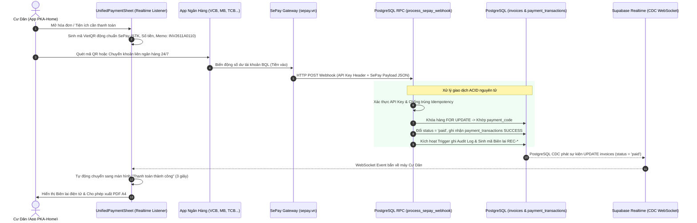

# Đặc Tả Thiết Kế: Cổng Thanh Toán VietQR Tự Động 100% Qua SePay Webhook (Production Real-Payment Engine)

> **Mục tiêu:** Xây dựng hệ thống thanh toán thật cấp độ sản xuất (Production Real-Payment) cho PKA-Home B2B SaaS, tích hợp cổng thanh toán VietQR tự động hóa 100% qua **SePay Webhook (sepay.vn)**. Loại bỏ triệt để mọi cơ chế giả lập/demo cũ, đảm bảo tính toàn vẹn tài chính ACID, bảo mật API Key/Secret Token, gạch nợ hóa đơn tự động trong 2-3 giây và đồng bộ tức thì xuống ứng dụng cư dân qua Supabase Realtime CDC.

---

## 1. Kiến Trúc Luồng Thanh Toán Thực Tế (SePay Production Flow)



---

## 2. Chuẩn Dữ Liệu SePay Webhook (Contract Specification)

### 2.1. Payload SePay Gửi Về
SePay gửi HTTP POST request kèm header `Authorization: Apikey <SEPAY_API_KEY>` (hoặc cấu hình Webhook Token bảo mật).

```json
{
  "id": 92704,
  "gateway": "MBBank",
  "transactionDate": "2026-11-08 18:05:00",
  "accountNumber": "0388888888",
  "code": null,
  "content": "INV2611A0110 thanh toan phi thang 11",
  "transferType": "in",
  "transferAmount": 1500000,
  "accumulated": 15000000,
  "subAccount": null,
  "referenceCode": "MBVCB.123456789",
  "description": "Thanh toan tien dich vu"
}
```

### 2.2. Quy Tắc Thẩm Định & Gạch Nợ (Validation & Reconciliation Rules)
1. **Kiểm tra loại giao dịch (`transferType`)**:
   - Chỉ xử lý khi `transferType == 'in'` (tiền vào tài khoản).
   - Nếu `transferType == 'out'` (tiền ra/rút tiền), bỏ qua an toàn với phản hồi `{ "success": true, "status": "IGNORED_OUTGOING" }`.
2. **Kiểm tra Idempotency chống xử lý trùng lặp**:
   - Sử dụng `id` của SePay hoặc `referenceCode` làm `idempotency_key`.
   - Nếu bản ghi giao dịch đã tồn tại với trạng thái `SUCCESS`, trả về ngay `{ "success": true, "status": "DUPLICATE" }` mà không cập nhật lại lần hai.
3. **Trích xuất mã đối soát hóa đơn / tiện ích**:
   - Tìm kiếm chuỗi `INV[0-9]{4}[A-Za-z0-9]+` hoặc `AMN[0-9]{4}[A-Za-z0-9]+` trong cả hai trường `content` và `description`.
   - Nếu không có mẫu regex, thực hiện `ILIKE '%' || invoice.payment_code || '%'` trên bảng `invoices`.
4. **Xử lý số tiền giao dịch (`transferAmount`)**:
   - **Đủ hoặc thừa tiền (`transferAmount >= invoice.total_amount`)**:
     - Gạch nợ thành công (`invoices.status = 'paid'`, `payment_method = 'vietqr'`).
     - Ghi nhận `payment_transactions` trạng thái `SUCCESS` (hoặc `OVERPAID` nếu thừa tiền).
     - Sinh số chứng từ biên lai điện tử `REC-YYYYMMDD-XXXXX`.
   - **Thiếu tiền (`transferAmount < invoice.total_amount`)**:
     - Ghi nhận `payment_transactions` trạng thái `PARTIAL`.
     - Giữ nguyên trạng thái hóa đơn chưa thanh toán đủ hoặc ghi nhận số dư đã nộp.
   - **Không tìm thấy hóa đơn (`UNMATCHED`)**:
     - Ghi nhận `payment_transactions` trạng thái `UNMATCHED` kèm toàn bộ payload SePay để kế toán xử lý thủ công tại trạm BQL.

---

## 3. Thiết Kế Cơ Sở Dữ Liệu & RPC PostgreSQL

### 3.1. Bổ Sung Bảng Cấu Hình SePay Tòa Nhà (`building_payment_configs`)
Cho phép mỗi tòa nhà/cơ sở B2B SaaS cấu hình riêng tài khoản SePay của mình:
- `building_id` (UUID, Foreign Key tới `buildings.id`).
- `sepay_api_key` (TEXT, mã API Key bí mật để xác thực webhook).
- `bank_name` (TEXT, ví dụ: "MBBank", "Vietcombank").
- `bank_account_number` (TEXT, STK nhận tiền).
- `bank_account_name` (TEXT, Tên chủ tài khoản viết hoa không dấu).
- `bank_bin` (TEXT, Mã định danh ngân hàng NAPAS, ví dụ: "970422").
- `is_active` (BOOLEAN, mặc định true).

### 3.2. RPC Nâng Cấp: `process_sepay_webhook(p_payload JSONB, p_api_key TEXT)`
- `SECURITY DEFINER` với `search_path = public, pg_catalog`.
- Thẩm định API Key khớp với tòa nhà nhận tiền.
- Khóa hàng `FOR UPDATE` trên bản ghi `invoices` để chống race condition.
- Trả về JSON chuẩn hóa: `{ "success": true, "status": "SUCCESS", "invoice_id": "...", "receipt_number": "..." }`.

---

## 4. Thiết Kế Trải Nghiệm Cư Dân (Resident UX - Realtime Payment)

1. **Sinh Mã VietQR Động SePay**:
   - URL ảnh QR tiêu chuẩn:
     `https://qr.sepay.vn/img?acc={bankAccountNumber}&bank={bankName}&amount={amount}&des={paymentCode}&template=compact`
   - Hoặc render trực tiếp mã vector qua `VietQrGenerator` (offline fallback khi mất mạng).
2. **Nút Thao Tác Nhanh Tiện Lợi**:
   - **"Sao chép STK"**, **"Sao chép Nội dung"**, **"Sao chép Số tiền"**.
   - **"Mở App Ngân Hàng"**: Tự động gọi URL scheme ngân hàng tương ứng để mở thẳng app trên điện thoại (VCB Digibank, MB Bank, Techcombank Mobile...).
3. **Lắng Nghe Realtime Tự Động 100% (No Demo Buttons)**:
   - Cư dân **không cần bấm nút giả lập nào**.
   - Sau khi chuyển tiền, `UnifiedPaymentSheet` hiển thị thanh radar lắng nghe `invoices` status change.
   - Khi nhận sự kiện WebSocket `status == 'paid'` từ Supabase Realtime CDC, sheet tự động chuyển sang bước **Thành công** kèm hiệu ứng tích xanh và mã biên lai thực tế.

---

## 5. Thiết Kế Bàn Kế Toán Đối Soát (Accounting Workstation - Unmatched Handler)

- **Danh Sách Giao Dịch SePay Đã Khớp**: Hiển thị thời gian thực dòng tiền đổ về, tự động đối soát với danh sách căn hộ.
- **Xử Lý Giao Dịch Chuyển Khoản Sai Cú Pháp (Unmatched Queue)**:
  - Khi cư dân gõ nhầm nội dung (ví dụ: gõ "tiền phòng cô Lan" thay vì mã `INV2611A0110`).
  - Giao dịch xuất hiện trong tab **"Chờ đối soát thủ công"** với trạng thái `UNMATCHED`.
  - Kế toán chọn căn hộ tương ứng và bấm nút **"Khớp nợ thủ công"** $\rightarrow$ Hệ thống tự động gán giao dịch vào hóa đơn và chuyển trạng thái `paid`.

---

## 6. Kế Hoạch Kiểm Thử TDD & Tiêu Chuẩn Sản Xuất

1. **Unit Test & Contract Test DTO**:
   - `SepayWebhookPayloadDto`: parse chính xác các trường `transferType`, `transferAmount`, `content`, `referenceCode`, `id`.
   - Kiểm thử logic phân loại `in` vs `out`, khớp `payment_code`.
2. **Database Migration Test**:
   - Kiểm thử cú pháp SQL, hàm `process_sepay_webhook`, cấu hình bảng `building_payment_configs`.
3. **Widget Test `UnifiedPaymentSheet`**:
   - Kiểm thử hiển thị VietQR động, các nút sao chép, deep-link mở app ngân hàng và cơ chế reactive update khi có biến động CDC.
4. **Static Analysis & Verification**:
   - `dart analyze lib test` đạt 0 issues.
   - Kiểm thử toàn bộ test suite pass 100%.
   - Commit trực tiếp vào nhánh `main`.

