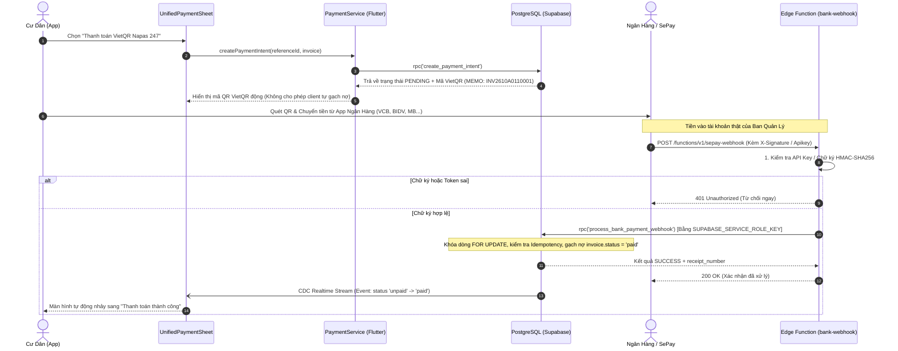

# Đặc Tả Kỹ Thuật: Webhook Ngân Hàng Bảo Mật (SePay HMAC-SHA256) & Cổng Thanh Toán Trực Tuyến VNPay

- **Ngày ban hành:** 14/11/2026
- **Trạng thái:** Bản thiết kế được phê duyệt (Approved Design Spec)
- **Tác giả:** Đội ngũ Kiến trúc Hệ thống PKA-Home B2B SaaS
- **Mục tiêu:** Chuyển đổi toàn diện cơ chế thanh toán từ mô phỏng sang dòng tiền thật:
  1. Bảo vệ cổng Webhook ngân hàng: Chặn hoàn toàn việc client tự gọi RPC gạch nợ khống; chuyển sang Supabase Edge Function có xác thực token / HMAC-SHA256 và quyền `service_role`.
  2. Tích hợp Cổng thanh toán trực tuyến thật VNPay (Chuẩn mã hóa HMAC-SHA512, URL redirect & IPN Webhook).
  3. Đảm bảo tính toán toàn vẹn nguyên tử (ACID), chống chi kép (Idempotency), không thất thoát tiền của Ban Quản Lý.

---

## 1. Kiến Trúc Luồng Tiền Thật & Webhook Đối Soát 24/7



---

## 2. Các Thay Đổi Trọng Yếu Về Bảo Mật CSDL (PostgreSQL Hardening)

### 2.1. Thu Hồi Quyền Gọi Trực Tiếp Từ Client (Privilege Revocation)
- **Vấn đề:** Hiện tại `process_bank_payment_webhook` và `process_sepay_webhook` đang mở quyền `EXECUTE` cho vai trò `anon` và `authenticated`. Người dùng độc hại có thể mạo danh client gửi payload giả để gạch nợ hóa đơn mà không chuyển tiền.
- **Giải pháp:**
  ```sql
  REVOKE EXECUTE ON FUNCTION public.process_bank_payment_webhook(JSONB) FROM PUBLIC, anon, authenticated;
  REVOKE EXECUTE ON FUNCTION public.process_sepay_webhook(JSONB, TEXT) FROM PUBLIC, anon, authenticated;
  
  GRANT EXECUTE ON FUNCTION public.process_bank_payment_webhook(JSONB) TO service_role;
  GRANT EXECUTE ON FUNCTION public.process_sepay_webhook(JSONB, TEXT) TO service_role;
  ```
- **Ý nghĩa:** Chỉ máy chủ backend (Edge Function) mang `SUPABASE_SERVICE_ROLE_KEY` mới có thể thực thi hàm này. Mọi nỗ lực gọi từ trình duyệt, Postman hay ứng dụng di động sẽ bị PostgreSQL chặn đứng với lỗi `42501 (Permission Denied)`.

### 2.2. Kiểm Tra API Key Tòa Nhà Đối Với Đơn Vị Thu Hộ (Tenant Secret Matching)
- Trong hàm `process_sepay_webhook`: So khớp `p_api_key` gửi lên với cấu hình trong bảng `building_payment_configs.api_key`.
- Nếu tòa nhà đã cấu hình API Key riêng mà webhook gửi sai key: Hủy bỏ giao dịch và báo lỗi `401 Unauthorized`.

---

## 3. Kiến Trúc Cổng Thanh Toán VNPay Gateway (HMAC-SHA512)

Ngoài hình thức chuyển khoản VietQR Napas 247, PKA-Home tích hợp cổng thanh toán trực tuyến **VNPay (VNPAY-QR / Thẻ ATM / Thẻ Quốc tế)**:

### 3.1. Cấu Trúc Khởi Tạo URL Thanh Toán (`VnpayService`):
1. **Thuật toán sinh URL:**
   - Phiên bản: `vnp_Version = 2.1.0`
   - Lệnh: `vnp_Command = pay`
   - Đơn vị tiền tệ: `vnp_CurrCode = VND`
   - Mã giao dịch tham chiếu: `vnp_TxnRef = <transaction_code>` (Ví dụ: `TXN2611140001`)
   - Số tiền: `vnp_Amount = amount * 100` (Theo quy chuẩn VNPay nhân 100)
   - Thông tin: `vnp_OrderInfo = "Thanh toan hoa don PKA-Home - Can ho A0110"`
   - Thời gian khởi tạo & hết hạn: `vnp_CreateDate` & `vnp_ExpireDate = now + 15 phút`
2. **Ký số bảo mật HMAC-SHA512:**
   - Các tham số được sắp xếp theo bảng chữ cái ASCII (`ksort`).
   - Ghép thành chuỗi dữ liệu băm `hashData`: `key1=val1&key2=val2...`
   - Ký bằng khóa bí mật `vnp_HashSecret`: `vnp_SecureHash = HMAC_SHA512(vnp_HashSecret, hashData)`.
   - Ghép URL điều hướng đến cổng thanh toán VNPay: `https://sandbox.vnpayment.vn/paymentv2/vpcpay.html?...&vnp_SecureHash=...`

### 3.2. Webhook Tiếp Nhận Kết Quả VNPay (IPN Endpoint):
- **Tệp:** `supabase/functions/vnpay-ipn/index.ts`
- **Quy trình:**
  1. Trích xuất toàn bộ tham số từ query string của request IPN do VNPay gửi tới.
  2. Tách riêng `vnp_SecureHash` và kiểm tra chữ ký HMAC-SHA512 với khóa bí mật.
  3. Nếu chữ ký sai: Trả về JSON `{ "RspCode": "97", "Message": "Invalid Checksum" }`.
  4. Nếu chữ ký đúng: Kiểm tra mã kết quả `vnp_ResponseCode == "00"` (Giao dịch thành công).
  5. Gọi hàm PostgreSQL `process_bank_payment_webhook` với vai trò `service_role` để gạch nợ hóa đơn.
  6. Trả về cho VNPay: `{ "RspCode": "00", "Message": "Confirm Success" }`.

---

## 4. Tự Động Hóa & Trải Nghiệm Người Dùng (Realtime Auto-Advance)

- Cư dân mở `UnifiedPaymentSheet`:
  - Lựa chọn tab 1: **Chuyển khoản VietQR (Napas 247)** -> Hiển thị mã QR chứa MEMO tự động.
  - Lựa chọn tab 2: **Cổng thanh toán VNPay** -> Nhấn nút "MỞ CỔNG VNPAY" -> Điều hướng sang Webview hoặc App ngân hàng liên kết.
- Khi tiền vào tài khoản và webhook xử lý thành công:
  - PostgreSQL kích hoạt Trigger ghi `payment_transactions` thành `SUCCESS` và cập nhật `invoices.status = 'paid'`.
  - Supabase Realtime CDC đẩy bản ghi mới qua WebSocket đến thiết bị Cư dân.
  - `UnifiedPaymentSheet` phát hiện trạng thái thay đổi, tự động phát âm thanh xác nhận, hiển thị dấu tích xanh và đóng sheet trong 1.5 giây.

---

## 5. Chiến Lược Kiểm Thử & Tiêu Chí Nghiệm Thu (Quality Gate)

1. **Unit Test CSDL / Migration:**
   - Viết test kiểm tra quyền: Xác nhận user `anon` và `authenticated` không thể gọi trực tiếp `process_bank_payment_webhook` hay `process_sepay_webhook`.
2. **Unit Test Edge Functions:**
   - Kiểm thử `sepay-webhook`: Bắn webhook sai API Key trả về HTTP 401; bắn webhook chuẩn trả về HTTP 200 và gọi RPC qua `service_role`.
   - Kiểm thử `vnpay-ipn`: Xác minh thuật toán kiểm tra chữ ký HMAC-SHA512.
3. **Unit Test Client Flutter:**
   - `VnpayServiceTest`: Kiểm tra URL sinh ra có sắp xếp đúng alphabet và tạo đúng chữ ký HMAC-SHA512.
   - `PaymentServiceTest`: Đảm bảo `createPaymentIntent` tạo giao dịch PENDING và không tự ý gọi RPC gạch nợ từ client.
4. **Static Analysis:** `dart analyze lib test` đạt `0 issues`.
