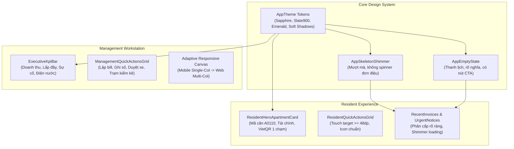

# Thiết Kế Chi Tiết: Nâng Cấp Giao Diện Impeccable Craft UI Cho PKA-Home

- **Mã thiết kế:** `SPEC-20261115-UI-CRAFT`
- **Phiên bản:** 1.0 (Production SaaS)
- **Tác giả:** Antigravity Design & Engineering Team
- **Trạng thái:** Đã phê duyệt (Approved)
- **Chuẩn tuân thủ:** Impeccable Craft v4.8, Material Design 3, Luật PDPL 91/2025/QH15, `design-rules.md`, `coding-rules.md`.

---

## 1. Tôn Chỉ & Định Hướng Thiết Kế (Design Director POV)

Giao diện PKA-Home được định vị là sản phẩm **PropTech Thương Mại B2B SaaS** cao cấp. Giao diện phải toát lên sự tin cậy, sắc nét, hiện đại, mang lại trải nghiệm tối ưu cho cả Cư dân sinh hoạt hàng ngày và Ban Quản Lý điều hành liên tục nhiều giờ.

### Nguyên tắc Bắt buộc (Craft Floor Constraints):
1. **Tuyệt đối cấm Thẻ lồng Thẻ (No Nested Cards)**: Không bọc một `Card` bên trong một `Card` khác. Tận dụng khoảng cách (Whitespace), đường phân cách mỏng 1px mờ (`slate200` / `0.08 alpha`) hoặc nền khối phẳng (`slate50`) để phân tách thông tin.
2. **Tuyệt đối cấm Nhãn Chân mày (No Eyebrow / Kicker)**: Tiêu đề màn hình và khối nội dung phải tự mang trọng lượng của mình. Không dùng nhãn phụ nhỏ in hoa đặt ngay trên heading.
3. **Tuyệt đối không dùng Emoji**: Mọi biểu tượng chức năng phải sử dụng hệ thống `Icons.*` chuẩn Material Design với cùng độ dày nét và kích thước hài hòa.
4. **Không dùng Gradient Text**: Điểm nhấn thị giác được tạo bởi độ đậm font (Font Weight: Bold/SemiBold) và kích thước typographic scale, không tô màu loang trên chữ.
5. **Tiêu chuẩn Tương phản & Cảm ứng**:
   - Tương phản văn bản chính $\ge 4.5:1$, tương phản tiêu đề $\ge 3:1$.
   - Mọi nút bấm, thẻ tương tác đạt diện tích chạm tối thiểu **$48 \times 48\text{dp}$**.
   - Hỗ trợ co giãn văn bản (Text Scale $1.3\times - 1.5\times$) không bao giờ gây lỗi tràn viền (Anti-RenderFlex Guarantee).
6. **100% Tiếng Việt chuẩn mực SaaS B2B**: Không sử dụng từ tiếng Anh trong ngoặc đơn để giải nghĩa kiểu `(Password)`, không dùng tiếng lóng.

---

## 2. Kiến Trúc Thành Phần Giao Diện (UI Architecture)

---

## 3. Đặc Tả Chi Tiết Từng Module

### 3.1. Hệ thống Trạng thái Vi mô (Micro-States Components)

#### A. `AppSkeletonShimmer` (`lib/core/widgets/app_skeleton_shimmer.dart`)
- **Mục đích**: Thay thế toàn bộ `CircularProgressIndicator` đơn điệu khi tải danh sách từ Supabase, giảm cảm giác chờ đợi của người dùng.
- **Cơ chế hoạt động**:
  - Sử dụng `AnimationController` vòng lặp với đường cong chuyển động `Curves.easeInOutSine` (chu kỳ 1200ms).
  - Áp dụng dải màu chuyển tiếp tinh tế giữa `Color(0xFFE2E8F0)` (Slate 200) và `Color(0xFFF8FAFC)` (Slate 50) trong chế độ sáng; `Color(0xFF1E293B)` và `Color(0xFF334155)` trong chế độ tối.
- **Factory Constructors tiện ích**:
  - `AppSkeletonShimmer.rectangular({width, height, borderRadius})`: Khối chữ nhật bo góc cho card/banner.
  - `AppSkeletonShimmer.circular({size})`: Khối tròn cho avatar hoặc icon badge.
  - `AppSkeletonShimmer.textLine({width, height})`: Dòng chữ mô phỏng tiêu đề hoặc nội dung.
  - `AppSkeletonShimmer.cardList({count, itemHeight})`: Danh sách skeleton mô phỏng thẻ dữ liệu.

#### B. `AppEmptyState` (`lib/core/widgets/app_empty_state.dart`)
- **Mục đích**: Hiển thị khi danh sách dữ liệu rỗng (chưa có hóa đơn, chưa có sự cố, chưa có thông báo).
- **Cấu trúc**:
  - Icon minh họa trung tâm: Nằm trong vòng tròn nền mờ nhẹ (`AppTheme.sapphire.withValues(alpha: 0.08)`), kích thước icon 40dp.
  - Tiêu đề (Title): `16sp`, `FontWeight.w600`, màu `slate800`.
  - Mô tả (Description): `13sp`, màu `slate600`, tự động xuống dòng và căn giữa.
  - Nút hành động chính (Action Button - Tùy chọn): `ElevatedButton` hoặc `OutlinedButton` để người dùng thực hiện hành động tạo mới ngay lập tức.

---

### 3.2. Cải Tiến Trang Chủ Cư Dân (`ResidentHomeScreen`)

1. **Thẻ Căn Hộ Hero (`ResidentHeroApartmentCard`)**:
   - Sử dụng nền gradient tối sang trọng `AppGradients.heroDark` kết hợp viền mờ `Color(0x1FFFFFFF)`.
   - Hiển thị nổi bật mã căn hộ chuẩn: `Căn hộ A0110` (Block A, Tầng 01, Phòng 10).
   - Tên chủ hộ hoặc người lưu trú kèm huy hiệu vai trò ("Chủ hộ" / "Khách thuê").
   - Trạng thái tài chính tháng hiện tại:
     - Nếu còn nợ: Hiển thị số tiền đỏ nhạt hoặc vàng cam, kèm nút "Thanh toán VietQR" một chạm ngay trên thẻ.
     - Nếu đã thanh toán: Huy hiệu xanh ngọc "Đã hoàn thành phí sinh hoạt tháng".
2. **Dải Thao Tác Nhanh (Resident Quick Actions)**:
   - Bố cục lưới 4 cột (hoặc 2 hàng x 3 cột) với icon Material sắc nét trong nền bo tròn 12dp:
     - *Hóa đơn & Phí* (`Icons.receipt_long`)
     - *Báo sự cố* (`Icons.handyman`)
     - *Khách thăm (QR)* (`Icons.qr_code_2`)
     - *Bưu kiện (PIN)* (`Icons.inventory_2`)
     - *Đăng ký xe* (`Icons.directions_car`)
     - *Biểu quyết m²* (`Icons.how_to_vote`)
   - Từng ô đảm bảo `InkWell` hiệu ứng gợn sóng (Ripple Effect) và diện tích chạm $\ge 48\text{dp}$.
3. **Khối Hóa Đơn Đến Hạn & Thông Báo Khẩn**:
   - Khi đang nạp dữ liệu: Hiển thị `AppSkeletonShimmer.cardList()`.
   - Khi không có nợ: Hiển thị `AppEmptyState` thông báo chúc mừng an tâm sinh hoạt.

---

### 3.3. Cải Tiến Dashboard Ban Quản Lý (`ManagementDashboardScreen`)

1. **Executive KPI Bar**:
   - Bố cục 4 chỉ số cấp cao, co giãn tự động giữa Grid 2x2 trên di động và 1 hàng 4 cột trên Desktop/Web:
     - **Doanh thu kỳ này**: Tổng số tiền thu được vs Kế hoạch phải thu kèm thanh tiến trình phần trăm.
     - **Tỷ lệ lấp đầy**: Số căn có người ở / Tổng số căn hộ tòa nhà.
     - **Sự cố cần xử lý**: Số phiếu phản ánh đang mở (đặc biệt nhấn mạnh phiếu vi phạm SLA).
     - **Chốt số điện nước**: Tiến độ nhập chỉ số công tơ tháng hiện tại.
2. **Khối Phím Tắt Nghiệp Vụ BQL**:
   - Phân nhóm rõ ràng:
     - *Thu phí & Kế toán*: Lập hóa đơn hàng loạt, Ghi chỉ số, Quỹ bảo trì.
     - *Vận hành & Kỹ thuật*: Trạm kiểm kê bàn giao, Phân công sự cố, Vật tư kho.
     - *An ninh & Cư dân*: Duyệt xe, Trạm lễ tân, Kích hoạt cư dân.
3. **Khả năng tương thích Responsive**:
   - Trên màn hình rộng ($\ge 900\text{dp}$): Tự động hiển thị dạng Dashboard đa cột (Executive KPI phía trên, cột trái là Biểu đồ dòng tiền/Sự cố, cột phải là Danh sách tác vụ cần phê duyệt ngay).

---

## 4. Kế Hoạch Kiểm Thử & Nghiệm Thu (QA Matrix)

1. **Widget Test `test/core/widgets/app_skeleton_shimmer_test.dart`**:
   - Kiểm tra render đúng các dạng rectangular, circular, textLine, cardList.
   - Kiểm tra không xảy ra memory leak khi dispose animation.
2. **Widget Test `test/core/widgets/app_empty_state_test.dart`**:
   - Kiểm tra hiển thị đúng icon, tiêu đề, mô tả và kích hoạt callback khi bấm nút hành động.
3. **Widget Test `test/features/resident/resident_home_screen_test.dart` & `test/features/management/management_dashboard_enhanced_test.dart`**:
   - Kiểm tra render an toàn trên kích thước hẹp 320dp và kích thước rộng 1200dp.
   - Kiểm tra Text scale $1.3\times$ không gây lỗi RenderFlex.
4. **Phân tích tĩnh**: `dart analyze lib test` đạt 0 issues.
