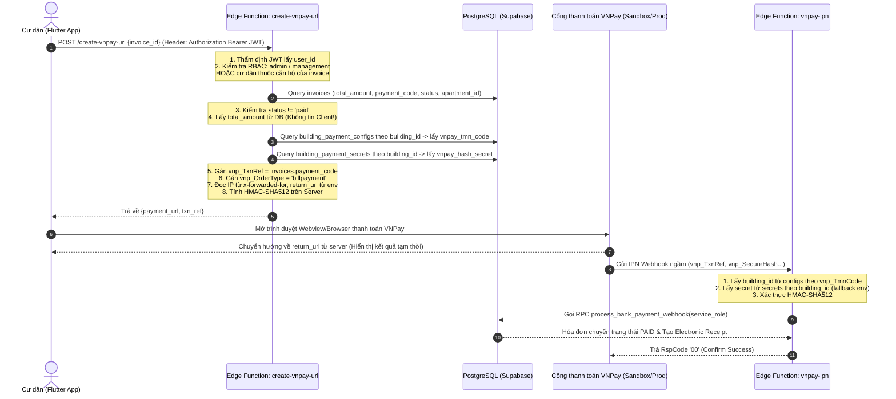

# Thiết Kế Kỹ Thuật: Khắc Phục Lỗi P0 VNPay & Chuẩn Hóa Design System, A11y (Phương Án A Cuốn Chiếu)

- **Mã tài liệu**: `SPEC-2026-11-17-VNPAY-UI-A11Y`
- **Ngày cập nhật**: 17/11/2026 (Phiên bản v1.1 - Đã hiệu chỉnh theo phản biện kỹ thuật)
- **Trạng thái**: Bản đặc tả đã chuẩn hóa (Final Spec Approved)
- **Định hướng sản phẩm**: B2B SaaS PropTech Commercial Production (PKA-Home)

---

## 1. Bối Cảnh & Mục Tiêu

### 1.1. Hiện trạng & Thách thức
1. **Lỗi P0 VNPay sau khi tách Secrets**:
   - Migration `20261116_02_separate_payment_secrets_and_scope_webhook.sql` đã `DROP` cột `vnpay_hash_secret` khỏi bảng `building_payment_configs` để bảo vệ khóa bí mật khỏi việc cư dân đọc trộm qua REST API.
   - Phía Client (`PaymentService.createVnpayPaymentUrl`) đọc config từ `building_payment_configs` nên luôn nhận `vnpayHashSecret == null`, khiến nút VNPay trên `UnifiedPaymentSheet` ném ngoại lệ *"Không thể khởi tạo URL thanh toán VNPay"*.
   - Khóa bí mật không bao giờ được phép để ở Client. Cần chuyển việc sinh URL và ký số HMAC-SHA512 về Server-side an toàn tuyệt đối.
   - Edge Function `vnpay-ipn/index.ts` hiện tại vẫn đang `select` `vnpay_hash_secret` từ bảng cũ `building_payment_configs` (vốn đã bị drop).
2. **Nợ kỹ thuật Giao diện (Theme & A11y)**:
   - Toàn hệ thống có 61 mã màu cứng và hơn 1.330 chỗ khai báo `fontSize:` cứng rải khắp các màn hình, gây khó khăn cho việc bảo trì và nâng cấp dark mode / text scale.
   - Hai widget chuẩn hóa `AppSkeletonShimmer` và `AppEmptyState` mới chỉ xuất hiện cục bộ; các màn hình quản trị BQL (như `issue_management_screen.dart`, `invoice_management_screen.dart`) và các màn hình chi tiết vẫn còn dùng `CircularProgressIndicator` hoặc text rỗng thô sơ.
   - Trợ năng A11y (Accessibility) cho người khiếm thị / người cao tuổi sử dụng TalkBack / VoiceOver gần như bằng 0 (thiếu nhãn `Semantics` cho các badge trạng thái, số tiền hóa đơn, nút chức năng icon-only).

### 1.2. Mục tiêu cốt lõi
1. **P0 VNPay**: Tạo Edge Function `create-vnpay-url` ký số bảo mật phía server, kiểm soát chặt chẽ số tiền từ DB và phân quyền RBAC; sửa `vnpay-ipn` tra cứu bảng secrets theo 2 bước độc lập; dọn dead code client.
2. **Design System & Guardrail**: Mở rộng tiện ích Typography, bổ sung Dark-mode Adaptive Getters cho `AppStatusColors` (giữ nguyên màu Light để zero-regression), tận dụng `VietnameseCurrencyWords` cho trợ năng giọng đọc, kèm chốt chặn CI test chống tái phát nợ kỹ thuật cho các module đã hoàn thiện.
3. **Cuốn chiếu 2 Module Trọng yếu (7 màn hình gồm cả Danh sách và Chi tiết)**:
   - Module Tài chính/Hóa đơn (`resident_invoice_screen`, `resident_invoice_detail_screen`, `invoice_management_screen`, `management_invoice_detail_screen`).
   - Module Sự cố/Vận hành (`resident_issue_screen`, `issue_detail_screen`, `issue_management_screen`).
4. **Đảm bảo chất lượng**: Zero-regression, 0 lỗi analyze, 100% tests pass, kèm test widget mới và checklist QA thủ công Light/Dark.

---

## 2. Phần 0: Server-Authoritative VNPay Payment Engine (P0)



### 2.1. Đặc tả Edge Function `create-vnpay-url`
- **Xác thực & Phân quyền (RBAC)**:
  - Bắt buộc Header `Authorization: Bearer <supabase_jwt>`.
  - Giải mã `user_id` từ JWT qua `supabase.auth.getUser(token)`.
  - Tra cứu vai trò: Kiểm tra bảng `users` (`role IN ('admin', 'management')`) hoặc gọi hàm `get_effective_user_role(user_id, building_id)`.
  - Nếu là Cư dân (`role == 'resident'`): Kiểm tra trong bảng `residents_apartments` xem `user_id` có liên kết với `invoices.apartment_id` hay không. Nếu không thuộc về căn hộ này $\rightarrow$ Trả HTTP 403 Forbidden (`Bạn không có quyền thanh toán hóa đơn này`).
- **Tính toàn vẹn dữ liệu (Financial Integrity)**:
  - Server tự query bảng `invoices` lấy `total_amount`, `payment_code`, `status`, và `apartment_id`.
  - Ràng buộc trạng thái: Nếu `invoices.status == 'paid'` $\rightarrow$ Trả HTTP 400 (`Hóa đơn đã được thanh toán toàn bộ`).
  - Số tiền thanh toán: `v_amount = invoices.total_amount` (Server làm chủ 100%, tuyệt đối **không** nhận `amount` từ client body).
- **Ràng buộc mã giao dịch (`vnp_TxnRef`)**:
  - `vnp_TxnRef = invoices.payment_code` (Bắt buộc phải khớp chính xác để RPC `process_bank_payment_webhook` đối chiếu gạch nợ).
- **Lấy cấu hình thanh toán & Khóa bí mật (2 bước độc lập)**:
  - Bước 1: Từ `invoices.apartment_id`, lấy `building_id` qua `apartments.building_id`.
  - Bước 2: Query `building_payment_configs` lấy `vnpay_tmn_code`, `vnpay_is_active`. Nếu `vnpay_is_active == false` hoặc thiếu cấu hình $\rightarrow$ Trả HTTP 400 (`Tòa nhà chưa kích hoạt cổng VNPay`).
  - Bước 3: Query `building_payment_secrets` lấy `vnpay_hash_secret` theo `building_id`. Nếu không có, fallback về `Deno.env.get("VNPAY_HASH_SECRET")`.
- **Tạo chữ ký số HMAC-SHA512 phía Server**:
  - `vnp_Version`: `2.1.0`.
  - `vnp_Command`: `pay`.
  - `vnp_TmnCode`: Lấy từ `building_payment_configs`.
  - `vnp_Amount`: `(v_amount * 100).toString()`.
  - `vnp_CurrCode`: `VND`.
  - `vnp_TxnRef`: `invoices.payment_code`.
  - `vnp_OrderInfo`: `Thanh toan hoa don ${invoices.payment_code}`.
  - `vnp_OrderType`: `billpayment` (Thay đổi có chủ đích chuẩn 2.1.0 cho hóa đơn dịch vụ).
  - `vnp_Locale`: `vn`.
  - `vnp_IpAddr`: Đọc từ Header `x-forwarded-for` (cắt lấy IP đầu tiên) hoặc `cf-connecting-ip`, fallback `127.0.0.1`.
  - `vnp_ReturnUrl`: Đọc từ biến môi trường `Deno.env.get("VNPAY_RETURN_URL") ?? "https://pka-home.web.app/payment-result"` (Không tin client gửi lên để ngăn chặn phishing/open redirect).
  - `vnp_CreateDate`: Định dạng `yyyyMMddHHmmss` theo giờ Việt Nam (UTC+7).
  - Điểm cuối: `https://sandbox.vnpayment.vn/paymentv2/vpcpay.html` nếu `VNPAY_IS_SANDBOX=true` (hoặc cấu hình tòa nhà), ngược lại `https://vnpayment.vn/paymentv2/vpcpay.html`.

### 2.2. Nâng cấp Edge Function `vnpay-ipn`
- Khắc phục lỗi `PGRST200` (không có FK trực tiếp giữa `building_payment_configs` và `building_payment_secrets`):
  ```ts
  // Bước 1: Tra cứu building_id theo TMN code từ bảng configs
  const { data: configData } = await supabase
    .from("building_payment_configs")
    .select("building_id, vnpay_is_active")
    .eq("vnpay_tmn_code", tmnCode)
    .eq("vnpay_is_active", true)
    .maybeSingle();

  let hashSecret = Deno.env.get("VNPAY_HASH_SECRET") || "";

  // Bước 2: Tra cứu secret từ bảng secrets theo building_id tìm được
  if (configData?.building_id) {
    const { data: secretData } = await supabase
      .from("building_payment_secrets")
      .select("vnpay_hash_secret")
      .eq("building_id", configData.building_id)
      .maybeSingle();

    if (secretData?.vnpay_hash_secret) {
      hashSecret = secretData.vnpay_hash_secret;
    }
  }
  ```
- Nếu không tìm thấy secret theo tòa nhà, giữ nguyên cơ chế fallback về biến môi trường `VNPAY_HASH_SECRET` để không làm gián đoạn hệ thống hiện tại.

### 2.3. Dọn dẹp Dead Code & Mô hình Dữ liệu Client
- Trong `BuildingPaymentConfigModel`: Xóa bỏ 2 trường `vnpayHashSecret` và `sepayApiKey` (không còn trong DB schema).
- Trong `VnpayService` & `PaymentService`:
  - `PaymentService.createVnpayPaymentUrl`: Gọi Edge Function `create-vnpay-url` qua `supabase.functions.invoke('create-vnpay-url', body: {'invoice_id': invoiceId})`.
  - Xóa bỏ logic ký số HMAC-SHA512 thừa ở client khỏi `VnpayService`.
  - `UnifiedPaymentSheet`: Giữ nguyên UX, gọi `paymentService.createVnpayPaymentUrl(invoiceId)` an toàn.

---

## 3. Phần 1: Tối Ưu UI/UX, Design Tokens & A11y (Phương Án A Cuốn Chiếu)

### 3.1. Khâu 1: Design System Toolkit & CI Guardrail

#### A. Typography Helper (`BuildContext.textStyles`)
Tạo extension `BuildContext.textStyles` và `AppTypography` chuẩn hóa truy xuất `Theme.of(context).textTheme`:
```dart
extension AppTypographyExtension on BuildContext {
  TextTheme get textTheme => Theme.of(this).textTheme;
  TextStyle? get displayLarge => textTheme.displayLarge;
  TextStyle? get titleLarge => textTheme.titleLarge;
  TextStyle? get titleMedium => textTheme.titleMedium;
  TextStyle? get titleSmall => textTheme.titleSmall;
  TextStyle? get bodyLarge => textTheme.bodyLarge;
  TextStyle? get bodyMedium => textTheme.bodyMedium;
  TextStyle? get bodySmall => textTheme.bodySmall;
  TextStyle? get labelLarge => textTheme.labelLarge;
  TextStyle? get labelSmall => textTheme.labelSmall;
}
```

#### B. Thích ứng Màu sắc Dark Mode (`AppStatusColors`)
Giữ nguyên 100% các giá trị màu Light hiện tại (tránh ảnh hưởng 177 nơi đang sử dụng), bổ sung các hàm getter thích ứng Dark Mode:
```dart
class AppStatusColors {
  // Giữ nguyên giá trị Light hiện tại
  static const Color paid = Color(0xFF4CAF50); // Xanh lá
  static const Color unpaid = Color(0xFFF44336); // Đỏ
  static const Color pendingConfirmation = Color(0xFFFFB300); // Vàng/Cam
  static const Color priorityHigh = Color(0xFFD32F2F); // Đỏ đậm
  static const Color priorityMedium = Color(0xFFFF9800); // Cam
  static const Color priorityLow = Color(0xFF64B5F6); // Xanh dương nhạt
  static const Color pending = Color(0xFFFF9800); // Cam
  static const Color rejected = Color(0xFFE57373); // Đỏ nhạt

  // Bổ sung Getter thích ứng Dark Mode chuẩn WCAG AA
  static Color getPaid(BuildContext context) =>
      Theme.of(context).brightness == Brightness.dark ? const Color(0xFF34D399) : paid;
  static Color getUnpaid(BuildContext context) =>
      Theme.of(context).brightness == Brightness.dark ? const Color(0xFFFB7185) : unpaid;
  static Color getPendingConfirmation(BuildContext context) =>
      Theme.of(context).brightness == Brightness.dark ? const Color(0xFFFBBF24) : pendingConfirmation;
  static Color getPriorityHigh(BuildContext context) =>
      Theme.of(context).brightness == Brightness.dark ? const Color(0xFFF87171) : priorityHigh;
  static Color getPriorityMedium(BuildContext context) =>
      Theme.of(context).brightness == Brightness.dark ? const Color(0xFFFBBF24) : priorityMedium;
  static Color getPriorityLow(BuildContext context) =>
      Theme.of(context).brightness == Brightness.dark ? const Color(0xFF60A5FA) : priorityLow;
}
```

#### C. Trợ năng Đọc tiền thành tiếng (Spoken Currency Semantics)
Sử dụng trực tiếp tiện ích đã có `VietnameseCurrencyWords.toVietnameseWords(double amount)` từ `lib/core/utils/vietnamese_currency_words.dart` cho thuộc tính `semanticLabel` của widget hiển thị số tiền.

#### D. CI Guardrail Test (`test/core/theme_and_color_guard_test.dart`)
- Quét các file trong danh sách `targetModulesWhitelist` (chỉ gồm 7 màn hình của 2 module đã chuẩn hóa ở đợt này).
- Có `exclusionList` bỏ qua các định nghĩa gốc (`app_theme.dart`, `app_skeleton_shimmer.dart`...).
- Phát hiện bất kỳ `Color(0x` hoặc `fontSize:` cứng trong 7 màn hình này $\rightarrow$ Ném lỗi chỉ rõ đường dẫn và số dòng, bảo vệ thành quả refactor.

---

### 3.2. Khâu 2: Cuốn Chiếu Module 1 - Tài Chính & Hóa Đơn (4 Màn Hình)

**Phạm vi**:
1. `lib/features/resident/screens/resident_invoice_screen.dart` (Danh sách cư dân)
2. `lib/features/resident/screens/resident_invoice_detail_screen.dart` (Chi tiết cư dân)
3. `lib/features/management/screens/invoice_management_screen.dart` (Danh sách BQL)
4. `lib/features/management/screens/management_invoice_detail_screen.dart` (Chi tiết BQL)

**Nội dung thực thi**:
- **Dọn dẹp Theme**: Thay thế toàn bộ mã màu cứng và `fontSize:` cứng trong 4 file trên bằng `context.textTheme` và `AppStatusColors.get*()`.
- **Skeleton & Empty State**:
  - Khi loading dữ liệu: Hiển thị `AppSkeletonShimmer.cardList(count: 4)`. Xóa bỏ triệt để `CircularProgressIndicator` thô.
  - Khi danh sách trống: Hiển thị `AppEmptyState` với Icon `Icons.receipt_long_outlined`, thông điệp chuẩn mực.
- **Trợ năng Semantics**:
  - Thẻ hóa đơn: Bọc `Semantics(label: "Hóa đơn ${invoice.paymentCode}, số tiền ${VietnameseCurrencyWords.toVietnameseWords(invoice.totalAmount)}, trạng thái ${invoice.statusVietnamese}", ...)`
  - Badge trạng thái: Bọc `Semantics` mô tả tình trạng gạch nợ rõ ràng.
  - Nút hành động (VietQR, VNPay, In phiếu thu): Bọc `Semantics(button: true, label: "...")`.

---

### 3.3. Khâu 3: Cuốn Chiếu Module 2 - Sự Cố & Vận Hành (3 Màn Hình)

**Phạm vi**:
1. `lib/features/resident/screens/resident_issue_screen.dart` (Danh sách cư dân)
2. `lib/features/resident/screens/issue_detail_screen.dart` (Chi tiết sự cố & trao đổi)
3. `lib/features/management/screens/issue_management_screen.dart` (Danh sách BQL)

**Nội dung thực thi**:
- **Dọn dẹp Theme**: Chuyển đổi mã màu cứng và font size cứng sang Design Tokens.
- **Skeleton & Empty State**:
  - Xóa bỏ hoàn toàn `CircularProgressIndicator` còn sót lại ở phía BQL (`issue_management_screen.dart`) và màn chi tiết. Thay bằng `AppSkeletonShimmer.cardList()`.
  - Hiển thị `AppEmptyState` với Icon `Icons.build_circle_outlined` khi danh sách sự cố trống.
- **Trợ năng Semantics**:
  - Thẻ sự cố: `Semantics(label: "Sự cố ${issue.title}, Mức độ ưu tiên ${issue.priorityText}, Trạng thái ${issue.statusText}, Căn hộ ${issue.apartmentCode}", ...)`
  - Ảnh đính kèm: `Semantics(image: true, label: "Ảnh chụp hiện trường sự cố số ${index + 1}", ...)`
  - Nút điều phối / phân công kỹ thuật viên: `Semantics(button: true, label: "Phân công kỹ thuật viên xử lý sự cố", ...)`

---

## 4. Kịch Bản Kiểm Thử & Nghiệm Thu (Quality & QA)

### 4.1. Bộ Test Tự Động (Automated Test Suite)
1. `test/core/theme_and_color_guard_test.dart`: Kiểm tra tĩnh bảo vệ quy chuẩn Design System cho 7 màn hình đã chuẩn hóa.
2. `test/core/services/vnpay_server_flow_test.dart`: Unit test xác minh gọi Edge Function `create-vnpay-url` và xử lý URL.
3. `test/features/resident/resident_invoice_a11y_and_shimmer_test.dart`: Widget test kiểm tra Shimmer Loading, Empty State và các nhãn Semantics giọng đọc tiếng Việt trên màn hình hóa đơn.
4. `test/features/management/invoice_management_a11y_and_shimmer_test.dart`: Widget test kiểm tra giao diện BQL hóa đơn.
5. `test/features/management/issue_management_a11y_and_shimmer_test.dart`: Widget test kiểm tra giao diện BQL sự cố không còn `CircularProgressIndicator`.

### 4.2. Checklist Kiểm Thử Thủ Công & Sandbox (Manual QA)
- [ ] **Deploy & Cấu hình Edge Functions**:
  - Deploy function `create-vnpay-url`.
  - Re-deploy function `vnpay-ipn`.
  - Xác nhận Supabase Secrets đã được cấu hình: `VNPAY_HASH_SECRET`, `VNPAY_IS_SANDBOX=true`, `VNPAY_RETURN_URL=https://pka-home.web.app/payment-result`.
- [ ] **VNPay Sandbox End-to-End**:
  - Khởi tạo thanh toán VNPay từ app cư dân.
  - Kiểm tra link mở đúng sandbox VNPay kèm số tiền chính xác từ DB.
  - Dùng thẻ test NCB (9704198526191432198, NGUYEN VAN A, 07/15, OTP: 123456).
  - Kiểm tra IPN nhận callback, đối chiếu chữ ký thành công và hóa đơn chuyển trạng thái `paid`.
- [ ] **Kiểm Tra Trực Quan Đạt Chuẩn WCAG (Light & Dark Mode)**:
  - Chụp đối chiếu giao diện Sáng / Tối trên cả 7 màn hình.
  - Các badge trạng thái (Đã nộp, Chưa nộp, Chờ duyệt, Khẩn cấp) hiển thị rõ nét, tương phản tốt, không bị lóa hoặc chìm nền.
- [ ] **Trợ năng TalkBack / VoiceOver**:
  - Bật TalkBack/VoiceOver, kiểm tra giọng đọc phát âm rõ ràng: "Hóa đơn..., một triệu năm trăm nghìn đồng chẵn, chưa nộp".

---

## 5. Quy Trình Cam Kết Triển Khai
- Chạy `dart analyze lib test` đạt 0 error, 0 warning trước mỗi commit.
- Chạy 100% test suites liên quan đạt kết quả Passed.
- Commit trực tiếp trên nhánh `main` với các commit message rõ ràng theo chuẩn Conventional Commits.
