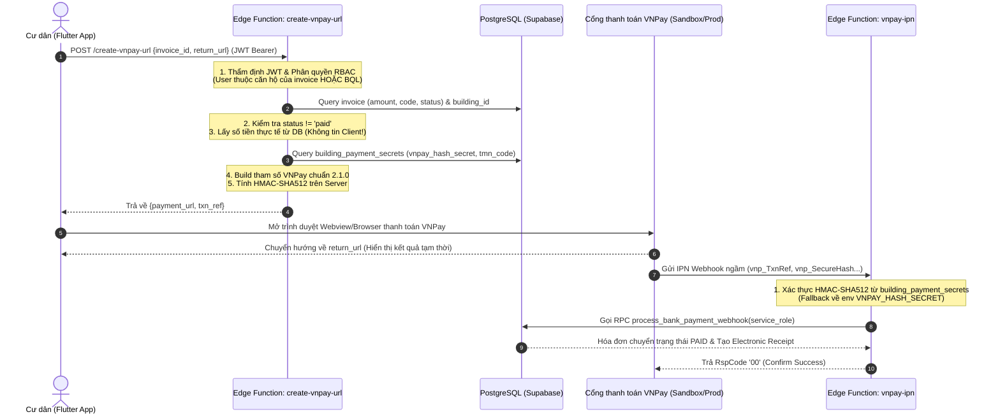

# Thiết Kế Kỹ Thuật: Khắc Phục Lỗi P0 VNPay & Chuẩn Hóa Design System, A11y (Phương Án A Cuốn Chiếu)

- **Mã tài liệu**: `SPEC-2026-11-17-VNPAY-UI-A11Y`
- **Ngày lập**: 17/11/2026
- **Trạng thái**: Bản thảo thiết kế trình duyệt (Draft for Review)
- **Định hướng sản phẩm**: B2B SaaS PropTech Commercial Production (PKA-Home)

---

## 1. Bối Cảnh & Mục Tiêu

### 1.1. Hiện trạng & Thách thức
1. **Lỗi P0 VNPay sau khi tách Secrets**:
   - Migration `20261116_02_separate_payment_secrets_and_scope_webhook.sql` đã `DROP` cột `vnpay_hash_secret` khỏi bảng `building_payment_configs` để bảo vệ khóa bí mật khỏi việc cư dân đọc trộm qua REST API.
   - Phía Client (`PaymentService.createVnpayPaymentUrl`) đọc config từ `building_payment_configs` nên luôn nhận `vnpayHashSecret == null`, khiến nút VNPay trên `UnifiedPaymentSheet` ném ngoại lệ *"Không thể khởi tạo URL thanh toán VNPay"*.
   - Khóa bí mật không bao giờ được phép để ở Client. Cần chuyển việc sinh URL và ký số HMAC-SHA512 về Server-side an toàn tuyệt đối.
   - Edge Function `vnpay-ipn/index.ts` hiện tại vẫn đang `select` `vnpay_hash_secret` từ bảng cũ `building_payment_configs`.
2. **Nợ kỹ thuật Giao diện (Theme & A11y)**:
   - Toàn hệ thống có 61 mã màu cứng và hơn 1.330 chỗ khai báo `fontSize:` cứng rải khắp các màn hình, gây khó khăn cho việc bảo trì và nâng cấp dark mode / text scale.
   - Hai widget chuẩn hóa `AppSkeletonShimmer` và `AppEmptyState` mới chỉ xuất hiện cục bộ; các màn hình quản trị BQL (như `issue_management_screen.dart`) và các màn hình chi tiết vẫn dùng `CircularProgressIndicator` hoặc text rỗng thô sơ.
   - Trợ năng A11y (Accessibility) cho người khiếm thị / người cao tuổi sử dụng TalkBack / VoiceOver gần như bằng 0 (thiếu nhãn `Semantics` cho các badge trạng thái, số tiền hóa đơn, nút chức năng icon-only).

### 1.2. Mục tiêu cốt lõi
1. **P0 VNPay**: Tạo Edge Function `create-vnpay-url` ký số bảo mật phía server, kiểm soát chặt chẽ số tiền từ DB và phân quyền RBAC; sửa `vnpay-ipn` tra cứu bảng secrets; xóa dead code client.
2. **Design System & Guardrail**: Xây dựng bộ toolkit Typography, Dark-mode Adaptive Status Colors, Spoken Currency Semantics, kèm chốt chặn CI test chống tái phát nợ kỹ thuật.
3. **Cuốn chiếu 2 Module Trọng yếu**:
   - Module Tài chính/Hóa đơn (`resident_invoice_screen`, `resident_invoice_detail_screen`, `invoice_management_screen`, `management_invoice_detail_screen`).
   - Module Sự cố/Vận hành (`resident_issue_screen`, `issue_detail_screen`, `issue_management_screen`).
4. **Đảm bảo chất lượng**: Zero-regression, 0 lỗi analyze, 100% tests pass, kèm test widget mới và checklist QA thủ công Light/Dark.

---

## 2. Phần 0: Server-Authoritative VNPay Payment Engine (P0)



### 2.1. Đặc tả Edge Function `create-vnpay-url`
- **Xác thực & Phân quyền (RBAC)**:
  - Bắt buộc Header `Authorization: Bearer <supabase_jwt>`.
  - Kiểm tra quyền:
    - Nếu là Cư dân: Hóa đơn phải thuộc căn hộ mà người dùng đang được gán trong `residents_apartments`.
    - Nếu là Ban quản lý (`admin`, `manager`, `accountant`): Cho phép khởi tạo thanh toán hộ cư dân tại quầy.
- **Tính toàn vẹn dữ liệu (Financial Integrity)**:
  - Server tự query bảng `invoices` lấy `total_amount`, `amount_paid`, và `invoice_code`.
  - Số tiền thanh toán: `v_amount = (invoices.total_amount - invoices.amount_paid)`. Tuyệt đối **không** dùng `amount` client gửi lên.
  - Nếu `invoices.status == 'paid'` hoặc `v_amount <= 0`: Trả lỗi HTTP 400 (`Hóa đơn đã được thanh toán toàn bộ`).
- **Lấy cấu hình thanh toán & Khóa bí mật**:
  - Dùng `service_role` JOIN bảng `building_payment_configs` và `building_payment_secrets` theo `building_id`.
  - Nếu tòa nhà chưa kích hoạt VNPay (`vnpay_is_active == false`) hoặc thiếu cấu hình: Trả lỗi HTTP 400 (`Tòa nhà chưa cấu hình cổng VNPay`).
- **Tạo chữ ký số HMAC-SHA512**:
  - Sắp xếp từ điển các tham số chuẩn VNPay 2.1.0: `vnp_Version=2.1.0`, `vnp_Command=pay`, `vnp_TmnCode`, `vnp_Amount = v_amount * 100`, `vnp_CreateDate`, `vnp_CurrCode=VND`, `vnp_IpAddr`, `vnp_Locale=vn`, `vnp_OrderInfo`, `vnp_OrderType=billpayment`, `vnp_ReturnUrl`, `vnp_TxnRef`.
  - `vnp_ReturnUrl`: Mặc định `https://pka-home.web.app/payment-result` (hoặc cấu hình từ env `VNPAY_RETURN_URL`).
  - Điểm cuối: `https://sandbox.vnpayment.vn/paymentv2/vpcpay.html` nếu `VNPAY_IS_SANDBOX=true` (hoặc cấu hình tòa nhà), ngược lại `https://vnpayment.vn/paymentv2/vpcpay.html`.

### 2.2. Nâng cấp Edge Function `vnpay-ipn`
- Đổi câu truy vấn tìm secret:
  ```ts
  const { data: secretData } = await supabase
    .from("building_payment_secrets")
    .select("vnpay_hash_secret, building_id, building_payment_configs!inner(vnpay_tmn_code, vnpay_is_active)")
    .eq("building_payment_configs.vnpay_tmn_code", tmnCode)
    .eq("building_payment_configs.vnpay_is_active", true)
    .maybeSingle();
  ```
- Nếu không tìm thấy cấu hình theo tòa nhà trong database, tiếp tục fallback về biến môi trường `Deno.env.get("VNPAY_HASH_SECRET")` như kiến trúc ban đầu để đảm bảo tính sẵn sàng.

### 2.3. Dọn dẹp Dead Code & Mô hình Dữ liệu Client
- Trong `BuildingPaymentConfigModel`: Xóa bỏ 2 trường `vnpayHashSecret` và `sepayApiKey` (không còn trong DB schema, tránh nhầm lẫn).
- Trong `VnpayService` & `PaymentService`:
  - `PaymentService.createVnpayPaymentUrl`: Gọi Edge Function `create-vnpay-url` thông qua Supabase Functions Client `supabase.functions.invoke('create-vnpay-url', body: ...)`.
  - Loại bỏ các hàm tạo chữ ký HMAC-SHA512 ở client khỏi `VnpayService`.
  - `UnifiedPaymentSheet`: Giữ nguyên giao diện người dùng mượt mà, gọi `paymentService.createVnpayPaymentUrl(invoiceId, ...)` mà không cần quan tâm đến secret key.

---

## 3. Phần 1: Tối Ưu UI/UX, Design Tokens & A11y (Phương Án A)

### 3.1. Khâu 1: Design System Toolkit, Dark Mode Colors & CI Guardrail

#### A. Typography & Text Theme Helper
- Mở rộng tiện ích `BuildContext` để truy xuất `TextTheme` nhất quán:
  ```dart
  extension AppTypographyExtension on BuildContext {
    TextTheme get textTheme => Theme.of(this).textTheme;
    TextStyle? get displayLarge => textTheme.displayLarge;
    TextStyle? get titleLarge => textTheme.titleLarge;
    TextStyle? get titleMedium => textTheme.titleMedium;
    TextStyle? get titleSmall => textTheme.titleSmall;
    TextStyle? get bodyLarge => textTheme.bodyLarge;
    TextStyle? get bodyMedium => textTheme.bodyMedium;
    TextStyle? get bodySmall => textTheme.bodySmall;
    TextStyle? get labelLarge => textTheme.labelLarge;
    TextStyle? get labelSmall => textTheme.labelSmall;
  }
  ```

#### B. Thích ứng Màu sắc Dark Mode (`AppStatusColors`)
Bổ sung bộ màu thích ứng độ tương phản chuẩn WCAG AA cho cả Light & Dark mode:
```dart
class AppStatusColors {
  // Light mode
  static const Color paid = Color(0xFF10B981); // Emerald
  static const Color unpaid = Color(0xFFF43F5E); // Rose
  static const Color pendingConfirmation = Color(0xFFF59E0B); // Amber
  static const Color priorityHigh = Color(0xFFE11D48);
  static const Color priorityMedium = Color(0xFFF59E0B);
  static const Color priorityLow = Color(0xFF3B82F6);

  // Dark mode Adaptive helpers
  static Color getPaid(BuildContext context) =>
      Theme.of(context).brightness == Brightness.dark ? const Color(0xFF34D399) : paid;
  static Color getUnpaid(BuildContext context) =>
      Theme.of(context).brightness == Brightness.dark ? const Color(0xFFFB7185) : unpaid;
  static Color getPending(BuildContext context) =>
      Theme.of(context).brightness == Brightness.dark ? const Color(0xFFFBBF24) : pendingConfirmation;
}
```

#### C. Spoken Currency A11y Helper
Tạo helper đọc thành tiếng số tiền cho người khiếm thị / người cao tuổi sử dụng TalkBack / VoiceOver:
```dart
class VietnameseCurrencyVoiceHelper {
  /// Chuyển đổi số tiền VND sang chuỗi đọc tự nhiên bằng tiếng Việt
  /// Ví dụ: 1500000 -> "Một triệu năm trăm nghìn đồng"
  static String toSpokenWords(num amount) { ... }
}
```

#### D. CI Guardrail Test (`test/core/theme_and_color_guard_test.dart`)
- Kiểm tra tĩnh quét tự động bằng Flutter Test.
- Định nghĩa rõ `allowedModuleWhitelist` (chỉ kiểm tra các module đã được chuẩn hóa).
- Định nghĩa `exclusionList` (cho phép các file định nghĩa màu gốc `app_theme.dart`, `app_colors.dart`, `app_skeleton_shimmer.dart`).
- Phát hiện bất kỳ `Color(0x` hoặc `fontSize:` cứng trong module đã chuẩn hóa $\rightarrow$ Báo lỗi chi tiết số dòng và chặn CI merge.

---

### 3.2. Khâu 2: Cuốn Chiếu Module 1 - Tài Chính & Hóa Đơn

**Phạm vi 4 màn hình**:
1. `lib/features/resident/screens/resident_invoice_screen.dart` (Danh sách cư dân)
2. `lib/features/resident/screens/resident_invoice_detail_screen.dart` (Chi tiết cư dân)
3. `lib/features/management/screens/invoice_management_screen.dart` (Danh sách BQL)
4. `lib/features/management/screens/management_invoice_detail_screen.dart` (Chi tiết BQL)

**Nội dung thực thi**:
- **Dọn dẹp Theme**: Thay thế toàn bộ mã màu cứng và `fontSize:` bằng `context.textTheme` và `AppStatusColors`.
- **Skeleton & Empty State**:
  - Khi `AsyncLoading`: Hiển thị `AppSkeletonShimmer.cardList(count: 4)` (thay thế vòng xoay Spinner thô).
  - Khi danh sách trống: Hiển thị `AppEmptyState` với Icon Material chuẩn (`Icons.receipt_long_outlined`), tiêu đề "Không có hóa đơn nào" và mô tả phù hợp theo từng bộ lọc (Tất cả / Chưa thanh toán / Đã thanh toán).
- **Trợ năng Semantics**:
  - Thẻ hóa đơn: `Semantics(label: "Hóa đơn tháng $period, Căn hộ $room, số tiền ${VietnameseCurrencyVoiceHelper.toSpokenWords(amount)}, trạng thái $statusText", ...)`
  - Badge trạng thái: Đính kèm semantic role và thông điệp trạng thái rõ ràng.
  - Nút hành động: Nút quét QR, nút thanh toán VNPay, nút tải biên nhận PDF đều có `tooltip` và `Semantics(button: true, label: "...")`.

---

### 3.3. Khâu 3: Cuốn Chiếu Module 2 - Sự Cố & Vận Hành

**Phạm vi 3 màn hình**:
1. `lib/features/resident/screens/resident_issue_screen.dart` (Danh sách cư dân)
2. `lib/features/resident/screens/issue_detail_screen.dart` (Chi tiết sự cố & trao đổi)
3. `lib/features/management/screens/issue_management_screen.dart` (Danh sách BQL)

**Nội dung thực thi**:
- **Dọn dẹp Theme**: Chuẩn hóa typography và bảng màu độ ưu tiên (Khẩn cấp / Cao / Trung bình / Thấp).
- **Skeleton & Empty State**:
  - Loại bỏ hoàn toàn `CircularProgressIndicator` còn sót lại ở phía BQL (`issue_management_screen.dart`) và màn chi tiết. Thay bằng `AppSkeletonShimmer.cardList()`.
  - Hiển thị `AppEmptyState` với Icon `Icons.build_circle_outlined` hoặc `Icons.task_alt_outlined`.
- **Trợ năng Semantics**:
  - Thẻ sự cố: `Semantics(label: "Sự cố $title, Mức độ ưu tiên $priorityText, Trạng thái $statusText, Căn hộ $apartmentCode", ...)`
  - Ảnh đính kèm sự cố: `Semantics(image: true, label: "Ảnh chụp hiện trường sự cố số $index", ...)`
  - Nút điều phối / phân công kỹ thuật viên: `Semantics(button: true, label: "Phân công kỹ thuật viên xử lý sự cố", ...)`

---

## 4. Kịch Bản Kiểm Thử & Nghiệm Thu (Quality & QA)

### 4.1. Bộ Test Tự Động (Automated Test Suite)
1. `test/core/theme_and_color_guard_test.dart`: Kiểm tra tĩnh bảo vệ quy chuẩn Design System cho 2 module đã chuẩn hóa.
2. `test/core/services/vnpay_server_flow_test.dart`: Unit test xác minh gọi Edge Function `create-vnpay-url` và xử lý response.
3. `test/features/resident/resident_invoice_a11y_and_shimmer_test.dart`: Widget test kiểm tra Shimmer Loading, Empty State và các nhãn Semantics giọng đọc tiếng Việt.
4. `test/features/management/invoice_management_a11y_and_shimmer_test.dart`: Widget test kiểm tra giao diện BQL hóa đơn.
5. `test/features/management/issue_management_a11y_and_shimmer_test.dart`: Widget test kiểm tra giao diện BQL sự cố không còn `CircularProgressIndicator`.

### 4.2. Checklist Kiểm Thử Thủ Công & Sandbox (Manual QA)
- [ ] **VNPay Sandbox End-to-End**:
  - Nhập thẻ ATM test sandbox VNPay (NCB: 9704198526191432198, NGUYEN VAN A, 07/15, OTP: 123456).
  - Kiểm tra Edge Function `create-vnpay-url` trả về URL chính xác.
  - Mở cổng VNPay, thực hiện thanh toán thành công, kiểm tra IPN gạch nợ hóa đơn tự động thành `paid`.
- [ ] **Độ Tương Phản & Dark Mode**:
  - Chuyển đổi giữa Chế độ Sáng (Light) và Chế độ Tối (Dark).
  - Kiểm tra các badge trạng thái (Đã nộp, Chưa nộp, Chờ duyệt, Khẩn cấp) hiển thị rõ nét, không bị chìm nền hoặc lóa mắt.
- [ ] **Trợ năng TalkBack / VoiceOver**:
  - Bật TalkBack (Android) / VoiceOver (iOS), lướt qua thẻ hóa đơn và sự cố.
  - Nghe giọng đọc phát âm chuẩn tiếng Việt cho số tiền ("Một triệu năm trăm nghìn đồng") và các nút bấm chức năng.

---

## 5. Quy Trình Cam Kết Triển Khai
- Commit trực tiếp trên nhánh `main`.
- Đảm bảo 100% tiếng Việt chuẩn B2B SaaS PropTech Commercial.
- Chạy `dart analyze lib test` đạt 0 error, 0 warning trước khi hoàn tất.
